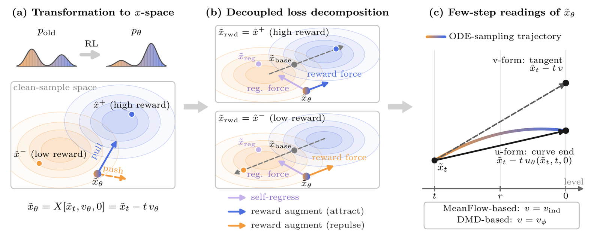
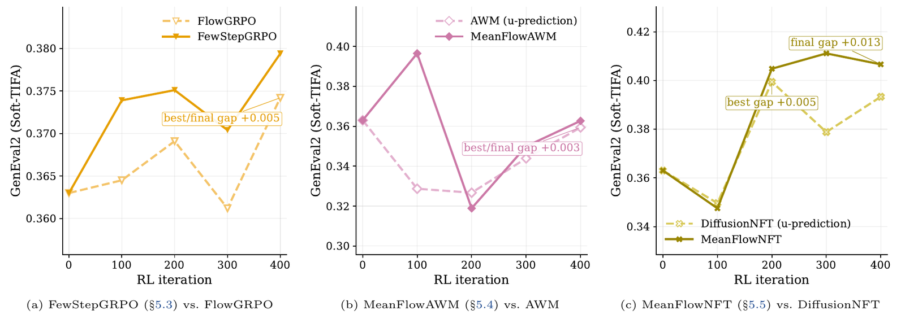
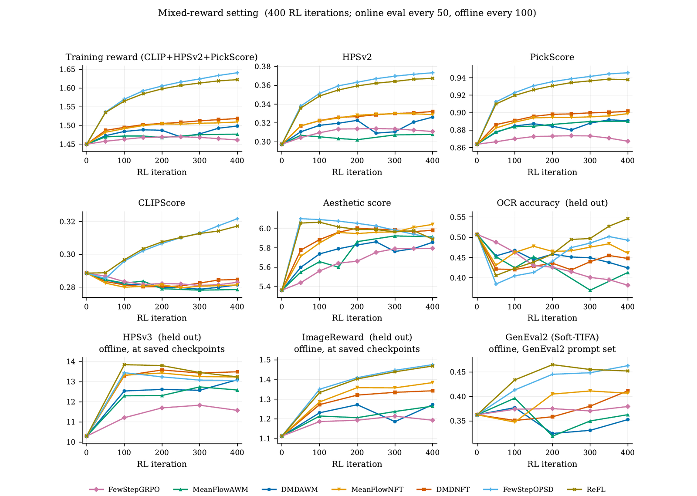
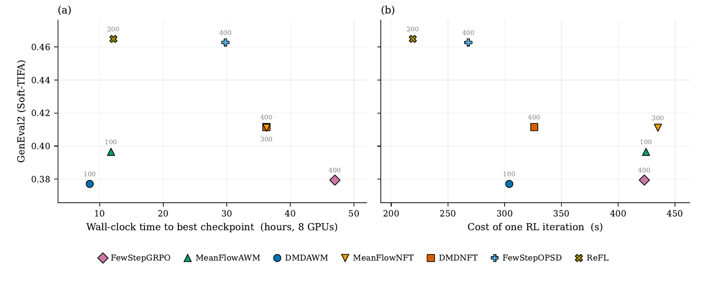
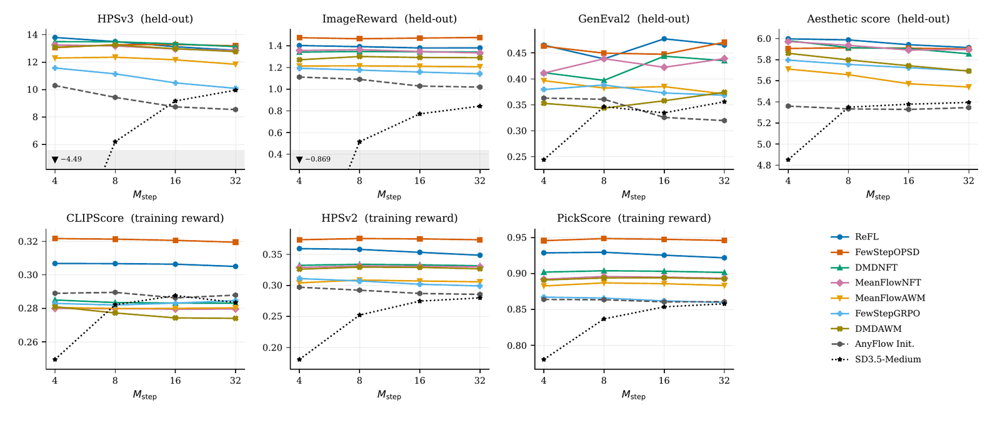
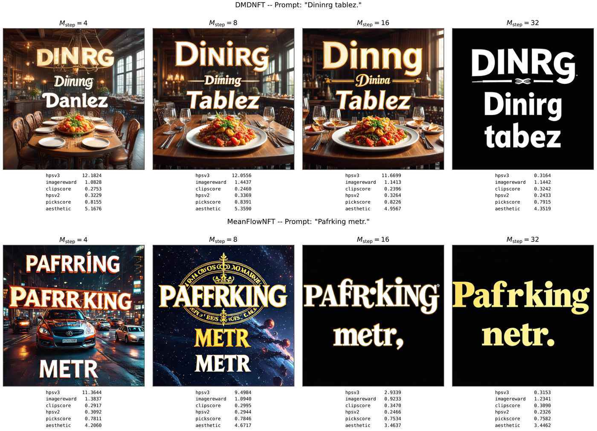

# FewStepRL: Fine-tuning Few-step Diffusion Models with Reinforcement Learning

**论文**: [arXiv:2611.08240v1](https://arxiv.org/abs/2611.08240)（cs.LG，2026-11-05，86 页：正文 52 页，附录从第 68 页起）
**作者**: Haitao Lin\*†（腾讯混元）, Minsi Ren\*（西湖大学）, Yang Li†（腾讯混元）, Xingtong Ge, Zheyuan Hu（腾讯混元）, Peiyan Hu（西湖大学、国科大）, Tailin Wu‡（西湖大学）—— **腾讯混元 + 西湖大学**（\* 共同一作，† 项目负责人，‡ 通讯）
**链接**: [项目页](https://edapinenut.github.io/fewsteprl.page/)。论文列了两个代码仓库（`fewsteprl-sd35` 图像、`fewsteprl-wan21` 视频）和 Hugging Face checkpoint，但 PDF 里的链接都指向 "coming soon" 页，目前没放 `[待补]`

---

## 1. 一句话定位

**FewStepRL 把 5 种扩散 RL 目标（FlowGRPO、AWM、DiffusionNFT、DiffusionOPSD、ReFL）系统地改造到"输出区间平均速度"的少步模型上，并在一个代码库里横向比较。** 改造分三步：
1. **变换到 x 空间**：所有目标都改写成对同一个"干净端预测" `x̃_θ = x̃_t − t·v` 的损失；
2. **梯度分解**：每个方法的梯度 = 拉向参照点的"自回归项" + 沿"奖励点 − 基线点"方向的"奖励增广项"，一个方法就是 3 个参照点加 3 个权重；
3. **少步适配**：方法需要的瞬时速度，要么用 MeanFlow 恒等式从网络自身恢复，要么用 DMD 式的辅助网络拟合。

最后得到 7 个 trainer，在 AnyFlow 蒸出的 SD3.5-Medium（4 步，图像）和 Wan2.1-T2V-1.3B（4 步，视频）上比较。

| | 初始化 | FewStepGRPO | MeanFlowAWM | DMDAWM | MeanFlowNFT | DMDNFT | FewStepOPSD | ReFL |
|---|---|---|---|---|---|---|---|---|
| 图像，训练 reward（第 400 次，Table 6b） | 1.450 | 1.461 | 1.477 | 1.498 | 1.509 | 1.519 | **1.641** | 1.623 |
| 图像，GenEval2 最好 checkpoint（留出） | 0.363 | 0.379 | 0.397 | 0.377 | 0.411 | 0.412 | 0.463 | **0.465** |
| 图像，到第 400 次的小时数（8 张 H20） | — | 47.0 | 47.2 | 33.8 | 48.3 | 36.2 | 29.8 | **24.3** |
| 视频，训练 reward（第 250 次，Table 8） | 16.54 | 15.89 | 16.66 | 16.78 | 16.80 | **17.93** | 16.26 | 16.46 |
| 视频，VBench overall（留出） | 83.68 | 83.62 | **83.70** | 83.64 | 83.62 | 83.38 | 83.60 | 83.69 |
| 视频，H20 GPU 时（250 次） | — | 1,633 | 1,637 | 1,824 | **1,631** | 1,824 | 2,623 | 2,426 |

（图像的训练 reward 是 CLIPScore + HPSv2 + PickScore；视频的是 HPSv3 两种汇总 + VideoAlign 的运动质量、文本对齐。）

🔴 **读完全文后我认为要打五个折扣**：
1. **全部是单次运行，大部分差距在作者自己声明的噪声以内。**
   - 作者说 GenEval2 的分辨率约 0.03。用来证明"少步适配有用"的 Fig 1，三组差距只有 +0.003 到 +0.013；而同一条曲线相邻两个 checkpoint 就能跳 0.04 以上（MeanFlowAWM 从第 100 次的 0.397 掉到第 200 次的约 0.32，从图上读的）。
   - 五个 group-advantage 方法之间，GenEval2 在 0.377–0.412、训练 reward 在 1.461–1.519，也在这个量级。真正拉开的只有两个 reward 梯度方法（GenEval2 +0.10）。
2. **视频上 RL 基本没提升任何留出指标。** 七个方法的 VBench overall 都在 83.38–83.70，初始化是 83.68，极差 0.32。训练 reward 涨得最多的 DMDNFT（+1.39）VBench 反而最低（83.38），dynamic degree 也最低（53.33，其余 58–60）。每个视频 run 花 1,600–2,600 H20 GPU 时。
3. **"能用 reward 梯度就用 reward 梯度"只在图像上成立。** 视频上 FewStepOPSD、ReFL 的训练 reward 反而低于初始化（16.26、16.46 对 16.54），GPU 时还是最贵的两个。原因作者交代得很清楚：
   - VideoAlign 的两项不可微，梯度只覆盖 96% 的 reward；
   - bf16 版 HPSv3 的梯度方向平均偏了 76.2°，所以改用 fp32；
   - 为省显存，视频逐个 latent 帧单独解码，梯度和联合解码相比偏了 79.2°。
   
   也就是说，视频上用的 reward 梯度方向本身就很不准。另外视频的这两个方法用了 48 卡、1.5 倍 rollout，不是同样本量的对比。
4. **OCR reward 下，能把 OCR 拉上去的方法都严重损伤了其他质量。** 第一个 OCR 超过 0.82 的 checkpoint：DMDAWM 的 HPSv3 从 12.86 掉到 5.05，ImageReward 从 1.233 掉到 0.092，GenEval2 从 0.363 掉到 0.244；最好的 MeanFlowNFT 也掉到 HPSv3 10.64、GenEval2 0.306。对初始策略的速度惩罚权重只有 1e-4。
5. **框架是"统一改写"，不是新算法；代码也还没放。**
   - 梯度分解对任何"梯度是 x 空间残差线性组合"的损失都成立。
   - 少步适配的两种办法都来自前作：用 MeanFlow 恒等式恢复瞬时速度就是 MeanFlowNFT（Huang 等 2026）的做法，辅助网络就是 DMD 的做法。
   - FewStepGRPO 和 AWM 里的比值 `ρ`，作者自己说是"替代比值，不是重要性权重"，属于工程上的启发式。

📌 **站得住的部分**：
- **成本账算得很细**（Table 4、7、8）。MeanFlow 式估计（v-ind）每次查询要多 2 次旧策略前向来算 `J`；DMD 式（v-aux）不要 `J`，但每个外循环要多 5 步辅助网络的前向加反向。结果图像上 DMD 式更快（304–326 对 423–435 s/iter），视频上反过来（821 对 734–737 s/iter），因为视频模型的反向更贵，拟合辅助网络约 144 s/iter。
- **少步版 OPSD / ReFL 里的 `J` 可以精确消掉**（附录 C）。实测 FewStepOPSD 从 499 降到 268 s/iter，训练 reward 差不到 0.002（两组计时不在同一台机器上）。
- **解释了 group advantage 为什么推不动 CLIPScore**（附录 D.2）：CLIPScore 在同一个 prompt 组内的标准差只有约 0.01，只占自身数值的 3.5%–5%，组内归一化的 advantage 几乎感受不到它；提高它的权重或加大组，只是把信号从另外两项挪过来。reward 梯度方法三项能一起涨。这一点对设计多项组合 reward 很有用。
- **几条诚实的负面结果**：
  - 测试时加步数在整体指标上没有收益，在 OCR 敏感的 prompt 上还会退化成纯文字（Fig 9）；
  - AnyFlow 初始化本身从 4 步加到 32 步，HPSv3 掉 17%；
  - 视频 reward 梯度的三个数值陷阱，对任何要在视频上做 ReFL 的人都是现成的警告。

---

## 2. 要解决的问题

**RL 后训练的主要成本在 rollout。** FlowGRPO、AWM、DiffusionNFT 这类方法每次迭代都要用当前策略采样，多步采样器下 rollout 占了大部分时间和显存，视频更严重。少步模型能把这部分成本砍掉。

**但少步模型和这些 RL 目标的假设不匹配。** MeanFlow、AnyFlow、DMD 蒸出的少步模型输出的是区间平均速度 `u_θ(x_t, t, r)`（一条采样轨迹的割线方向），而 FlowGRPO、AWM、DiffusionNFT 都是按瞬时速度和多步采样器设计的。直接套用要回答三个问题：微分哪一次网络调用、参考策略怎么算、区间的哪一段得到训练。

**前作一次只改一个。** Flow-Map GRPO 改 GRPO，MeanFlowNFT 改 DiffusionNFT，RTDMD 把 reward 揉进 DMD，没有系统的改造方法，也没有同一实现下的对比。

---

## 3. 方法

> **Fig 2 读法**：
> - **（a）变换到 x 空间**：RL 要提高高奖励样本在旧策略 rollout 分布里的相对质量（左边双峰分布右峰变高）。默认在干净端比较：当前策略的预测 `x̃_θ = x̃_t − t·v_θ` 被拉向高奖励样本 `x̂⁺`（蓝箭头），推离低奖励样本 `x̂⁻`（橙虚线）。
> - **（b）梯度分解**：上半是高奖励样本，下半是低奖励样本。紫色箭头是拉回参照点 `x̃_reg` 的"自回归力"；蓝 / 橙箭头是"奖励力"，方向沿基线点 `x̃_base` 指向奖励点 `x̃_rwd` 的连线，高奖励时吸引、低奖励时排斥。
> - **（c）少步模型怎么读出 `x̃_θ`**：彩色曲线是 ODE 采样轨迹。u-form 取"曲线终点"，直接用平均速度 `u_θ(x̃_t, t, 0)` 一步跳到 0；v-form 取"切线"，用瞬时速度 `v` 线性外推到 0。瞬时速度在 MeanFlow 系里是 `v_ind`（网络自身恢复），在 DMD 系里是 `v_φ`（辅助网络）。

### 3.1 背景：平均速度模型

噪声水平 `t ∈ [0, 1]`，`t = 0` 是数据。学生输出区间 `[r, t]` 上的平均速度，少步采样就是一串精确跳跃 `x̂_r = x̂_t − (t − r)·u_θ(x̂_t, t, r)`。MeanFlow 恒等式把平均速度和瞬时速度联系起来（Eq 6）：

$$
u_\theta(\tilde x_t,t,r)=v_\theta(\tilde x_t,t)-(t-r)\,\partial_t u_\theta(\tilde x_t,t,r)
$$

后面所有用法都把修正项 detach，记作 `J = (t − r)·sg(∂_t u)`。

### 3.2 第一步：变换到 x 空间

线性噪声调度下，一个速度定义了一个仿射搬运（Eq 21–22）：

$$
X(x_t,v,r)=x_t-(t-r)\,v,\qquad \lVert v_a-v_b\rVert^2=\frac{1}{(t-r)^2}\left\lVert X(x_t,v_a,r)-X(x_t,v_b,r)\right\rVert^2
$$

所以速度上的 MSE 就是 x 空间里搬运点之间的 MSE 乘一个系数。条件速度 `v_cond = ε − x̂` 搬到 0 正好是 rollout 样本 `x̂` 本身。于是 AWM 变成"当前预测与样本之间、按 advantage 加权的残差"，DiffusionNFT 变成"两条隐式策略分支各自到样本的残差按 `r̂` 混合"。

### 3.3 第二步：梯度分解

在 x 空间里，每个方法的梯度都能写成同一个形式（Eq 28）：

$$
\nabla_\theta\mathcal{L}=2\left(\frac{\partial\tilde x_\theta}{\partial\theta}\right)^{\top}\left[W_{\mathrm{reg}}\left(\tilde x_\theta-\tilde x_{\mathrm{reg}}\right)-W_{\mathrm{rwd}}\,\omega\left(\tilde x_{\mathrm{rwd}}-\tilde x_{\mathrm{base}}\right)\right]
$$

对应的可实现损失是两个平方项（Eq 30）：

$$
\mathcal{L}=W_{\mathrm{reg}}\left\lVert\tilde x_\theta-\tilde x_{\mathrm{reg}}\right\rVert^2+W_{\mathrm{rwd}}\left\lVert\tilde x_\theta-\mathrm{sg}\left(\tilde x_\theta+g\right)\right\rVert^2,\qquad g=\omega\left(\tilde x_{\mathrm{rwd}}-\tilde x_{\mathrm{base}}\right)
$$

第一项把预测拉回参照点，限制每步能走多远，起防 reward hacking 的作用；第二项沿"基线点 → 奖励点"推动预测，方向由 `ω` 的符号决定。一个方法就是 6 个量：

| 方法 | `x̃_reg` | `x̃_base` | `x̃_rwd` | `W_reg` | `W_rwd` | `ω` |
|---|---|---|---|---|---|---|
| AWM | 无 | `sg(x̃_θ)` | rollout 样本 `x̂` | 0 | `w(t)/t²` | `A` |
| DiffusionNFT | 旧策略预测 `x̃_old` | `x̃_old` | `x̂` | `β²/t²` | `β²/t²` | `clip(A, −1, 1)/β` |
| MeanFlow 蒸馏 | 无 | 自诱导预测 `x̃_ind,r` | teacher 预测 `x̃_real,r` | 0 | `1/(t − r)²` | 1 |
| DMD | 无 | 辅助网络预测 `x̃_aux` | teacher 预测 `x̃_real` | 0 | `(1 − t)/(2t²)` | 1 |
| DiffusionOPSD | `x̃_old` | `x̃_old` | 用 reward 梯度构造的上升点、下降点 `x̃_±` | `β²(a₊ + a₋)` | 同左 | 上升 `> 0`，下降 `< 0` |
| ReFL（OPSD 的代理） | 无 | `x̃_old` | 一步上升点 `x̃_+` | 0 | 任意正数 | `> 0` |

几个看点：
- **AWM 没有自回归项**，它的"自回归"靠额外的速度惩罚 `‖v_θ − v_old‖²` 实现。
- **DiffusionNFT 的参照点和基线点重合**在旧策略预测上：它往哪里约束，就从哪里度量奖励。
- **advantage 决定吸引还是排斥，不是原始 reward**：分数高于组均值的样本被吸引，低于组均值的被排斥，即使它的原始 reward 也很高。
- **ReFL 是 OPSD 的特例**（Example 9）：只走一步上升、不要自回归、旧策略等于当前策略时，梯度方向与 ReFL 共线，只差一个正的标量。

### 3.4 第三步：少步适配

少步网络输出平均速度，框架却需要瞬时速度。有三种读法（Table 1）：

| | u-form | v-form，自诱导（v-ind） | v-form，辅助网络（v-aux） |
|---|---|---|---|
| 当前预测 `x̃_θ` | `X(x̃_t, u_θ(x̃_t, t, 0), 0)` | `X(x̃_t, u_θ(x̃_t, t, r) + J, 0)` | `X(x̃_t, u_θ(x̃_t, t, r), 0)` |
| 参照点 `x̃_reg` | `X(x̃_t, u_old(x̃_t, t, 0), 0)` | `X(x̃_t, v_ind, 0)` | `X(x̃_t, u_old(x̃_t, t, r), 0)` |
| 基线点 `x̃_base` | 同上 | `X(x̃_t, v_ind, 0)` | `X(x̃_t, v_φ, 0)` |
| 训练到的 `(t, r)` | 只有 `r = 0` 一条边 | 全部 `0 ≤ r ≤ t` | 全部 `0 ≤ r ≤ t` |

- **u-form 只训练 `r = 0` 那条边**，而 4 步采样器用到的是 `r ≠ 0` 的那些跳，所以它们得不到梯度。这就是"直接套用"的问题所在。
- **v-ind**：`v_ind = u_old + J`，`J` 用旧策略的中心差分估计（Eq 87），每次查询多 2 次旧策略前向；同一个 `J` 在当前预测和参照点之间共享，所以在自回归项的差里抵消掉。

$$
J=(t-r)\,\frac{u_{\mathrm{old}}(\tilde x_t+\epsilon_{cd}v_{\mathrm{cond}},t+\epsilon_{cd},r)-u_{\mathrm{old}}(\tilde x_t-\epsilon_{cd}v_{\mathrm{cond}},t-\epsilon_{cd},r)}{2\epsilon_{cd}}
$$

- **v-aux**：每个外循环先用 flow matching 把辅助网络 `v_φ` 拟合到当前 rollout 上（5 步），它只当基线点用。当前预测不能用 `v_φ` 算，否则 reward 传不到策略上。

### 3.5 七个 trainer

所有 trainer 共享一个外循环：旧策略 rollout → 打分算 advantage → （v-aux 才有）拟合辅助网络 → 若干次查询，累积 Eq 30 的梯度并更新一次 → 旧策略取当前策略的 EMA。各家只覆盖少数几个钩子（Table 2、5）：

| 类别 | trainer | reward 信号 | 采样器 | 基线点 | 瞬时速度 |
|---|---|---|---|---|---|
| group advantage | FewStepGRPO | `A`（PPO 式裁剪） | SDE，重放存下的转移 | `sg(μ_θ)` | v-ind（重放轨迹上估 `J`） |
| | MeanFlowAWM | `A` | ODE | `sg(x̃_θ)` | v-ind |
| | DMDAWM | `A` | ODE | `x̃_aux` | v-aux，不要 `J` |
| | MeanFlowNFT | 混合权重 `r̂` | ODE | `x̃_ind` | v-ind |
| | DMDNFT | `r̂` | ODE | `x̃_aux` | v-aux |
| reward 梯度 | FewStepOPSD | `∇R` 加 `r̂` | ODE + 沿 `∇R` 构造的点 | `x̃_ind` | `J` 抵消 |
| | ReFL | `∇R` | ODE + 一步上升点 | `x̃_ind` | `J` 抵消 |

- advantage 用每个 prompt 内的均值减、全局 batch 的标准差除（Eq 83），避免组内 reward 全相同时除以 0；NFT / OPSD 再把它压成 `[0, 1]` 的混合权重 `r̂`（`c_adv = 5`）。
- FewStepOPSD 从旧策略的干净预测出发，沿归一化的 `±∇R` 各走 `M_tgt = 2` 步（带信赖域），得到上升点和下降点再回归过去；reward 要对干净样本可微，梯度要穿过 VAE decoder 和 reward 模型。

---

## 4. 实验设置

| 项 | 图像 | 视频 |
|---|---|---|
| 生成器 | SD3.5-Medium，经 AnyFlow 蒸馏（先 MeanFlow 恒等式训练，再做 on-policy 分布匹配） | Wan2.1-T2V-1.3B，同样经 AnyFlow 蒸馏 |
| 训练参数 | 注意力投影上的 LoRA，rank 32（scale 64） | 同左 |
| 分辨率 / 步数 | 512×512；4 步，网格 `{1, 0.9, 0.75, 0.5, 0}`；不开 CFG | 480×832，81 帧（latent 21×16×60×104）；4 步；不开 CFG |
| 每个外循环 | 48 个 prompt × 每组 24 个 = 1,152 条 rollout，8 张 H20 | 2,048 条 rollout，32 张 H20；OPSD 和 ReFL 用 48 卡、3,072 条 |
| 优化 | AdamW，学习率 3e-6，权重衰减 1e-4，梯度裁剪 1；旧策略 EMA 衰减 `min(1e-3·i, 0.5)`；`β = 0.1`；对初始策略的速度惩罚权重 1e-4 | 学习率 3e-6，其余同左 |
| 查询 | 每个样本 4 次查询；`t`、`r` 取两个均匀数的最大、最小值再做 shift 3；一半样本 `r = t`，四分之一 `r = 0` | 同左 |
| 训练 reward | OCR 准确率（不可微）；或 CLIPScore + HPSv2 + PickScore 等权和（可微） | HPSv3-general + HPSv3-percentile + VideoAlign 运动质量（MQ）+ 文本对齐（TA），后两项 z 归一化；只有 HPSv3 可微 |
| 留出评测 | LAION aesthetic、HPSv3、ImageReward、GenEval2（Soft-TIFA）；OCR 设定下 CLIPScore，混合设定下 OCR 也算留出 | VBench（946 个 prompt × 5 = 4,730 个视频，第 250 次），没有方法优化它 |
| 迭代数 | OCR 200 次；混合 reward 400 次 | 250 次 |
| 直接套用的对照 | 只在混合 reward 设定下跑了 FlowGRPO、AWM、DiffusionNFT 的"平均速度直接替换瞬时速度"版本 | 无 |
| 没有报告的 | 多 seed 与方差；人工评测；视频上的直接套用对照；u-form 的 OPSD（作者说它是 v-form 固定 `r = 0` 的特例，没比） | |

---

## 5. 结果

### 5.1 少步适配 vs 直接套用（Fig 1、Fig 6）

> **Fig 1 读法**：混合 reward 设定，横轴是 RL 迭代，纵轴是留出的 GenEval2。虚线是原目标直接套在少步模型上（平均速度顶替瞬时速度），实线是本文的适配版。三组的标注差距是 +0.005（GRPO）、+0.003（AWM）、最佳 +0.005 / 最终 +0.013（NFT）。
>
> ⚠️ 这些差距都远小于作者自己说的约 0.03 的分辨率。中间那组 MeanFlowAWM 从第 100 次的 0.397 掉到第 200 次的约 0.32（从图上读的），单条曲线的抖动就比差距大一个数量级。这张图本身不足以支持"适配有用"。

更能说明问题的是 Fig 6 的其他指标（适配版减直接套用版，"最佳 / 最终"）：

| 对比 | 留出 HPSv3 | 训练 reward（第 400 次） | 留出 OCR |
|---|---|---|---|
| FewStepGRPO − FlowGRPO | +0.838 / +1.955 | 1.461 对 1.438 | **−0.038 / −0.103** |
| MeanFlowAWM − AWM | +0.089 / +0.641 | — | +0.008 / +0.080 |
| MeanFlowNFT − DiffusionNFT | +1.079 / +1.447 | 1.509 对 1.440 | +0.001 / +0.041 |

直接套用的 FlowGRPO 把 HPSv3 从 10.30 拉低到 9.62，DiffusionNFT 直接套用的 HPSv3 是 11.79、ImageReward 1.317、最佳 GenEval2 0.399。HPSv3 上适配版确实更好；但 FewStepGRPO 在留出的 OCR 上反而更差。

### 5.2 OCR reward（不可微，Table 6a）

| trainer | s/iter | 第 50 / 100 / 150 / 200 次的 OCR | 首次 ≥ 0.85（小时） | 首个 OCR > 0.82 的 checkpoint：OCR / aesthetic / HPSv3 / ImageReward / GenEval2 |
|---|---|---|---|---|
| 初始化 | — | — | — | 0.498 / 5.24 / 12.86 / 1.233 / 0.363 |
| FewStepGRPO | 451 | 0.599 / 0.645 / 0.708 / 0.776 | 未达到 | — |
| MeanFlowAWM | 496 | 0.575 / 0.661 / 0.755 / 0.802 | 未达到 | — |
| DMDAWM | 342 | 0.698 / 0.820 / 0.902 / 0.936 | 150（14.3） | 第 200 次：0.936 / 4.49 / **5.05** / **0.092** / **0.244** |
| MeanFlowNFT | 483 | 0.785 / 0.850 / **0.945** / 0.934 | **100（13.4）** | 第 100 次：0.850 / 4.99 / 10.64 / 0.887 / 0.306 |
| DMDNFT | 346 | 0.765 / 0.829 / 0.879 / 0.897 | 150（14.4） | 第 100 次：0.829 / 4.69 / 7.58 / 0.556 / 0.277 |

- MeanFlowNFT 最早到 0.85，峰值也最高。
- DMDAWM 涨得最猛，作者的解释是它没有自回归项，且基线点每轮都跟着策略重拟合；代价是留出质量几乎崩掉。
- FewStepOPSD 和 ReFL 需要 reward 梯度，这里用不了。

### 5.3 混合 reward（可微，Table 6b、Fig 4、Fig 5）

| trainer | s/iter | 小时 | 训练 reward | HPSv2 | PickScore | CLIPScore | aesthetic | OCR | HPSv3 | ImageReward | GenEval2：第 400 次 / 100–400 均值 / 最佳（迭代） |
|---|---|---|---|---|---|---|---|---|---|---|---|
| 初始化 | — | — | 1.450 | 0.297 | 0.864 | 0.289 | 5.36 | 0.507 | 10.30 | 1.113 | 0.363 / — / — |
| FewStepGRPO | 423 | 47.0 | 1.461 | 0.311 | 0.867 | 0.283 | 5.80 | 0.382 | 11.58 | 1.193 | 0.379 / 0.375 / 0.379（400） |
| MeanFlowAWM | 425 | 47.2 | 1.477 | 0.308 | 0.890 | 0.279 | 5.92 | 0.413 | 12.59 | 1.265 | 0.363 / 0.357 / 0.397（100） |
| DMDAWM | 304 | 33.8 | 1.498 | 0.326 | 0.891 | 0.281 | 5.86 | 0.424 | 13.10 | 1.272 | 0.353 / 0.346 / 0.377（100） |
| MeanFlowNFT | 435 | 48.3 | 1.509 | 0.329 | 0.899 | 0.281 | **6.04** | 0.461 | 13.23 | 1.385 | 0.407 / 0.393 / 0.411（300） |
| DMDNFT | 326 | 36.2 | 1.519 | 0.332 | 0.902 | 0.285 | 5.98 | 0.448 | **13.49** | 1.343 | 0.412 / 0.375 / 0.412（400） |
| FewStepOPSD | 268 | 29.8 | **1.641** | **0.373** | **0.946** | **0.322** | 5.91 | 0.493 | 13.06 | **1.476** | **0.463** / 0.442 / 0.463（400） |
| ReFL | **219** | **24.3** | 1.623 | 0.368 | 0.938 | 0.317 | 5.89 | **0.546** | 13.24 | 1.469 | 0.452 / **0.451** / **0.465**（200） |

> **Fig 4 读法**：九个小图，第一行是训练 reward 及其中两项，第二行是 CLIPScore、aesthetic、留出 OCR，第三行是三个离线留出指标。
> - **reward 梯度两条线（浅蓝 FewStepOPSD、橄榄绿 ReFL）**在训练 reward、HPSv2、PickScore、CLIPScore、ImageReward、GenEval2 上都明显高于其余五条，两者几乎重合。
> - **CLIPScore**：五个 group-advantage 方法全部从 0.289 往下掉到 0.28 左右，只有 reward 梯度两条一路涨到 0.32。
> - **HPSv3 和 aesthetic**：多数方法在第 100 次左右到顶，之后下降，而训练 reward 还在涨，作者认为这是 reward hacking 开始的信号。
> - **留出 OCR**：大多数方法先跌到 0.38–0.45，ReFL 后半段回升到 0.546，是唯一超过初始化的。

> **Fig 5 读法**：纵轴是每个 trainer 最佳 checkpoint 的 GenEval2，数字是那个 checkpoint 的迭代数。左图横轴是到达它的墙钟时间（8 卡），右图是每次迭代的成本。ReFL 在左上角：12.2 小时、每次 219 s 就到 0.465；FewStepOPSD 分数相同但要 29.8 小时。group-advantage 方法里，DMD 式两个（圆、方）每次迭代比 MeanFlow 式（三角）便宜约 100 s。

**成本拆分**（Table 7，8 张 H20，中位数）：

| trainer | s/iter | 采样（s） | 更新（s） | 每个外循环的查询数 | 算 `J` 的额外前向 | 辅助网络拟合步数 |
|---|---|---|---|---|---|---|
| FewStepGRPO | 423 | 78.7 | 344.2 | 4 | 8 | 0 |
| MeanFlowAWM | 425 | 78.3 | 344.5 | 4 | 8 | 0 |
| DMDAWM | 304 | 78.2 | 223.4 | 4 | 0 | 5 |
| MeanFlowNFT | 435 | 78.8 | 354.6 | 4 | 8 | 0 |
| DMDNFT | 326 | 78.4 | 244.7 | 4 | 0 | 5 |
| FewStepOPSD | 268 | 224.7 | 43.3 | 1 | 0 | 0 |
| ReFL | 219 | 174.6 | 44.2 | 1 | 0 | 0 |

reward 梯度方法每轮只查询一次、`J` 又能消掉，所以更新很便宜；但它们的"采样"阶段包含对像素空间 reward 求梯度（要穿过 reward 模型和 VAE decoder），比普通 rollout 慢 2–3 倍。

### 5.4 视频（Table 8、附录 Table S2）

| trainer | 卡数 | s/iter | GPU 时 | 训练 reward | HPSv3-G | HPSv3-P | MQ | TA | VBench overall | quality | semantic |
|---|---|---|---|---|---|---|---|---|---|---|---|
| 初始化 | — | — | — | 16.54 | 6.42 | 9.43 | 2.64 | 1.85 | 83.68 | 85.36 | 76.98 |
| FewStepGRPO | 32 | 735 | 1,633 | 15.89 | 6.24 | 9.38 | 2.40 | 1.23 | 83.62 | 85.27 | 76.98 |
| MeanFlowAWM | 32 | 737 | 1,637 | 16.66 | 6.49 | 9.46 | 2.68 | 1.84 | **83.70** | 85.36 | **77.04** |
| DMDAWM | 32 | 821 | 1,824 | 16.78 | 6.51 | 9.53 | 2.74 | 1.82 | 83.64 | 85.35 | 76.76 |
| MeanFlowNFT | 32 | 734 | 1,631 | 16.80 | 6.53 | 9.51 | 2.76 | 1.80 | 83.62 | 85.34 | 76.75 |
| DMDNFT | 32 | 821 | 1,824 | **17.93** | **7.01** | **10.01** | **3.06** | 1.68 | 83.38 | 85.07 | 76.63 |
| FewStepOPSD | 48 | 787 | 2,623 | 16.26 | 6.30 | 9.32 | 2.54 | **1.91** | 83.60 | 85.37 | 76.53 |
| ReFL | 48 | 728 | 2,426 | 16.46 | 6.39 | 9.38 | 2.61 | 1.89 | 83.69 | **85.40** | 76.85 |

- **FewStepGRPO 最差**：唯一训练 reward 低于初始化的 group-advantage 方法，TA 从 1.85 掉到 1.23。
- **DMDNFT 训练 reward 涨得最多，留出质量也掉得最多**：VBench overall 七个里最低，dynamic degree 53.33，其余方法 58–60。
- **reward 梯度方法失去了图像上的优势**：训练 reward 略低于初始化；它们的采样阶段最长到 674 s（其余约 291 s），GPU 时是最贵的两个。
- **DMD 式在视频上反而更慢**：省掉 `J` 的 8 次前向约省 60 s，但辅助网络拟合约要 144 s。
- ⚠️ VBench 16 个维度里，七个方法之间极差超过 2.6 的只有 dynamic degree（6.29）和 multiple objects（2.95）。

### 5.5 测试时加步数（Fig 7、Fig 9、附录 Table S3）

把混合 reward 下训好的 4 步 checkpoint 直接用 4、8、16、32 步采样，不重训。

> **Fig 7 读法**：每条实线是一个微调后的模型，灰虚线是 AnyFlow 初始化，黑点线是原版 SD3.5-Medium（带 CFG 4.5，每步两次前向）。
> - **SD3.5-Medium**：4 步太粗，HPSv3 是 −4.49，加到 32 步（64 次前向）才到 9.96，仍低于每一个微调后的 4 步模型。
> - **AnyFlow 初始化**：加步数反而变差，4 → 32 步 HPSv3 掉 17%，ImageReward 1.11 → 1.02，GenEval2 0.363 → 0.320。
> - **微调后的模型**：训练 reward 的三项几乎是平的；HPSv3 多在 4 或 8 步最高，之后缓慢下降。

| trainer（checkpoint） | HPSv3：4 / 8 / 16 / 32 步 | 4 → 32 步 HPSv3 变化 |
|---|---|---|
| FewStepGRPO（400） | 11.58 / 11.15 / 10.49 / 10.09 | −12.85% |
| MeanFlowAWM（100） | 12.30 / 12.36 / 12.17 / 11.85 | −3.71% |
| DMDAWM（400） | 13.10 / 13.24 / 12.98 / 12.77 | −2.53% |
| MeanFlowNFT（300） | 13.26 / 13.18 / 12.96 / 12.85 | −3.08% |
| DMDNFT（400） | 13.49 / 13.49 / 13.34 / 13.13 | −2.67% |
| FewStepOPSD（400） | 13.06 / 13.27 / 13.29 / 13.19 | +0.97% |
| ReFL（200） | 13.80 / 13.50 / 13.12 / 12.87 | −6.76% |

> **Fig 9 读法**：两个拼写错误的 DrawBench prompt（"Dininrg tablez."、"Pafrking metr."），从左到右是 4、8、16、32 步，图下是该图的各项分数。
> - **上（DMDNFT）**：4–16 步是带大字招牌的餐桌场景，32 步变成黑底白字，HPSv3 从 12.18 掉到 0.32，CLIPScore 却从 0.275 升到 0.324。
> - **下（MeanFlowNFT）**：8 步已经变成星空加徽章字，16 步起就是纯文字，HPSv3 从 11.36 掉到 0.32。
>
> 注意 4 步时画面上已经叠着 prompt 的文字，这和 CLIP 类打分器偏好"图里写出 prompt 文字"的现象一致（我的判断），加步数只是把它放大。论文明确说这是挑出来的极端例子。

作者也挑了几个加步数变好的例子（Fig 10），但整体指标上没有系统收益：7 个模型里有 3 个的 HPSv3 在训练用的 4 步最高。

### 5.6 附录里的几组消融

- **保留 `J` 还是丢掉**（Table S1）：FewStepOPSD 两种做法的训练 reward 在每个评估点都差不到 0.002，ReFL 差 0.006；s/iter 从 499 降到 268（OPSD）、303 降到 219（ReFL）。
- **为什么推不动 CLIPScore**（Table S4）：把 CLIPScore 的权重调到 8:1:1 或只用 CLIPScore，它会涨（第 400 次 0.302、0.308；组大小 72 时 0.325），但另外两项就不再提升；ReFL 只对 HPSv2 求梯度时，HPSv2 涨到 0.3946，CLIPScore 不动。reward 梯度方法用全 reward 时三项一起涨。
- **速度惩罚的参照**（D.4）：对初始平均速度模型（KL-u）还是对 teacher 瞬时速度（KL-v），训练 reward 都是 1.509，留出指标差 1%–1.5%，没有明确优劣。
- **FewStepOPSD 和 ReFL 为什么几乎一样**（D.3）：两条分支的系数 5.12 和 4.88 只差 2.4%，上升项和下降项都把预测往 reward 增大的方向推，所以它基本就是"ReFL 加一个自回归项和多走一步"。

---

## 6. 数字核对

| 说法 | 复算 | 结论 |
|---|---|---|
| 图像每个外循环 1,152 条 rollout | 48 × 24 | ✅ |
| 视频 2,048 / 3,072 条 | 2 个 batch × 每卡 2 个 prompt × 16 × 32 卡 = 2,048；48 卡时 3,072 | ✅ |
| 视频 GPU 时 | 32 × 735 × 250 / 3600 = 1,633；48 × 787 × 250 / 3600 = 2,623；48 × 728 × 250 / 3600 = 2,426 | ✅ |
| OCR 设定的到达时间 | 100 × 483 / 3600 = 13.4 h；150 × 342 / 3600 = 14.3 h；150 × 346 / 3600 = 14.4 h | ✅ |
| 混合 reward 下的训练 reward 增量 | OPSD +0.191，ReFL +0.173；group-advantage +0.011（GRPO）到 +0.069（DMDNFT） | 我算的 |
| 最佳 GenEval2 相对初始化 | OPSD +0.100，ReFL +0.102；MeanFlowNFT +0.048，DMDNFT +0.049，MeanFlowAWM +0.034，FewStepGRPO +0.016，DMDAWM +0.014 | 我算的；后两个在 0.03 分辨率以内 |
| 视频训练 reward 增量 | DMDNFT +1.39（+8.4%）；MeanFlowNFT +0.26；OPSD −0.28；GRPO −0.65 | 我算的 |
| 视频 VBench 极差 0.32 | 83.70 − 83.38 | ✅ |
| 丢掉 `J` 省下的时间 | OPSD 1 − 268/499 = 46%；ReFL 1 − 219/303 = 28% | 我算的（两组不在同一台机器计时） |
| CLIPScore 组内标准差约为数值的 3.5% | 0.010 / 0.289 = 3.5% | ✅ |

---

## 7. 争议与权衡

**① 证据强度与篇幅不成比例。** 86 页里绝大部分是推导和实现细节，实验却全是单次运行。作者在 §6.6 里很克制（"each from a single run"），但摘要和贡献列表里的"adaptation 有益""DiffusionNFT 系更快达到高 reward"这类结论，有一部分建立在噪声量级的差距上。最该补的是 3 个 seed 的重复，尤其是 Fig 1 那组。

**② 统一视角的价值在"能对比"，不在"新方法"。** 把六种方法压成 3 个参照点 + 3 个权重，确实让差异一目了然：AWM 没有自回归项，NFT 的参照点和基线点重合，ReFL 是 OPSD 的退化情形。但这个分解本身是代数恒等式，少步适配的两种做法也都来自前作；真正新增的是 FewStepGRPO 的重放实现、`J` 可消去的证明和一个公共代码库（尚未放出）。

**③ 视频实验的结论其实是"没有赢家"。** 训练 reward 的变化不传导到 VBench，涨得最多的方法留出质量最差，reward 梯度方法受数值问题拖累。比较诚实的读法是：在 Wan2.1-1.3B、250 次迭代、这套四项 reward 下，七种 RL 都没有带来可测的留出收益，而每个 run 要 1,600–2,600 GPU 时。

**④ reward hacking 贯穿始终，防御手段很弱。** OCR 设定下所有能拉高 OCR 的方法都伤了其他质量；混合设定下 HPSv3、aesthetic 第 100 次后下降；加步数在 OCR 敏感 prompt 上退化成纯文字。对初始策略的速度惩罚权重只有 1e-4，自回归项的强度也没有扫描。框架里"自回归项防 hacking"的说法缺少实验支撑。

**⑤ 结论绑定在 AnyFlow 蒸出的模型上。** 两个生成器都是 MeanFlow + 分布匹配蒸馏的平均速度模型，网络有 `r` 这个输入。常见的 DMD 学生（例如 H3 上那些 4 步 LoRA）保留原架构、没有 `r`，采样时就是"一步预测干净样本再重新加噪"，只对应本文的 u-form（`r = 0`）；本文的 v-form 改造对它们用不上，结论能否迁移没有测。

---

## 8. 一句话总结

**FewStepRL 把 FlowGRPO、AWM、DiffusionNFT、DiffusionOPSD、ReFL 统一写成"拉回参照点 + 沿奖励方向推"的两项损失，再按"从网络自身恢复瞬时速度"或"用辅助网络拟合"两种方式改造到少步平均速度模型上，在一个代码库里比较了 7 个 trainer。图像上 reward 可微时，ReFL 这类 reward 梯度方法又快又好（GenEval2 0.363 → 0.465，24 小时）；不可微时 DiffusionNFT 系最快拉高 reward，但都伴随明显的 reward hacking。视频上七种方法都没有带来可测的 VBench 收益，reward 梯度还因为不可微项、bf16 和逐帧解码而方向失真。所有结论都来自单次运行，许多差距在作者自己声明的噪声以内。**

---

## 9. 在仓库图谱里的位置

| | 关系 |
|---|---|
| **[DiffusionNFT](../diffusion_nft/analysis.md)** | 本文的 NFT 系（MeanFlowNFT、DMDNFT）就是它在少步模型上的改造。分解后看得很清楚：NFT 的参照点和基线点都是旧策略预测，`W_reg = W_rwd = β²/t²`，`ω = clip(A, −1, 1)/β`。直接把平均速度代进去（u-form）只训练 `r = 0` 那条边 |
| **[Flow-GRPO](../flow_grpo/analysis.md)** | FewStepGRPO 用随机采样器的重放转移来恢复 PPO 式似然比；在本文的对比里它是最慢、最弱的一个，视频上还低于初始化 |
| [DiffusionOPSD](../diffusion_opsd/analysis.md) | FewStepOPSD 的原型。本文证明它在少步模型上 `J` 可以精确消去，并把 ReFL 识别为它"一步上升、无自回归"的特例 |
| **[RWTD](../rwtd/analysis.md)** | 另一种"对已蒸好的一步 / 少步模型做 reward 对齐"的路线：RWTD 用 `softmax(βr)` 给当前模型和参考模型的样本加权，在冻结的 DINO 特征空间里做分布匹配；本文全部走 RL 目标 |
| [TDM-R1](../../inference_acceleration/tdm_r1/analysis.md) | 同样是"少步模型 + 不可微 reward"，TDM-R1 学一个代理 reward 扩散模型；本文在不可微时推荐 DiffusionNFT 系 |
| **[PTD](../../video_generation/ptd/analysis.md)** | 少步模型的上游：PTD 研究怎么把 teacher 蒸成 4 步，本文研究蒸好之后怎么用 RL 继续调。本文用作初始化的 AnyFlow，在 PTD 的 Table 1 里是 Wan2.1-14B 上的参考行之一 |

⚠️ **仓库缺口**：AnyFlow、MeanFlow、MeanFlowNFT、AWM、ReFL / DRaFT、Flow-Map GRPO、RTDMD 都还没有笔记。

---

## Q&A

**Q: 我们要给自家的少步模型（H3 的 4 步 LoRA、蒸馏过的 Wan）做 RL 后训练，这篇的结论该怎么用？**

A: **先看 reward 能不能对干净样本求梯度、求梯度贵不贵，再决定走 reward 梯度还是 group advantage；无论走哪条，都要配留出评测盯住 reward hacking。**
1. **reward 可微且便宜**（图像上的美学、偏好打分器）：先用 ReFL。图像上它最快（219 s/iter，12 小时到最佳 checkpoint），效果和 FewStepOPSD 打平，实现最简单。
2. **reward 不可微**（OCR、VLM 判官、游戏内规则检查、资产规格校验）：用 DiffusionNFT 系（MeanFlowNFT 或 DMDNFT）。它在 OCR 上 100–150 次迭代就能拉到 0.85，但留出质量会明显下降，要早停，或者把对初始策略的速度惩罚加大（论文只用了 1e-4）。
3. **视频要格外小心 reward 梯度**：
   - 打分器用 fp32，bf16 版梯度方向会偏 70° 以上；
   - VAE 解码不要逐帧拆开，否则梯度方向几乎和真实方向正交；
   - 不可微的项（运动质量、文本对齐）得不到梯度。
   
   这几条不解决，reward 梯度方法在视频上不如 group advantage。
4. **多项组合 reward 要先看每一项在组内的方差。** group advantage 只感受得到组内有差异的项，CLIPScore 那种组内标准差只有 0.01 的项基本推不动；调权重只是把信号从别的项挪过来。
5. **不要指望训完再加推理步数来提质。** 整体指标没有收益，在文字敏感的 prompt 上还可能退化。
6. **H3 这类 DMD 蒸出的 4 步 LoRA 不能直接照搬。** 论文的两个模型都是 AnyFlow 蒸的平均速度模型，网络带 `r` 输入；DMD 学生没有 `r`，只能按 u-form（`r = 0`，"一步预测干净样本"）来套这些目标，本文最主要的 v-form 改造用不上。ReFL 只需要在加噪状态上预测干净样本，是这类模型上最直接能试的。

---
