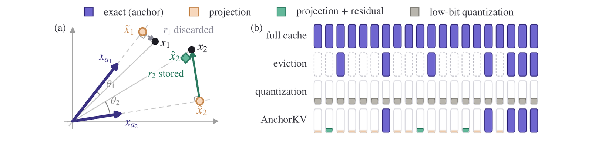
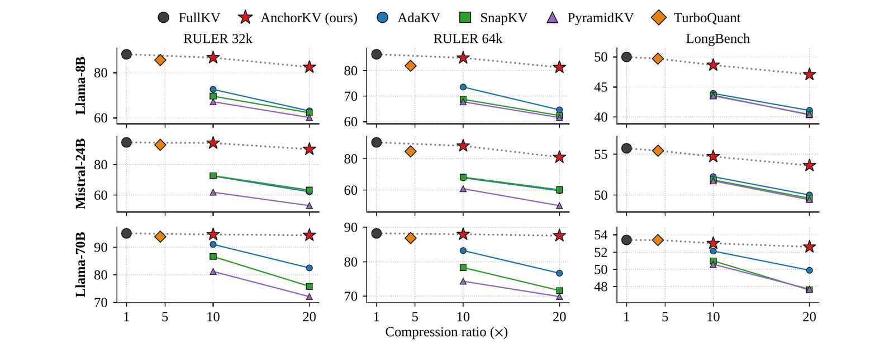
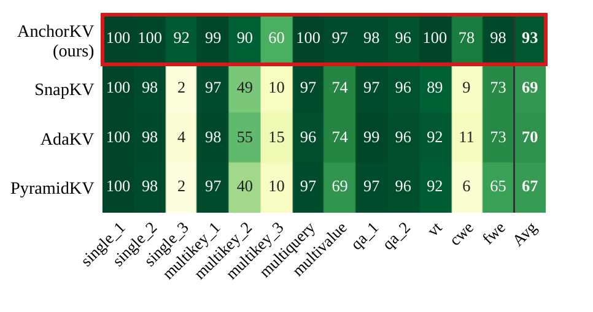
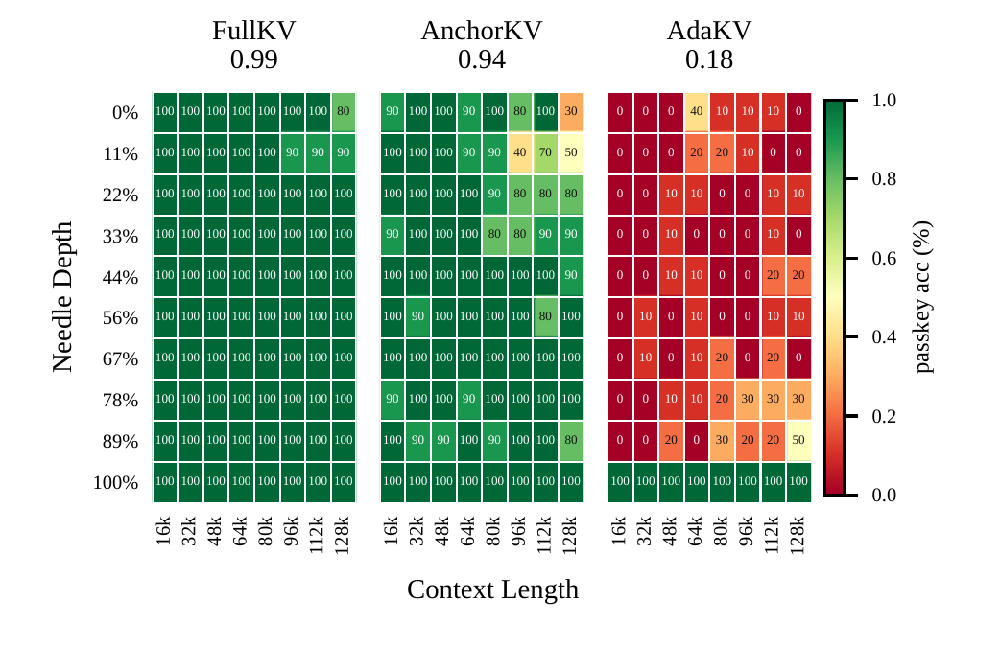
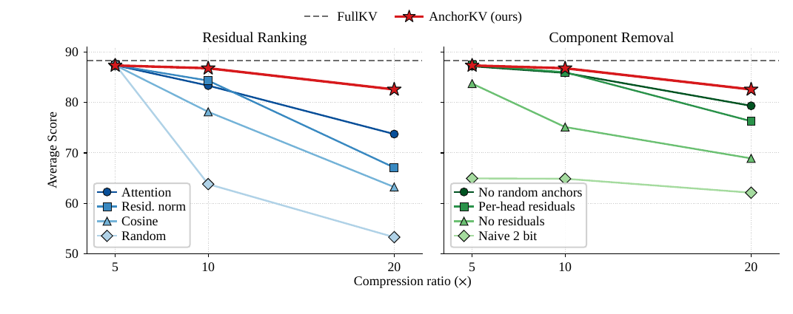
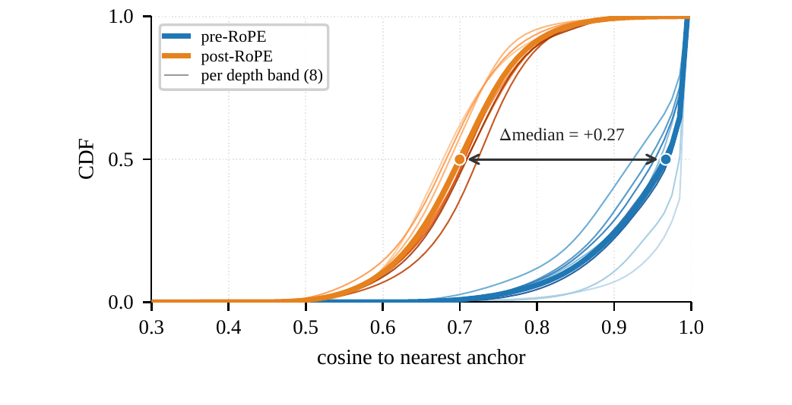
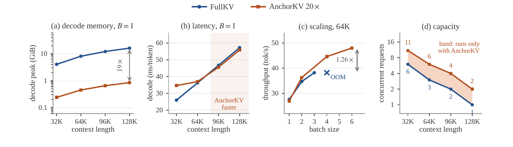

# AnchorKV: Anchor-Residual KV Cache Compression

**论文**: [arXiv:2608.02901v1](https://arxiv.org/abs/2608.02901)（cs.LG，2026-08-03，Preprint / under review，24 页：正文 7 页，附录从第 10 页起）
**作者**: Malik Khalaf\*, Yara Shamshoum\*, Nitzan Hodos, Yuval Sieradzki, Assaf Schuster —— **Technion（以色列理工学院）计算机系**（\* 共同一作）
**代码**: 论文写明"接收后发布"，目前没有 `[待补]`

---

## 1. 一句话定位

**免训练的 LLM KV cache 压缩：一个 token 都不丢，按字节预算给不同 token 分配不同精度。** prefill 结束时，每个 KV head 精确保存 `k = S/128` 个锚点（含最后 32 个 token）。其余每个 token 的 key（RoPE 之前）和 value 都表示成"最相似锚点的一个缩放副本"，每侧只花一个锚点索引和一个系数。剩下的字节预算买 2-bit 残差，按"不存它会让注意力输出差多少"的一阶估计，在同一层所有 KV head 之间统一分配。用户只设一个参数：保留比例 `θ`（`θ = 0.05` 即 20×）。

| 20× 下的平均分（Table 6–15） | FullKV | 最强驱逐基线 | AnchorKV | AnchorKV 保留率（我算的） |
|---|---|---|---|---|
| Llama-3.1-8B，RULER-32K | 88.3 | 63.1（AdaKV） | **82.6** | 93.5% |
| Mistral-Small-3.1-24B，RULER-32K | 94.4 | 63.1（SnapKV） | **90.0** | 95.3% |
| Llama-3.1-70B，RULER-32K | 95.0 | 82.5（AdaKV） | **94.4** | 99.4% |
| Llama-3.1-8B，LongBench | 50.0 | 41.1（AdaKV） | **47.1** | 94.2% |
| Llama-3.1-70B，LongBench | 53.4 | 49.9（AdaKV） | **52.6** | 98.5% |
| Llama-3.1-8B，128K，单请求解码峰值显存（不含权重，Appendix E.1） | 16.26 GiB | — | 0.85 GiB | 19.1× |

（所有方法按每层字节数对齐；AnchorKV 的字节数包含全部元数据。）

🔴 **读完全文后我认为要打五个折扣**：
1. **"量化最多到 5× 左右"只来自一个复现的基线，和它最接近的方法一个都没比。**
   - 量化这条线只有一个 3.5-bit 的 TurboQuant，而且是作者按社区代码复现、改了离群值方案的版本（官方没放代码）。复现版在全部 7 组 RULER 设置里 QA1 都掉 6.5–13.1 分，Mistral RULER-64K 上 CWE 从 49.7 掉到 0.0，其余任务大多接近无损，像是复现问题，论文没讨论。
   - 论文自己说 AnchorKV 最接近"共享表示 / 码本"一族（CommVQ、CentroidKV、ClusterKV、Squeezed Attention），却一个都没比；低秩（Palu、xKV）、合并（CaM、D2O）、按输出扰动打分的驱逐（CriticalKV、OBCache）也都没比。
2. **大优势集中在合成的检索、聚合任务上，真实文档上差距小得多。**
   - RULER 上 20× 比最强驱逐高 10.9–26.9 分；LongBench 上只高 2.7–6.0 分，其中 TREC（少样本分类）一项就贡献了一大块：去掉 TREC，只高 1.1–4.0 分（我算的）。70B 的 LongBench 上，AdaKV 在 5 个任务上反而更好（TriviaQA 高 12.2，RepoBench-P 高 7.4）。
   - NIAH 用的是 64 位数字的 passkey，要求逐位完全匹配。论文明说换成短 passkey，所有方法都接近饱和。这是专门放大驱逐弱点的压力测试。
3. **"模型越大，压缩损失越小"只在 RULER-32K 那一列成立。** 32K 上保留率依次是 93.5%、95.3%、99.4%；64K 上是 94.1%（8B）、89.7%（Mistral-24B）、99.3%（70B），Mistral 反而最低（我算的）。而且 8B、70B 是 Llama，24B 是 Mistral，规模和模型家族混在一起。
4. **效率对比的基线偏弱，也没和驱逐方法比速度。**
   - FullKV 用 Hugging Face transformers + PyTorch SDPA，prefill 不分块。缓存读取量少了约 19 倍，128K 单请求解码却只快 2.5%（55.82 vs 57.23 ms/token）；32K 单请求慢 33%（34.65 vs 25.97）。
   - 19 倍的解码显存缩减只换来约 2 倍的最大并发，吞吐提升 21%–26%，因为瓶颈在不分块 prefill 的峰值（论文自己说的）。
   - 同字节预算的驱逐方法同样省显存，还能用现成 kernel，论文没比它们的解码速度；也没在 vLLM / SGLang 这类分页 KV 的服务框架里测。prefill / decode 分离部署的收益是论证，不是实测。
5. **理论部分偏松。** 定理 1 的 key 项是 `2·V_max·tanh(μ)`，`μ` 由误差最大的那个 key 决定，而没存残差的 token，key 误差就是整段投影残差。在注意力尖锐的 head 上，`μ` 很容易远大于 1，这时界退化成平凡的 `2·V_max`（我的推断）。式 8 和驱逐的比较，前提是"保留集相同"（只有锚点，约 0.8% 的 token），而不是同字节预算下驱逐能保留的 5%（20× 时）。

其他限制：
- 只在 prefill 结束时压一次，之后生成的 token 以 bf16 追加，长输出或多轮对话下压缩比会持续下降。论文只测到 2048 个生成 token（32K 时 60 步后从 20× 降到 19.3×）。
- 锚点预算是在 RULER 子任务上、用 Llama-3.1-8B 从 S/64、S/128、S/256 里挑的，评测也用 RULER。
- 只测了三个模型（两个 Llama、一个 Mistral）；代码没放。

📌 **站得住的部分**：
- **RoPE 之前的 key 确实能被少数锚点方向覆盖。** 32K 上下文、每个 head 256 个锚点时，key 到最近锚点的余弦中位数，RoPE 前是 0.967，RoPE 后只有 0.70（Fig 7，我从 PDF 矢量数据读的）。也就是说，大部分非锚点 key 只用 4 个字节（2 字节索引 + 2 字节系数）就保住了方向。但 value 侧的同类统计没给。
- **按字节严格对齐的对比是干净的。** 9 个"模型 × benchmark"组合里，AnchorKV 20× 全部高于最强驱逐基线 10×，差距 0.5–17.4 分（我从附录表格逐一核过）。字节账（Table 1）把锚点、索引、系数、位置、bitmask、残差码和尺度全算进去了。
- **消融说清了收益从哪来**（RULER-32K，8B，20×，从 Fig 5 矢量数据读的）：
  - 按效用分配残差 82.6，只按注意力分 73.6，按残差范数 67.0，按余弦 63.1，随机分配 53.2。随机分配比所有驱逐基线（60.2–63.1）都差，说明"保留全部 token"本身不够，收益来自定点补残差。
  - 不做旋转、不用 Lloyd–Max 码本的朴素 2-bit 残差只有 62.0，比完全不存残差（68.8）还差，残差编码方式很关键。
- **直接测了注意力输出的保真度**（Fig 10）：20× 下，输出余弦低于 0.9 的 (layer, head, sample) 单元，AnchorKV 占 0.2%（NIAH-S1）和 0.3%（FWE），最强驱逐基线是 8.4% 和 24%。

---

## 2. 要解决的问题

**长上下文推理的瓶颈是 KV cache 显存。** Llama-3.1-8B 在 128K 上下文下，一个请求的 bf16 KV cache 就有 16 GiB，和模型权重一样大（论文 §1；我按 32 层 × 8 个 KV head × 128 维复算也是 16.0 GiB）。现有做法分三类：

| 家族 | 代表 | 问题 |
|---|---|---|
| 驱逐（eviction） | StreamingLLM、H2O、SnapKV、PyramidKV、AdaKV | 打分发生在后续 query 出现之前；被丢的 token 后来要用就找不回来 |
| 卸载 / 检索 | InfLLM、Quest | 完整缓存仍放在别处，取数和调度进入解码循环 |
| 量化 / 低秩 | KIVI、KVQuant、TurboQuant；Palu、xKV | 保留所有 token，但压到 1–2 bit 时精度掉得快，压缩比有上限 |
| 共享表示 | CaM、D2O（合并）；CommVQ、CentroidKV、ClusterKV（码本） | 多个 token 共用一个表示后，softmax 无法再区分它们 |

**AnchorKV 的定位**：最接近"共享表示"一族，锚点就是参考向量，大部分 token 对着某个锚点编码。不同之处有两点：每个 token 有自己的系数，两个 token 不会变得完全相同；输出误差最大的那些 token 另存残差。

> **Fig 1 读法**：
> - **左（a）**：二维示意。紫色箭头是两个锚点 `x_a1`、`x_a2`，精确保存。`x1` 和锚点 1 夹角小，只存它在锚点方向上的投影 `x̃1`，残差 `r1` 丢掉；`x2` 和锚点 2 夹角大，额外存一个 2-bit 残差 `r2`，重建为 `x̂2 = x̃2 + r̃2`。
> - **右（b）**：同一字节预算下每个 token 占多少字节。驱逐把预算全花在精确保存的少数 token 上，其余为空；量化让每个 token 都低精度；AnchorKV 精确保存的 token 更少（预算要分给其余每个 token 的投影），少数 token 有残差（绿色）。

---

## 3. 方法

全部操作按"层 × KV head"进行。记上下文长度 `S`、head 维度 `D`、KV head 数 `H`、query head 数 `H_q`、最近窗口 `W`、每个 head 的锚点预算 `k`（含窗口）。

### 3.1 锚点—残差表示

对 key 和 value 分别处理（记作通用向量 `x_1 … x_S`）。锚点集合 `𝒜` 精确保存；每个非锚点向量分配给方向最接近的锚点，用在它上面的正交投影近似（Eq 1–3）：

$$
a(i)=\arg\max_{a\in\mathcal{A}}\frac{\left|\langle x_i,x_a\rangle\right|}{\lVert x_i\rVert\,\lVert x_a\rVert},\qquad \gamma_i=\frac{\langle x_i,x_{a(i)}\rangle}{\lVert x_{a(i)}\rVert^{2}},\qquad r_i=x_i-\gamma_i x_{a(i)}
$$

$$
\hat x_i=\gamma_i\,x_{a(i)}+\mathbf{1}[i\in\mathcal{R}]\,\tilde r_i
$$

- 分配用的是余弦的**绝对值**，所以 `γ_i` 可以为负。
- key 和 value 共用锚点位置，但分配、系数、残差集合 `R_K`、`R_V` 各自独立。
- 投影是正交的：余弦为 `c` 时，丢掉的残差相对范数是 `√(1−c²)`。

### 3.2 选锚点，以及为什么在 RoPE 之前投影

- **锚点 = 最后 `W = 32` 个 token + 打分最高的 70% + 均匀随机的 30%**（后两者分 `k − W` 个名额）。打分沿用 SnapKV：用最后 `W` 个位置的 query（按 GQA 分组平均）对前文的注意力，再做宽度 `κ = 7` 的平均池化，让尖峰的邻居也被选上（Appendix A.2）。
- **随机那 30% 的作用**：锚点还要当"方向"给别的 token 投影，高注意力 token 不一定覆盖了缓存里各种方向。
- **key 在 RoPE 之前投影，打分用 RoPE 之后的 key。** RoPE 对每个位置是一个线性旋转，对分解可以分配：`R_t K_t = R_t K̃_t + R_t r_t^K`。所以 key 可以按 RoPE 之前的形式存，解码时再旋转。旋转会破坏不同位置之间的方向相似性（§5.5）。

### 3.3 残差编码（Appendix A.1）

- 先做随机 Hadamard 旋转 `U = H_D · diag(s) / √D`（符号 `s` 用固定种子，所有层和 head 共用，不用存），把残差能量摊到各个坐标上；
- 再按每个 token 的绝对值最大值归一化，用"单位高斯源的 4 级 Lloyd–Max 码本"量化成 2 bit，4 个坐标打包成 1 字节；
- 每个 key 残差 `D/4 + 4` 字节（码字 + fp32 尺度），value 残差多 1 字节的块内位置，即 `D/4 + 5`。`D = 128` 时分别是 36、37 字节，而一个 bf16 的 key 是 256 字节。

### 3.4 按注意力输出误差给残差打分

对一个 query，记精确的 logit、注意力和输出为 `s_t = qᵀK_t/√D`、`α = softmax(s)`、`y = Σ_t α_t V_t`。缓存被扰动后，用 softmax 的 Jacobian 做一阶展开（Eq 5）：

$$
\Delta y\approx\underbrace{\sum_t\alpha_t\left(\Delta s_t-\overline{\Delta s}\right)\left(V_t-y\right)}_{\text{K channel}}+\underbrace{\sum_t\alpha_t\,\Delta V_t}_{\text{V channel}},\qquad \overline{\Delta s}=\sum_t\alpha_t\Delta s_t
$$

key 的误差通过注意力权重起作用，并被 `V_t − y` 调制：如果这个 token 的 value 和当前输出一致，key 错了也无妨。value 的误差直接进入输出。

在"各 token 的误差零均值、相互独立"的假设下（随机旋转支持这个假设），`E‖Δy‖²` 拆成逐 token 可加的项。每个残差字节数相同，所以在固定个数下取最大的那些项即可。用最后 `m = W·H_q/H` 个观察 query 代替未来的 query，得到效用（Eq 6）：

$$
u^K_t=\frac1m\sum_{w=1}^{m}\left(\alpha^{(w)}_t\right)^2\frac{\left(q^{(w)\top}R_t r^K_t\right)^2}{D}\left\lVert V_t-y^{(w)}\right\rVert^2,\qquad u^V_t=\frac1m\sum_{w=1}^{m}\left(\alpha^{(w)}_t\right)^2\left\lVert r^V_t\right\rVert^2
$$

这和 SnapKV 一样，假设"最近的 query 用到的位置，就是解码要用的位置"。区别在于估计错了的后果：被低估的 token 只是存得粗糙，仍在 softmax 里。

### 3.5 字节预算

`θ` 定下每层的字节预算。先扣掉锚点和每 token 元数据，剩下的买残差（Eq 9）：

$$
N=\max\left\lbrace 0,\ \left\lfloor\frac{\theta M_{\mathrm{full}}-M_{\mathrm{base}}}{b_{\mathrm{res}}}\right\rfloor\right\rbrace
$$

key 分 `⌊N/2⌋` 个残差，value 分其余；每一侧在同一层所有 KV head 的候选里按效用取最高的，所以注意力输出误差大的 head 分得多。

**论文的算例**（Appendix A.1，`S = 32K`、`D = 128`、`H = 8`、`W = 32`、`k = 256`，索引和系数各 2 字节）：

| 项 | 数值 |
|---|---|
| 未压缩的一层 `M_full = 4SHD` | 134.2 MB |
| 固定开销 `M_base`（锚点 K/V、每个 token 每侧的索引和系数、位置、bitmask） | 3.39 MB，占 2.5% |
| `θ = 0.05` 时剩给残差的 | 3.32 MB |
| 残差个数 `N` | 91,056（总共 2HP = 523,776 个 token-side），即 17.4% 的 token-side 有残差（我算的） |

我按 Eq 13 复算 `M_base = 3,387,336` 字节，`N = 91,056` 也对得上。推论（我算的）：**固定开销已占 2.5%，一个残差都不存时压缩比的上限约 40×**，不像驱逐那样可以无限压。

### 3.6 为什么要保留每个 token

- **输出误差分解**（Eq 7）：`‖y − ŷ‖ ≤ E_K + E_V`。value 侧 `E_V` 是按注意力加权的平均误差。key 侧 `E_K` 由最差的那个 key 决定，因为一个重建坏了的 key 会吸走本不属于它的注意力。
- **定理 1**（Appendix A.4）：

$$
\lVert y-\hat y\rVert\le\underbrace{\sum_t\hat\alpha_t\lVert V_t-\hat V_t\rVert}_{E_V}+\underbrace{2V_{\max}\tanh(\mu)}_{E_K},\qquad \mu=\frac{\lVert q\rVert\,\max_t\lVert K_t-\hat K_t\rVert}{\sqrt D}
$$

  证明我核过，是对的（softmax 的似然比落在 `[e^(−2μ), e^(2μ)]` 内，再用 `‖p − p̃‖₁ ≤ 2·tanh(μ)`）。问题在数值上：没存残差的 token 的 key 误差就是整段投影残差，它的最大值远大于中位数，注意力尖锐时 `μ` 很容易远大于 1，`tanh(μ)` 接近 1，这一项就变成 `2·V_max`（我的推断）。
- **与驱逐的比较**（Eq 8）：

$$
E_V\le\left(\max_{t\notin\mathcal{A}}\beta_V(t)\frac{\lVert r^V_t\rVert}{\lVert V_t\rVert}\right)\sum_{t\notin\mathcal{A}}\hat\alpha_t\lVert V_t\rVert
$$

  右边的和是"锚点以外的 value 质量"，正是只保留锚点的驱逐方法要付的代价；AnchorKV 再乘一个不超过 1 的因子。论文承认这个比较不严格（权重是重建后的 `α̂`，驱逐还会在更小的支撑上重新归一化）。⚠️ 这里的对照是"只保留锚点（约 0.8% 的 token）的驱逐"，不是同字节预算的驱逐（20× 时保留 5%）。

### 3.7 解码

- 稠密的 K、V 丢掉、不再重建。每层每个解码步启动三个 Triton kernel：
  - score kernel 在寄存器里按 16 个 token 一块重建 key，施加 RoPE，一次 tensor-core 运算算完同一 GQA 组的 4 个 query 行，只写出 fp32 logit；
  - value kernel 不重建 value：逆 Hadamard 变换是线性的，所以锚点投影项和残差项分开累加，只访问有残差的位置（17.3% 的密度下每 64 个位置约 11 个）；
  - combine kernel 合并部分结果，每个 head 每步只做一次逆变换，再在同一个 online softmax 里并上精确窗口。
- 解码生成的新 token 以 bf16 追加到精确窗口，不再压缩。

---

## 4. 实验设置

| 项 | 设置 |
|---|---|
| 模型 | Llama-3.1-8B-Instruct、Mistral-Small-3.1-24B-Instruct、Llama-3.1-70B-Instruct；bf16，FlashAttention-2，Hugging Face transformers；所有层都压缩 |
| Benchmark | RULER（13 个任务，32K、64K，8B 另有 96K；每个长度 1,300 条，每个子任务 100 条）；LongBench（16 个任务，不截断，沿用 SnapKV 的设置）；NIAH（64 位 passkey，Paul Graham 散文作填充，16K–128K × 10 个深度 × 每格 10 条） |
| 基线 | 驱逐：SnapKV、PyramidKV、AdaKV，都走 KVPress 的默认设置（`W = 64`、`κ = 5`，query-aware）。量化：TurboQuant 3.5 bit 的复现版（3 bit 均匀量化 + 每个 key 4 个最大通道保留 fp16 + 128 token 的 fp16 最近窗口），官方代码当时没有发布 |
| 字节对齐 | 驱逐保留 `B` 个 token 计 `4BHD` 字节；AnchorKV 按 Eq 9 计全部张量。压缩比相对 bf16 缓存，最高 20× |
| AnchorKV 超参 | 所有模型和任务一套：`W = 32`，`k = S/128`，`ρ = 0.7`，`κ = 7`，锚点 bf16，残差 2 bit |
| 解码 | 贪心，batch 1，种子 42；答题前缀（如"The pass key is:"）不参与压缩，所有方法相同 |
| 硬件 | A100-80GB；效率实验每格取 5 次重复的中位数 |
| 没有报告的 | 各任务的方差或多种子结果；query 未知（query-agnostic）时的表现；超过 2048 个生成 token 的长输出；分页 KV 服务框架下的速度；与驱逐方法的解码速度对比 |

---

## 5. 结果

### 5.1 主结果（Fig 2、Table 6–15）

> **Fig 2 读法**：行是三个模型，列是 RULER-32K、RULER-64K、LongBench；横轴是压缩比（1、5、10、20×）。黑点是 FullKV，红星是 AnchorKV，橙色菱形是 TurboQuant（约 4.5×），蓝、绿、紫是三个驱逐方法。每一格里红星都几乎贴着 FullKV 的虚线；驱逐方法在 10× 已经明显下滑。

| 设置 | FullKV | TurboQuant（约 4.2–4.5×） | 10×：最强驱逐 / AnchorKV | 20×：最强驱逐 / AnchorKV |
|---|---|---|---|---|
| 8B，RULER-32K | 88.3 | 85.7 | 72.7 / **86.8** | 63.1 / **82.6** |
| 8B，RULER-64K | 86.4 | 81.8 | 73.6 / **85.0** | 64.6 / **81.3** |
| 8B，RULER-96K | 84.1 | 76.1 | 72.1 / **81.7** | 61.5 / **77.7** |
| 8B，LongBench | 50.0 | 49.7 | 43.9 / **48.7** | 41.1 / **47.1** |
| 24B，RULER-32K | 94.4 | 92.8 | 72.6 / **94.0** | 63.1 / **90.0** |
| 24B，RULER-64K | 90.2 | 84.5 | 68.2 / **88.0** | 60.2 / **80.9** |
| 24B，LongBench | 55.7 | 55.4 | 52.2 / **54.7** | 50.0 / **53.6** |
| 70B，RULER-32K | 95.0 | 93.8 | 91.0 / **94.6** | 82.5 / **94.4** |
| 70B，RULER-64K | 88.2 | 86.9 | 83.2 / **88.0** | 76.7 / **87.6** |
| 70B，LongBench | 53.4 | 53.4 | 52.1 / **53.0** | 49.9 / **52.6** |

- **"20× 的 AnchorKV 胜过 10× 的所有驱逐"**：9 个主图组合全部成立，但 LongBench 上差距很小：8B 高 3.2，24B 高 1.4，70B 只高 0.5（我算的）。
- **TurboQuant 在 4.5× 左右接近无损**：在 LongBench 上和 FullKV 几乎一样；8B 的 LongBench 上 TurboQuant 4.2× 是 49.7，AnchorKV 5× 是 49.1，在相近压缩比下各有胜负。
- ⚠️ **LongBench 的差距有一半左右来自 TREC。** 20× 时三个驱逐方法的 TREC 掉到 23.0–48.0，AnchorKV 保持在 64.5–75.0。去掉 TREC 后，AnchorKV 对 AdaKV 的平均领先：8B 从 6.0 降到 4.0，24B 从 3.6 降到 2.2，70B 从 2.7 降到 1.1（我算的）。代码补全 RepoBench-P 上，8B 和 70B 的驱逐方法都比 FullKV 还高（51.2 vs 46.7，66.9 vs 60.9），AnchorKV 反而更低（41.4、59.5）。

### 5.2 逐任务（Fig 3）

> **Fig 3 读法**：每格是 20× 时该任务分数相对 FullKV 的百分比（RULER-32K 和 64K 合并计算）。AnchorKV 最低的是 multikey_3（60）、cwe（78）；驱逐方法在 single_3、multikey_3、cwe 三个任务上跌到 2–15。
> - 论文说 AnchorKV 在 13 个任务里有 12 个不低于最强驱逐，剩下一个（qa_1）低 1 分；它的最低保留率是 60%，而最强驱逐有 4 个任务低于 70%、3 个低于 16%。我按图里的数逐格核过，都对。
> - 差距最大的三项（cwe、single_3、multikey_3）分别领先 67、88、45 个百分点。这三项分别是全上下文聚合、带干扰项的检索，正好是"打分时没被看重、后来却要用"的 token 最多的任务。

### 5.3 大海捞针（Fig 4）

> **Fig 4 读法**：横轴是上下文长度（16K–128K），纵轴是 needle 所在深度，每格是 10 条样本的精确匹配率，标题是全图均值。5× 时 FullKV 0.99，AnchorKV 0.94，AdaKV 0.18（附录：SnapKV 0.13，PyramidKV 0.12）。AnchorKV 不行的格子集中在长上下文、浅深度（例如 128K、深度 0% 只有 30），也就是 needle 离打分用的最后几个 query 最远的地方。最下面一行（深度 100%）所有方法都是满分，因为 needle 落在精确保存的最近窗口里。
>
> 附录 Fig 9：10× 时 AnchorKV 降到 0.80，三个驱逐方法都是 0.11。论文没给 20× 的结果。

### 5.4 消融（Fig 5）

全部在 Llama-3.1-8B、RULER-32K 上，一次只改一项，字节预算不变。数值是我从 PDF 矢量标记读出来的（AnchorKV 的三个点与 Table 6 吻合，误差 < 0.1）：

| 变体 | 5× | 10× | 20× |
|---|---|---|---|
| **AnchorKV（按效用排序）** | **87.3** | **86.8** | **82.6** |
| 按注意力排序 | 87.3 | 83.2 | 73.6 |
| 按残差范数排序 | 87.3 | 84.2 | 67.0 |
| 按到锚点的余弦排序 | 87.3 | 78.0 | 63.1 |
| 随机分配残差 | 87.4 | 63.7 | 53.2 |
| 锚点全按注意力选（去掉随机 30%） | 87.0 | 85.7 | 79.2 |
| 各 head 平分残差（不跨 head 统一分配） | 87.3 | 85.9 | 76.2 |
| 不存残差（预算全给锚点） | 83.6 | 75.0 | 68.8 |
| 朴素 2-bit（不旋转、不用 Lloyd–Max） | 64.8 | 64.8 | 62.0 |

- 5× 时预算几乎够每个 token 都存残差，怎么排序都一样；越往 20× 走差距越大。
- 注意力只看"用得多不多"，残差范数只看"近似得差不差"，余弦两者都不看，所以单用任何一个都比效用差。
- 随机分配（53.2）比所有驱逐基线的 20×（60.2–63.1）都低；朴素 2-bit（62.0）比不存残差（68.8）还低。

### 5.5 RoPE 之前还是之后投影（Fig 7）

> **Fig 7 读法**：Llama-3.1-8B、RULER-32K，四个任务各 20 条样本，横轴是每个 token 的 key 到最近锚点的余弦，纵轴是累积分布；粗线是汇总，细线按每 4 层分成 8 组。RoPE 之后的中位数是 0.70，RoPE 之前是 0.967（我从矢量数据读的，差 0.27，与图上标注一致），8 组的顺序都一样。
>
> 换算成残差相对范数（`√(1−c²)`）：中位数 token 在 RoPE 之前约 0.25，之后约 0.71（我算的）。所以在 RoPE 之前投影，同一套锚点能覆盖多得多的缓存。⚠️ 这张图只测了 key，value 到最近锚点的余弦分布没有报告。

### 5.6 效率（Fig 6、Appendix E）

> **Fig 6 读法**：Llama-3.1-8B，单张 80 GiB A100，AnchorKV 20× 对比 PyTorch SDPA 下的完整缓存，显存不含权重。
> - **（a）** 单请求解码峰值显存，对数坐标，小 17–19 倍。
> - **（b）** 单请求解码延迟：32K 时 AnchorKV 慢，64K 左右持平，96K 以上略快（阴影区）。
> - **（c）** 64K 下吞吐随 batch 的变化：FullKV 到 batch 4 就 OOM，AnchorKV 能跑到 6，两者各自上限处的吞吐差 1.26 倍。
> - **（d）** 各上下文下能同时服务的最大请求数，AnchorKV 大约是 FullKV 的 2 倍。

**解码延迟**（ms/token，Table 2）：

| 上下文 | batch | FullKV | AnchorKV | 比值 |
|---|---|---|---|---|
| 32K | 1 | 25.97 | 34.65 | 1.33 |
| 32K | 2 | 36.77 | 37.79 | 1.03 |
| 32K | 4 | 57.79 | 56.13 | 0.97 |
| 64K | 1 | 36.25 | 37.00 | 1.02 |
| 64K | 2 | 57.65 | 55.11 | 0.96 |
| 96K | 1 | 46.72 | 45.55 | 0.97 |
| 96K | 2 | 78.48 | 72.39 | 0.92 |
| 128K | 1 | 57.23 | 55.82 | 0.98 |

**并发上限与吞吐**（Table 3）：

| 上下文 | FullKV 最大 batch / tok/s | AnchorKV 最大 batch / tok/s | 吞吐比（我算的） |
|---|---|---|---|
| 32K | 6 / 76.3 | 11 / 92.1 | 1.21 |
| 64K | 3 / 38.2 | 6 / 48.0 | 1.26 |
| 96K | 2 / 25.5 | 4 / 32.2 | 1.26 |
| 128K | 1 / 17.5 | 2 / 21.8 | 1.25 |

- **prefill 开销**：一次性压缩让 prefill 变成 FullKV 的 1.30 倍（32K）到 1.12 倍（128K）。
- **端到端开销**（`generate()` 整体，各上下文取两边都能跑的最大 batch，Table 4）：生成 64 个 token 时 +10.6% 到 +20.7%；生成 2048 个 token 时 −0.7% 到 +5.8%。
- **为什么显存省 19 倍、并发只翻倍**：prefill 不分块，并发上限由 prefill 的激活峰值决定，压缩只把它降了 2.0 倍（论文 Appendix E.3）。

### 5.7 附录里的另外两组分析

- **残差在 head 之间怎么分**（Fig 11，20×，8B，RULER-32K）：如果按 head 平分，每格应是 12.5%；实际同一层里有的 head 拿到 35%–48%，有的不到 5%，而且拿得最多的 head 随层、随任务变化。这是"跨 head 统一分配"比"各 head 平分"好（82.6 vs 76.2）的原因。
- **注意力输出保真度**（Fig 10）：见 §1"站得住的部分"。

---

## 6. 数字核对

| 说法 | 复算 | 结论 |
|---|---|---|
| RULER-32K 20× 保留率 93.5% / 95.3% / 99.3%（§4.2） | 82.6/88.3 = 93.5%；90.0/94.4 = 95.3%；94.4/95.0 = 99.4% | ⚠️ 70B 按表算是 99.4%；32K、64K 合起来是 (94.4+87.6)/(95.0+88.2) = 99.3%，引言的 99.3% 可能是这个口径 |
| LongBench 保留率 94.1%（8B）、98.4%（70B） | 47.1/50.0 = 94.2%；52.6/53.4 = 98.5% | 差 0.1，可能来自未取整的分数 |
| 70B 最强驱逐保留 86.8% | AdaKV 82.5/95.0 = 86.8% | ✅ |
| Mistral 最强驱逐两个长度都低于 67% | 32K：63.1/94.4 = 66.8%；64K：60.2/90.2 = 66.7% | ✅ |
| 20× 的 AnchorKV 高于所有驱逐的 10× | 9 个主图组合逐一比较，差距 +0.5 到 +17.4 | ✅ |
| Fig 3：cwe、single_3、multikey_3 分别领先 67、88、45 个百分点 | 78−11、92−4、60−15 | ✅ |
| 算例 `M_base = 3.39 MB`、`N = 91,056` | 按 Eq 13：3,387,336 字节；(0.05×134,217,728 − 3,387,336)/36.5 = 91,056 | ✅ |
| 128K 下 8B 的缓存 16 GiB | 4 × 131,072 × 8 × 128 × 32 字节 = 16.0 GiB | ✅ |
| 解码峰值显存 19.1× | 16.26/0.85 = 19.1 | ✅ |
| 并发上限处吞吐提升 21%–26% | 92.1/76.3 = 1.21；48.0/38.2 = 1.26；32.2/25.5 = 1.26；21.8/17.5 = 1.25 | ✅ |
| Fig 7 的 Δmedian = 0.27 | 矢量数据读出 0.967 − 0.700 = 0.267 | ✅ |
| 20× 时 17.3% 的残差密度（Appendix E.1） | 91,056/523,776 = 17.4% | ✅（算例对应 32K） |

---

## 7. 争议与权衡

**① "不丢 token"是不是关键？消融给的答案是：不完全是。** 随机分配残差的 AnchorKV（53.2）比所有驱逐基线（60.2–63.1）都差。真正起作用的是"保留全部 token 的粗略表示"加上"把精确信息精准地补给关键 token"。这和论文的叙事一致，但说明"保留全部 token"本身并不是免费的午餐：只有 256 个锚点时，大多数 token 的近似很粗，没有对的残差分配就会输。

**② 基线选择偏向放大优势。** 驱逐是这篇的主要对照，也是最容易在"后来要用的 token"上翻车的一族；NIAH 选 64 位 passkey 又进一步放大这一点。真正同类的对手（码本 / 聚类、合并、低秩）和更新的驱逐（按输出扰动打分）都没比，量化只比了一个复现版。对想选型的人来说，最该补的对照是 CommVQ 这类码本方法在同字节预算下的结果。

**③ 效率结论只在一个不太现实的服务栈上成立。** HF transformers + SDPA + 不分块 prefill，单请求解码没变快，并发受 prefill 峰值限制只翻倍。在分页 KV、分块 prefill 的生产框架里，解码 kernel 的相对开销和并发收益都可能不同，论文没测。

**④ 压缩只发生一次。** prefill 之后生成的 token 都以 bf16 存，对长推理链、多轮对话、agent 这类"生成比输入长"的场景，压缩比会一路下降；也没有讨论能否对已压缩的缓存再压缩。

**⑤ 理论贡献主要是定性的。** 一阶效用是个合理的启发式，附录也直接测了输出保真度；但定理 1 的 key 项在实际数值下很可能是空的，式 8 与驱逐的比较用的是"同样的保留集"而不是同样的字节数。

---

## 8. 一句话总结

**AnchorKV 把 KV cache 存成"少数精确锚点 + 每个 token 一个锚点索引和系数 + 少量定点补的 2-bit 残差"，在严格按字节对齐的比较里，20× 的它稳定胜过 10× 的驱逐方法，70B 上 RULER-32K 保留 99.4%，解码峰值显存降 19 倍；关键发现是 RoPE 之前的 key 到最近锚点的余弦中位数高达 0.967。但优势主要在合成检索任务上，量化只比了一个复现版，最接近的码本类方法没比，效率实验用的是 HF + SDPA 的弱基线，单请求解码并没有变快。**

---

## 9. 在仓库图谱里的位置

| | 关系 |
|---|---|
| **[Sink-Sparse Hybrid](../sink_sparse_hybrid/analysis.md)** | 📌 **"不丢、粗略近似其余部分"的两种粒度**。那篇（以及笔记里对照的 Sol-Attn）用块内均值 key 代表整块 token，同一块里的 token 在 softmax 里变得不可区分；AnchorKV 给每个 token 留一个沿锚点方向的独立系数，论文强调的正是"没有两个 token 会变成相同的" |
| **[Recency Forcing](../../video_generation/recency_forcing/analysis.md)** | 那篇给自回归视频长上下文工作的三分类里，第一类是 KV cache 压缩 / 剪枝（Deep Forcing、PackForcing 等）。AnchorKV 是 LLM 侧的对应工作，它的论点是驱逐的主要失败模式是"不可逆"，这一点在视频世界模型的重访场景里同样成立 |
| **[ReWorld](../../video_generation/reworld/analysis.md)** | 交互世界模型的 KV 预算：那篇记录 720p 下无界 KV cache 先 OOM，滑动窗口和 KV 压缩在"走出去再回来"的轨迹上会漂移，最后用"sink + 最近窗口 + 按位姿检索的 landmark"做有界缓存。AnchorKV 的"有界但不遗忘"是另一条路：不挑哪些留，而是全部留下、按重要性给精度 |
| [LongLive 2.0](../../video_generation/longlive2/analysis.md) | 视频侧量化 KV 的例子（NVFP4 KV cache）。按 AnchorKV 的论点，纯量化属于压缩比有上限的那一族 |

⚠️ **仓库缺口**：StreamingLLM、H2O、SnapKV、PyramidKV、AdaKV、KIVI、TurboQuant、CommVQ 都还没有笔记；LLM 推理侧的 KV cache 工作目前只有这一篇。

---

## Q&A

**Q: 这套方法能不能用到我们的自回归视频 / 游戏世界模型的 KV cache 上？**

A: **思路可以迁移，先花一个脚本的成本验证"锚点覆盖率"再决定。**
1. **先测，再做**：在自家模型上 dump 一段长 rollout 的缓存，按每个 head `S/128` 个锚点（最近窗口 + 注意力高的 + 随机），统计 key（RoPE 之前）和 value 到最近锚点的余弦分布，对照 Fig 7。如果两侧中位数都在 0.9 以上，值得做原型；论文只给了 key 侧的数，value 侧要自己测。
2. **压缩时机要改**：LLM 是 prefill 结束时压一次；自回归视频是一个 chunk 一个 chunk地追加，可以在 chunk 滑出最近窗口时压它，用当前 chunk 的 query 当观察窗口算效用。视频的 3D RoPE 同样是逐位置的线性旋转，"RoPE 之前投影、解码时再旋转"的做法照样成立。
3. **评测要换**：论文的优势主要体现在逐字检索（NIAH、RULER）上；世界模型更该看的是重访一致性和画质，最好像 ReWorld 那样设计"走出去再回来"的轨迹，在同字节预算下和"sink + 最近窗口"、landmark 缓存比。
4. **工程成本**：解码要自己写融合 kernel（重建 key、施加 RoPE、按残差稀疏累加 value）。论文的实现在 32K、单请求时比 SDPA 还慢 33%，收益主要体现在显存和并发上；如果瓶颈是单流延迟而不是显存，收益可能有限。

---
