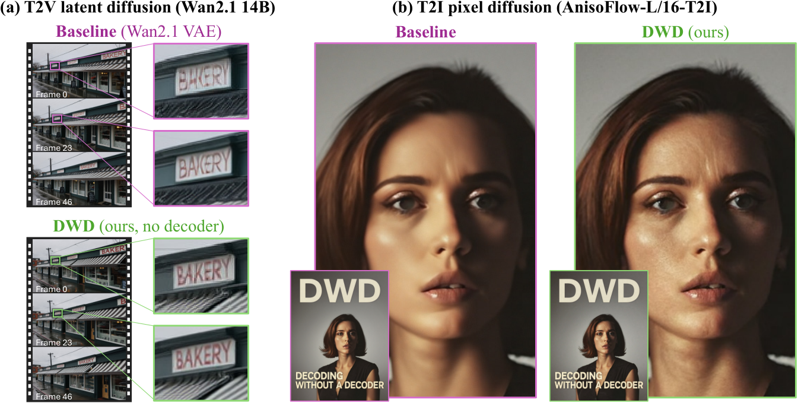
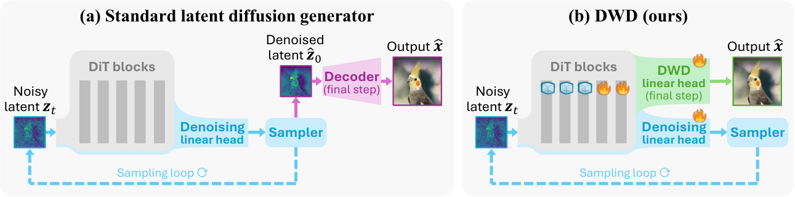
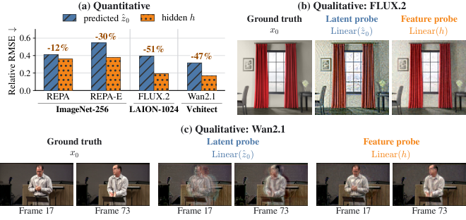
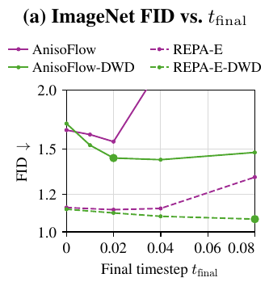
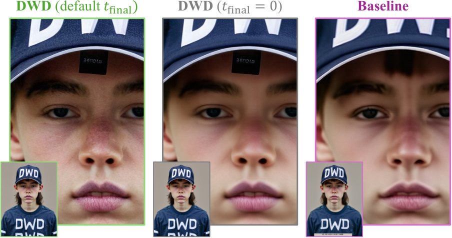
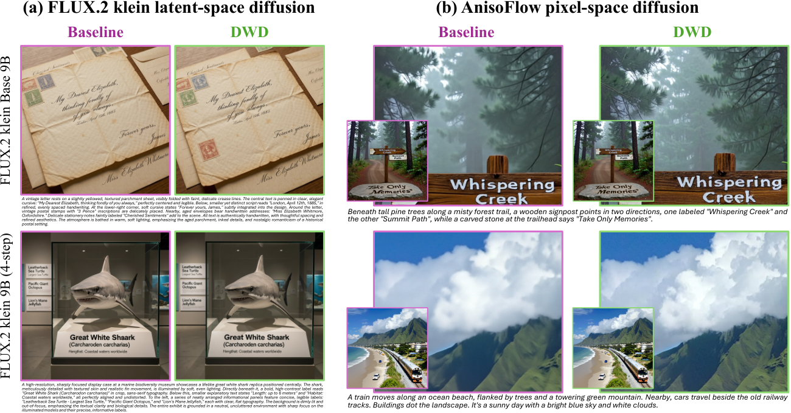
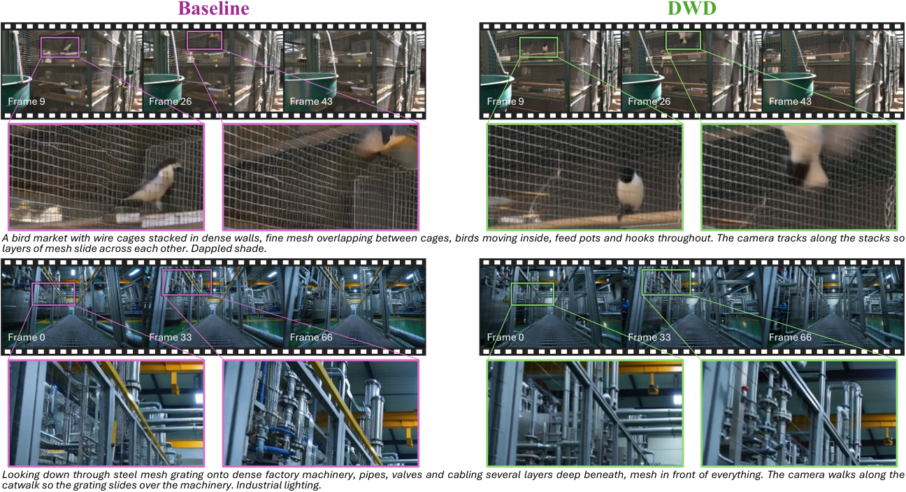

# DWD: Decoding Without a Decoder —— Direct Pixel Prediction from Diffusion Transformers

**论文**: [arXiv:2611.22287v1](https://arxiv.org/abs/2611.22287)（cs.CV，2026-11-17，23 页：正文 10 页 + 参考文献 6 页 + 附录 7 页）
**作者**: Hansheng Chen（Stanford、Luma AI）, Shengqu Cai, Jan Ackermann, Rayhan Zirvi（Stanford、Caltech）, Gordon Wetzstein, Xinchen Yan（Luma AI）, Leonidas Guibas —— **Stanford + Luma AI**。第一作者也是 π-Flow、AsymFlow 的作者；AnisoFlow 是同组的另一篇（Zirvi et al.）
**链接**: 论文写的项目页 `hanshengchen.com/dwd` 本笔记查看时（2026-11-18）返回 404；**论文本身没有代码和权重**。作者同期的博客 [pi-H3](https://hanshengchen.com/blog/pi-h3/)（2026-11-10）把 DWD 用在 2 / 4 步 MiniMax-H3 上，HF demo 已上线，权重和推理代码预告 11 月 16–22 日在 [LakonLab](https://github.com/Lakonik/LakonLab) 发布，训练代码"11 月晚些时候"；本笔记查看时 HF 模型页尚未公开 `[待补]`

---

## 1. 一句话定位

**DWD 在预训练 DiT 的最后一层 token 上并联一个线性头，只在采样的最后一步用它直接输出像素，从而去掉 VAE decoder。** 原来的去噪头保持不变，继续负责采样轨迹；新的像素头单独用 L1 + LPIPS + GAN 训练。微调时只动最后 K 个 block（K = 2–16），并用一个冻结的原模型做速度锚定，保证采样轨迹不变。同一个"分头"思路用在没有 decoder 的像素扩散模型上，也能明显改善纹理。

| 底座（论文表） | 指标 | Baseline | DWD |
|---|---|---|---|
| SiT-XL/2-REPA-E（ImageNet 256，latent） | FID | 1.12 | **1.06** |
| AnisoFlow-H/16（ImageNet 256，pixel） | FID | 1.55 | **1.43** |
| FLUX.2 klein Base 9B（T2I 1024²） | COCO FID / pFID / OneIG | 15.13 / 18.69 / 0.556 | 15.05 / 18.38 / 0.556 |
| AnisoFlow-L/16-T2I 0.9B（pixel） | COCO FID / pFID | 28.86 / 36.59 | **27.54 / 32.26** |
| Wan2.1-T2V-14B（832×480，81 帧） | warping error（×10⁻³）/ dynamic degree | 1.52 / 0.736 | **1.18** / 0.711 |
| Wan2.1-1.3B 4 步（rCM） | 端到端时延（H100） | 4.661 s | **2.757 s**（1.69×） |
| FLUX.2 klein 9B 4 步 | 端到端时延 | 0.776 s | 0.695 s（1.12×） |

🔴 **读完全文后我认为要打四个折扣**：

1. **省 decoder 的收益只在少步模型、且对比的是原厂 VAE 时才显著。**
   - 多步模型里 decoder 本来就占比很小（我按 FLOPs 估算）：Wan2.1-14B 50 步 + CFG 下，decoder 的 0.28 PFLOPs 约占 0.17%；FLUX.2 klein Base 32 步约占 0.22%。
   - 4 步模型上才明显：Wan 1.3B 时延降 41%，FLUX.2 4 步降 10%。
   - 对比已有的快速 decoder，收益很小。作者自己的 pi-H3 博客（H100，768p，5 s，4 步）：DWD 12.02 s，Sol-H3 + Sol-H3-VAE 12.61 s（DWD 快 4.7%），LightX2V + LightVAE-Lite 12.99 s（快 7.5%）。只有对比原厂 H3 VAE 的 2 步配置时才快 37%（6.19 s vs 9.87 s）。论文正文没有和 LightVAE、PiD 这些快速 decoder 做时延对比。
   - DWD 的去噪步本身更慢：博客里 DWD 的去噪时间 2 步多 5.1%、4 步多 2.5%。论文说 H3 需要加 refiner，这部分开销可能来自 refiner，博客没有说明。
2. **视频上的"闪烁降 23%"部分可能来自运动变少。**
   - Wan2.1-14B 上 warping error 1.52 → 1.18（按表算是 −22.4%，论文写 23%）。但 dynamic degree 同时从 0.736 降到 0.711，8-bit 版从 0.728 降到 0.703。warping error 本身随运动量上升，运动少了它也会降。作者的回应是"定性结果看不出运动减少"，没有给控制运动量之后的对比。
   - 4 步 Wan 1.3B 上有自蒸馏变体，dynamic degree 基本持平（0.822 vs 0.825），warping error 只降 14%，比标准版的 27% 少了一半。这说明标准版的部分收益和运动下降相关。
   - 同一个 4 步模型上，标准 DWD 的 imaging quality 0.669 → 0.648，HPSv2.1 0.265 → 0.258，背景一致性也略降。论文自己说"1.3B 对 DWD 不利"。
3. **训练成本不低，H3 这类高压缩 VAE 上线性头不够用。**
   - Wan2.1-14B 的 DWD 微调用了约 **4,300 H100 GPU 小时**（40k 步），4 步 Wan 1.3B 也用了 980 小时。"只调最后几个 block"让每步更快，但总量仍然可观。对比：在同样数据上微调原 decoder 只训了 2k 步。
   - MiniMax-H3 的 VAE 每个 token 对应 4×32×32×3 = 12,288 个像素值，比 DiT 的 hidden 维度 5,376 大一倍多，线性头容量不够，要加卷积 refiner。论文 App. B.5 和博客都说 H3 上的结果是"初步的"，没有给任何数值。
4. **ImageNet 上的提升小，且有混杂因素。**
   - latent 模型的 FID 只改善 0.02–0.06，论文没有给多 seed 的方差。
   - SiT-XL/2-REPA 的 DWD 版单独换了 guidance（2.3，区间 [0, 0.56]），baseline 用默认设置。这个 0.02 的差距里有多少来自 guidance，论文没拆开。
   - DWD-conv（加卷积 refiner）在 ImageNet 上没有一致的提升，所以"线性头就够了"只在 16×16 patch 下成立，作者在 Limitations 里也承认了。

📌 **站得住的部分**：

- **"分头"这个设计有干净的消融。** 把像素损失和轨迹锚定放到同一个头上（w/o separate head），AnisoFlow 的 FID 从 1.55 变差到 1.71，JiT 从 1.90 到 1.91；分开之后分别是 1.43 和 1.85。同样的损失、同样的数据，只差一个头。作者的解释：L2 去噪损失倾向于覆盖所有模式，LPIPS + GAN 倾向于感知质量但会压缩多样性，两者放在同一个头上会互相干扰。
- **最后一步要在 `t > 0` 读像素，这一点有扫描证据（Fig 4）。** 在 `t_final = 0`（相当于把 DWD 当成 decoder 用）时，FID 和 baseline 持平或更差；`t_final` 取一个小的正值，增益才出现。像素头需要一点残余噪声来"造"细节。
- **像素扩散模型的纹理改善很明显，而且便宜。** AnisoFlow-L/16-T2I 只调 4/23 个 block、3k 步、约 14 H100 GPU 小时，pFID 从 36.59 降到 32.26（−11.8%）；ImageNet 版 AnisoFlow-H/16 只调 2 个 block、4k 步、约 8 GPU 小时，FID 1.55 → 1.43。
- **对 Wan 的 decoder 失真有对照实验。** 用同样的数据和像素损失直接微调 Wan decoder，warping error 只从 1.52 降到 1.39；DWD 降到 1.18。所以收益主要来自方法，而不是训练数据。
- **对 8-bit 推理更稳。** W8A8 FP8 + SageAttention2 下，baseline 的 warping error 从 1.52 升到 1.69，DWD 只从 1.18 升到 1.20。
- **比"把 latent 模型改成像素模型"的路线更便宜，也更好。** 在 FLUX.2 klein Base 上，AsymFlow 的 FID / OneIG / LongText 分别是 18.10 / 0.506 / 0.777，用了 1,100 H100 GPU 小时；DWD 是 15.05 / 0.556 / 0.908，用了 350 小时，并且和原模型同 seed 下内容一致。

---

## 2. 背景

> **Fig 1**：(a) Wan2.1 14B，左 baseline（经 Wan VAE 解码）、右 DWD（无 decoder），同一 seed 的第 0 / 23 / 46 帧。baseline 里招牌上的小字逐帧扭曲，DWD 保持可读。(b) AnisoFlow 像素扩散，baseline 的皮肤和头发偏平滑，DWD 恢复了毛孔和发丝。

Latent diffusion 的标准流程是：DiT 在 latent 空间去噪 → 卷积 decoder 把 latent 映射回像素。decoder 带来两个问题：

- **成本**：论文举例，H100 上 4 步 Wan 1.3B 生成 5 秒视频，采样 2.8 s，解码还要 1.9 s，多出约 70%。
- **失真**：decoder 对小字、网格、密集结构会产生逐帧变化的扭曲，在视频里表现为闪烁。

现有的两条路线：

| 路线 | 代表 | 和 DWD 的区别 |
|---|---|---|
| 换更快 / 更好的 decoder | LightVAE、PiD（蒸馏的像素扩散 decoder）、SSDD、Sol-H3-VAE | 仍保留一个独立的 decoder 网络 |
| 把 latent 模型改成像素模型 | AsymFlow、L2P | 要改变去噪轨迹，需要全网络反传；同 seed 下内容会变 |
| 直接训练像素模型 | JiT、AnisoFlow、PixelFlow | 去噪输出就是像素，L2 损失使细节偏平滑 |

DWD 的切入点：**以前不管是 latent 还是像素模型，都是"去噪输出 → 最终像素"，像素质量和去噪绑在一起。DWD 把两者分开。**

---

## 3. 方法

> **Fig 2**：(a) 标准流程：DiT blocks → 去噪线性头 → 采样器循环 → 最后一步得到去噪 latent，再经 decoder 得到像素。(b) DWD：前面的 block 冻结（冰块图标），最后几个 block 和两个头微调（火焰图标）；采样循环仍走去噪头，最后一步改走并联的 DWD 线性头直接出像素，跳过 decoder。

### 3.1 为什么线性头可行：最后一层 token 已经含有像素信息

> **Fig 3**：冻结预训练模型，分别从去噪后的 latent `ẑ_0` 和最后一层 token `h` 做逐 patch 的线性回归到真实像素。(a) 留出集上的相对 RMSE：用 `h` 比用 `ẑ_0` 低 12%（REPA）、30%（REPA-E）、51%（FLUX.2）、47%（Wan2.1）。(b)(c) `ẑ_0` 线性探针在 FLUX.2 上有明显噪点、在 Wan 上有重影；`h` 的探针已经接近真实图像。

这一步说明：**微调之前，最后一层 token 就比去噪 latent 更适合线性读出像素。** 剩下的差距靠微调最后几个 block 补上。

### 3.2 DWD 头

$$
\hat{x}_i = W h_i + b
$$

- 每个 token `h_i` 映射到一个像素 patch，拼起来就是整张图或整段视频。图像模型是 16×16×3；Wan 是 4×16×16×3（每个 token 对应 4 帧），另配一个 1×16×16 的头处理第一帧 latent（Wan VAE 的第一帧只对应 1 个像素帧）。
- **输出维度一般小于 DiT 的 hidden 维度**，所以线性头的开销可以忽略。
- latent 模型和 AnisoFlow-T2I 在归一化的 **Oklab 色彩空间**里预测（沿用 AsymFlow），像素损失在转换回 RGB 后计算。ImageNet 像素模型直接预测 RGB。
- **最小二乘初始化**：用冻结的预训练模型在 1 万张训练图上，按 `p_pix` 的时间步采 `h`，解正规方程同时得到 `W` 和 `b`。Fig 3 的探针就是这样来的。
- **DWD-conv**（消融用）：在线性预测上加一个残差分支，半分辨率卷积 + pixel shuffle，token 先过 128 维 bottleneck 再展成 32 通道特征图，两个 3×3 残差块，输出卷积零初始化。视频逐帧处理。

**只在最后一步用 DWD 头，而且这一步的 `t` 是一个小的正数，不是 0。** 最后一步不做 CFG（只跑条件分支），因为 CFG 的作用是引导轨迹，而这一步不再推进轨迹。论文表里 baseline 最后一步的 FLOPs 记成 "2×"，DWD 记 "1×"，部分节省就来自这里。

### 3.3 微调

$$
\mathcal{L} = \mathcal{L}_{\mathrm{pix}} + \lambda \mathcal{L}_{\mathrm{traj}}
$$

$$
\mathcal{L}_{\mathrm{pix}} = \mathbb{E}_{t \sim p_{\mathrm{pix}}} \left[ \left\| \hat{x} - x \right\|_1 + \mathrm{LPIPS}(\hat{x}, x) + \ell_{\mathrm{adv}}(\hat{x}) \right], \qquad
\mathcal{L}_{\mathrm{traj}} = \mathbb{E}_{t \sim p_{\mathrm{traj}}} \left[ \left\| \hat{u} - \hat{u}_{\mathrm{ref}} \right\|_2^2 \right]
$$

- **像素损失**：L1 和 LPIPS 1:1，加 StyleGAN-T 判别器（沿用 RAE）。判别器先预热，生成器的对抗项在训练后段才打开，权重按 L1 + LPIPS 在像素上的梯度范数自适应。T2I 和视频的判别器只看随机 256×256 的裁块；视频判别器逐帧提特征，再加一个沿帧轴的 1D 卷积残差块。`p_pix` 默认是 [0, 0.1]（shift 之前），对应推理时 DWD 头工作的小 `t` 区间。
- **轨迹锚定**：让微调后的去噪头输出 `û` 贴近冻结原模型的输出 `û_ref`。`p_traj` 默认是 [0.04, 1]，覆盖中间的去噪步。
- **只微调最后 K 个 block**，前缀冻结；冻结前缀只算一次，原模型的尾部和微调后的尾部共享这次前向，所以不需要两次完整前向。时间步 embedding MLP 被所有 block 共享，DWD 把它复制一份给微调的 block，避免影响冻结部分。论文说这样比全网络反传最多快 3 倍。
- 两个损失分别用各自的 `t` 采样，各自 backward，梯度累加后一起 step（Algorithm 1）。

| Table 4（节选） | K / 总 block | 迭代 | λ | `p_traj` | `p_pix` | 最后一步 `t` | H100 GPU 小时 |
|---|---|---|---|---|---|---|---|
| SiT-XL/2-REPA | 16 / 28 | 100k | 5 | [0.04, 1] | [0, 0.1] | 0.08 | 170 |
| SiT-XL/2-REPA-E | 8 / 28 | 200k | 10 | [0.04, 1] | [0, 0.1] | 0.08 | 200 |
| JiT-H/16 / AnisoFlow-H/16 | 2 / 32 | 4k | 50 | [0.04, 1] | [0, 0.1] | 采样器最后一步 | 8 |
| FLUX.2 klein Base 9B | 4 / 32 | 26k | 10 | [0.04, 1] | [0, 0.1] | 0.3 | 350 |
| FLUX.2 klein 9B 4 步 | 4 / 32 | 26k | 10 | [0.3, 1] | [0, 0.5] | 采样器最后一步 | 340 |
| AnisoFlow-L/16-T2I | 4 / 23 | 3k | 500 | [0.04, 1] | [0, 0.1] | 采样器最后一步 | 14 |
| **Wan2.1-T2V-14B** | 8 / 40 | 40k | 5 | [0.04, 1] | [0.02, 0.1] | 0.3（shift 7，约等于 shift 前 0.058） | **4,300** |
| Wan2.1-T2V-1.3B 4 步（rCM） | 8 / 30 | 40k | 5 | [0.3, 0.94] | [0.02, 0.3] | 采样器最后一步 | 980 |

其他设置：Adam，lr 1e-4，betas (0.9, 0.95)，无 weight decay，DWD 头 5 倍学习率；EMA（Karras，γ = 7）。FLUX.2 和 Wan 训练时冻结的 block 和参考模型都量化成 FP8。像素模型的锚定权重 λ 大得多（50–500），因为去噪头本身就在像素空间，更容易被像素损失带偏。

⚠️ 对 latent 模型，最后一步的 `t` 是手动设的（比如 Wan 的 0.3），论文没说清楚采样器到这个 `t` 之后剩下的步是被跳过，还是网格本来就在这里结束。如果是跳过，DWD 还省了几步采样，表里的 FLOPs 只算了最后一步，没有体现这一部分。

**数据**：ImageNet 训练集；T2I 用 AnisoFlow 的约 1 MP 数据（TextAtlas、RedCaps、LAION-Aesthetics），FLUX.2 Base 另加 0.5 MP 和 0.25 MP 两档；视频用 Vchitect T2V DataVerse，**只用 ≥ 720p 的源视频再下采样**（作者说这对得到清晰的真值很关键），分辨率 352×640 到 720×1280、17–81 帧分桶。

---

## 4. 实验

### 4.1 ImageNet 256×256（Table 1）

| | 方法 | Decoder | 参数 M（+ decoder） | 最后一步 GFLOPs | FID | IS |
|---|---|---|---|---|---|---|
| Latent | SiT-XL/2-REPA | SD-VAE | 674.8 + 49.5 | 2 × 237.2 + 622.2 | 1.38 | 306.2 |
| | DWD | – | 678.5 | 237.7 | 1.36 | 312.5 |
| | DWD-conv | – | 678.9 | 239.2 | 1.35 | 313.6 |
| | SiT-XL/2-REPA-E | E2E-VA-VAE | 674.9 + 41.4 | 2 × 237.3 + 252.2 | 1.12 | 302.9 |
| | DWD | – | 678.5 | 237.7 | **1.06** | 303.1 |
| | DWD-conv | – | 679.0 | 239.2 | 1.10 | 305.7 |
| Pixel | JiT-H/16 | – | 952.5 | 2 × 363.9 | 1.90 | 300.9 |
| | DWD | – | 956.7 | 363.9 | 1.85 | 305.7 |
| | 不分头 | – | 955.8 | 363.9 | 1.91 | 302.4 |
| | AnisoFlow-H/16 | – | 953.1 | 2 × 364.8 | 1.55 | 300.1 |
| | DWD | – | 957.3 | 363.9 | **1.43** | 303.5 |
| | DWD-conv | – | 957.8 | 365.4 | 1.44 | 303.6 |
| | 不分头 | – | 956.4 | 364.8 | 1.71 | 302.9 |

- "最后一步" FLOPs 的对比看起来差很多（REPA 1,097 vs 238 GFLOPs），但采样总量里 decoder 占比很小。按 SiT 常用的 250 步 SDE + CFG 估算（我的估算，论文没给总 FLOPs），总量约 119 TFLOPs，SD-VAE decoder 约占 0.5%。
- 1.43 是论文声称的"像素 flow 模型 SOTA"。

> **Fig 4**：(a) 横轴是最后一步的 `t_final`，紫线是 baseline 在该 `t` 停止并输出，绿线是 DWD。`t_final = 0` 时 DWD 与 baseline 持平（REPA-E）或更差（AnisoFlow，约 1.67 vs 1.62，从图上读）；`t_final` 取小的正值后，AnisoFlow-DWD 降到约 1.43，REPA-E-DWD 随 `t` 增大持续略降，而 baseline 在 `t_final` 增大时变差（AnisoFlow 变差得尤其快）。大圆点是 Table 1 用的默认值。(b) 默认 `t_final` 的 DWD 有皮肤毛孔和布料纹理；`t_final = 0` 的 DWD 和 baseline 一样平滑。

### 4.2 文生图（Table 2，1024×1024）

| | 方法 | 参数 B（+ decoder） | 最后一步 TFLOPs | COCO FID | pFID | HPSv3 | HPSv2.1 | OneIG | LongText |
|---|---|---|---|---|---|---|---|---|---|
| Latent | FLUX.2 klein Base 9B | 9.08 + 0.05 | 2 × 75.51 + 10.47 | 15.13 | 18.69 | 10.54 | 0.284 | 0.556 | 0.909 |
| | DWD | 9.15 | 75.54 | 15.05 | 18.38 | 10.54 | 0.284 | 0.556 | 0.908 |
| | 无对抗损失 | 9.15 | 75.54 | 15.10 | 18.97 | 10.57 | 0.284 | 0.555 | 0.907 |
| | FLUX.2 klein 9B（4 步） | 9.08 + 0.05 | 75.51 + 10.47 | 21.50 | 25.52 | 12.23 | 0.307 | 0.535 | 0.867 |
| | DWD | 9.15 | 75.54 | 21.92 | 25.33 | 12.15 | 0.307 | 0.537 | 0.871 |
| Pixel | AnisoFlow-L/16-T2I | 0.92 | 2 × 5.99 | 28.86 | 36.59 | 10.72 | 0.297 | 0.528 | 0.850 |
| | DWD | 0.94 | 5.98 | **27.54** | **32.26** | 10.63 | 0.301 | 0.533 | 0.852 |
| | 无对抗损失 | 0.94 | 5.98 | 28.93 | 34.52 | 10.67 | 0.299 | 0.532 | 0.843 |

> **Fig 5**：(a) FLUX.2 klein Base 和 4 步版：DWD 与 baseline 同 seed 下几乎看不出差别，长文本也一致。(b) AnisoFlow：DWD 保持构图，树皮、叶子、云的纹理明显更细。

- **FLUX.2 上是"持平但省掉 decoder"**。作者的解释：FLUX.2 的 latent 很宽，每个 token 128 维对应 768 个像素值；Wan 是 64 维对应 3,072 个像素值，所以 FLUX.2 的 decoder 本来就容易，没什么可改进的。4 步版的 COCO FID 还略差了 0.42。
- **4 步 FLUX.2 的最后一步在 `t = 0.7`（shift 后）**，远大于多步模型，DWD 仍然持平。这说明在 4 步模型上，DWD 头在较大噪声下也能直接出像素。
- **对抗损失有帮助但不是必须的**：去掉后主要是 pFID 变差（AnisoFlow 32.26 → 34.52），仍比 baseline 好。

### 4.3 文生视频（Table 3，Wan2.1-14B，832×480，81 帧）

| 方法 | 参数 B（+ decoder） | 最后一步 PFLOPs | Warping error（×10⁻³）↓ | HPSv3 | HPSv2.1 | 主体一致 | 背景一致 | Temporal flicker | Motion smooth | Dynamic degree | Aesthetic | Imaging |
|---|---|---|---|---|---|---|---|---|---|---|---|---|
| Wan2.1 14B | 14.29 + 0.07 | 2 × 1.68 + 0.28 | 1.52 | 9.06 | 0.266 | 0.951 | 0.981 | 0.990 | 0.983 | 0.736 | 0.682 | 0.677 |
| DWD | 14.49 | 1.68 | **1.18** | 9.04 | 0.266 | 0.952 | 0.982 | 0.993 | 0.984 | 0.711 | 0.685 | 0.671 |
| 微调 decoder | 14.29 + 0.07 | 2 × 1.68 + 0.28 | 1.39 | 9.03 | 0.266 | 0.951 | 0.982 | 0.992 | 0.983 | 0.731 | 0.681 | 0.676 |
| Wan2.1 14B（8-bit） | 14.29 + 0.07 | 2 × 1.68 + 0.28 | 1.69 | 8.99 | 0.265 | 0.950 | 0.979 | 0.990 | 0.982 | 0.728 | 0.675 | 0.676 |
| DWD（8-bit） | 14.49 | 1.68 | **1.20** | 9.01 | 0.267 | 0.951 | 0.982 | 0.993 | 0.984 | 0.703 | 0.683 | 0.668 |

> **Fig 6**：上：鸟市的铁丝笼网格，baseline decoder 把网格扭成波浪线；下：透过钢格栅俯视管道，baseline 把密集的管道打碎成斑点。两种失真都逐帧变化，看起来就是闪烁；DWD 的网格规则、管道结构完整，镜头移动时也稳定。

- **warping error**：用 RAFT 估计相邻帧的双向光流，把后一帧 warp 到前一帧，按前后向一致性去掉遮挡区，再算 RGB 平方误差。作者认为 VBench 的 temporal flickering 是直接的帧间像素差、不考虑运动，两个模型都接近满分，不适合衡量这种失真。
- 其他 VBench 维度和 HPS 基本持平，**dynamic degree 降了 3.4%**（见 §1 折扣 2），imaging quality 也略降（0.677 → 0.671）。
- 我对这组结果的理解：Fig 6 选的是 decoder 最容易出问题的场景（细网格、密集结构），这类内容在游戏场景（栅栏、UI 文字、植被）里很常见，对我们是有参考价值的；但 warping error 的整体下降幅度要结合运动量一起看。

### 4.4 少步视频（App. B.2，Table 5，4 步 Wan2.1-1.3B，rCM 蒸馏）

| 方法 | Warping error ↓ | HPSv3 | HPSv2.1 | 主体一致 | 背景一致 | Temporal flicker | Dynamic degree | Imaging |
|---|---|---|---|---|---|---|---|---|
| Wan2.1 1.3B（4 步） | 2.84 | 8.32 | 0.265 | 0.938 | 0.962 | 0.976 | 0.825 | 0.669 |
| DWD | **2.07** | 8.46 | 0.258 | 0.946 | 0.959 | 0.984 | 0.811 | 0.648 |
| DWD（自蒸馏） | 2.45 | 8.45 | 0.261 | 0.942 | 0.956 | 0.982 | 0.822 | 0.631 |

- 自蒸馏变体：步数很少时，最后一步要生成更多内容，和真实像素的对应关系变得模糊，L1 / LPIPS 可能不再合适。于是把真值换成"参考模型的最后一步 → 重新加噪到小 `t` → 一个已训好的小 `t` DWD 模型的像素输出"。这样 dynamic degree 保住了，但 imaging quality 降得更多（0.631）。
- 训练时先用 `p_traj = [0.1, 0.94]`、`p_pix = [0.02, 0.1]` 训 32.5k 步，再切到对应 4 步采样器最后一步的区间。

| Table 6（4 步模型，eager 模式） | 时延 | 峰值显存 |
|---|---|---|
| FLUX.2 klein 9B（4 步） | 0.776 s | 37.31 GB |
| DWD | **0.695 s** | **35.54 GB** |
| Wan2.1 1.3B（4 步） | 4.661 s | 19.22 GB |
| DWD | **2.757 s** | **16.15 GB** |

### 4.5 与"latent 改像素"路线对比（App. B.4，Table 7）

| 方法 | FID | pFID | OneIG | LongText | 训练成本（H100 GPU 小时） |
|---|---|---|---|---|---|
| FLUX.2 klein Base 9B | 15.13 | 18.69 | 0.556 | 0.909 | – |
| AsymFlow | 18.10 | 22.62 | 0.506 | 0.777 | 1,100（15k 步） |
| DWD | 15.05 | 18.38 | 0.556 | 0.908 | 350（26k 步） |
| Z-Image Turbo | – | – | 0.528 | 0.917 | – |
| L2P | – | – | 0.499 | 0.787 | – |

AsymFlow 是作者自己的前作，这里训练数据缺少文字渲染，作者也说 AsymFlow 对数据敏感。L2P 的数字取自对应 base 的官方报告，不是同条件复现。

### 4.6 MiniMax-H3（App. B.5 + pi-H3 博客）

论文只有文字描述：H3 的 VAE 每个 token 覆盖 4 帧 × 32×32，线性头要输出 12,288 维，是 hidden 维度 5,376 的两倍多；H3 又是单流模型，文本、视频、音频共享 transformer 权重。因此线性头容量很有限，需要轻量 refiner（如 DWD-conv）。最后一步的像素目标改成"参考模型的最后一步 + 原厂 decoder 的输出"（decoder 蒸馏），不再用真实像素。

博客给的时延（H100 80GB，batch 1，各阶段中位数之和，768p · 5 s）：

| 配置 | 去噪（全部步） | 视频 decoder | 总计 |
|---|---|---|---|
| pi-H3 2 步 DWD | 6.125 s | – | **6.19 s** |
| PDMD 2 步 + 原厂 H3 VAE | 5.83 s | 3.972 s | 9.87 s |
| pi-H3 4 步 DWD | 11.955 s | – | **12.02 s** |
| Sol-H3 4 步 + Sol-H3-VAE | 11.66 s | 0.88 s | 12.61 s |
| LightX2V 4 步 + LightVAE-Lite | 11.66 s | 1.265 s | 12.99 s |

博客另报 B200 上 2 步生成 5 s 768p 带立体声音频的视频要 3.8 s，比视频本身短。这里的加速来自三部分：步数更少、去掉 decoder、FP8 量化，DWD 只是其中一部分。H3 上 DWD 的画质没有任何量化评测。

---

## 5. 争议与权衡

| 问题 | 我的判断 |
|---|---|
| "decoder 基本是多余的" | 对 16×16 patch 的 VAE（FLUX.2、Wan、SD-VAE）成立：线性头在画质上持平或更好。对 H3 这种 32×32×4 的高压缩 VAE 还没有证据，作者自己也说需要 refiner |
| 速度收益 | 只在少步模型上显著，且主要相对于原厂重型 decoder。相对 LightVAE、Sol-H3-VAE 这类快速 decoder，H3 上只快 5–7%，DWD 自身的去噪步还慢 2.5–5% |
| 画质收益 | 视频：细网格、小字的逐帧失真确实减少，有和"微调 decoder"的对照；但 warping error 的下降里混有运动减少。像素扩散：纹理改善明显，成本很低 |
| 训练成本 | 14B 视频模型约 4,300 H100 GPU 小时，不是"随手可加"的后处理；图像像素模型只需 8–14 小时 |
| 和蒸馏的组合 | 4 步 FLUX.2、4 步 Wan 1.3B、2 / 4 步 H3 都能用；但每换一个学生都要重新调 `p_pix`、`p_traj` 并重训，学生每更新一次也要重训 |
| 同 seed 内容一致性 | 轨迹锚定 + 冻结前缀让 DWD 和原模型同 seed 输出几乎一致（Fig 5a），这一点比 AsymFlow / L2P 这类改轨迹的方法实用：现有的 prompt、seed、LoRA 工作流不受影响（LoRA 兼容性是我的推论，论文没测） |

对我们的启示（基于我对业务的理解，未经实验）：

- **少步视频生成上值得关注。** 在 4 步 Wan 1.3B 这类模型上，decoder 占端到端时延的约 40%，DWD 去掉后时延降 41%、显存降 16%。如果我们部署的是蒸馏后的 Wan 系模型，这是一个实际的优化点。代价是 1.3B 模型约 980 H100 GPU 小时的训练，以及 imaging quality 略降。
- **H3 上先等 pi-H3 的权重。** H3 线上如果已经换成 Sol-H3-VAE / LightVAE-Lite 这类快 decoder，DWD 的速度收益只剩 5–7%；画质收益没有数据。
- **像素级细节（小字、网格）是游戏资产的常见痛点。** DWD 在这类结构上对 Wan decoder 的改进有直观对比；如果我们遇到 VAE 解码导致的 UI 文字、栅栏纹理失真，可以把"DiT 最后一层直接读像素"当作一个候选方向。

---

## 6. 一句话总结

**DWD 在 DiT 最后一层 token 上并联一个只在最后一步使用的线性像素头，用像素损失单独训练、用冻结原模型锚定去噪轨迹，从而去掉 VAE decoder：16×16 patch 的 latent 模型画质持平或更好（Wan 14B warping error −22%，但 dynamic degree 也降了 3.4%），像素模型纹理明显改善（ImageNet FID 1.55 → 1.43）；速度收益集中在少步模型（4 步 Wan 1.3B 端到端 1.69×），相对快速 decoder 只快 5–7%，H3 这类高压缩 VAE 上还需要 refiner、尚无画质数据。**

---

## 7. 在仓库图谱里的位置

| | 关系 |
|---|---|
| **[H3 Streaming VAE](../h3_streaming_vae/analysis.md)** | 🔴 **同一个瓶颈的两种解法**：那篇不训练，把 H3 原厂 decoder 改成因果流式，省的是"等未来 latent"的延迟；DWD 直接去掉 decoder，省的是 decoder 计算。DWD 的 pi-H3 博客给了原厂 H3 VAE 的时延量级：768p · 5 s 的 2 步配置里 decoder 占 3.97 s，比去噪的 5.83 s 少不了多少 |
| [Veda](../veda/analysis.md) / [Sink-Sparse Hybrid](../sink_sparse_hybrid/analysis.md) | H3 推理链路上的另一段：它们降注意力成本，DWD 去掉 decoder。pi-H3 的时延已经用了 Sol-Attn |
| [Diffusibility](../../image_generation/diffusibility/analysis.md) | 讨论 tokenizer latent 的可扩散性（以 RAE 等为对照）。DWD 从另一端给了相关观察：不管 latent 怎么设计，DiT 最后一层 token 线性读像素都比去噪 latent 更准（误差低 12–51%，Fig 3），说明 decoder 能做的事 DiT 内部已经做了一大半 |
| [PTD](../../video_generation/ptd/analysis.md) / [ReDiverse](../../video_generation/rediverse/analysis.md) | 都在少步 H3 上工作：PTD 改蒸馏方法，ReDiverse 修多样性，DWD 去掉 decoder。三者原则上可以叠加，但 DWD 每换一个学生都要重训 |
| [VDN](../../video_generation/vdn/analysis.md) | pi-H3 博客把 VDN 列为可以和 DWD 叠加的长视频注意力加速 |

⚠️ **仓库缺口**：π-Flow、AsymFlow、AnisoFlow、JiT、L2P、PiD、LightVAE、Sol-H3、PDMD、REPA / REPA-E、RAE 都还没有笔记。

---

## Q&A

（暂无）

---
