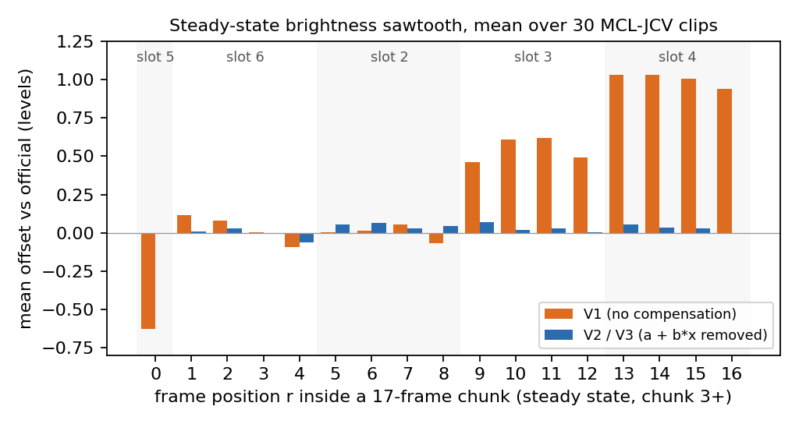
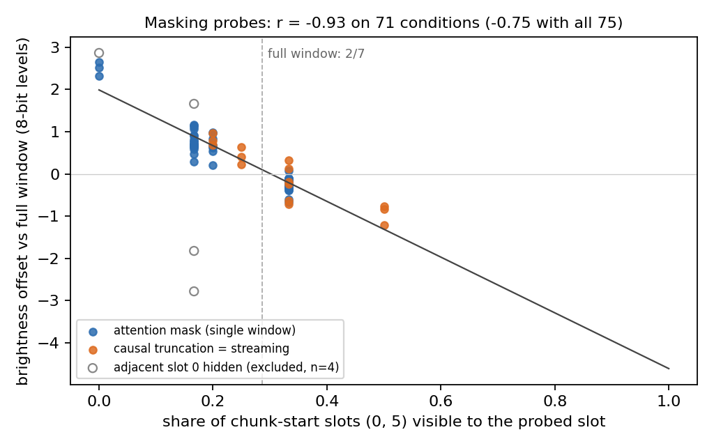
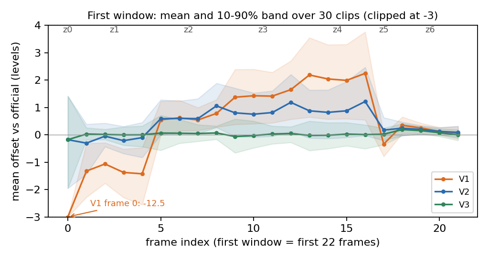

# H3 Streaming VAE Decoder: Training-Free Streaming without Future Latents

**来源**: SolarX-Team [技术博客](https://solarx-team.github.io/H3-Streaming-VAE-Decoder/)（2026-10）+ 代码 [SolarX-Team/H3-Streaming-VAE-Decoder](https://github.com/SolarX-Team/H3-Streaming-VAE-Decoder)，读的 commit 是 `a7c61a6`（2026-10-16）。没有论文
**作者**: Bohong Chen, Yajing Chen, Yihua Du, Junchao Huang, Guian Fang, Shengju Qian —— SolarX-Team，与 [SolarWM](../../world_model/solarwm/analysis.md)、[SolarRenderer](../../world_model/solarrenderer/analysis.md) 是同一批人
**许可**: 代码 Apache-2.0。官方 H3 VAE 权重（`FL2VA`）和 StreamRender-H3 的学生权重受 MiniMax H3 community license 约束（README 原话），学生权重不在仓库里
**说明**: 博客的图是网页里用 JS 画的；本笔记的三张图是我用博客公开的 `assets/data.js` 重画的，数字与博客正文逐项核对过

---

## 1. 一句话定位

**这不是新模型，而是对 MiniMax-H3 官方 VAE decoder 的一次纯推理改造，不训练、不改权重。** 官方 decoder 是 36 层双向 ViT，一次吃 7 个 latent，步长 5，解当前 5 个 latent 的帧要等后面 2 个 latent 也生成出来。改造后变成 latent by latent 的因果流式解码：
- 每个 latent 到达时只算它自己那一格，attention 读前面各格缓存的 K/V；
- 窗口右移时，把重叠的 2 个 latent 在新位置重算一次（prefill）；
- 看不见未来会产生一种按 slot 固定的亮度偏差，用 231 个查表系数做一步逐像素校正 `out − (a + b·x)` 消掉（V2）；
- 第二个 latent 到达时把第一格的 K/V 重算一次，修掉开头的问题（V3）。

| | 官方 decode | V1 | V2 | **V3（最终版）** | StreamRender-H3 |
|---|---|---|---|---|---|
| 要等的未来 latent | 2 | 0 | 0 | **0** | 0（但一步攒 2 个） |
| 对原片 PSNR / LPIPS / rFVD（MCL-JCV 30 段） | **31.04** / **0.0745** / **13.3** | 30.26 / 0.0771 / 19.1 | 30.37 / 0.0770 / 17.7 | 30.41 / 0.0759 / 16.9 | **30.43** / 0.0826 / 18.6 |
| 对官方 PSNR | — | 37.16 | 37.98 | **38.40** | 36.84 |
| 亮度跳变 p95（中位数，越低越好） | 0.18 | 1.95 | 0.89 | 0.71 | 0.53 |
| 第一帧何时出 | z6 生成后再 0.73 s | | | **z0 生成后 0.04 s** | |
| 吞吐（1344 × 768） | 24.38 fps | | | 70.12 fps（fused） | **246 fps** |

（数字来自博客各表；StreamRender-H3 是 NVIDIA 蒸馏的 24 层学生解码器，一步 2 个 latent。）

📌 **值得记住的几点**：
- **省掉的是等待，不是算力**：每个窗口仍然算 7 格，计算量比官方低 2.5%（按模型结构解析计算），首帧延迟从"等 7 个 latent 再加 0.73 s"降到"0.04 s"。
- **"看不见未来"的代价是固定的、可测的**：画质比官方低 0.6–0.8 dB；亮度偏差只由 slot 位置决定，所以能用很少的系数补掉。拟合只用了 14 段视频，直接搬到 SolarWM 的生成视频上（分布不同）也有效。
- **诊断做得干净**：把真实的未来 K/V 喂进同一套代码，能以 50.19 dB 复现官方结果，只剩 bf16 噪声。所以后面所有差异都来自"看不见未来"本身，不是实现错误。

⚠️ **需要打的折扣**：
1. **显存**：K/V cache 在 1344 × 768 下是 **14.8 GB**（代码 docstring；我按形状复算一致），博客正文没提。这是叠加在 33B 生成模型之上的。
2. **硬件没写**：博客的测速表没写 GPU；`data.js` 里这组数据的键名是 `b300_optimization`（2026-10-14），推测是 B300。fused kernel 用的是 SM100 的 GEMM（`GemmGatedSm100`），只能在数据中心级 Blackwell 上跑。
3. **收益取决于上游**：目前社区的 H3 生成器基本都是 5 个 latent 一块地出（博客自己也这么说）。在那种情况下，能拿到的收益只是"不用等下一块的 2 个 latent"，逐 latent 出帧的优势要等生成端也逐 latent 才完全体现。
4. **亮度校正是经验规律**：机理博客自己说"还没弄清楚"。"偏差只由位置决定"这条规律，在遮住紧挨着的 slot 0 的 4 个条件下不成立（那 4 个点被排除在拟合外，见 §3.3）；好在流式解码时不会出现这种遮挡。

---

## 2. 官方 decoder 为什么要等未来 latent

```text
编码端：视频按 17 帧一段，每段左边补 3 帧 → 20 帧 = 5 个 latent，段首 latent = [P P P F0]

解码窗口（7 个 latent，步长 5，段首 latent 总在 slot 0 和 slot 5）：

 slot:      0      1     2     3     4   |   5      6
 latent:   z0     z1    z2    z3    z4   |  z5     z6
 DiT 输出: 4帧   4帧   4帧   4帧   4帧    |  4帧   4帧     （proj_out 每个 latent 出 4 帧，共 28 帧）
 丢补帧:  [−3]                          | [−3]          （decode_temporal 切 [0:20] 和 [20:28]，各丢开头 3 帧）
 输出:     1  +  4  +  4  +  4  +  4     |  1  +  4      → 前 17 帧是本窗口，后 5 帧与下一窗口线性混合

 每一层都是 7 个 latent 之间的全连接 attention → z0–z4 的画面依赖 z5、z6
```

- **结构**：36 层 ViT，宽 2048，门控 SiLU FFN，24.2 亿参数。
- **空间切块**：画面切成 256 × 256 像素的块，块间至少重叠 64 像素，1344 × 768 下是 4 × 7 = 28 块；attention 只在块内算，块之间用线性渐变权重混合。
- **时间维度上的等待**：每层都是 7 个 latent 全连接，所以解当前 5 个 latent 的帧，必须等后面 2 个也到。官方代码里的 `_decode_temporal_streaming` 只是省显存的写法，仍要先拿到全部 latent 再一窗一窗地解，延迟上没有区别。
- **实测**：第一个窗口要等 z6 生成后再花 0.73 s 才出第一帧。

📌 这和 [SolarWM 笔记 §5](../../world_model/solarwm/analysis.md#5-模型家族) 里 minimax-h3 的 "`17n+5 ↦ 5n+2`" 是同一套约定：17n + 5 帧编码成 5n + 2 个 latent，正好是 n 个 5-latent 段加 2 个用于和下一窗口重叠的 latent。

---

## 3. 方法

### 3.1 V1：把 decoder 当成因果模型来跑

博客列了五条规则，代码里都能一一对上（主文件 [`stream_decoder.py`](https://github.com/SolarX-Team/H3-Streaming-VAE-Decoder/blob/a7c61a6e02bef8539178a17b6e150a775b3a0ebb/h3_vae/stream_decoder.py#L1)）：

| 规则 | 做法 | 代码 |
|---|---|---|
| ① 窗口几何不变 | 仍是 7 格窗口、起点是 5 的倍数。H3 的 RoPE 时间坐标按"输入 latent 个数"归一化到 [−1, 1]，没填满的窗口直接送进去会被当成更短的窗口、位置全错，所以每一格都按它在完整 7 格窗口里的位置取坐标 | [`_window_start` (`:238`)](https://github.com/SolarX-Team/H3-Streaming-VAE-Decoder/blob/a7c61a6e02bef8539178a17b6e150a775b3a0ebb/h3_vae/stream_decoder.py#L238)；RoPE 表按完整窗口生成（[`:266`](https://github.com/SolarX-Team/H3-Streaming-VAE-Decoder/blob/a7c61a6e02bef8539178a17b6e150a775b3a0ebb/h3_vae/stream_decoder.py#L266)） |
| ② 未来格留空 | 还没生成的 latent 对应的格子不填任何东西 | attention 只读前 `suffix + (slot + 1) × hw` 行（[`:321`](https://github.com/SolarX-Team/H3-Streaming-VAE-Decoder/blob/a7c61a6e02bef8539178a17b6e150a775b3a0ebb/h3_vae/stream_decoder.py#L321)） |
| ③ 只算新来的那一格 | 新 latent 单独前向，attention 读前面各格缓存的 K/V；K/V 按层缓存 | 写 cache（[`:349`](https://github.com/SolarX-Team/H3-Streaming-VAE-Decoder/blob/a7c61a6e02bef8539178a17b6e150a775b3a0ebb/h3_vae/stream_decoder.py#L349)） |
| ④ 换窗时 prefill | 每 5 个 latent 窗口右移一次，重叠的 2 个 latent 从 slot 5、6 变成 slot 0、1，位置变了，就在新位置重算它们的 K/V，不再出帧 | `fresh` 集合（[`:217`](https://github.com/SolarX-Team/H3-Streaming-VAE-Decoder/blob/a7c61a6e02bef8539178a17b6e150a775b3a0ebb/h3_vae/stream_decoder.py#L217)） |
| ⑤ 立即出帧、不回改 | 段首 latent 出 1 帧，其余出 4 帧，之后不再修改，时间方向不做混合；空间上沿用官方 28 块切分与线性混合 | 裁帧（[`:230`](https://github.com/SolarX-Team/H3-Streaming-VAE-Decoder/blob/a7c61a6e02bef8539178a17b6e150a775b3a0ebb/h3_vae/stream_decoder.py#L230)）、[`_blend` (`:410`)](https://github.com/SolarX-Team/H3-Streaming-VAE-Decoder/blob/a7c61a6e02bef8539178a17b6e150a775b3a0ebb/h3_vae/stream_decoder.py#L410) |

**规则 ② 是比较出来的**（7 格窗口，MCL-JCV 30 段，对原片的像素 PSNR）：

| 未来格与换窗的处理 | PSNR |
|---|---|
| 未来格放最新 latent 的复制，真跑一遍 | 29.96 |
| 未来格放复制的 K/V，不真跑 | 28.90 |
| 换窗时把旧 K/V 原样搬到新 slot，不 prefill | 29.68 |
| **未来格留空，换窗时 prefill（V1）** | **30.57** |

博客的总结是 *"decoder 对'看不见的未来'比对'假的未来'更宽容"*。

**代码里三个博客没细说的实现细节**：
- **换窗那一步是一起算的**：窗口第三个 latent 到达时，slot 0、1 的 prefill 和这个 latent 在**同一次前向**里完成，三格之间互相可见（[`:217`](https://github.com/SolarX-Team/H3-Streaming-VAE-Decoder/blob/a7c61a6e02bef8539178a17b6e150a775b3a0ebb/h3_vae/stream_decoder.py#L217)、[`:321`](https://github.com/SolarX-Team/H3-Streaming-VAE-Decoder/blob/a7c61a6e02bef8539178a17b6e150a775b3a0ebb/h3_vae/stream_decoder.py#L321)），所以 slot 0、1 的 K/V 看得到 slot 2。博客测过把这两格提前单独算：对原片 PSNR 从 30.41 降到 30.28，p95 从 0.71 升到 0.88，所以这一步不提前。
- **缓存的是加了 RoPE 之后的 K**：博客写的是"存乘 RoPE 之前的值，读出来时再按当前 slot 加位置编码"，代码 docstring 和实现都是存加 RoPE 之后的值（[`:22`](https://github.com/SolarX-Team/H3-Streaming-VAE-Decoder/blob/a7c61a6e02bef8539178a17b6e150a775b3a0ebb/h3_vae/stream_decoder.py#L22)）。因为位置只在换窗时才变、而换窗时本来就重算，两种写法等价，但描述与实现不一致。
- **4 个 register token 和 1 个 cls token 每步都重算**，它们的 K/V 放在 cache 最前面、每步覆盖。这也是线性层计算量比官方略多的原因。

**正确性检查**：把真实的未来 K/V 喂进同一套代码（不再因果），输出与官方 decode 的 PSNR 是 50.19 dB，只剩 bf16 噪声。

### 3.2 V1 的问题：按 chunk 周期的亮度锯齿

V1 在 MCL-JCV 上整体已经接近官方，但背景里有周期性闪烁，在大片平坦区域的视频（SRC10、SRC20）上最明显，而且第一帧明显偏暗。



> **读法**：横轴是一个 17 帧 chunk 内的帧位置，按解出它的 slot 分组：第 1 帧来自上一窗口的 slot 5，接下来 4 帧来自 slot 6，其余 12 帧来自新窗口的 slot 2、3、4。纵轴是相对官方的平均亮度偏差（8-bit 灰阶），30 段平均。橙色是 V1：slot 3、4 偏亮（+0.54、+1.00），下一个 chunk 的第一帧（slot 5）偏暗（−0.63），所以每 17 帧在边界上有约 1.6 级的跳变，30 fps 下约每秒 1.8 次。蓝色是 V2 / V3 校正后，各 slot 都在 ±0.07 级以内。

| slot | chunk 内帧位置 | V1 平均偏差（级） | 视频间标准差 | 与平均同号的视频 |
|---|---|---|---|---|
| 5 | r = 0 | −0.63 | 0.31 | **100%** |
| 6 | r = 1–4 | +0.03 | 0.06 | 73% |
| 2 | r = 5–8 | 0.00 | 0.18 | 57% |
| 3 | r = 9–12 | +0.54 | 0.29 | **100%** |
| 4 | r = 13–16 | +1.00 | 0.49 | **100%** |

**亮度跳变 p95 的定义**（博客自定义的指标）：
1. 每帧的 `bias(t)` 是重建帧与原视频同一帧的平均亮度之差（BT.601 luma）；
2. 在 token 边界（chunk 内 r = 0、1、5、9、13）上取 `|bias(t) − bias(t−1)|`，从第 2 帧开始统计；
3. 每段视频取 95 分位，再取 30 段的中位数。

官方自己是 0.18，V1 是 1.95（最差一段 3.10）。第 0 → 1 帧的跳变单独报告。

### 3.3 V2：按 slot 查表的线性亮度校正

**为什么能用查表补**：博客论证了偏差的三个性质。

**① 由 slot 位置决定，而不是画面内容。** 做法是在单个窗口上用 attention mask 遮住被测 slot 能看到的部分 slot，测它的亮度偏移；流式截断本身就是其中一种遮挡。偏移几乎只由一个量决定：被测 slot 能看到的格子里，段首位置（slot 0、5）所占的比例。



> **读法**：每个点是一种遮挡条件。蓝点是任意 mask，橙点是因果截断（也就是流式时的情况），竖虚线是完整窗口的比例 2/7。比例越高越暗，越低越亮，71 个条件上 r = −0.93。把 slot 0、5 上的段首 latent 换成普通 latent，甚至 7 格全放同一个 latent，点仍落在同一条线上，所以起作用的是位置本身。
>
> ⚠️ **空心的 4 个点被排除在拟合外**：它们都是遮住了紧挨着的 slot 0 的条件。在同一比例（1/6）下，偏移随窗口内容从 −2.78 变到 +1.66，不服从这条规律；把这 4 个点算进去，r 只有 −0.75（我按 data.js 复算）。博客正文只写了"71 个条件"，图上用空心点标出，没有单独讨论。流式解码时每个 slot 都能看到紧挨着的前一格，所以这种情况不会出现，不影响方法本身。

博客的解释是：段首 latent 只编码了 1 帧真实画面，探针显示它的响应约为普通 latent 的 0.82 倍；decoder 可能学会了按"看到的段首比例"做曝光补偿。官方窗口里这个比例恒为 2/7，补偿是平衡的；流式截断后比例变了，补偿就失衡了。流式时每个 slot 看到的比例是固定的（slot 3 是 1/4，slot 4 是 1/5，slot 5 是 2/6），所以偏差也是固定的。博客自己承认这个解释"还有没弄清楚的地方"，但校正只依赖实测规律。

**② 更像增益误差，而不是常数偏移。** 把画面切成 64 × 64 的小块看，偏移随这块的亮度近似线性增大：暗处几乎为 0，越亮偏得越多。只减常数会让暗部校正过头、亮部又补不够。

**③ 不依赖未来。** 偏移只取决于 slot（流式时已知）和当前帧自己的亮度（刚解出来就有）。

**校正公式**：

$$
\mathrm{out} \leftarrow \mathrm{out} - \left(a + b\,x\right),\qquad \mathrm{out}_{\mathrm{frame}\,0} \leftarrow \mathrm{out} - \left(a + b\,x + c\,x^2\right)
$$

`x` 是每个像素自己的值，3 个通道分开算。`a`、`b` 按 slot、通道和 latent 内的帧位置查表，系数在流式输出自己身上、按 64 × 64 小块的平均拟合。校正放在空间 tile 混合之后、反归一化之前，每 4 帧约 0.21 ms（[`_compensate` (`:436`)](https://github.com/SolarX-Team/H3-Streaming-VAE-Decoder/blob/a7c61a6e02bef8539178a17b6e150a775b3a0ebb/h3_vae/stream_decoder.py#L436)）。

**系数一共 231 个，只用 SRC01–14 拟合，SRC15–30 留作测试**：

| 表 | 内容 | 博客口径 | 文件里实际非零（我读 `.pt` 数的） |
|---|---|---|---|
| `first_window.pt` | 第一个窗口 z0–z5 共 18 帧，每通道每帧一组 `a`、`b`；第 0 帧每通道多一个 `c` | 108 + 3 | `a`、`b` 各 3 × 18 = 54 个；`c` 只有第 0 列 3 个 |
| `steady.pt` | 稳态 slot 2–6 × 3 通道 × 4 个帧位置 | 120 | `a`、`b` 各 51 个非零：slot 5 是段首 latent、只出 1 帧，只用到 1 个帧位置 |

所以实际起作用的是 54 × 2 + 3 + 51 × 2 = **213** 个数；博客的 231 把 slot 5 用不到的 3 个帧位置也算进去了，不影响结论。

**效果**（留出视频 SRC15–30）：slot 3、4、5 的帧平均残差从 0.66 / 1.09 / 0.66 级降到 0.35 / 0.33 / 0.26 级；只减常数则是 0.42 / 0.58 / 0.35 级。

| 亮度跳变 p95（中位数 / 最差一段） | 训练集 SRC01–14 | 测试集 SRC15–30 | 全部 30 段 |
|---|---|---|---|
| 官方 decode | 0.18 / 0.48 | 0.19 / 0.73 | 0.18 / 0.73 |
| V1 | 2.01 / 2.94 | 1.82 / 3.10 | 1.95 / 3.10 |
| V2 | 0.92 / 1.66 | 0.86 / 1.86 | 0.89 / 1.86 |

测试集（0.86）不比训练集（0.92）差，没有过拟合迹象。PSNR 从 30.26 到 30.37 dB，rFVD 从 19.1 到 17.7。

### 3.4 V3：第二个 latent 到达时重算第一格

**问题**：V2 剩下的偏差集中在视频开头的第一个窗口（前 22 帧）。z0 是在窗口里还什么都没有的时候算的：它看得见的格子里段首比例是 100%，按上面的规律会严重偏暗，V1 第 0 帧平均暗 12.5 级，最亮的一段暗 24.8 级。V2 的二次项把第 0 帧本身救了回来，但 z0 的 K/V 一直留在 cache 里，第一个窗口里 z1–z6 都要读它：
- z1 只看得见 slot 0 和它自己，这份 K/V 占了一半上下文，所以 z1 的 4 帧细节偏软（对官方亮度 PSNR 只有 33.9 dB，平均亮度却只差 0.34 级）；
- z2–z4 整体偏亮 0.6–1.2 级，到第 17 帧才回落，在 SRC20 上这一下是 −2.0 级。

**做法**：z1 到达时，把 slot 0 和 z1 一起重新算一次，cache 里的 slot 0 换成用真实上下文算出的 K/V。第 0 帧已经输出，不再修改；从 z2 开始又只算自己那一格。每段视频只多算 1 格，z1 那一步约是稳态一步的两倍。代码只有两行（[`:218`](https://github.com/SolarX-Team/H3-Streaming-VAE-Decoder/blob/a7c61a6e02bef8539178a17b6e150a775b3a0ebb/h3_vae/stream_decoder.py#L218)）：

```python
# h3_vae/stream_decoder.py:217
fresh = {s for s in range(slot) if not self._valid[s]} | {slot}
if self.first_refresh and start == 0 and slot == 1:
    fresh.add(0)
```



> **读法**：线是 30 段的平均，色带是 10–90% 分位，顶部标的是每帧所属的 latent，纵轴截断在 −3。V1 第 0 帧暗 12.5 级（出界，已标注），之后逐个 slot 变亮；V2 第 0 帧正常，但 z2–z4 仍偏亮，到第 17 帧回落；V3 这 22 帧的平均偏差都在 ±0.2 级以内。

| | 第 0 帧偏差 | 第 0→1 帧跳变（中位数） | z1 的 4 帧对官方亮度 PSNR | 亮度跳变 p95 | PSNR | rFVD |
|---|---|---|---|---|---|---|
| V1 | −12.45 | +11.11 | 33.6 | 1.95 | 30.26 | 19.1 |
| V2 | −0.47 | −0.02 | 33.9 | 0.89 | 30.37 | 17.7 |
| **V3** | −0.47 | +0.61 | **38.5** | **0.71** | **30.41** | **16.9** |

三个版本对应三组开关（[`h3_vae.py:23`](https://github.com/SolarX-Team/H3-Streaming-VAE-Decoder/blob/a7c61a6e02bef8539178a17b6e150a775b3a0ebb/h3_vae/h3_vae.py#L23)）：V1 两个都关，V2 只开 `compensate`，V3 两个都开（默认）。

### 3.5 加速：CUDA graph 与 fused kernel

| 版本 | 吞吐 | 稳态每步（中位数） | 相对未优化 V3 的单步加速 | 换窗那一步 |
|---|---|---|---|---|
| V3，未优化（query 只看 cache，28 块一次前向） | 27.43 fps | 0.094 s | — | 0.26 s |
| + RoPE cache、`torch.compile` | 60.67 fps | 0.045 s | 2.09× | 0.11 s |
| + fused kernel | 70.12 fps | 0.039 s | 2.41× | 0.09 s |

（加速比是按稳态单步耗时算的：0.094 / 0.045 = 2.09，0.094 / 0.039 = 2.41。）

- **fused 路径的组成**：
  - CUDA graph 把每种固定步形状的 36 层、输出投影、tile 混合和亮度校正录成一张图（[`v3_graph.py`](https://github.com/SolarX-Team/H3-Streaming-VAE-Decoder/blob/a7c61a6e02bef8539178a17b6e150a775b3a0ebb/h3_vae/kernels/v3_graph.py#L1)）；
  - 一个 Triton kernel 合并 Q/K 的 RMSNorm、RoPE 和 K/V 写 cache（[`v3_fused.py`](https://github.com/SolarX-Team/H3-Streaming-VAE-Decoder/blob/a7c61a6e02bef8539178a17b6e150a775b3a0ebb/h3_vae/kernels/v3_fused.py#L1)）；
  - 一个 Triton kernel 合并输出 unpack、tile 混合、裁帧和校正（[`v3_output.py`](https://github.com/SolarX-Team/H3-Streaming-VAE-Decoder/blob/a7c61a6e02bef8539178a17b6e150a775b3a0ebb/h3_vae/kernels/v3_output.py#L1)）；
  - FFN 用 quack 的 SM100 门控 GEMM，把 SwiGLU 放进 epilogue（[`v3_ffn.py:27`](https://github.com/SolarX-Team/H3-Streaming-VAE-Decoder/blob/a7c61a6e02bef8539178a17b6e150a775b3a0ebb/h3_vae/kernels/v3_ffn.py#L27)）。
- **加速前后输出几乎一样**：两者之间 PSNR 54.7 dB，p95 从 0.711 到 0.713，rFVD 从 16.86 到 16.89。

### 3.6 StreamRender-H3 的学生解码器

仓库还带了一份 NVIDIA StreamRender-H3 学生解码器的推理实现（权重要另行下载）。它和本文的思路不同：**是训出来的，不是推理改造**。

- **层数**：从官方 36 层里留下 24 层（`keep_layers` 为 0–17、19–21、31、32、35，见 [`config.json`](https://github.com/SolarX-Team/H3-Streaming-VAE-Decoder/blob/a7c61a6e02bef8539178a17b6e150a775b3a0ebb/streamrender_h3/config.json#L1)），再按因果缓存蒸馏。
- **空间**：16 × 16 token（256 像素）的局部窗口，奇数层把窗口网格平移半个窗口（Swin 式），不做重叠切块。
- **时间**：严格因果，缓存前 4 个 latent。时间 RoPE 用绝对 latent 编号加固定归一化常数（7），缓存的 key 位置不会变。
- **register / cls token**：每步重建，带上本块第一个 latent 的时间编号。docstring 里记了一个踩过的坑：这些 token 的位置编号全为零时，分数会依赖绝对时间，从第 10 个 latent 起段首帧变暗（[`causal_vit_decoder.py:1`](https://github.com/SolarX-Team/H3-Streaming-VAE-Decoder/blob/a7c61a6e02bef8539178a17b6e150a775b3a0ebb/streamrender_h3/decoder/causal_vit_decoder.py#L1)）。
- **步长**：原版一步 2 个 latent、互相可见。本仓库把默认改成一步 1 个（`chunk=1`）：新 latent 只看缓存里前 4 个和自己。

**改成一步一个 latent 的代价很小**（30 段中位数）：对原片 PSNR 从 32.82 到 32.66，对官方从 36.99 到 36.40，p95 从 0.53 到 0.54。⚠️ 这张表的 PSNR（32.8）和上面主表里 StreamRender 的 30.43 口径不同：这张博客写明是 30 段的中位数，主表没写聚合方式（看数值应是平均）。两张表不能混着比。

**不需要亮度校正**：学生解码器本来就是按因果缓存蒸馏的，slot 上的偏差已经吸收进权重里，两种步长的 p95 都接近官方自己的水平。

---

## 4. 评测设置

| 项 | 设置 |
|---|---|
| 主测试集 | MCL-JCV 30 段（1920 × 1080 源片，24 / 25 / 30 fps，每段 107–141 帧，共 3,873 帧），统一到 1344 × 768；用官方 encoder 得到 latent（后验均值），再与原片逐帧比较，不经过 mp4 编码 |
| 拟合 / 留出 | SRC01–14 拟合亮度系数，SRC15–30 留出 |
| 指标 | 对原片的 PSNR / SSIM / LPIPS / rFVD；对官方的 PSNR；亮度跳变 p95（自定义，见 §3.2）；第 0→1 帧跳变；首帧与稳态延迟、吞吐 |
| 泛化测试 | SolarWM 测试集 13 个子集各随机取 2 段，共 26 段、12,002 帧，1344 × 768、16 fps，长度 81 / 160 / 960 帧；生成视频没有原片，所以对官方比较。另取这 26 段对应的真实视频编码后再解码，对原片比较 |
| 测速 | 1344 × 768，GPU 型号未写（`data.js` 键名提示是 B300） |
| 没有的 | 人评；肉眼闪烁只有视频对比；显存对比 |

---

## 5. 结果

### 5.1 画质（MCL-JCV 30 段，对原片）

| | PSNR ↑ | SSIM ↑ | LPIPS ↓ | rFVD ↓ | 对官方 PSNR ↑ | 跳变 p95 ↓ |
|---|---|---|---|---|---|---|
| 官方 decode | **31.04** | **0.879** | **0.0745** | **13.3** | — | **0.18** |
| V1 | 30.26 | 0.869 | 0.0771 | 19.1 | 37.16 | 1.95 |
| V2 | 30.37 | 0.867 | 0.0770 | 17.7 | 37.98 | 0.89 |
| V3 | 30.41 | 0.868 | 0.0759 | 16.9 | 38.40 | 0.71 |

最终版比官方低 0.63 dB，rFVD 高 27%（16.9 vs 13.3，我算的）。从 V1 到 V3，PSNR、rFVD、对官方 PSNR、p95 每一步都在变好，SSIM 和 LPIPS 基本不变。

### 5.2 在 SolarWM 生成视频上的泛化（不重新拟合系数）

| | 对官方 PSNR：全片 | 第一个窗口 | 之后 | 最差一帧（中位数） | 跳变 p95（中位数 / 最差） | 第 0→1 帧跳变（中位数） |
|---|---|---|---|---|---|---|
| V1 | 33.89 | 30.68 | 34.45 | 23.09 | 2.27 / 3.05 | +13.44 |
| V2 | 34.26 | 31.99 | 34.58 | 28.44 | 0.60 / 0.94 | −0.30 |
| **V3** | **34.41** | **32.96** | 34.58 | **29.58** | **0.59 / 0.93** | +0.17 |

- **13 个子集无一例外都变好**；V1 在 SolarWM 上的 chunk 内锯齿和在 MCL-JCV 上几乎一样，说明这是 decoder 的性质，不是数据的性质。参照：官方 decode 自身相邻帧的自然亮度变化中位数是 0.28 级。
- **真实视频编码再解码**（26 段）：官方对原片 31.62 dB，V3 是 30.85 dB，平均差 −0.78 dB（范围 −1.37 到 −0.43）；V3 对官方 36.60 dB，SSIM 0.968。

### 5.3 计算量与延迟

**计算量**（按结构解析计算，1344 × 768、28 块，每块每个 latent 256 个 token，另有 4 个 register 和 1 个 cls）：
- 稳态每个窗口：官方 270.4 TFLOPs，流式 263.6 TFLOPs，低 2.5%；
- 线性层略多（register 和 cls 每步重算），attention 小得多（新 query 只看 cache 和自己，而不是 7 × 7 全连接）；
- V3 多算的只有 z1 那一步的 slot 0，每段视频多 1 格。

| 相对官方的计算量 | V1、V2 | V3 |
|---|---|---|
| 27 个 latent（90 帧） | −2.5% | +0.1% |
| 52 个 latent（175 帧） | −2.5% | −1.2% |
| MCL-JCV 30 段（3,873 帧） | −2.5% | −0.7% |
| 282 个 latent（957 帧，16 fps 下约 60 s） | −2.5% | −2.3% |

**延迟**（MCL-JCV 30 段，1344 × 768）：

| | 官方 decode | V3（未优化） |
|---|---|---|
| 要等的未来 latent | 2 | 0 |
| 第一帧 | z6 生成后再 0.73 s | 0.09 s |
| 前 17 帧 | z6 生成后再 0.73 s | 0.54 s |
| 稳态每个 latent（中位数） | 每 5 个 0.73 s | 0.09 s |
| 换窗那一步（含 2 格 prefill） | — | 0.26 s |
| 吞吐 | 24.38 fps | 27.43 fps |

加上 fused kernel 后：第一帧在 z0 生成后 0.04 s 出，z1 那一步 0.06 s，之后每个 latent 约 0.04 s，换窗那一步 0.09 s。

### 5.4 与 StreamRender-H3 学生解码器对比（同一套打分）

| | PSNR ↑ | SSIM ↑ | LPIPS ↓ | rFVD ↓ | 对官方 PSNR ↑ | 速度 |
|---|---|---|---|---|---|---|
| 官方 decode | 31.04 | 0.879 | 0.0745 | 13.3 | — | 24.38 fps |
| **V3**（36 层，免训练） | 30.41 | 0.868 | **0.0759** | **16.9** | **38.40** | 70 fps，每个 latent 一到就出帧 |
| StreamRender-H3（24 层，蒸馏） | **30.43** | 0.868 | 0.0826 | 18.6 | 36.84 | **246 fps**（一步 27 ms，一步 2 个 latent） |

**画质上 V3 略好**（LPIPS、rFVD、对官方 PSNR 三项更好，PSNR 打平），**速度上 StreamRender 快约 3.5 倍**（我算的）。StreamRender 少了 12 层、空间窗口不重叠，但一步要攒齐 2 个 latent 才出帧。

---

## 6. 数字核对

| 说法 | 复算 | 结论 |
|---|---|---|
| 稳态每窗口 −2.5% 计算量 | 263.58 / 270.42 = 0.9747 | ✅ |
| K/V cache 14.8 GB（1344 × 768） | 2（K、V）× 36 层 × 28 块 ×（5 + 7 × 256）× 32 头 × 64 维 × 2 字节 = 14.84 GB | ✅（代码 docstring 的数，博客没提） |
| 231 个系数 | 文件里非零的是 213 个（slot 5 只用 1 个帧位置） | ⚠️ 口径差异，不影响结论 |
| "每 17 帧约 1.6 级跳变，约每秒 1.8 次" | +1.00 −（−0.63）= 1.63；30 / 17 = 1.76 | ✅ |
| 遮挡实验 r = −0.93 | 71 个条件 −0.935；含 4 个排除条件的 75 个是 −0.747 | ✅（但排除口径只在图上可见） |
| 单步加速 2.09× / 2.41× | 0.094 / 0.045 = 2.09；0.094 / 0.039 = 2.41 | ✅（是单步耗时比，不是吞吐比） |
| 吞吐 70.12 fps vs 官方 24.38 fps | 2.88 倍 | 我算的，博客没强调 |
| SolarWM 真实视频 −0.78 dB | 31.62 → 30.85 | ✅ |
| V1 slot 3 / 4 平均偏差 | 第 9–12 帧均值 0.544，第 13–16 帧均值 1.002（data.js） | ✅ |

另：`data.js` 里 SolarWM 那组的解码 fps 只有 11.9–12.0，远低于 MCL-JCV 的 60–70 fps。博客正文没报 SolarWM 的速度，硬件和配置都不明，这里只记一笔，不作结论。

---

## 7. 争议与权衡

**① 画质代价是真实存在的。** 对原片低 0.63 dB（MCL-JCV）到 0.78 dB（SolarWM 真实视频），rFVD 高 27%。博客结论说得很直白：*"看不见未来本身是有代价的，只改推理能补回来的有限。"* 对画质极敏感的离线渲染，官方 decode 仍然更好；这个方法适合需要尽早出帧的交互场景。

**② 显存是隐藏成本。** 一条流要常驻 14.8 GB 的 K/V cache（1344 × 768），且一个 decoder 对象只服务一条流（docstring）。多路并发或者在 24 GB 卡上和生成模型共存，都需要另外考虑。

**③ 收益要配合上游才能完全兑现。** 现在 H3 的流式生成器（官方 `_decode_temporal_streaming`、TaoMate-H3、LynnReal-Omni 的 NativeOverlapStream）都是按 chunk 出 latent。在那种情况下，这个方法能省掉的是"等下一个 chunk 的 2 个 latent"，而不是逐 latent 出帧带来的全部延迟收益。SolarWM 一次出 5 个 latent，正是这种情况。

**④ 亮度校正是"测出来的规律"而不是推导。** 机理没弄清；系数只用 14 段真实视频拟合。在 SolarWM 的生成视频上没重新拟合也有效，说明规律相当稳。但换分辨率、换切块方式、换 H3 的新版 VAE，表都得重新确认：表的形状和窗口几何是在代码里硬校验的（[`:158`](https://github.com/SolarX-Team/H3-Streaming-VAE-Decoder/blob/a7c61a6e02bef8539178a17b6e150a775b3a0ebb/h3_vae/stream_decoder.py#L158)），数值本身没有。

**⑤ 评测用的是自定义的闪烁指标，没有人评。** 亮度跳变 p95 只看帧平均亮度在 token 边界上的变化，不能覆盖局部的、颜色上的闪烁；视觉判断只有博客里的同步播放视频。

**⑥ 免训练 vs 蒸馏的取舍很清楚。** 同一套 latent by latent 的调度，用在蒸馏过的 StreamRender-H3 学生解码器上，不需要任何亮度校正、速度快 3.5 倍，代价是 LPIPS 和 rFVD 更差、要多一份蒸馏权重。如果能接受一次蒸馏，学生解码器在吞吐上明显更划算；如果要保留官方权重和画质，就用 V3。

---

## 8. 一句话总结

**H3 Streaming VAE Decoder 用"固定 7 格窗口的 RoPE 位置 + 未来格留空 + 逐格 K/V cache + 换窗 prefill"把 H3 官方的双向 VAE decoder 跑成了因果流式，再用 213 个（博客口径 231 个）按 slot 查表的线性亮度系数补掉截断带来的固定偏差，并在第二个 latent 时重算第一格。结果是不训练、不改权重、计算量不增加，首帧从"等 7 个 latent 再加 0.73 s"降到 0.04 s，代价是画质低约 0.6–0.8 dB，以及 14.8 GB 的常驻 cache。**

---

## 9. 在仓库图谱里的位置

| | 关系 |
|---|---|
| **[SolarWM](../../world_model/solarwm/analysis.md)** | 同一团队；SolarWM 是这个方法的主要受益者和泛化测试集。SolarWM 一次生成 5 个 latent，用这个 decoder 可以去掉对下一个 chunk 2 个 latent 的等待；26 段测试上 p95 从 2.27 降到 0.59 |
| **[SolarRenderer](../../world_model/solarrenderer/analysis.md)** | 同一团队、同一个 H3 backbone；它的 209 s 渲染耗时里，VAE 解码占多少没有拆开 |
| **[minWM](../../video_generation/minwm/analysis.md)** | 那篇在实时性指标里排除了 VAE 时间。本篇给了 H3 上的一个具体量级：官方 decode 每个 5-latent 窗口 0.73 s，首帧还要先等 7 个 latent；VAE 解码是交互延迟里不能忽略的一段 |
| [FlashForward](../../video_generation/flashforward/analysis.md) | 那篇的延迟也只计去噪路径、不含 VAE 解码；多卡流水线把去噪做快之后，VAE 这一段的等待会更显眼 |
| [Veda](../veda/analysis.md) | 同一个 33B backbone 的另一段加速：Veda 降 DiT 注意力的成本，本篇降 VAE 解码的等待，两者在推理链路上前后衔接 |

⚠️ **仓库缺口**：StreamRender-H3、TaoMate-H3、LynnReal-Omni 都还没有笔记。

---

## Q&A

**Q: 我们要是自己的流式生成也用 H3，接这个 decoder 要注意什么？**

A: **三件事。**
1. **显存**：先确认能常驻 14.8 GB 的 K/V cache（1344 × 768）。分辨率越高、切块越多，cache 线性增长。
2. **系数表与几何绑定**：系数表和"7 格窗口、步长 5、256 像素切块"的几何绑定。改了任何一项都要用自己的视频重拟合（博客的拟合方法是对流式输出与官方输出按 64 × 64 小块做线性回归），否则亮度锯齿会回来。
3. **出 latent 的粒度**：如果上游按 5 个 latent 一块出，直接用 V3 也能省掉等下一块的 2 个 latent。如果能改成逐 latent 出，首帧延迟能降到 0.04 s 量级。另外 fused kernel 只能在数据中心级 Blackwell（SM100）上用，其他卡走 `torch.compile` 路径（博客测得约 60 fps，GPU 未写）。

---
