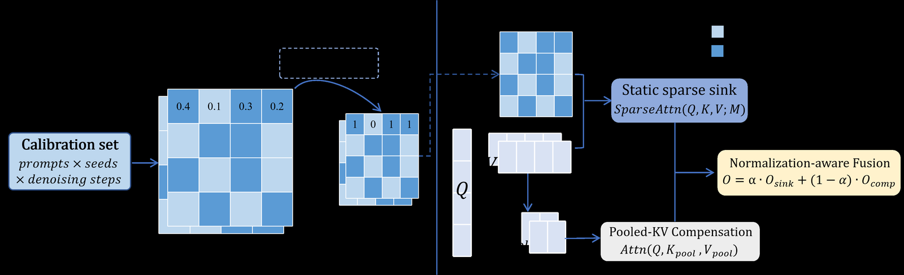
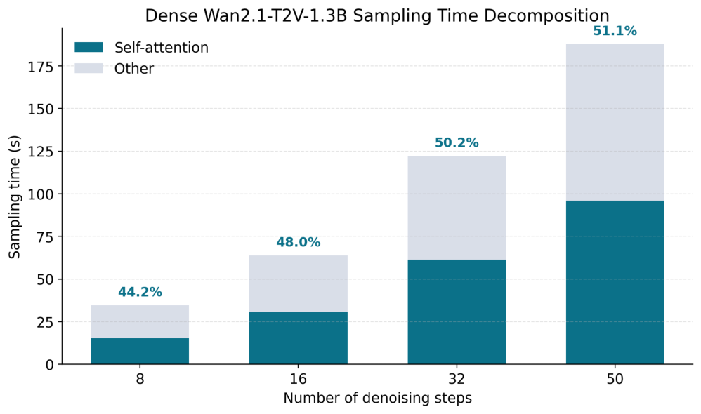
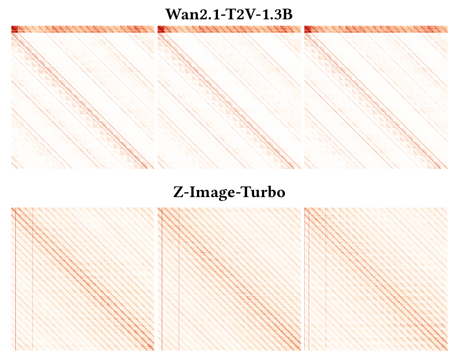
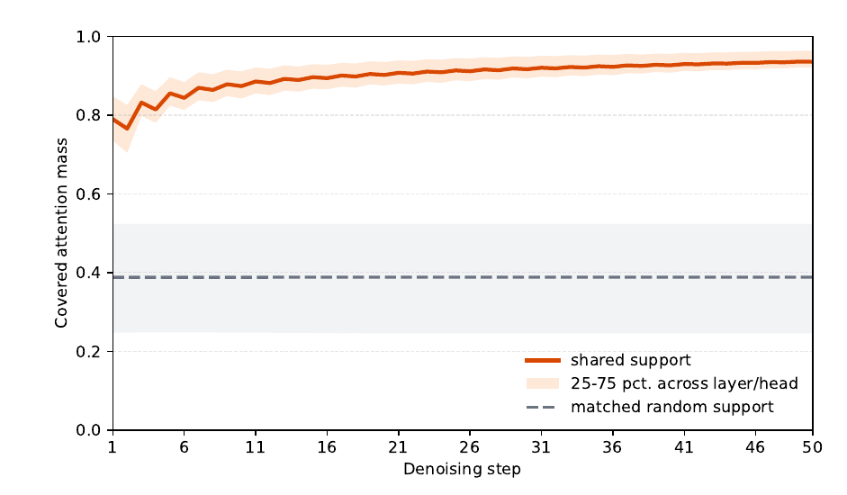
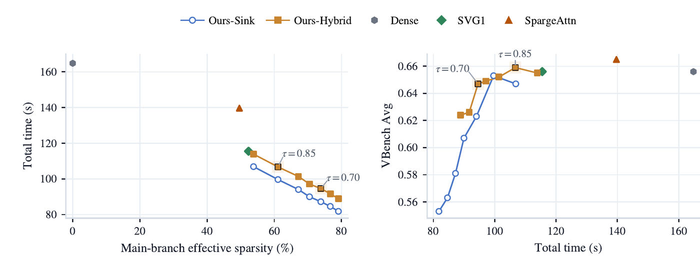
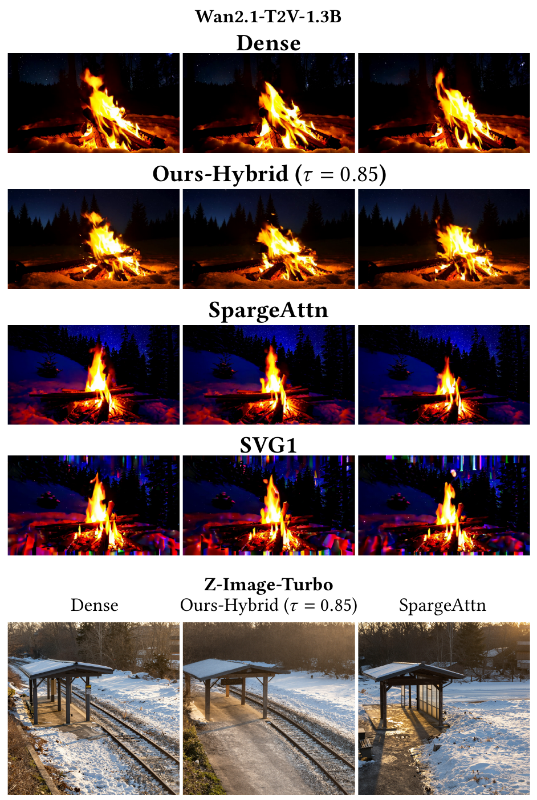

# Sink-Sparse Hybrid Attention for Efficient Inference in T2I/T2V Diffusion Transformers

**论文**: [arXiv:2610.22975v1](https://arxiv.org/abs/2610.22975)（cs.CV，2026-10-16，12 页，含参考文献）
**作者**: Bingxin Xing\*, Yu Zhang\*, Jiatong Ding, Lei Lu, Ping Wang† —— 西安交通大学、厦门大学、上海交通大学（\* 共同一作，† 通讯）
**代码**: PDF 和 HTML 版都没有代码链接；block size、稀疏 kernel 也没写，目前无法复现 `[待补]`

---

## 1. 一句话定位

**免训练的静态块稀疏注意力。** 先在少量 dense 推理上离线统计每个 (layer, head) 的块级注意力质量，选出一张固定 mask，之后所有 prompt、所有去噪步都用它。另加一条"全分辨率 Q × 均值池化 KV"的粗分支，补回被 mask 丢掉的上下文。标定只用 4 个 prompt × 2 个 seed 的完整 50 步轨迹，推理时不做任何在线选块。

| Wan2.1-T2V-1.3B，832×480，81 帧，50 步，A800（Table 1） | Dense | SVG1 | SpargeAttn | 本文 τ = 0.70 | 本文 τ = 0.85 |
|---|---|---|---|---|---|
| 端到端时间（s） | 164.80 | 115.49 | 139.68 | **94.57** | 106.73 |
| 加速 | 1.00× | 1.43× | 1.18× | **1.74×** | 1.54× |
| VBench 8 维均值 | 0.656 | 0.656 | **0.665** | 0.647 | 0.659 |
| 主分支稀疏度（从图 6 读的） | 0 | 52.3% | 49.6% | 73.9% | 61.1% |

| Z-Image-Turbo，2048×2048，8 步（Table 2） | Dense | SpargeAttn | 本文 τ = 0.85 |
|---|---|---|---|
| 时间（s）/ 加速 | 23.39 / 1.00× | 15.92 / 1.47× | **14.88 / 1.57×** |
| Soft-TIFA GM / AM | **16.38 / 67.80** | 15.07 / 66.88 | 15.21 / 66.48 |

🔴 **读完全文后我认为要打四个折扣**：
1. **质量证据只有 VBench 8 维均值，而这个指标在这里分不出好坏。**
   - 两个稀疏基线都不低于 dense（SpargeAttn 0.665、SVG1 0.656，dense 0.656）。但 Fig 5 里 SVG1 三帧的顶部和底部都是彩色竖条，SpargeAttn 整体偏蓝。
   - 本文 τ = 0.85 赢 SVG1（0.659 vs 0.656），全部来自 Dynamic Degree（0.931 vs 0.819）。去掉这一维重算 7 维均值：SpargeAttn 0.642 > SVG1 0.633 > dense 0.627 > 本文 τ = 0.85 0.620 > 本文 τ = 0.70 0.616（我算的）。
   - 没有任何对 dense 输出的保真度指标（PSNR / SSIM / LPIPS）。Fig 5 里本文的视频和 dense 构图不一样（镜头更远、多出一排树），它生成的是"另一个合理的视频"，不是"同一个视频算得更快"。
   - VBench 用了多少 prompt、几个 seed，没写。均值在 τ 上也不单调（Sink-only 从 τ = 0.85 的 0.653 降到 τ = 0.90 的 0.647），千分位上的差距应当看成噪声。
2. **混合分支的融合公式把保留区域算了两次。** 粗分支对**整条序列**的池化 key 做 attention，包括稀疏分支里已经精确算过的块；融合用的却是"两份不相交 key 集合合并"的 LSE 公式。池化近似较好的行上 `α ≈ c/(1+c) ≤ 0.5`（`c` 是稀疏分支覆盖的质量），粗分支反而拿到一半以上的权重。论文说的"保留支撑足够时稀疏分支占主导"并不由公式保证，见 [§3.3](#33--融合公式实际在做什么)。
3. **加速天花板和图 1 对不上；混合分支的收益按时间对齐后变小。**
   - 图 1 里 dense 50 步约 187 s、注意力占 51.1%（从图上读的），表 1 的 dense 却是 164.80 s。用图 6 的 7 个 Sink-only 点拟合：耗时 = 61.35 s + 98.59 s × 块密度，最大残差 0.47 s。也就是说评测那套实现里非注意力部分约 61 s，注意力约占 63%，只加速注意力的上限约 2.7×（我算的）。
   - 表 4 的 ΔAvg（+0.006 到 +0.071）是同 τ 比较，但混合分支在每个 τ 上都多花 7.0–7.4 s。按端到端时间对齐后，差距缩到 −0.002 到 +0.020，100 s 左右两者持平（我按表 4 插值算的）。
4. **复现信息缺得多，也没有代码。** block size `b`、稀疏 kernel、FlashAttention 版本、两个基线的超参、VBench 和 GenEval2 的 prompt 数都没写。Wan 81 帧 832×480 有 32,760 个 token（我按 Wan2.1 的 VAE 步长和 patch 算的），不能被 64 或 128 整除，块怎么切不清楚。

📌 **站得住的部分**：
- **"块级注意力质量跨 prompt、seed、步数都稳定"有实证。** 一张 38.8% 密度的静态 mask 在留出样本上平均覆盖 90% 的 dense 注意力质量；第 2 步最低（0.77），之后逐步升到第 50 步的 0.94（Fig 3，我从 PDF 矢量数据读的）。这支持"离线标定一次、反复用"的做法。
- **稀疏度相近时，静态 mask 比 SVG1 快。** Sink-only（τ = 0.90，稀疏度 53.8%）106.88 s，SVG1（52.3%）115.49 s。差距来自在线 profiling 还是 SVG1 的 dense 预热，论文没拆开。
- **耗时与块密度几乎严格线性，选 τ 时能直接预测速度。** 标定量也小，而且很快饱和：2×2 条轨迹已到 0.645，4×4 是 0.650，8×4 不再提升。

---

## 2. 要解决的问题

**免训练稀疏注意力要在两种做法之间二选一。** 一种是固定的局部布局，例如 STA 的滑动 tile、SVG 的空间头 / 时间头，便宜但僵硬，长程依赖不一定落在固定邻域里。另一种是在线选块，例如 SVG2 的语义重排、AdaSpa、SpargeAttn、XAttention，灵活，但每次调用都要重新找一遍模式，有在线开销。

本文的问题是：能不能用很小的离线标定集，找出每个 (layer, head) 跨 prompt、跨 seed、跨去噪步都有用的块交互，做成一张静态 mask 反复用，在线开销接近零？

**和前作的边界**：
- "sink" 这个名字借自 LLM 的 attention sink（StreamingLLM），但这里指的是每个 (layer, head) 的一组块级支撑，不是某几个 token。
- "按 head 离线做决定"在 LLM 里有 DuoAttention（离线区分 retrieval head 和 streaming head，本文引了）。仓库里的 [Veda](../veda/analysis.md) 也是每个 (layer, head) 离线选 tile 形状，但具体选哪些块仍在线由打分器决定。
- 本文的增量是：用 dense 注意力的**精确块质量**离线定出每个 (layer, head) 的整张 mask，所有步共用；再加一条池化 KV 的粗分支补偿。

---

## 3. 方法

> **Fig 4 读法**：
> - **左（Stage A）**：标定集（prompt × seed × 去噪步）上跑 dense attention，把 token 级注意力概率聚合成块级质量矩阵，再在多次观测上取平均；每一行按覆盖阈值 τ 选块，得到每个 (layer, head) 一张 0/1 mask。
> - **右（Stage B）**：每个去噪步都复用这张 mask 做块稀疏 attention（`O_sink`）；同时把 K、V 均值池化，用全分辨率 Q 做一次 dense attention（`O_comp`）；两路按 `α` 加权相加。

### 3.1 离线标定：精确块质量 + 逐行 top-p

对标定集里的每次观测 `u`（某个 prompt–seed 对的某一步），先算 dense 的 token 级 softmax 概率 `A`，把序列按原始顺序切成 `B` 个长度为 `b` 的连续块（不做任何重排），聚合成块级质量，再在标定集上平均（Eq 3–4）：

$$
m^{(l,h)}_{r,c,u}=\frac{1}{|\mathcal{B}_r|}\sum_{i\in\mathcal{B}_r}\sum_{j\in\mathcal{B}_c}\left[A^{(l,h)}_u\right]_{ij},\qquad \bar m^{(l,h)}_{r,c}=\frac{1}{|\mathcal{C}|}\sum_{u\in\mathcal{C}}m^{(l,h)}_{r,c,u}
$$

每个 query 块这一行的质量之和为 1。每行把 key 块按平均质量从大到小排序，保留累计质量刚好达到 τ 的最短前缀（Algorithm 1）：

$$
M^{(l,h)}_{r,\pi_r[1:k_r]}=1,\qquad k_r=\min\left\lbrace k:\sum_{t=1}^{k}\bar m^{(l,h)}_{r,\pi_r[t]}\ge\tau\right\rbrace
$$

- **一张 mask 管所有步**：标定时把 50 步的统计合在一起（论文叫 shared-step mask），推理时每一步都用同一张。不同 backbone 分别标定。
- **规模**：Wan2.1-1.3B 有 30 层 × 12 头，即 360 张 mask。81 帧 832×480 的视频有 21 × 30 × 52 = 32,760 个 token（按本地 Wan2.1 配置 `vae_stride = (4, 8, 8)`、`patch_size = (1, 2, 2)` 我算的）。
- ⚠️ **标定成本被低估**：Algorithm 1 要显式算出每个 head 的完整 softmax 概率矩阵，Wan 这个尺寸下是 32,760² ≈ 1.07 × 10⁹ 个元素 / head / 步。FlashAttention 不返回概率，所以标定需要单独实现。Table 3 的"22 分钟"只是 dense 推理时间 × 8 条轨迹，不含这部分 `[待补]`。

### 3.2 在线推理：静态稀疏分支 + 池化 KV 粗分支

- **稀疏分支（Ours-Sink）**：只在 mask 保留的块对上做块稀疏 attention，输出 `O_sink` 和每行的 log-sum-exp `ℓ_sink`。
- **粗分支**：K、V 沿展平后的序列做不重叠均值池化，间隔 `g = 30`（Wan 上剩 1,092 个池化 key，我算的）；全分辨率的 Q 对它们做一次 dense attention，输出 `O_comp` 和 `ℓ_comp`。
- **融合（Ours-Hybrid，Eq 5–6）**：

$$
\alpha_i=\frac{\exp(\ell_{\mathrm{sink},i})}{\exp(\ell_{\mathrm{sink},i})+\exp(\ell_{\mathrm{comp},i}+\log g)},\qquad O_i=\alpha_i\,O_{\mathrm{sink},i}+(1-\alpha_i)\,O_{\mathrm{comp},i}
$$

  `log g` 让每个池化 key 按 `g` 个 token 计数，论文称之为"支撑大小修正"。
- **复杂度（Eq 7）**：

$$
\mathcal{C}^{(l,h)}_{\mathrm{hyb}}=O\left(\left(\rho^{(l,h)}+g^{-1}\right)N^2\right)
$$

  `ρ` 是 mask 的 token 级密度。粗分支的计算量是 dense 的 1/30；实测它让每次生成多花 7.0–7.4 s，约为 dense 时间的 4.3%（我按表 4 算的）。

### 3.3 📌 融合公式实际在做什么

**Eq 5 的形式就是 FlashAttention / FlashDecoding 合并 split-KV 部分结果的 LSE 公式。** 对两份**不相交**的 key 集合，按 `exp(ℓ)` 加权合并两路输出，结果恰好等于对并集做 attention。但这里粗分支的 key 是**整条序列**的池化，和稀疏分支保留的块是重叠的。

记第 `i` 行保留块上的配分函数为 `Z_R`，全部 key 上为 `Z`，覆盖率 `c = Z_R / Z`。`exp(ℓ_sink) = Z_R`；粗分支给出的 `Ẑ = g Σ_p exp(q·k̄_p/√d)`，由 Jensen 不等式 `Ẑ ≤ Z`，块内 key 越相近越接近 `Z`：

$$
\alpha_i=\frac{Z_R}{Z_R+\hat Z}\ \xrightarrow{\ \hat Z\to Z\ }\ \frac{c}{1+c}\le\frac12
$$

在 `Ẑ ≈ Z`、粗分支输出 `Õ` 近似准确时，合并结果可以展开成：

$$
O_i\approx\frac{Z_R\,O_R+Z_R\,\tilde O_R+Z_{\bar R}\,\tilde O_{\bar R}}{2Z_R+Z_{\bar R}}
$$

- **保留区域被算了两次**：一次精确（`O_R`），一次粗略（`Õ_R`）。保留区域的有效权重是 `2c/(1+c)`，被丢区域是 `(1−c)/(1+c)`，真实值分别是 `c` 和 `1−c`。按 Fig 3 的平均覆盖率 0.90 算，`α ≈ 0.47`，被丢区域只拿回 0.053 的权重，真实是 0.10（我算的）。
- **谁占主导由注意力的尖锐程度决定，不由覆盖率决定**：注意力越尖，池化越压低峰值，`Ẑ` 远小于 `Z`，`α` 才接近 1。论文说"保留支撑足够时稀疏分支占主导"，公式本身并不保证这一点。
- **我在合成数据上验算过这个关系**（N = 3,840，b = 64，g = 30，逐行 top-p，τ = 0.85）：注意力较平时 `α` 均值 0.464，`c/(1+c)` 为 0.460；注意力变尖后 `α` 升到 0.85。这只验证代数关系，不代表真实 DiT 的行为。
- **对照 Sol-Attn 的补偿**：按 Miowtion 对 Sol-Attn 的封装（[`sol.py`](https://github.com/veda-sparse/Miowtion/blob/ffbb4c29d9b1f19f026dec0c0485840fffe4639f/miowtion/kernels/sol.py#L1)），它只给**没选中的块**补项，和精确块放进同一个 softmax，两部分不相交，没有重复计数：

$$
O_i^{\mathrm{Sol}}=\frac{\sum_{j\in R}e^{s_{ij}}v_j+\sum_{b\notin R}e^{\bar s_{ib}}\sum_{j\in b}v_j}{\sum_{j\in R}e^{s_{ij}}+\sum_{b\notin R}n_b\,e^{\bar s_{ib}}},\qquad \bar s_{ib}=\frac{q_i\cdot\bar k_b}{\sqrt d}
$$

- 本文的版本在 Wan 上仍然有用（表 4 每个 τ 都更高），但"粗分支去掉保留块"的不重叠版本没有试过。

---

## 4. 实验设置

| 项 | 设置 |
|---|---|
| T2V | Wan2.1-T2V-1.3B，832×480，81 帧，50 步；VBench-1.0 的 8 维（Subject Consistency、Motion Smoothness、Dynamic Degree、Background Consistency、Scene、Aesthetic、Imaging Quality、Overall Consistency）取均值 |
| T2I | Z-Image-Turbo，2048×2048，8 步；GenEval2 的 VQA 协议，主指标 Soft-TIFA GM，辅指标 Soft-TIFA AM |
| 硬件与计时 | 单卡 A800-SXM4-80GB；端到端时间，不含模型初始化和写文件 |
| 标定 | 4 个 prompt × 2 个 seed，每条轨迹统计全部去噪步；与评测集不重叠；Z-Image 单独标定一套 mask；`g = 30` |
| 实现 | Dense 用 FlashAttention（版本未写）；T2V 的所有方法共用 SVG1 代码库里的 QK-norm 和 RoPE 实现 |
| 基线 | T2V：Dense、SVG1、SpargeAttn；T2I：Dense、SpargeAttn |
| 没有报告的 | block size `b`；稀疏分支用的 kernel；基线超参（SVG1 的 dense 预热步数和层数、SpargeAttn 的阈值）；VBench 与 GenEval2 的 prompt 数和 seed 数；对 dense 的 PSNR / SSIM / LPIPS；T2I 的 τ 扫描、Sink-only 对照和标定量；CFG 的条件 / 无条件两路是否共用 mask；Z-Image 单流序列里文本 token 是否参与分块、prompt 长度变化时块边界怎么对齐；显存；代码 |

---

## 5. 结果

### 5.1 注意力占多少时间（Fig 1）

> **Fig 1 读法**：dense Wan2.1-T2V-1.3B 在 8、16、32、50 步下的采样时间，深色是 self-attention，浅色是其余部分。注意力占比依次是 44.2%、48.0%、50.2%、51.1%。从图上读，四根柱子的总高约 34、64、122、187 s。

⚠️ **这张图和表 1 不是同一套实现。** 图注说这是"评测设定"下的分解，但 50 步的 dense 总时长约 187 s，表 1 的 dense 是 164.80 s，差了约 23 s。按图 6 的拟合（§5.4），评测那套实现里非注意力部分约 61 s，图 1 里约 92 s。差额大概来自表 1 换用的 SVG1 版 QK-norm 和 RoPE（这是我的推测）。所以图 1 的 51% 低估了评测环境里的注意力占比（约 63%），只加速注意力的上限是约 2.7×，不是约 2×。本文 1.54–1.74× 的加速约为这个上限的 57%–65%（我算的）。

### 5.2 注意力结构跨 prompt 稳定（Fig 2、Fig 3）

> **Fig 2 读法**：
> - **上（Wan2.1-T2V-1.3B）**：同一层同一个 head 在三个 prompt 下的 dense 注意力图。共同结构有三种：主对角带；与主对角平行、间距固定的条纹（按 Wan 帧优先的展平顺序，应是不同帧同一空间位置之间的对应）；顶部一条横带。图里没标坐标轴，看不出这条横带代表一组 query 还是一组 key。
> - **下（Z-Image-Turbo）**：密集的平行斜纹（应是二维网格上相邻行之间的对应），左侧还有两条竖线。三个 prompt 之间肉眼几乎看不出差别。
>
> 从 HTML 版的原图文件名（`wanx_pure_heatmap_s01_l04_h03`、`zimg_pure_heatmap_s03_l23_h01`）看，展示的分别是某一层的某一个 head；为什么选这个 head，论文没说。

> **Fig 3 读法**：一张平均块密度 38.8%（稀疏度 61.2%）的 mask，在留出样本上每一步覆盖了多少 dense 注意力质量。橙线是所有 (layer, head) 的均值，浅橙带是 25%–75% 分位。
> - 我从 PDF 矢量数据读出：第 1 步 0.790，第 2 步 0.766（最低），第 10 步 0.874，第 50 步 0.936；50 步平均 0.900，第 11 步以后平均 0.916；分位带范围 0.705–0.963。
> - 这张 mask 的密度和图 6 里 τ = 0.85 那组一致（我从图 6 读出 τ = 0.85 的稀疏度是 61.1%）。
> - ⚠️ 作为对照的"同预算随机 mask"是一条完全水平的线，50 步都是 0.388，正好等于 mask 密度 38.8%，旁边的灰带（0.246–0.524）也不随步数变。所以它是按密度算出来的期望值，不是实测。随机 mask 本来就是最弱的对照；更有信息量的两个对照，"每个输入自己的 oracle top-p（上限）"和"同密度的局部窗口"，都没给。
> - 留出样本有多少条，没写。

### 5.3 主结果（Table 1、Table 2）

**Table 1（Wan2.1-T2V-1.3B，speedup 相对 164.80 s 的 dense）**：

| 方法 | 时间（s） | 加速 | SubCons | MotSm | DynDeg | BgCons | Scene | Aesth | ImgQual | OverCons | 8 维均值 | 去掉 DynDeg 的 7 维均值（我算的） |
|---|---|---|---|---|---|---|---|---|---|---|---|---|
| Dense | 164.80 | 1.00× | 0.894 | 0.972 | 0.861 | 0.941 | 0.145 | 0.588 | 0.614 | 0.235 | 0.656 | 0.627 |
| SVG1 | 115.49 | 1.43× | 0.941 | 0.970 | 0.819 | 0.950 | 0.126 | 0.565 | 0.652 | 0.224 | 0.656 | 0.633 |
| SpargeAttn | 139.68 | 1.18× | 0.930 | 0.954 | 0.833 | 0.961 | 0.154 | 0.608 | 0.676 | 0.208 | 0.665 | **0.642** |
| 本文 τ = 0.70 | **94.57** | **1.74×** | 0.864 | 0.967 | 0.858 | 0.927 | 0.137 | 0.568 | 0.619 | 0.233 | 0.647 | 0.616 |
| 本文 τ = 0.85 | 106.73 | 1.54× | 0.871 | **0.976** | **0.931** | 0.933 | 0.148 | 0.566 | 0.615 | 0.233 | 0.659 | 0.620 |

- 论文的读法是：τ = 0.85 比 SVG1 均值略高且更快，比 SpargeAttn 均值略低但快得多。
- ⚠️ 我的读法：
  - 两个基线的 Subject Consistency、Background Consistency 都**高于** dense，Dynamic Degree 低于 dense，即运动更少、画面更"稳"。本文正相反：一致性低于 dense，Dynamic Degree 反而高 0.07。
  - 8 维均值的排名几乎完全由 Dynamic Degree 决定。不看这一维，本文两个设定都排在 dense 和两个基线之后。
  - 这张表能说明的只是"VBench 意义上没明显变差"，说明不了"和 dense 一样"。

**Table 2（Z-Image-Turbo，2048×2048，8 步）**：

| 方法 | Soft-TIFA AM ↑ | Soft-TIFA GM ↑ | 时间（s） | 加速 |
|---|---|---|---|---|
| Dense | **67.80** | **16.38** | 23.39 | 1.00× |
| SpargeAttn | 66.88 | 15.07 | 15.92 | 1.47× |
| 本文 τ = 0.85 | 66.48 | 15.21 | **14.88** | **1.57×** |

- 两种稀疏方法都有可见的下降：本文的 GM 相对 dense 低 7.1%，AM 低 1.9%；SpargeAttn 分别低 8.0%、1.4%（我算的）。论文用的词是"competitive"，指的是和 SpargeAttn 比。
- T2I 只有这一组设定，没有 τ 扫描、Sink-only 对照和标定量消融。

### 5.4 稀疏度、速度、质量（Fig 6、Table 4）

> **Fig 6 读法**：
> - **左**：横轴是主分支有效稀疏度，纵轴是端到端时间。蓝圈是 Sink-only，橙方块是 Hybrid，各 7 个点对应 τ = 0.60 到 0.90；灰点是 dense，绿菱形是 SVG1，三角是 SpargeAttn。Hybrid 每个点都比同 τ 的 Sink-only 高约 7 s。
> - **右**：横轴是时间，纵轴是 VBench 8 维均值。Hybrid 在 τ = 0.85 达到最高，τ = 0.70 是"速度优先"点。

我从 PDF 的矢量标记读出每个点的稀疏度（τ = 0.60 读出 79.09%，与正文给的数字完全一致），和 Table 4 合在一起：

| τ | 主分支稀疏度（读图） | Sink 时间 | Sink 均值 | Hybrid 时间 | Hybrid 均值 | 同 τ 的 ΔAvg（论文） | 按时间对齐的差（我算的） |
|---|---|---|---|---|---|---|---|
| 0.60 | 79.1% | 81.82 | 0.553 | 88.88 | 0.624 | +0.071 | — |
| 0.65 | 76.7% | 84.60 | 0.563 | 91.69 | 0.626 | +0.063 | — |
| 0.70 | 73.9% | 87.22 | 0.581 | 94.57 | 0.647 | +0.066 | — |
| 0.75 | 70.5% | 89.98 | 0.607 | 97.12 | 0.649 | +0.042 | +0.018（89.98 s） |
| 0.80 | 67.2% | 94.04 | 0.623 | 101.37 | 0.652 | +0.029 | +0.020（94.04 s） |
| 0.85 | 61.1% | 99.64 | 0.653 | 106.73 | 0.659 | +0.006 | −0.002（99.64 s） |
| 0.90 | 53.8% | 106.88 | 0.647 | 113.89 | 0.655 | +0.008 | +0.012（106.88 s） |

- **"按时间对齐的差"**：在 Sink-only 某个点的耗时上，对 Hybrid 曲线做线性插值，再与 Sink-only 相减。τ ≤ 0.70 的 Sink 点比所有 Hybrid 点都快，没法对齐。
- **结论**：Hybrid 每个 τ 都更好，但它也更贵。花同样的时间，它只高 0 到 0.02；100 s 左右，把 Sink-only 的 τ 调到 0.85 一样能拿到 0.653。
- **速度模型**：Sink-only 7 个点的耗时 = 61.35 s + 98.59 s × 块密度，最大残差 0.47 s；外推到全密度为 159.94 s，接近 dense 的 164.80 s（我算的）。Hybrid 的同一拟合截距是 68.62 s。
- **和基线同稀疏度比**：SVG1 52.3%、115.49 s、0.656；本文 Hybrid τ = 0.90 是 53.8%、113.89 s、0.655，两者基本一样。本文的优势只在把稀疏度推到 61% 以上之后出现。

### 5.5 标定量（Table 3）

| 标定量（prompt × seed） | 时间（s） | 离线标定成本（估算） | VBench 8 维均值 |
|---|---|---|---|
| 2 × 2 | 92.84 | 11.0 min | 0.645 |
| 4 × 2（默认） | 94.57 | 22.0 min | 0.647 |
| 4 × 4 | 93.71 | 43.9 min | 0.650 |
| 8 × 4 | 94.18 | 87.9 min | 0.649 |

- 全部是 Hybrid、τ = 0.70。成本按"条数 × 164.80 s"估算，不含显式算 softmax 概率的开销（见 §3.1）。
- 0.645 到 0.650 的差距和 §5.4 里 τ 非单调所反映的噪声（约 0.006）同量级，所以"标定越多越好"在这里看不出来。能说的是：4 个 prompt 以内就够了。
- 论文说"运行时间几乎不随标定量变"，但同一个 τ 下耗时还是在 92.84–94.57 s 之间变，说明不同标定集选出的 mask 密度略有不同。

### 5.6 定性对比（Fig 5）

> **Fig 5 读法**：
> - **上（Wan）**：prompt 是"雪林夜晚的篝火，背景是星空"，同一个 seed，第 16、40、64 帧，四行依次是 Dense、本文 τ = 0.85、SpargeAttn、SVG1。
>   - Dense 是篝火近景，背景几乎全黑。
>   - 本文画面干净，但构图明显不同：镜头更远，多出一排松树剪影。
>   - SpargeAttn 整体偏蓝紫。
>   - SVG1 每帧顶部和底部都有彩色竖条状伪影。
> - **下（Z-Image）**：prompt 是"黄金时刻的冬日车站"，三张分别是 Dense、本文、SpargeAttn。三张都合理，但视角和构图各不相同。
>
> 论文的读法是"本文在整体结构与外观上更接近 dense"。我的读法是本文最干净，但"接近 dense"并不成立：三种方法都改变了构图。SVG1 那种竖条伪影很像配置或实现问题，不像是 SVG1 方法本身该有的结果，可基线超参全文没写 `[待补]`。

---

## 6. 数字核对

| 说法 | 复算 | 结论 |
|---|---|---|
| 1.43× / 1.18× / 1.74× / 1.54× | 164.80 ÷ 115.49 = 1.427；÷ 139.68 = 1.180；÷ 94.57 = 1.743；÷ 106.73 = 1.544 | ✅ |
| T2I 1.47× / 1.57× | 23.39 ÷ 15.92 = 1.469；÷ 14.88 = 1.572 | ✅ |
| Table 1 的 8 维均值 | 按表中三位小数重算：0.6562、0.6559、0.6655、0.6466、0.6591 | ✅（表注说明均值按未取整的分数算） |
| Sink-only τ = 0.60 为 2.01× | 164.80 ÷ 81.82 = 2.014 | ✅ |
| Table 4 的 ΔAvg | 0.624 − 0.553 = 0.071，… ，0.655 − 0.647 = 0.008 | ✅（7 行全对） |
| Table 3 的标定成本 | 4 / 8 / 16 / 32 条 × 164.80 s = 11.0 / 22.0 / 43.9 / 87.9 min | ✅ |
| 图 1 是"评测设定"下的分解 | 50 步 dense 总时长从图上读约 187 s，表 1 为 164.80 s | ⚠️ 对不上 |
| Fig 3 的 mask 密度 38.8% | 随机对照线恒为 0.388；τ = 0.85 读图稀疏度 61.1% | ✅ 一致 |
| 图 6 的 τ = 0.60 稀疏度 79.09% | 由矢量标记位置按坐标轴换算，得 79.09% | ✅ |

---

## 7. 争议与权衡

**① 评测证据配不上"保持生成质量"的说法。** VBench 8 维均值在这里分不出好坏：两个看得见伪影的基线不低于 dense，排名由 Dynamic Degree 一维决定。稀疏注意力的论文通常会报对 dense 的 PSNR / SSIM / LPIPS，这篇没有。Fig 5 也说明它改变了生成内容，不是"同一视频更快"。

**② 融合公式在原理上有偏，但实测仍然有效。** 粗分支覆盖全序列、按不相交集合的公式合并，保留区域被算两次，粗分支在平滑的行上拿到约一半权重（§3.3）。Table 4 显示它在激进稀疏时确实有用，可能是因为粗略但完整的全局信息比"直接丢掉"强。一个不重叠的版本（粗分支去掉保留块，或像 Sol-Attn 那样只补没选中的块）理论上更干净，作者没有试。

**③ 静态 mask 绑定在 token 布局上。** mask 定义在展平序列的块网格上，换分辨率或帧数后 N 和块布局都变了，原来的 mask 用不了。论文每个模型只测了一个尺寸，局限性一节也没提这一点（这是我的推断）。实际部署时，每个 (分辨率, 帧数) 组合都要单独标定一次。

**④ 对分布外 prompt 的稳健性没测。** 论文自己承认静态 mask 可能不适应分布偏移或少见 prompt。标定 prompt 和评测 prompt 不重叠，但都来自什么分布、和 VBench prompt 有多像，没写。

**⑤ 基线的公平性存疑。** 所有 T2V 方法共用 SVG1 版的 QK-norm 和 RoPE，Dense 用 FlashAttention（版本未写）；SVG1 在 Fig 5 里有明显伪影；两个基线的超参全文没写。同稀疏度下本文 Hybrid 和 SVG1 的时间、质量几乎一样（§5.4）。

**⑥ 适用面窄。** 只有 Wan2.1-1.3B（一个分辨率）和 Z-Image-Turbo（一个分辨率）。没测 14B 这种更大的模型，没测更长的视频，也没测 mask 能不能跨模型迁移；论文局限性一节也承认了后几点。

---

## 8. 一句话总结

**这篇把"注意力块结构跨输入稳定"做成了一个零在线开销的静态块稀疏方案：8 条 dense 轨迹定出每个 (layer, head) 的 mask，38.8% 密度时平均覆盖 90% 的注意力质量，Wan2.1-1.3B 上端到端 1.54–1.74×。但质量只用 VBench 均值衡量，而这个指标分不出好坏；混合分支的融合公式把保留区域算了两次；图 1 的耗时分解和表 1 也对不上。观察可信，结论偏弱。**

---

## 9. 在仓库图谱里的位置

| | 关系 |
|---|---|
| **[Veda](../veda/analysis.md)** | 📌 **同一问题的两端**。Veda 训一个打分器，每次调用在线逐 tile 选块；本篇完全不在线选，用 dense 轨迹离线统计精确块质量，得到一张所有步、所有 prompt 共用的 mask。两篇的依据都是 dense 注意力本身：Veda 取 tile 内的最大概率来训打分器，本篇取块内的概率质量直接定 mask；两篇也都拿 SpargeAttn 做对照。补偿方式上，本篇的粗分支覆盖全序列、与稀疏分支重叠，Veda 仓库里自测更好的 Sol-Attn 只补没选中的块 |
| **[HetA-DiT](../heta_dit/analysis.md)** | "全局信息怎么给"的又一种答案：本篇让每个 query 都走两路，一路是精确的静态块稀疏，一路是全序列池化 KV 的近似；HetA 让 80% 的 token 只走局部。本篇免训练，HetA 需要两阶段微调 |
| [Vidu S2](../../video_generation/vidu_s2/analysis.md) | 工业侧按层灵敏度混用 SageAttention / SpargeAttn / SLA；SpargeAttn 正是本篇的主要对照 |
| [TeaCache](../teacache/analysis.md) | 正交的另一条免训练路线：跨步缓存，省的是"算不算这一步"；本篇省的是"每一步里注意力算多少" |

⚠️ **仓库缺口**：SVG / SVG2、SpargeAttn、STA、XAttention、DiTFastAttn、Sol-Attn 都还没有笔记。

---

## Q&A

**Q: 这篇的稀疏方式和我在用的 Sol-Attn 有什么不同？能不能拿来给我们的 Wan / H3 游戏资产生成提速？**

A: **差别在"什么时候选块"和"怎么补丢掉的部分"。可以试，但要按自己的分辨率和 prompt 重新标定，补偿方式最好换成 Sol 那种只补没选中块的写法。**

| | 本篇（Sink-Sparse Hybrid） | Sol-Attn（按 Miowtion 的封装） |
|---|---|---|
| 什么时候选块 | 离线一次，所有步、所有 prompt 共用 | 每次调用、每个 head 在线选 |
| 选块依据 | 标定集上 dense 的精确块质量平均 | 当前输入的代理分数（query 块均值 · key 块均值） |
| 每行保留多少 | 累计质量达到 τ 的最少块（top-p） | 代理分数超过 `μ + τσ` 的块，数目由激活决定 |
| 丢掉的部分 | 全序列池化 KV 的粗分支，和稀疏分支重叠，按 LSE 合并 | 只给没选中的块补一项，和精确块在同一个 softmax 里 |
| 在线额外开销 | 粗分支约 1/30 的 dense 计算 | 代理分数约 1/64 的 dense 计算，再加补偿项 |
| 输入自适应 | 没有 | 有 |

真要用到我们的场景，建议按这个顺序：
1. **每个 (分辨率, 帧数) 组合单独标定**：mask 绑定在 token 布局上，换尺寸就失效（§7 ③）。
2. **用我们自己的 prompt 标定**：角色、道具、场景各取几条，跑几条完整轨迹。论文显示 4 个 prompt × 2 个 seed 就饱和了，成本不高。
3. **评测要对 dense 做保真度对比**：固定 seed 算 PSNR / LPIPS，再看资产本身的指标，不要只看 VBench 均值。
4. **一个值得试的组合**（我的建议，没人测过）：用本篇的静态 mask 代替 Sol 的在线代理分数做路由，省掉选块开销；保留 Sol 只补没选中块的补偿方式，避开 §3.3 的重复计数。

---
