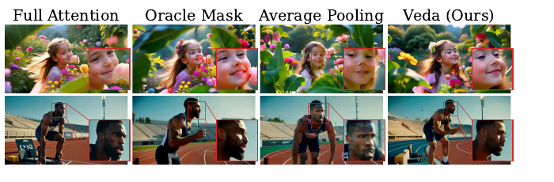
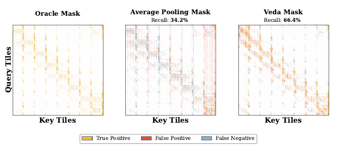
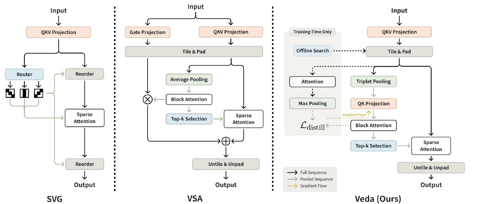
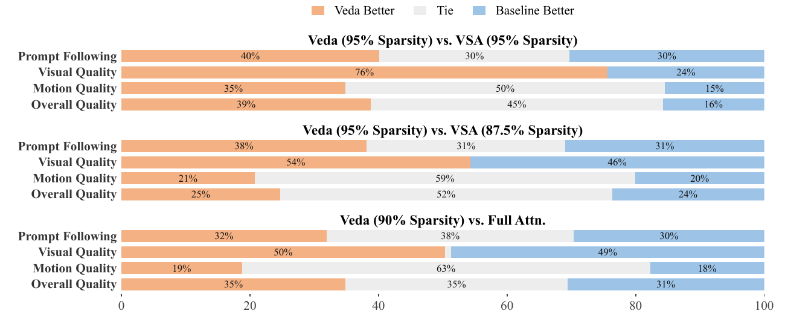
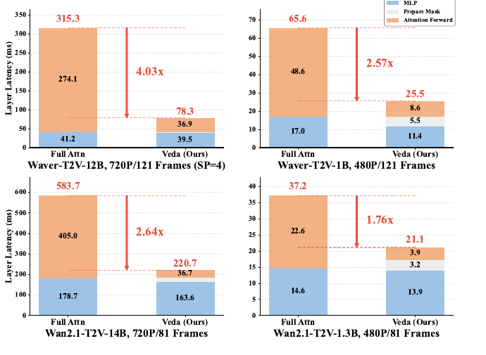
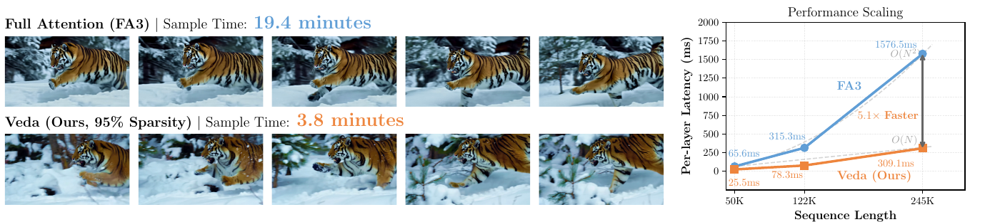

# Veda: Scalable Video Diffusion via Distilled Sparse Attention

**论文**: [arXiv:2605.30325v1](https://arxiv.org/abs/2605.30325)（cs.CV，2026-05-28，17 页：正文 9 页 + 附录 A–D），**ICML 2026**（PMLR 306）
**作者**: Shihao Han\*、Hao Yang†、Xiaofeng Mei、Xinting Hu、Yi Jiang、Xiaojuan Qi —— **字节跳动 + 港大 + 中科大**（\* 字节实习期间完成，† project lead；通讯作者 Xinting Hu、Xiaojuan Qi）
**论文实验的底座**: Waver-T2V 1B / 12B（字节自家的 MM-DiT）、Wan2.1-T2V 1.3B / 14B
**项目页**: [veda-sparse.github.io](https://veda-sparse.github.io/)
**代码**: 官方组织 [`veda-sparse`](https://github.com/veda-sparse) 发布了两个仓库，**都只针对 MiniMax-H3（33B 音视频 DiT），论文里 Waver / Wan 的代码没有发布**：
- [Miowtion](https://github.com/veda-sparse/Miowtion)（MIT，项目页的 "Code" 指向它）：H3 上的 Veda 训练与推理全流程
- [Veda-on-ComfyUI](https://github.com/veda-sparse/Veda-on-ComfyUI)（MIT）：ComfyUI 推理插件

predictor 权重在 HF [`Veda-Sparse`](https://huggingface.co/Veda-Sparse)，继承 MiniMax H3 Community License。代码逐行解读见 code_read：[miowtion](../../../Code/inference_acceleration/miowtion/analysis.md)、[veda_on_comfyui](../../../Code/inference_acceleration/veda_on_comfyui/analysis.md)。

---

## 1. 一句话定位

**Veda 把视频 DiT 的稀疏注意力当成"按 tile 选 key"的问题来做，并且把"选哪些 tile"从扩散损失里拆出来，变成一个显式的蒸馏目标。** 具体是三件事：
1. 把 full attention 按 tile 做 max-pool，作为每个 query tile 对 key tile 的打分目标。
2. 用一个轻量 estimator 去逼近这个目标：每个 tile 取 Avg / Max / Min 三种统计量（TripPool），过每个 head 各自的 MLP，算出 tile 分数。
3. 每个 (layer, head) 离线挑一个 3D tile 形状 `(p_t, p_h, p_w)`（乘积固定为 128），再用 tile-skipping kernel 只算选中的 Top-k 个 key tile。

| 论文头条 | 数字 | 出处 |
|---|---|---|
| Waver-T2V-12B，720P / 241 帧，95% 稀疏度 | 生成 19.4 min → **3.8 min（5.1×）** | Fig 1 |
| 同上，单层延迟（245,760 token，SP=8） | FA3 1576.5 ms → 309.1 ms（5.1×） | Fig 1、§5.2 |
| 同上，自注意力 | **10.5×**，注意力占比 92% → 50% | 摘要 |
| Wan2.1-T2V-14B，720P / 81 帧 | 单层 2.64×，自注意力 7.08× | 摘要、Fig 8 |
| 人评（Waver-T2V-1B，480P，304 个 prompt），90% 稀疏 vs full | 胜 / 平 / 负基本持平 | Fig 7 |

🔴 **核对全文后，我认为要打四个折扣**：
1. **"质量无明显下降"只在 Waver 上成立，Wan2.1 上自家的 VBench 掉得很明显。** Wan2.1-1.3B 在 95% 稀疏度下，Aesthetic Quality 从 0.629 掉到 0.394，Subject Consistency 从 0.940 掉到 0.790；即使 90% 稀疏度，6 项里也有 4 项低于 87.5% 稀疏度的 VSA。人评只做了 Waver-1B，12B / 720P 只有两张定性图（§5.1）。
2. **被当作"上界"的 Oracle mask 在 Table 1 里并不是上界。** Wan2.1 上它的 Aesthetic Quality 只有 0.325（全表最低），Waver 上它的 Subject Consistency 0.907 也是最低；论文正文对此一字未提（§5.1）。
3. **加速比要这样读**（§5.2）：
   - 头条的 5.1× 出现在 245,760 token、8 卡序列并行的极端设置；论文自己的 480P 实验，端到端只有 1.6–2.3×。
   - Fig 8 里同一层的 MLP 在 Veda 一侧明显更短（Waver-1B：17.0 → 11.4 ms），按 full 一侧的 MLP 时间算，单层加速比是 2.11× 而不是 2.57×。
   - 摘要里 Wan2.1-14B 的"7.08× 自注意力加速"已经把 20.4 ms 的 mask 准备时间算进去了，这是对的口径；但 Fig 1 的"5.1× faster"与端到端 5.1× 是两件事，只是恰好相同。
4. **不是免训练方法。** 论文的流程是两阶段：先冻结 backbone 训 estimator 1,000 步，再**解冻全部参数**、在目标稀疏度下微调（1B / 1.3B 规模共 23k 步）。而官方发布的 MiniMax-H3 版本**只训 predictor、不动 backbone**（600 + 100 次更新），和论文是两套配方（§6）。

📌 **站得住的部分**：
- **Fig 4 / 5 的对照干净有力。** 同样 90% 稀疏度下，用 full attention 选 tile 的 Oracle mask 生成质量明显好于平均池化的 mask，说明瓶颈在"选得准不准"，不在稀疏度本身。这是全文最有价值的诊断。
- **把 tile 选择写成显式蒸馏目标，配合 stop-gradient，思路清楚。** 训练 estimator 时不需要对 Top-k 求导。
- **per-head 的 3D tile 形状**有一个人评消融（Fig 10）。
- **单层延迟拆出了 mask 准备的开销**（Fig 8 的 Prepare Mask），这在同类论文里少见。
- **官方把方法完整落到了一个开源 33B 模型上**：权重、ComfyUI 插件、消费级显卡（4090）路径都有。

---

## 2. 要解决的问题：稀疏度不是瓶颈，mask 选得准才是

**Fig 4 / Fig 5 是全文的出发点。** 作者在 90% 稀疏度下做了一个控制实验：
- **Oracle mask**：把 full attention 矩阵按 tile max-pool，每个 query tile 取分数最高的 Top-k 个 key tile；
- **Average Pooling mask**：VSA 那种先对 tile 做平均池化、再算块注意力选 Top-k 的做法。

结果 Oracle 几乎保住了画面，平均池化出现"水波纹"、局部扭曲和时序闪烁（Fig 3）。论文的三条观察：

| 观察 | 内容 |
|---|---|
| Obs 1 | 稀疏度 ≥ 90% 时，静态模式（SVG、STA）和动态模式（VSA、VMoBA）都会出现一类**结构性伪影**，与底模本身的语义幻觉不同 |
| Obs 2 | **mask 质量比稀疏度重要。** 用 tile recall（Eq 3：预测的 Top-k 与 full attention Top-k 的交集占比）衡量，recall 越高伪影越少 |
| Obs 3 | **不同 head、不同层、不同 timestep 的注意力形态差别很大**（Fig 6），单一 tile 形状必然对一部分 head 不合适 |

> **Fig 4**：两行样例（花丛中的女孩、起跑线上的运动员），四列依次是 Full Attention / Oracle Mask / Average Pooling / Veda，红框里放大的是人脸。平均池化一列的人脸明显变形、发糊；Oracle 和 Veda 接近 full。论文脚注解释了为什么用人脸：视频伪影在静帧里不明显，而人脸扭曲一眼就能看出来。⚠️ 这是挑过的样例，没有数量化。

> **Fig 5**：横轴 key tile，纵轴 query tile。橙色是选对的（true positive），红色是多选的（false positive），蓝色是漏选的（false negative）。平均池化的 recall 是 **34.2%**，选中的 tile 沿竖条状分布、明显偏离 Oracle 的斜带结构；Veda 的 recall 是 **66.4%**，基本贴着 Oracle 的斜带走。⚠️ 这是单个样例（单层、单 head、单 timestep），不是全模型统计。

---

## 3. 方法

> **Fig 2**：
> - **左 · SVG**：Router 在几种预定义的稀疏模式（空间、时间等）里选一种，配合重排（Reorder）执行稀疏注意力。
> - **中 · VSA**：Gate 投影 + 平均池化 + 块注意力 + Top-k，选择完全由扩散损失隐式学出来。
> - **右 · Veda**：灰底框里是只在训练时存在的部分：full attention → Max Pooling → `L_distill`，以及离线的 tile 形状搜索（Offline Search）。推理路径是 Tile & Pad → Triplet Pooling → QK Projection → Block Attention → Top-k → Sparse Attention → Untile & Unpad。黄色虚线标的是梯度流：`L_distill` 只回传到 QK Projection，不进 backbone。

### 3.1 目标：full attention 的 tile 级 max-pool（Eq 4）

`N` 个 token 按 tile 大小 `B` 分成 `N_T` 个 tile。full attention `A* = Softmax(QKᵀ/√d)`，目标分数取 tile 区域内的最大值：

$$
S^{\mathrm{tgt}}_{ij} = \max_{(u,v) \in \mathrm{Tile}(i,j)} A^{*}_{uv}
$$

论文的理由是注意力稀疏而尖锐，平均会把关键的高响应稀释掉。训练时不能存下整个 `A*`，所以作者写了一个两遍的 **TileLang kernel**：第一遍在 SRAM 里算 tile 级 `QKᵀ`，写出每个 tile 未归一化的最大值和按行累计的统计量；第二遍再把行统计量收尾、归一化这些最大值，得到精确的 tile 分数。论文称它跑到 FA3 吞吐的约 0.9×，而且可以只监督随机一部分 query tile。

### 3.2 Estimator：TripPool + 每个 head 一套 MLP（Eq 5–6）

$$
\mathrm{TripPool}[\cdot] = \mathrm{Avg}[\cdot] \oplus \mathrm{Max}[\cdot] \oplus \mathrm{Min}[\cdot],\qquad S^{\mathrm{pred}}_{ij} = \frac{\phi_q\big(\mathrm{TripPool}[\tilde Q_i]\big)\cdot \phi_k\big(\mathrm{TripPool}[\tilde K_j]\big)^{\top}}{\sqrt{d'}}
$$

`φ_q`、`φ_k` 是每个 head 独立的 MLP，`d'` 是 estimator 的隐空间维度（论文没给数值）。按附录 Algorithm 2，`Q̃ ∈ R^{N_h × T_q × B × d}`，三种统计量在 tile 内的 `B` 个 token 上取，拼成 `3d` 维。

### 3.3 损失与训练（Eq 7、§5 实施细节）

对 `S^tgt` 做按行归一化、对 `S^pred` 做按行 softmax，再求 KL：

$$
\mathcal{L}_{\mathrm{distill}} = D_{\mathrm{KL}}\big(A^{\mathrm{tgt}} \,\|\, A^{\mathrm{pred}}\big),\qquad A^{\mathrm{tgt}} = \mathrm{RowNorm}(S^{\mathrm{tgt}}),\quad A^{\mathrm{pred}} = \mathrm{Softmax}(S^{\mathrm{pred}})
$$

- **estimator 的输入做了 stop-gradient**，`L_distill` 不回传进 backbone。论文说让梯度进 backbone 会明显降低画质。
- **Top-k 不参与求导**：KL 在 Top-k 之前算，附录 A.6 用"KL 局部等价于 Fisher 度量"来论证这样能保住排序。
- **两阶段训练**：
  - Stage 1：冻结 backbone，只训 projector 1,000 步（Xavier uniform 初始化，lr 6e-4）；
  - Stage 2：解冻全部参数，在目标稀疏度下用扩散损失 `L_diff` 微调 backbone（lr 6e-5），同时继续用 `L_distill` 训 predictor（lr 6e-4）；
  - 稀疏度从头到尾固定，不做 warm-up；1B / 1.3B 规模共训 23k 步，报 EMA（0.9999）权重。12B / 14B 训了多少步没写。

### 3.4 Head-aware tiling：每个 head 一个 3D tile 形状（Eq 8–9、Algorithm 1）

候选集合是 tile 大小 `B = 128` 的所有三维因式分解：

$$
\Omega = \{(p_t, p_h, p_w) \in \mathbb{N}^3 \mid p_t\,p_h\,p_w = B\},\qquad \pi^{*}_{l,h} = \arg\min_{\pi \in \Omega}\ \mathbb{E}_{x \sim D_{\mathrm{cal}}} \big\| O^{\mathrm{fu}}_{l,h}(x) - O^{\mathrm{sp}}_{l,h}(x; \pi) \big\|_F^2
$$

在校准集上，对每个 (layer, head) 枚举候选形状，**用 Oracle mask（不是 predictor 的 mask）**执行稀疏注意力，取输出误差最小的形状。

- 附录 A.5 的直觉：光栅顺序会把时间上的邻居拉开 `H × W` 个位置；3D tile 把时空邻域折叠进同一块，块内 token 更相似。
- 静态形状里 `[4, 4, 8]` 最好（Fig 10，人评）；head-aware 相对它，Motion Quality 净胜 +7.2%，Overall Quality 净胜 +9.6%。

### 3.5 Kernel（§4.3）

用 **ThunderKittens** 写的 Hopper tile-skipping kernel：producer warp 用 TMA 只取选中的、不连续的 K/V tile 放进环形共享内存缓冲区，consumer warp 做 WGMMA。论文称在 480P / 81 帧（约 34K token）上跑到 FA3 的约 80% MFU。

⚠️ **方法部分的两处不一致**：
- **附录的理论与 TripPool 的实现不是一回事。** 附录 A.3 用 `q·k = dμ_qμ_k + d·Cov(q,k)` 和 Bhatia-Davis 不等式，论证"Avg / Max / Min 足以近似内积"，其中 μ、Max、Min 是**一个向量的 d 个分量**上的统计量；而 Eq 5 / Algorithm 2 的 TripPool 是在 **tile 内 `B` 个 token 上、逐通道**取统计量。附录 A.4 的误差界 `Σ_i ⟨r_i^q, r_i^k⟩` 也只配对了同下标的 query / key 残差，而 tile 分数涉及全部 `B × B` 对。所以这部分理论是动机性的，证明不了所用的估计器。
- **Table 2 的数字到底是什么没说清。** 表注写 "average training loss"，正文写 "mean squared error (MSE) to oracle full-attention tile scores"，而方法的训练损失是 KL。三种池化的差也不大：0.982 / 0.965 / 0.912。

---

## 4. 实验设置

| 项 | 设置 |
|---|---|
| 底座 | Waver-T2V-1B（MM-DiT，8 个 Dual Flow + 22 个 Single Flow 块，12 头 × 128 维）；Waver-T2V-12B（16 + 40 块，24 头 × 128 维）；Wan2.1-T2V-1.3B / 14B。两个 Waver 都用 Wan-VAE 和 Flan-T5-XXL（附录 C） |
| 分辨率与 token 数 | 1B / 1.3B：480P、81 帧、34,020 token；Wan2.1-14B：720P、81 帧、75,600 token；Waver-12B：720P、241 帧、219,600 token |
| 训练数据 | 内部数据集（"a broad spectrum of general scenes"），规模未给 |
| 训练 | 两阶段（§3.3）；1B / 1.3B 共 23k 步，EMA 0.9999；12B / 14B 未给 |
| 稀疏设置 | tile 大小 `B = 128`；Veda 测 90% 与 95% 稀疏度；VSA 用 87.5% |
| Baseline | Full Attention（FA3）、Oracle mask、VSA；"所有方法用相同数据和步数训练"，VSA 用它论文里的 warm-up 设置。**SVG、STA、VMoBA 等出现在相关工作里，但没进对比** |
| 质量评测 | 人评：Waver-bench 1.0（304 个 prompt）上做盲测 SBS，看 Overall / Motion / Visual Quality 与 Prompt Following，**只在 Waver-T2V-1B 上做**；VBench 六项（Table 1），只做 1B / 1.3B |
| 速度评测 | NVIDIA Hopper；dense 用 FA3，稀疏方法都用同一个 tile-skipping kernel；报单层延迟（含 mask 准备）与端到端采样时间 |
| **没给** | GPU 数量与训练耗时；estimator 的隐维度 `d'` 与 MLP 结构；Top-k 的 `k` 怎么随稀疏度换算；校准集大小；12B / 14B 的训练步数；人评的标注者人数 |

⚠️ **token 数的一处对不上**：按 Wan2.1 官方 480P（832×480），81 帧应是 `21 × 30 × 52 = 32,760` 个 token；论文给的 34,020 等于 `21 × 30 × 54`，对应 864 宽，正是附录 C 里 Waver 的训练分辨率 480×864。Wan2.1 实验是不是也跑在 864 宽上，论文没说。

---

## 5. 结果

### 5.1 质量：VBench（Table 1）与人评（Fig 7）

| 模型 | 方法 | 稀疏度 | Subject | Background | Motion Smooth | Dynamic | Aesthetic | Imaging | FLOPs | 端到端耗时 |
|---|---|---|---|---|---|---|---|---|---|---|
| Waver 1B | Full Attn. | 0% | 0.938 | 0.955 | 0.979 | 0.969 | 0.655 | 0.693 | 4.83e16 | 69.3 s |
| | Oracle Mask | 90% | 0.907 | 0.950 | 0.974 | 0.993 | 0.639 | 0.685 | – | 126.3 s |
| | VSA | 87.5% | 0.933 | 0.949 | 0.978 | 0.983 | 0.648 | 0.692 | 1.56e16 | 34.3 s |
| | **Veda** | 90% | 0.940 | 0.954 | 0.980 | 0.963 | 0.650 | 0.699 | 1.47e16 | 31.9 s |
| | **Veda** | 95% | 0.934 | 0.951 | 0.978 | 0.979 | 0.649 | 0.698 | 1.28e16 | 30.6 s |
| Wan2.1 1.3B | Full Attn. | 0% | 0.940 | 0.969 | 0.977 | 0.844 | 0.629 | 0.670 | 5.82e16 | 58.5 s |
| | Oracle Mask | 90% | 0.957 | 0.968 | 0.931 | 0.861 | **0.325** | 0.642 | – | 94.6 s |
| | VSA | 87.5% | 0.911 | 0.950 | 0.975 | 0.795 | 0.549 | 0.661 | 2.55e16 | 42.5 s |
| | **Veda** | 90% | 0.887 | 0.941 | 0.972 | 0.913 | 0.543 | 0.663 | 2.46e16 | 37.6 s |
| | **Veda** | 95% | **0.790** | 0.926 | 0.928 | 0.733 | **0.394** | 0.661 | 2.27e16 | 35.8 s |

（全部 480P、81 帧；数字逐格核对过 300 DPI 渲染。）

- **Waver 上 Veda 与 full 基本持平**，95% 稀疏度也只差千分位。
- **Wan2.1 上掉得明显。**
  - 90% 稀疏度时，Veda 在 Subject / Background / Motion Smooth / Aesthetic 四项都**低于 87.5% 的 VSA**，只在 Dynamic Degree（0.913 vs 0.795）和 Imaging（+0.002）上领先。
  - 95% 稀疏度时，Aesthetic 从 0.629 掉到 0.394，Subject 从 0.940 掉到 0.790。
  - 正文只说 *"On the Waver-T2V architecture, our method maintains ..."* 和 *"competitive metric performance"*，摘要和结论却写 Waver 与 Wan2.1 都 *"no noticeable degradation"*。
- **Oracle mask 不是上界。** 它在 Wan2.1 上 Aesthetic 只有 0.325，在 Waver 上 Subject 0.907 也是全组最低；端到端还比 full 更慢（126.3 s vs 69.3 s），因为要先算 full attention 才能选 tile。论文把它当作 Veda 要逼近的上界（Fig 4 图注 *"serves as an upper bound"*），却没解释为什么它在 VBench 上反而不如 Veda。
- **FLOPs 与耗时**：90% 到 95% 稀疏度，端到端只从 31.9 s 降到 30.6 s。480P 下注意力已不是瓶颈，再加稀疏度意义不大。

> **Fig 7**：三组对比，每组四个维度，橙色是 Veda 胜，灰色平，蓝色是对手胜。
> - **Veda@95% vs VSA@95%**：Visual 76 : 24、Overall 39 : 16（平 45%），Veda 明显更好。
> - **Veda@95% vs VSA@87.5%**：Visual 54 : 46，其余三项几乎持平（Overall 25 : 24，平 52%）。
> - **Veda@90% vs Full**：Visual 50 : 49，Motion 63% 平，Overall 35 : 31，确实是持平。
>
> 📌 **显著性**（我按 304 个 prompt、每个 prompt 一次判断估的；论文没写标注人数）：同为 95% 稀疏度时，Visual 的 z ≈ 9.1、Overall 的 z ≈ 5.4，显著；但正文强调的 *"Veda (95%) surpasses VSA (87.5%) in VQ (54% vs. 46%)"*，z ≈ 1.4，**不显著**。

### 5.2 速度（Fig 8、Fig 1）

> **Fig 8**：每张子图左边是 FA3 的 full attention，右边是 Veda；蓝色是 MLP，灰色是 mask 准备（Prepare Mask），橙色是注意力前向。四组分别是 Waver-12B 720P/121 帧（4 卡序列并行）、Waver-1B 480P/121 帧、Wan2.1-14B 720P/81 帧、Wan2.1-1.3B 480P/81 帧。

| 设置 | Full：MLP + Attn | Veda：MLP + Prep + Attn | 报的单层加速 | **MLP 对齐后**（我算） | 注意力（含 Prep） |
|---|---|---|---|---|---|
| Waver-12B 720P/121F | 41.2 + 274.1 = 315.3 | 39.5 + 1.9 + 36.9 = 78.3 | 4.03× | 3.94× | 7.06× |
| Waver-1B 480P/121F | 17.0 + 48.6 = 65.6 | **11.4** + 5.5 + 8.6 = 25.5 | 2.57× | **2.11×** | 3.45× |
| Wan2.1-14B 720P/81F | 178.7 + 405.0 = 583.7 | 163.6 + 20.4 + 36.7 = 220.7 | 2.64× | 2.48× | 7.09× |
| Wan2.1-1.3B 480P/81F | 14.6 + 22.6 = 37.2 | 13.9 + 3.2 + 3.9 = 21.0 | 1.76× | 1.71× | 3.18× |

（Wan2.1-14B 的 Prep 在图上没标数字，20.4 ms 是我用总数减出来的。）

📌 **从这张表读出的四点**：
1. **同一层的 MLP 计算量相同，Veda 一侧的 MLP 却更短**，Waver-1B 差了 33%（17.0 → 11.4 ms）。按 full 一侧的 MLP 时间算，四个加速比都要下调，Waver-1B 从 2.57× 降到 2.11×。论文没解释这个差。
2. **摘要的"7.08× 自注意力加速"（Wan2.1-14B）算上了 mask 准备**：405.0 /（36.7 + 20.4）= 7.09，与摘要一致，这是诚实的口径。只算 kernel 是 11.0×。
3. **mask 准备在小模型上不便宜**：Waver-1B 是 5.5 ms，比稀疏注意力本身（8.6 ms）只少一点；Wan2.1-1.3B 是 3.2 ms vs 3.9 ms。
4. **480P 下端到端加速只有 1.6–2.3×**（Table 1：Waver 69.3 → 30.6 s，Wan2.1 58.5 → 35.8 s）。5.1× 只在更长的序列上出现。

> **Fig 1**：左边是同一 prompt 下 FA3（19.4 分钟）与 Veda@95%（3.8 分钟）的帧，右边是单层延迟随序列长度的变化：50K（65.6 → 25.5 ms）、122K（315.3 → 78.3 ms）、245K（1576.5 → 309.1 ms）。
>
> ⚠️ **两处要注意**：
> - 这里的 245,760 token 与实验设置里 Waver-12B 720P / 241 帧的 219,600 token 对不上，多出 12%。`245,760 = 64 × 48 × 80`，正好是 `61 × 45 × 80` 的 latent 网格补齐到 `[4, 4, 8]` tile 的倍数，像是把 padding 后的长度当成了序列长度（我的推断，论文没说）。
> - 两行的帧并不是同一个运动过程：Veda 一行的老虎姿态、雪地与背景都和 FA3 一行不同。这是"同 prompt 不同结果"，不能说明"质量不变"。

### 5.3 消融

| 消融 | 结果 | 我的读法 |
|---|---|---|
| tile 统计量（Table 2，冻结 backbone 训 estimator） | MaxMin 0.982 / Avg 0.965 / Triplet **0.912** | 差距 5–7%；指标是训练损失还是 MSE，表注与正文说法不一致（§3.5） |
| tile 形状（Fig 10，人评） | 静态里 `[4,4,8]` 最好；head-aware 相对它 Motion +7.2%、Overall +9.6% 净胜 | 只有人评净胜率，没有 VBench、没有 tile recall 的量化 |
| 有无 stop-gradient | 只有一句"让梯度进 backbone 会明显降质" | 没有数字 |
| 有无 Stage 2 全量微调 | **没做** | 这是判断"Veda 的收益有多少来自 estimator、多少来自 backbone 适应稀疏"的关键对照 |

---

## 6. 代码：发布的实现与论文差在哪

**结论：官方发布的两份代码，都是在 MiniMax-H3 上重新实现的 Veda，不是论文实验代码的转写版，论文里的数字无法用它们核对。** 逐行解读见 code_read：[Miowtion](../../../Code/inference_acceleration/miowtion/analysis.md)（训练 + 推理 + 研究，`ffbb4c2`）、[Veda-on-ComfyUI](../../../Code/inference_acceleration/veda_on_comfyui/analysis.md)（纯推理插件，`67e4eb5`）。

| 项 | 论文 | 发布的代码 |
|---|---|---|
| 模型 | Waver-T2V 1B / 12B、Wan2.1 1.3B / 14B | **只有 MiniMax-H3（33B 音视频 DiT）**；Wan 只接到冒烟级别 |
| 训练 | Stage 1 冻结 backbone 训 1,000 步 → Stage 2 解冻全部参数、扩散损失 23k 步 | **只发布了 Stage 1 的 predictor，backbone 不动**；仓库里的 Stage 2 是 LoRA + 对教师速度的 MSE，文档写"待 GPU 验证" |
| 教师 | 原模型 | 第三方 8 步 Turbo LoRA，轨迹只覆盖 σ ≥ 0.632 |
| Estimator | 每头 MLP `φ_q / φ_k`，隐维 `d'`，Xavier 初始化 | 每头线性 `[3D → D]` + mean 残差，N(0, 1e-4) 初始化；**未训练时等于平均池化打分**（[`predictor.py:251`](https://github.com/veda-sparse/Miowtion/blob/ffbb4c29d9b1f19f026dec0c0485840fffe4639f/miowtion/veda/predictor.py#L251)） |
| 稀疏范围 | 全部 token 分 tile、统一 top-k | 只稀疏 video→video；文本 / 音频行列双向全算；对角强制；预算按"等 kernel 成本"折算（[`mask.py:1`](https://github.com/veda-sparse/Miowtion/blob/ffbb4c29d9b1f19f026dec0c0485840fffe4639f/miowtion/veda/mask.py#L1)） |
| Tile 形状 | 每 (layer, head) 在全 Ω 上取 argmin | 每层 ≤ 2 种；padding 过滤 + 多数投票；9:16 由 16:9 转置 |
| Kernel | ThunderKittens（Hopper），GT heat 用 TileLang | Miowtion 用 FA4 CuTe 块稀疏，SM8x / SM120 自写补丁（[`fa4_sm8x/__init__.py:13`](https://github.com/veda-sparse/Miowtion/blob/ffbb4c29d9b1f19f026dec0c0485840fffe4639f/miowtion/kernels/fa4_sm8x/__init__.py#L13)）；ComfyUI 插件用 SageAttention v1 派生的 **INT8** Triton kernel（[`sparse_int8.py:1`](https://github.com/veda-sparse/Veda-on-ComfyUI/blob/67e4eb5541b648555563144401ebaba832bd73ec/veda_comfy/kernels/sage/sparse_int8.py#L1)） |

📌 **仓库自己的文档比论文更诚实**（均为作者自测）：
- **同密度下不如 Sol-Attn。** 16:9@37、11 条 clip 配对，PSNR 上 Sol 赢 Veda2 11 条、赢 Veda1 10 条（[`veda2.md:1122`](https://github.com/veda-sparse/Miowtion/blob/ffbb4c29d9b1f19f026dec0c0485840fffe4639f/docs/features/veda2.md#L1122)）。
- **稀疏度再高也省不下多少。** 5% 密度时，注意力耗时的 78.5% 是与密度无关的固定开销（[`veda2.md:1376`](https://github.com/veda-sparse/Miowtion/blob/ffbb4c29d9b1f19f026dec0c0485840fffe4639f/docs/features/veda2.md#L1376)）。
- **端到端加速比 README 写的低。** 3×4090、20 条 holdout 合计 2.24×（[`inference.md:130`](https://github.com/veda-sparse/Miowtion/blob/ffbb4c29d9b1f19f026dec0c0485840fffe4639f/docs/features/inference.md#L130)）；README 的"约 3.1×"是单条最好的结果。
- **predictor 的 recall 在 0.56–0.59 左右。**
- **ComfyUI 插件 README 写的默认稀疏度过期了**：写的是 `trained`，代码实际固定每行 32 个 tile（[`settings.py:59`](https://github.com/veda-sparse/Veda-on-ComfyUI/blob/67e4eb5541b648555563144401ebaba832bd73ec/veda_comfy/settings.py#L59)），14.4 s 视频上只保留 3.5%–3.9% 的视频 tile。

⚠️ **predictor 权重继承 MiniMax H3 Community License**：授权地区不含欧盟、英国、韩国、美国；营收超过 2,000 万美元的商用要另行授权。代码本身是 MIT。

---

## 7. 数字核对

| 项 | 结果 |
|---|---|
| Fig 8 四组的分项相加 = 总延迟 | ✅（Wan2.1-1.3B 为 21.0 vs 标注 21.1，舍入） |
| 摘要"Wan2.1-14B 自注意力 7.08×" | ✅ = 405.0 /（36.7 + 20.4），含 mask 准备 |
| §5.2 的 4.03×、2.64×、2.57×（Fig 1） | ✅ 按图上数字复算一致 |
| 19.4 → 3.8 min = 5.1× | ✅（5.11） |
| Waver-12B 720P / 241 帧 = 219,600 token | ✅ `61 × 45 × 80`（Wan-VAE 时间 4×、空间 16×） |
| Waver 480P / 121 帧 = 50,220 token | ✅ `31 × 30 × 54`（480×864） |
| 人评三组的百分比相加 | ✅（部分为 101%，舍入） |
| ⚠️ Fig 1 的 245,760 vs 实验设置的 219,600 | 多 12%，疑为 padding 后长度 |
| ⚠️ Wan2.1 480P 的 34,020 token | 官方 832×480 应为 32,760 |
| ⚠️ Fig 8 的 MLP 两侧不等 | Waver-1B 17.0 vs 11.4 ms |
| ⚠️ Table 2 表注"training loss" vs 正文"MSE" | 表述不一致 |

---

## 8. 争议与权衡

**站得住的**：
- **"mask 精度比稀疏度重要"这个诊断**，有 Oracle vs 平均池化的控制实验和 tile recall 指标支撑，对所有做 block-sparse attention 的人都有用。
- **把 tile 选择从扩散损失里拆出来，单独做蒸馏**：estimator 和 backbone 解耦，KL 在 Top-k 之前算，训练稳定，不需要稀疏度 warm-up。
- **per-head 的 3D tile 形状离线搜索**，零推理开销（形状是预先定好的）。
- **mask 准备开销单独列出来了**。

**需要打折的**：
- 🔴 **Wan2.1 上的质量下降和"无明显降质"的说法冲突**；人评只做了 Waver-1B。
- 🔴 **Oracle mask 在 VBench 上不是上界**，论文没解释。
- 🔴 **两阶段里有一次全量 backbone 微调（Stage 2）**，却没有"只做 Stage 1"的对照，分不清收益来源；而官方发布的 H3 版本恰恰只做了 predictor 训练。
- ⚠️ 加速比的口径：MLP 两侧不等；头条数字在 245K token、8 卡并行的极端设置下；480P 端到端只有 1.6–2.3×。
- ⚠️ 附录的理论与实际的估计器对不上（§3.5）。
- ⚠️ baseline 只有 VSA 一个动态方法，SVG / STA / VMoBA / SpargeAttn 都只在相关工作里出现。

---

## 9. 一句话总结

**Veda 把视频 DiT 的块稀疏注意力写成"蒸馏 full attention 的 tile 打分"：用 max-pool 后的 full attention 作目标，TripPool（Avg / Max / Min）+ 每头投影作 estimator，KL 在 Top-k 之前算；每个 (layer, head) 离线挑一个 3D tile 形状；再配一个 tile-skipping kernel。** 它最站得住的贡献是诊断：同样 90% 稀疏度下，Oracle mask 远好于平均池化 mask，说明瓶颈是"选得准不准"而不是稀疏度。🔴 但论文的结论要收窄：
- **Wan2.1 上自家 VBench 明显降质**：95% 稀疏度时 Aesthetic 0.629 → 0.394；90% 稀疏度时 6 项里有 4 项低于 87.5% 的 VSA。
- **Oracle 在 VBench 上并不是上界。**
- **加速比口径偏乐观**：Fig 8 里 MLP 两侧不等，按 full 一侧对齐后 Waver-1B 从 2.57× 降到 2.11×；480P 端到端只有 1.6–2.3×。
- **方法依赖一次全量 backbone 微调，而且没有"只做 Stage 1"的对照。**

官方随后只发布了 MiniMax-H3 上的实现：只训 predictor、不动 backbone，estimator 简化成"线性 + mean 残差"，kernel 换成 FA4 / INT8。仓库自测里，同密度下它不如免训练的 Sol-Attn，5% 密度时注意力耗时近八成是固定开销，4090 上 20 条 holdout 的端到端加速是 2.24×。

---

## 10. 在仓库图谱里的位置

| | 关系 |
|---|---|
| **[HetA-DiT](../heta_dit/analysis.md)** | 同期的另一种"学出来的注意力稀疏"：HetA 逐 token 在 local / dense 之间路由，信号来自高斯 NLL 版 DMD 训出的不确定度；Veda 逐 tile 做 Top-k，信号来自对 full attention 的蒸馏。**两边自己的证据都削弱了"学出来的信号"本身**：HetA 的固定均匀路由只低 0.15 分；Veda 仓库里同密度的 Sol-Attn 更好。两边也都显示 FLOPs 缩减到实测延迟之间折损很大 |
| [VDN](../../video_generation/vdn/analysis.md) | 同样在给 **MiniMax-H3** 降注意力成本，但走混合线性注意力（局部 softmax + 帧级 delta）；那篇还提到 FastH3 的稀疏蒸馏。三条路线目前没有共同基准 |
| [PixVerse R2](../../world_model/pixverse_r2/analysis.md) | 博客里的"块级相关性路由、稀疏度 > 90%"与 Veda 的 tile Top-k 同类，但没有任何速度数字；Veda 仓库给了参照：5% 密度时 78.5% 的注意力耗时是固定开销 |
| [TeaCache](../teacache/analysis.md) | 论文称自己与特征缓存、步数蒸馏正交。发布的实现恰好就架在 8 步 Turbo LoRA 上，算是"稀疏 + 少步"叠加的一个实例 |
| [Vidu S2](../../video_generation/vidu_s2/analysis.md) | 工业侧在用 SpargeAttn / SLA 这类免训练或轻训练的稀疏注意力；Veda 论文把 SpargeAttn 归为"平均池化估计"的一类 |
| [SolarWM](../../world_model/solarwm/analysis.md) | 以 MiniMax-H3-33B 为骨干之一；Veda 的官方实现正好给了这个 33B 模型在 24 GB 卡上推理的工程路径 |
| **[Sink-Sparse Hybrid](../sink_sparse_hybrid/analysis.md)** | 📌 **免训练、零在线选块的另一端**：用 8 条 dense 轨迹离线统计每个 (layer, head) 的块内注意力质量，定出一张所有步、所有 prompt 共用的静态 mask（38.8% 密度时平均覆盖 90% 的注意力质量），Wan2.1-1.3B 上端到端 1.54–1.74×；Veda 则训打分器、每次调用在线选块。它的补偿分支是全序列池化 KV，与稀疏分支重叠、按 LSE 合并，和 Sol-Attn 只补没选中块的做法不同 |

⚠️ **仓库缺口**：VSA、SVG、STA、VMoBA、SpargeAttn、Sol-Attn 等直接对手都还没有笔记，ThunderKittens 与 FA4 CuTe 块稀疏 kernel 也没有。

---

## Q&A

*(后续对话中产生的问答追加于此)*
