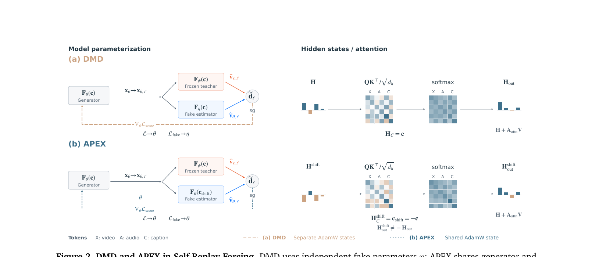
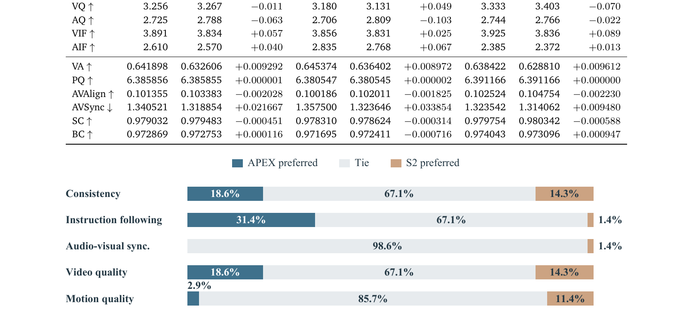
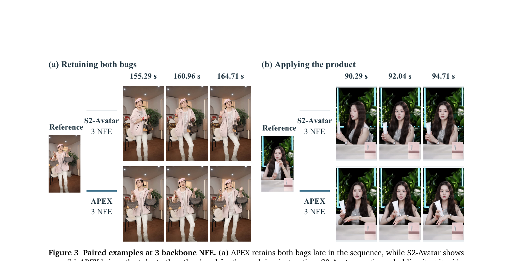

# APEX — Few-Step Streaming Video Generation via Condition Shifting

> **arXiv**: 2611.14033 · **发表**: 2026-11-10 · **机构**: 清华大学 + 生数科技 (Shengshu Technology) + 西湖大学 · **主页/代码**: Vidu5

---

## 1. 一句话定位

APEX 把 condition shifting 从图像单步生成迁移到**流式视频生成**，用生成网络自身（以 negated 文本条件运行）替代 DMD 的独立 fake-score 网络，在保留 S2-Avatar 冻结教师、Self-Replay Forcing 和感知正则化的前提下，消除了 DMD 在训练时对独立参数 `η` 的显存和计算开销。

---

## 2. 要解决的问题

流式视频生成的 few-step 蒸馏通常用 **Distribution Matching Distillation (DMD)**:
- 维持一个独立 fake-score 网络 `F_η(c)`，从生成样本中估计分布的 score/velocity
- `η` 必须跟随 `θ` 更新,需要额外 AdamW 状态 + 前向计算（内存 × 2，速度慢）
- `F_η` 和 `F_θ` 必须在相同条件 `c` 下运行,因此一定是两个独立网络

**核心洞察**（来自原始图像 APEX，Liu et al. 2026c）：生成方向 (`c`) 和 fake 估计方向 (`c_shift = -c`) 可以在**同一个网络**里共存——用不同的文本条件区分两条路径,而非用不同的网络或不同的时间步（TwinFlow 用的是正/负时间步）。

APEX for video 把这个思路整合进 S2-Avatar 的 Self-Replay Forcing (SRF) 框架。

---

## 3. 与前作的关系

| 方法 | 核心设计 | 与 APEX 关系 |
|------|---------|-------------|
| DMD (Yin et al. 2024) | 独立 `F_η` 估计 fake score | APEX 直接替代此网络 |
| TwinFlow (Cheng et al. 2026) | 正时间 real，负时间 fake，共享骨干 | 用时间区分；APEX 用 condition 区分 |
| APEX image (Liu et al. 2026c) | 条件移位做单步图像生成 | 本文直接扩展到视频流式生成 |
| S2-Avatar (Zhang et al. 2026c) | SRF + DMD + 冻结教师的流式 avatar | 本文用 APEX 替换 S2-Avatar 的 DMD 组件 |
| FSF-DMD (Kim et al. 2026) | 用 EMA copy 替代独立 fake 网络 | 也是无独立网络；APEX 通过条件移位，不用 EMA |

---

## 4. 核心方法

### 4.1 Self-Replay Forcing 框架（S2-Avatar 继承）

流式视频被切成 block，每个 block `i` 有：
- 视频 latent `x^i`，文本表示 `c^i`
- 上下文 `h^i`（参考图像 + 前序视频块 + 音频）
- 扩散时间 `t_i ∈ (0,1]`

Clean prediction：

$$\tilde{x}^i_0 = x^i_{t_i} - t_i F_\theta(x^i_{t_i}, t_i \mid h^i)$$

Block-wise 因果 mask 让每个 block 仅能 attend 自身 token 和前序 block。SRF 生成一段 detached rollout，对其中一段可微 replay 段做反向传播（前缀 detach，当前段连接梯度），同时保留 S2 的感知正则化 `L_perc`。

### 4.2 Condition Shifting（APEX 核心）

**核心操作**：fake estimator 在原始网络 `F_θ` 上运行，但把 projected text 改成 `c_shift = -c`（取负），diffusion time 不变。

```
生成路径:  F_θ(x, t, c)        → 生成视频
Fake路径:  F_θ(x, t, -c)       → 估计 fake 分布的 velocity
教师路径:  F_φ(x, t, c)        → 参考 velocity（冻结）
```

**Fake loss**（在 re-noised 的 replay 输出上）：

$$\mathcal{L}_\text{fake}(\theta) = \mathbb{E}\!\left[\text{MSE}\!\left(\hat{v}^{1:N}_{\theta,t'}, \epsilon' - x^{1:N,\text{sg}}_\theta\right)\right]$$

其中 `ε'` 是新鲜 Gaussian 噪声，`x^{1:N,sg}` 是 detach 的 replay 序列（防止梯度流过 `L_fake` 进入生成路径）。

**Score correction**（冻结教师修正）：

$$\hat{d}^i_{t'} = \hat{v}^i_{\theta,t'} - v^i_{r,t'} \qquad \text{(normalized by } w = \text{mean}|x_\theta - \hat{x}_{0,r}|\text{)}$$

$$\mathcal{L}_\text{score}(\theta) = \mathbb{E}\!\left[\text{MSE}\!\left(x^{1:N}_\theta,\ \text{sg}\!\left(x^{1:N}_\theta + \hat{d}^{1:N}_{t'}\right)\right)\right]$$

**总损失**：

$$\mathcal{L}(\theta) = \mathcal{L}_\text{score}(\theta) + \mathcal{L}_\text{perc}(\theta)$$

默认配置：`L` 和 `L_fake` 共享 AdamW optimizer 状态，即生成 step 和 fake 估计 step 更新同一个动量状态。

### 4.3 注意力中的 Condition Shifting

在 Transformer 注意力层中，`c_shift = -c` 通过将投影后的文本向量取负实现，输出为 `H^shift_out`。这使网络在同一前向里可以同时出：
- 原始条件方向的隐状态 `H_out`（生成路径）
- 移位条件方向的隐状态 `H^shift_out`（fake 估计路径）

两条路径共享 QK 计算，只在 key 对应的 `H_C` 不同（原始 `c` vs `-c`）。



> **Fig 2 逐段解读**：
>
> **(a) DMD — Model parameterization（左）**：Generator `F_θ(c)` 产生 rollout → 在同一 noisy state `x_{θ,t'}` 上送入两个独立网络：冻结教师 `F_φ(c)`（橙色）和独立 fake estimator `F_η(c)`（蓝色）。两者产生 `v̂_{r,t'}` 和 `v̂_{θ,t'}`，差值 sg 后得到修正 `d̃_{t'}`。损失 `L_fake → η`，`L_score → θ`，两套参数各自维护独立 AdamW 状态。
>
> **(a) DMD — Hidden states / attention（右上）**：普通 cross-attention，`H_C = c`（文本 token 整行填充蓝色），Q/K/V 是视频(X)/音频(A)/文本(C) 的统一 token 序列。
>
> **(b) APEX — Model parameterization（左）**：Generator `F_θ(c)` 和 Fake estimator 共用同一个 `F_θ`，以虚线框（`θ`）连接——只有 condition 不同（`c` vs `c_shift`）。冻结教师不变。损失 `L_fake → θ`（蓝色虚线），与 `L_score → θ` 共享同一参数和同一 AdamW 状态。
>
> **(b) APEX — Hidden states / attention（右下）**：在 shifted 通路，`H^shift_C = c_shift = -c`（文本 token 行变成橙色负值），`H^shift_out ≠ -H_out`（由于 softmax 的非线性），给网络足够的表达自由度来区分两条路径。
>
> **关键区别**：DMD 两条 `L` 更新方向在图中均用实线 → 双 AdamW；APEX 两条 `L` 均是虚线 → 单 AdamW，显存显著降低。

---

## 5. 实验结果

**设置**：S2-Avatar 完整训练数据（直播、说话人、影视、独舞、2D/3D 动画），3 NFE backbone + 1-step 2× 空间 Refiner，输出 1344×768。StreamAV-Bench 320 cases（160 Progressive + 160 Interactive），70 对 I2V 人类评估（180 秒视频）。

### 5.1 StreamAV-Bench 对比（Table 1，12 个模型）

| 模型 | VA ↑ | VIF ↑ | AIF ↑ | VQ ↑ | AVSync ↓ |
|------|------|-------|-------|------|----------|
| Vidu S2-Avatar | 0.633 | 3.831 | 2.768 | 3.267 | 1.319 |
| **APEX (ours)** | **0.642** | **3.856** | **2.835** | 3.256 | 1.341 |

APEX 在 VA、VIF、AIF 三项全榜第一；VQ 略降（-0.011 overall）；AVSync 时序误差升高 0.021s（单位秒，越小越好）——音视频同步略有权衡。

### 5.2 Per-track 结果（Table 2）

- VIF: +0.057 overall（Progressive +0.025，Interactive +0.089）
- AIF: +0.040 overall
- VA: +0.009
- VQ、AQ、SC、BC、AVAlign 变化微小（<0.003）
- AVSync 升高 0.022s（Progressive 更明显 +0.034s，Interactive 较小 +0.010s）

### 5.3 人类评估（70 对，3 NFE，图 4）



> **Fig 4 逐维度解读**（APEX preferred / Tie / S2 preferred）：
>
> - **Instruction following（指令跟随）**：31.4% / 67.1% / 1.4% → **净偏好 +30.0%**（22胜1负47平）。这是最大的优势维度，MOS 4.17 vs 3.99。说明 condition shifting 显著改善模型响应新指令的能力。
> - **Consistency（一致性）**：18.6% / 67.1% / 14.3% → 净偏好 +4.3%（三次净胜）。
> - **Video quality（视频质量）**：18.6% / 67.1% / 14.3% → 净偏好 +4.3%。
> - **Audio-visual sync（音视频同步）**：0 / 98.6% / 1.4% → 基本全平（69/70 tied），与 StreamAV-Bench AVSync 指标 tie 吻合。
> - **Motion quality（运动质量）**：2.9% / 85.7% / 11.4% → 净偏好 **-8.6%**（S2-Avatar 更好）。DMD 独立 fake 网络在运动动态上可能有更强的分布匹配能力；这是 APEX 明确的权衡。

**可用性（Usability）**：APEX 和 S2-Avatar 均 88.6%（62/70 对均达 MOS>2 的可用阈值）。

### 5.4 训练效率对比（vs DMD，matched settings，图 5）

| 指标 | DMD | APEX | 减少 |
|------|-----|------|------|
| Peak GPU 内存 (GiB/GPU) | 102.7 | 98.2 | **-4.5 GiB (−4.4%)** |
| 单步迭代时间 (s) | 35.9 | 32.6 | **-3.3s (−9.2%)** |

### 5.5 2 NFE 结果（Table 4）

| 配置 | Instruction ↑ | Consistency | Video | Motion | Sync |
|------|--------------|-------------|-------|--------|------|
| S2-Avatar 2 NFE vs S2 3 NFE | +2.9% | -8.6% | -10.0% | -1.4% | -100% |
| **APEX 2 NFE vs S2 3 NFE** | **+27.1%** | -2.9% | -2.9% | -7.1% | -7.1% |

APEX 以 2 NFE 对比 S2-Avatar 3 NFE 仍有 +27.1% 指令跟随优势——意味着 APEX 2 NFE 比 S2-Avatar 3 NFE 更节省推理算力且效果更好（指令维度）。

### 5.6 定性对比（图 3）



> **Fig 3 逐列解读**：
>
> **(a) Retaining both bags（保留双包）**：在 155-165s 长序列末段。S2-Avatar（上行）：人物只手持一个包，另一个已消失；说明长时一致性退化，模型遗忘了起始参考图像中的物品。APEX（下行）：双包均完整保留，姿势更接近参考图。这是 instruction following 和物体持久性的直接体现。
>
> **(b) Applying the product（执行"涂抹产品"指令）**：约 90-95s。S2-Avatar（上行）：手继续持管未移动（指令未响应）。APEX（下行）：手管从桌面拿起靠近脸部，完成"涂抹"动作序列。这是 AIF（指令跟随）指标提升的可视化证据。

---

## 6. 理论分析（附录 B 要点）

**Proposition 1 (Score-Velocity Duality)**：在 OT 插值路径下，marginal score 和 conditional mean velocity 之间存在闭式关系：

$$s_{r,t}(\mathbf{x}_t) = -\frac{\mathbf{x}_t + (1-t)\mathbf{v}^*_r(\mathbf{x}_t, t)}{t}$$

**Corollary 1**：两个分布的 velocity 差等于（scaled）score 差：

$$\mathbf{v}^*_1(\mathbf{x}_t, t) - \mathbf{v}^*_2(\mathbf{x}_t, t) = -\frac{t}{1-t}\left[s_{1,t}(\mathbf{x}_t) - s_{2,t}(\mathbf{x}_t)\right]$$

**Theorem 1 (Gradient Equivalence)**：mixed endpoint loss `L_mix`（原始 APEX 图像版用的）和视频版 APEX 目标 `G_APEX` 梯度等价：

$$\nabla_\theta \mathcal{L}_\text{mix}(\theta) = \nabla_\theta \mathcal{G}_\text{APEX}(\theta)$$

这保证了 condition-shifting 条件下 fake velocity 估计在理论上等价于 score 差监督。📌 但附录明确说明：这些恒等式不证明长 horizon 稳定性或 KL 梯度的精确性。

---

## 7. 局限性

| 局限 | 说明 |
|------|------|
| **运动质量下降** | -8.6% 人类偏好，DMD 独立网络在动态分布匹配上更有效 |
| **AVSync 轻微退化** | +0.021s 时序偏移（仅 StreamAV-Bench；人类评估 AVSync 几乎全平） |
| **仅对比 S2-Avatar** | 未与其他 few-step 方法做训练效率的直接对比，只与 DMD 变体比 |
| **仅音视频 avatar 场景** | 训练数据和评测聚焦于音视频生成，泛化性未验证 |
| **理论弱点** | 无法保证 full-trajectory KL gradient，score 解读需 common conditioning |

---

## 8. 一句话总结

APEX 通过在网络内部用 `c_shift = -c` 分离生成和 fake 估计两条路径，以 4.4% 显存和 9.2% 迭代时间的代价换来对 DMD 独立网络的完全消除，同时在指令跟随（+30%人类净偏好）和视觉美感上超越 S2-Avatar，代价是运动质量略输（-8.6%）——本质是一个极优雅的参数共享技巧，把 TwinFlow 的「时间轴上区分」换成「条件轴上区分」。

---

## Q&A

**Q: Condition shifting 为什么用 `c_shift = -c`（取负）而不是零或其他值？**

A: 有两个层面的考虑:

1. **理论层面**：fake velocity 的目标是估计"生成分布"的 score/velocity，而不是"真实数据分布"的。理论上需要一个条件分支，能让模型学到在同一 noisy state `x_{θ,t'}` 下"当前生成器输出的 velocity field"——这个分支必须在条件上与真实生成路径有系统性区分，让网络内部自然学到两套不同的映射。
   
2. **实现层面**：Negated condition 有明确的 Transformer 实现：在投影后取负 `H^shift_C = -c`，不改变 token 结构，只改变 key/value 的方向。梯度可以自然流通，不需要额外操作。与 TwinFlow 的"负时间步"相比，条件移位不需要改变网络对时间的处理（时间步仍为正），实现更简洁。

**关键**：`H^shift_out ≠ -H_out`（由于 softmax 的非线性），所以网络实际上对两条路径有足够区分能力，而不是简单镜像。

---

**Q: 为什么 motion quality 在 APEX 下变差？**

A: 论文没有明确分析，但合理推测有三点：

1. **DMD 独立 `F_η` 的优势**：独立 fake 网络可以在无任何梯度约束下专门学习 generated distribution 的 velocity field，更"纯粹"地捕捉运动动态的分布模式。APEX 的 shared `F_θ` 同时要完成生成和 fake 估计，两个目标在运动建模上可能相互抑制。

2. **Score 信号的运动偏向**：`L_score` 的修正信号 `d̂_{t'}` 在指令相关维度（语义方向）信噪比更高，在纯运动流畅度（高频、局部）上信噪比较低。这使 APEX 的改进集中在语义指令响应而非运动质量。

3. **参数共享的隐含权衡**：单个 AdamW 状态同时优化两个目标，可能使梯度在运动动态上的更新方向上达不到 DMD 双网络的精度。
