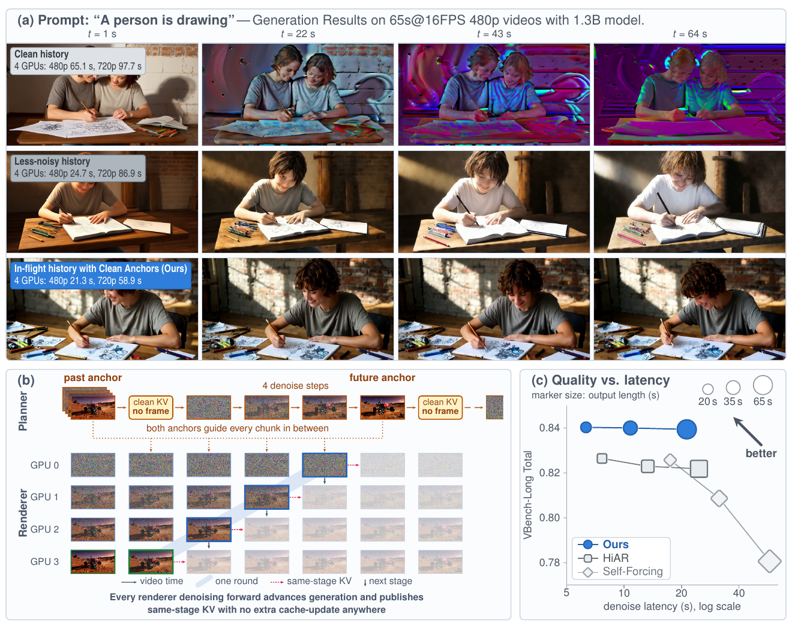
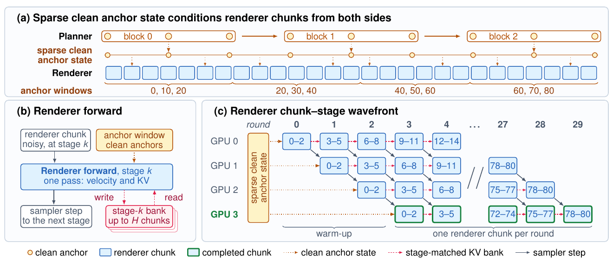
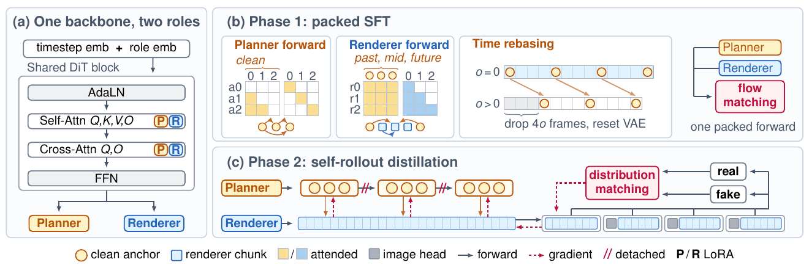
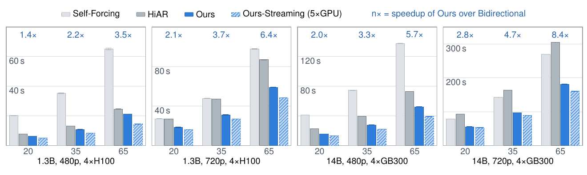
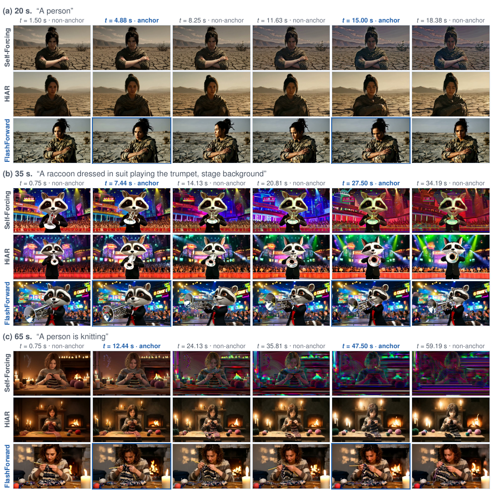
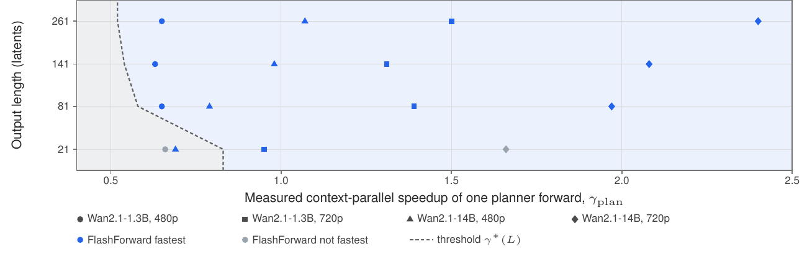
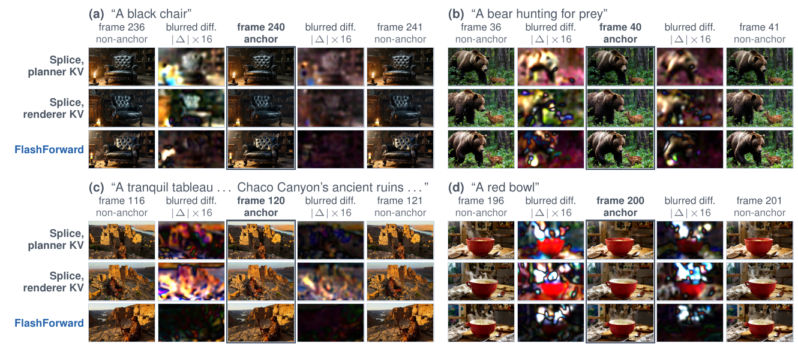

# FlashForward: In-Flight KV Cache with Clean Anchors for Faster Autoregressive Video Diffusion

**论文**: [arXiv:2609.32540v2](https://arxiv.org/abs/2609.32540) (cs.CV, v2 2026-09-30, 24 页：正文 + 参考文献到第 13 页，附录第 14–24 页)
**作者**: Yikai Wang, Xiao Han, Mengmeng Xu, Juan C. Pérez, Yiannis Douratsos, Sen He, Zijian Zhou, Fei Zhang, Zhaochong An, Juan-Manuel Pérez-Rúa, Chen Change Loy, Tao Xiang — **Meta**（Chen Change Loy 为 **NTU S-Lab**）
**Base**: Wan2.1-T2V-1.3B（训练 + 质量评测）；Wan2.1-T2V-14B **只做调度计时，没有训练**
**代码**: 无。[项目页](https://yikai-wang.github.io/FlashForward) 只有视频对比与交互演示（2026-10-13 查看）

---

## 1. 一句话定位

**FlashForward 改的是 few-step 因果 AR 视频扩散里"跨 chunk 记忆从哪来"：不再像 Self-Forcing 那样把生成完的 chunk 再前向一次拿 clean KV，也不像 HiAR 那样在每个 stage 重编码前驱，而是直接复用每次去噪前向本来就算出来的同 stage KV（论文叫 stage-matched / in-flight history）。** 这样 chunk `i` 在 stage `k` 只依赖 `(i, k+1)` 和 `(i−1, k)`，4 个 stage 各占一张卡就排成一条 wavefront 流水线。代价是这份历史带噪，所以另配一个 planner：先自回归生成每 10 个 latent 一个的稀疏 clean anchor，renderer 读两侧 anchor 的 clean KV 来稳住外观和运动。

| | Self-Forcing | HiAR | **FlashForward** |
|---|---|---|---|
| 跨 chunk 记忆 | clean（`σ0`），chunk 完成后再前向一次 | less-noisy（`σ_{k−1}`），每个 stage 重编码前驱 | **同 stage**（`σ_k`）的 in-flight KV + 稀疏 clean anchor |
| 每 chunk 纯建 cache 的前向 | 1 | S = 4 | **0**（planner 每个 block 1 次） |
| 81 latent 的总前向数（Eq 3） | 134 | 212 | **123** |
| chunk 能否跨卡重叠 | 否（串行） | 能（anti-diagonal） | 能（wavefront） |
| 1.3B 480p，20 / 35 / 65 s，各自最快配置（Table 4） | 17.44 / 31.48 / 57.89 s（**单卡**） | 7.67 / 13.31 / 24.67 s（4 卡） | **6.32 / 10.79 / 21.29 s**（4 卡） |
| 同为单卡（Table 4） | **17.44 / 31.48 / 57.89 s** | 27.86 / 50.41 / 94.74 s | 17.77 / 32.80 / 59.64 s |
| VBench-1.0 Total，20 s（Table 2） | 0.805* | 0.821* | **0.838** |
| VBench-Long Total，20 / 35 / 65 s（Table 2） | 0.8258 / 0.8087 / 0.7806 | 0.8265 / 0.8230 / 0.8219 | **0.8404 / 0.8401 / 0.8395** |

\* 论文 §4.1：*"Competing methods' results are taken from HiAR"*。VBench-Long 是作者自己按同一协议跑的四个方法。

🔴 **读完全文后我认为头条要打四个折扣**：
1. **"比 Self-Forcing 快 1.42–2.92×" 是 4 卡 FlashForward 对 Self-Forcing 的最快配置，而 1.3B 480p 下 Self-Forcing 的最快配置是单卡**（它开 4 卡 CP 反而更慢：20.25 s vs 17.44 s）。2.92× 那一格（35 s）就是 4×H100 对 1×H100。同为单卡时 FlashForward **慢 1.9–4.2%**（附录 A.2.1 自己写了）。按卡·秒算，1.3B 480p 下 4 卡 FlashForward 每条视频比单卡 Self-Forcing 多花 37–47% 的卡时（我算的，见 [§7](#7-争议与权衡)）。**它是用卡数换延迟，不是同硬件提速。** 对 HiAR 的 1.16–1.69× 才是同卡数比较，单卡也快 1.54–1.59×。
2. **14B 的四组数字只是调度计时**：附录 A.2 原话 *"The 14B rows are systems-only timing measurements"* —— 用 14B backbone 跑同样的张量形状、mask、cache 路径和调度，**没有训练好的 14B FlashForward**。摘要里 1.69× 这个上界来自 14B 720p，它只说明调度快，不说明 14B 能训出同等质量。质量只在 1.3B 480p 上测过。
3. **质量对比混入了训练数据差异**：FlashForward 比 Self-Forcing / HiAR 多一个在 **256K Shutterstock 真视频**上的 SFT 阶段（1,800 步 × batch 128，20 s 片段）。唯一同数据、同配方的对照是 Table 3 下半的 "clean history and future" 变体：**0.826**。它比 Self-Forcing 的 0.805 已经高 0.021，与 FlashForward 的 0.838 只差 0.012（见 [§5.4](#54-消融)）。
4. **核心记忆单独用不工作**：只有 stage-matched history 的变体 *"flicker so heavily that VBench fails to score their temporal flickering dimension"*（Table 3 记为 Failed）。按附录 C.2 的 student timestep 算，renderer 能读到的最干净的同 stage 历史，输入噪声也有 σ ≈ 0.62（见 [§3.2](#32-renderer同-stage-历史与-wavefront)）。**稳定性主要靠 planner 的 clean anchor，而 planner 本身就是一个以 30 latent 为步长、每个 block 多前向一次建 clean KV 的 Self-Forcing 式 AR 模型。**

📌 **站得住的部分**：
- Table 1 把"跨 chunk 记忆在哪个噪声级发布、何时可读、要几次纯建 cache 的前向、chunk 能否重叠"摆成一个设计空间（论文叫 *cross-chunk state contract*），Self-Forcing / N-C-Causal-rCM / HiAR 的差别一张表就说清楚了。Eq 3–4 的前向计数模型给出可操作的部署规则：短视频不划算；planner 的 CP 加速比小于 1 时就用单卡跑 planner。
- 延迟测量协议写得很规范：每格 20 条视频的均值 ± 标准差、取最慢 rank、角色权重切换时间计入、单卡 / 4 卡 / 5 卡都测，并且**主动报告了不利结果**（5 s 时双向模型最快；单卡比 Self-Forcing 慢；两个 21-latent 格子 FlashForward 不是最快）。
- 附录 B 用"anchor KV 来源 × 最终 anchor 来源"两个因子，再加一个真视频 anchor 的 probe，把 anchor 接缝的成因拆得很干净，解释了为什么 planner 生成的 anchor 只当条件、不进最终视频。

---

## 2. 要解决的问题：只建记忆、不推进输出的前向

Few-step 因果 AR 视频扩散（Self-Forcing 一系）把视频切成 chunk，每个 chunk 走 S = 4 个去噪 stage。后面的 chunk 要以前面的 chunk 为条件，就需要一份记忆（KV cache）。**问题在于这份记忆怎么来**。论文把它叫 cache-update-only forward：只为建记忆、不推进任何输出 latent 的前向。S = 4 时，Self-Forcing 每个 chunk 多 1 次（+25%），HiAR 每个 chunk 多 S 次（+100%）。

| 方法 | 记忆的噪声级 | 何时可用 | 纯建 cache 的前向 | chunk 执行 |
|---|---|---|---|---|
| Self-Forcing | `σ0` | chunk 重编码之后 | 每 chunk 1 次 | 串行 |
| N-C-Causal-rCM | `σ1 → σ0` | 最后一个去噪 stage 之后 | 0 | 串行 |
| HiAR | `σ_{k−1}` | 每次分 stage 重编码之后 | 每 chunk S 次 | 重叠 |
| **FlashForward** | `σ_k → σ_{k−1}` | **每个去噪 stage 一结束** | **0** | 重叠 |

（Table 1。N-C-Causal-rCM 是 Causal-rCM 的 noisy-context 变体，沿用 Diagonal Distillation，复用最后一次去噪前向的 KV，所以不需要额外前向，但要等前驱走完最后一个 stage，仍是串行。FlashForward 另有预先准备的稀疏 clean anchor KV。）

**论文的观察**：每次去噪前向本来就算出了当前 chunk 在当前噪声级的 KV。如果后面的 chunk 在**同一个 stage** 读这份 KV，记忆就是白来的，而且这个 stage 一结束就可用。于是依赖图变成 `(i, k) ← (i, k+1), (i−1, k)`，同一条反对角线上的节点可以在不同卡上同时跑。

**代价**：这份历史来自没去噪完的 chunk，是带噪的。单独用会把外观和运动的不确定性沿 chunk 边界传下去（论文引 Diffusion Forcing 与 HiAR）。音频驱动数字人里 TalkingMachines 和 Live Avatar 已经用过 stage-matched history，**Live Avatar 还把去噪 timestep 分到多卡做了流水线**；论文认为它们能成立，是因为有一张给定的干净参考图，而且场景基本静止。文生视频两者都没有，所以 FlashForward 用 planner 生成的稀疏 anchor 去替代那张参考图。

> **Fig 1 逐段解读**：
>
> **(a)** 同一 prompt *"A person is drawing"*，1.3B、480p、65 s @ 16 FPS。三行分别是 clean history（Self-Forcing）、less-noisy history（HiAR）和本文，左上角是 4 卡延迟：Self-Forcing 480p 65.1 s / 720p 97.7 s，HiAR 24.7 / 86.9 s，本文 21.3 / 58.9 s。Self-Forcing 在 t = 22 s 就出现色块，43 s、64 s 整幅变成紫绿色；HiAR 没有色块，但 T 恤从灰色变成白色，画面越来越亮；本文四个时刻的人物与场景一致。⚠️ 这里 Self-Forcing 标的是它的 **4 卡**延迟（65.1 s），它的单卡延迟其实更短（57.89 s，Table 4）。
>
> **(b)** 上半是 planner：past anchor → 前向一次得到 clean KV（不出帧）→ 4 步去噪出 future anchor → 再一次 clean KV。两个 anchor 之间的每个 chunk 都由它俩引导。下半是 renderer：GPU 0–3 各管一个 stage，蓝框沿对角线推进，红色虚线是同 stage KV 的传递。底部那句是全文主张：*"Every renderer denoising forward advances generation and publishes same-stage KV with no extra cache-update anywhere"*。
>
> **(c)** 横轴是去噪延迟（log），纵轴 VBench-Long Total，点的大小代表时长（20 / 35 / 65 s）。用的是**各方法最快配置（最多 4 卡）**，所以 Self-Forcing 的三个点是单卡数据（17.4 / 31.5 / 57.9 s）。本文三点都在 0.84 附近，Self-Forcing 随时长从 0.826 掉到 0.781。

---

## 3. 方法

### 3.1 布局与符号

目标有 `L` 个 latent，anchor 步长 `Δ`：

$$
\mathcal{P}=\lbrace m\Delta \mid m\in\mathbb{N}_0,\ m\Delta<L\rbrace\cup\lbrace L-1\rbrace,\qquad M=|\mathcal{P}|
$$

planner 把 `P` 分成 `N_P = ⌈M/B_P⌉` 个 block，每个最多 `B_P` 个 anchor；renderer 把全部 `L` 个位置分成 `N_R = ⌈L/B_R⌉` 个 chunk。chunk `i` 能看到的 anchor 窗口是

$$
\Gamma(i)=\lbrace 2u\Delta,\ (2u+1)\Delta,\ (2u+2)\Delta\rbrace,\qquad u=\lfloor B_R\, i/(2\Delta)\rfloor
$$

即每个区间前后各有 anchor，相邻区间共享端点。实际配置：`B_P = B_R = 3`、`Δ = 10`、`S = 4`、上下文预算 `W_ctx = 21` 个 latent、renderer 历史 `H = 5` 个 chunk、planner 历史 `H_P = 6` 个 block。21 个位置的分配是：renderer = 3 个 anchor + 最多 15 个历史 latent + 3 个当前 latent；planner = 最多 18 个已完成 anchor + 3 个当前 latent（附录 A.2）。

**具体例子（Fig 2）**：81 个 latent（20 s，321 帧 @ 16 FPS）。planner 生成 `{0, 10, …, 80}` 共 9 个 anchor，分 3 个 block；renderer 生成全部 81 个位置，共 27 个 chunk。位置 6–8 那个 chunk 读 `{0, 10, 20}` 三个 anchor 的 clean KV，再加上最近几个 chunk 在同一 stage 留下的 KV。

**两种记忆的时间尺度**（16 FPS 下 1 个 latent ≈ 4 帧 ≈ 0.25 s，换算是我做的）：

| 记忆 | 覆盖 | 约合时长 |
|---|---|---|
| renderer 的同 stage 历史 | 5 chunk × 3 = 15 latent | ≈ 3.75 s，只有过去 |
| renderer 的 anchor 窗口 | 3 个 anchor，跨 20 latent | ≈ 5 s，**过去 + 未来** |
| planner 的 anchor 历史 | 6 block × 3 = 18 个 anchor，跨 180 latent | ≈ 45 s |

📌 所以论文说的 "dense 管细节、sparse 管长程" 在数量上是：**renderer 直接看到的只有约 5 s 的局部，45 s 级别的一致性只能经由 planner 的 anchor 传进来。** 65 s 的视频已经超出 planner 的历史长度。

### 3.2 Renderer：同 stage 历史与 wavefront

> **Fig 2 逐段解读**：
>
> **(a)** planner 按 block 产出 anchor（橙色圆点），连成一条 "sparse clean anchor state"；renderer 的 chunk（蓝方块）按窗口 `{0,10,20}`、`{20,30,40}`、`{40,50,60}`、`{60,70,80}` 读两侧 anchor。
>
> **(b)** 一次 renderer 前向：输入是 stage `k` 的带噪 chunk，读 anchor 窗口的 clean KV 和 stage-k bank（最多 `H` 个 chunk），**一次前向同时输出 velocity 和自己的 KV**，KV 写回 stage-k bank，latent 交给下一个 stage。
>
> **(c)** 4 张卡、第 0–29 轮，框里的数字是 chunk 覆盖的 latent 位置。第 0 轮 GPU 0 处理 latent 0–2 这个 chunk 的第一个 stage；第 1 轮 GPU 0 处理 3–5，GPU 1 处理 0–2 的第二个 stage……第 3 轮起 GPU 3 每轮完成一个 chunk（绿框）。前 3 轮是 warm-up，81 个 latent 共 27 + 3 = 30 轮。

一次 renderer 前向（Eq 2）：

$$
\left(\hat v^{R}_{i,k},\ K^{R}_{i,k},\ V^{R}_{i,k}\right)=F^{R}_{\theta}\left(x^{R}_{i,k},\ c,\ \tau_k;\ \mathcal{A}_{\Gamma(i)},\ \mathcal{B}^{(i)}_{k}\right),\qquad \mathcal{B}^{(i+1)}_{k}=\mathrm{Tail}_H\left(\mathcal{B}^{(i)}_{k}\cup\lbrace (i,\ K^{R}_{i,k},\ V^{R}_{i,k})\rbrace\right)
$$

`A_Γ(i)` 是窗口内 anchor 的 clean KV，`B_k` 是 stage-k bank，`Tail_H` 只留最近 `H` 个 chunk。采样器用 rectified flow 的 Euler 步：`x_{k−1} = x_k − (σ_k − σ_{k−1}) v̂`。

**执行（Alg 1）**：rank `r` 固定负责 stage `k = S − r`。Phase A 先把 planner 全部跑完，anchor KV bank `A` 放在主机内存；Phase B 共 `N_R + S − 1` 轮，第 `n` 轮 rank `r` 处理 chunk `i = n − r`：rank 0 采噪声，其余 rank 拿上一轮前一个 rank 发来的 latent，读 `A_Γ(i)` 和本卡的 stage-k bank，前向、走一步、把 KV 原地写回本卡的 bank，再把 latent 发给下一个 rank。**每张卡只存自己那个 stage 的 bank，KV 不跨卡，卡间只传一个 chunk 的 latent**（附录 A.2.2 也说这个张量很小、传输与下一次前向重叠）。

📌 **我的一个观察：renderer 的推理在计算上等价于"对整段视频用 block-causal + 滑窗（H = 5）mask 跑 4 步 Euler 采样"，wavefront 只是这个计算的一种执行顺序。** 论文 §3.1 也说 renderer 可以 *"process the full clip at once using a chunk-wise causal mask"*，训练时正是这么做的（[§3.6](#36-phase-2self-rollout-dmd)）。所以 renderer 没有 Self-Forcing 那种"训练要逐 chunk rollout 才能对齐推理"的问题；真正的自回归只发生在 planner 上。从结构上看，FlashForward 就是 **"自回归生成稀疏关键帧（planner）+ 因果滑窗补帧（renderer）"**。论文 §2 也把 plan-then-infill 列为最接近的一类前作，强调的区别是 anchor 只当条件、不进输出。

📌 **"带噪"到什么程度**：附录 C.2 给出 4 个 student stage 的 timestep 是 `(999, 937, 833, 624)`。这正好是 Self-Forcing 的 `[1000, 750, 500, 250]` 经 flow shift 5 映射后的值（`σ' = 5σ/(1+4σ)`：0.75 → 0.9375，0.5 → 0.833，0.25 → 0.625，我算的），所以 4 个 stage 的输入噪声约为 **σ ≈ 1.0 / 0.937 / 0.833 / 0.624**。stage-k bank 里的 KV 是在输入噪声 `σ_k` 下算出来的：**renderer 读到的最干净的同 stage 历史，其输入里真实信号的权重也只有 1 − 0.624 = 0.376；第一个 stage 读到的历史，输入几乎是纯噪声。** 对比之下，HiAR 在最后一个 stage 读的是 `σ0 = 0` 的干净前驱，Self-Forcing 读的始终是干净的。（KV 是逐层算的，深层 KV 已经融合了 anchor 和更早历史的信息，不等于"只读到 62% 噪声"；但输入端的信息量确实受这个约束。）这能解释为什么 stage-matched history 单独用会 Failed：扩散采样的粗结构主要在高噪声的前几步确定，而那时 chunk 几乎看不到前驱的内容，只能靠 anchor。

### 3.3 Planner：稀疏 clean anchor

planner 按 block 自回归生成 anchor latent：每个 block 走 S 步去噪，然后**再做一次 clean-endpoint cache-extraction 前向**，把 clean anchor KV 追加到 `A`。这是 FlashForward 里**唯一**的纯建 cache 前向，每个 block 1 次。

**为什么这笔开销划算**：一次 planner 转移推进 30 个 latent（3 个 anchor × 步长 10），一次 renderer 转移只推进 3 个，自回归深度差了近 10 倍；而且一个三 anchor 窗口要服务 6–7 个 renderer chunk。81 latent 时 planner 共 `3 × 5 = 15` 次前向，占全部 123 次的 12%（我算的）。

**anchor 只当条件，不进最终视频**：renderer 会重新生成包括 anchor 位置在内的每一个输出位置。直接把 planner 的 anchor 拼进视频更省，但会产生周期性接缝，见 [§5.6](#56-anchor-接缝)。

### 3.4 一个 backbone，两个角色

> **Fig 3 逐段解读**：
>
> **(a)** 共享一个 Wan DiT block：timestep embedding 上加一个 role embedding 进 AdaLN；self-attention 的 Q/K/V/O 和 cross-attention 的 Q/O 上各挂一套 planner（P）/ renderer（R）LoRA；FFN 共享。
>
> **(b)** Phase 1：planner 前向在 clean 历史 block 上做因果注意力（黄色格子），renderer 前向同时看 past / mid / future 的 clean anchor（黄色）和同噪声级的前驱 chunk（蓝色）；右侧 time rebasing 是从不同 offset `o` 裁剪片段（丢掉前 `4o` 帧、重置 VAE）造出更多 planner 目标。三路在**一次 packed 前向**里用 flow matching 一起训。
>
> **(c)** Phase 2：planner 先自回归出 3 个 anchor block（`//` 表示 block 间 detach），renderer 一次性渲染整段，然后切成 4 个窗口交给 real / fake score 做 distribution matching，后三个窗口前面拼一个灰色的 image head。红色虚线是梯度：从 renderer 读 anchor 的那条边流回 planner。

- **Role embedding**：每个角色一个零初始化向量，经 AdaLN 注入。
- **Role LoRA**：rank 256，作用在 self-attention 的 Q、K、V、O 与 cross-attention 的 Q、O 上（附录 C.1）。
- **测延迟时**：把两套 LoRA 分别 merge 进 backbone，得到两份完整权重，这样每次前向的成本与 baseline 完全相同。设备上只放当前角色的权重，planner → renderer 切换时从 pinned 主机内存加载：1.3B 用 0.10–0.13 s，14B 用 0.13–0.17 s，**计入 4 卡延迟**。Streaming 版两份权重分别常驻在各自的卡上。

### 3.5 Phase 1：packed SFT 与 time rebasing

**为什么要用 20 s 的真视频**（附录 C.1）：5 s 的片段只有 3 个 anchor，正好一个 block，planner 学不到跨 block 的自回归依赖。蒸馏路线的监督来自 teacher 的轨迹，*"their supervision horizon is typically limited to the teacher's 5-second generation window"*。SFT 直接从真视频学，片段可以任意长；作者选 20 s，正好 9 个 anchor、3 个 block。

**一次 packed 前向里有什么**（Alg 2）：
- 每个 anchor 有三份拷贝：planner 的 clean 上下文副本 `P⁰`、planner 的加噪输入 `P^σ`、renderer 的加噪输入 `I^σ`；非 anchor 位置只出现在 `I^σ`。
- **每个片段只采一个 σ**，同一 latent 的不同拷贝共享 ε。
- **mask**：planner 输入看本 block 和更早的 clean planner block；renderer chunk 看本 chunk、**同一噪声级**下最多 5 个前驱 chunk，以及 `Γ(i)` 选中的 clean anchor。**renderer 读 clean anchor 是唯一的跨角色连接。**
- **time rebasing**：每步从 `{1, …, 9}` 不放回采 4 个 offset `o`，裁出帧区间 `[4o, 4o+281)`（因果 VAE 时间下采样 4 倍），重新编码得到 71 个 latent，取 `{0, 10, …, 70}` 共 8 个 anchor 作为 planner 目标（block 大小 3 + 3 + 2）。最后一个 block 没有下游读者，所以每个裁剪只加 8 个加噪输入和 6 个 clean 副本。
- **损失**：velocity `v = ε − x0` 的逐 token 平方误差，分别在 9 个原始 planner latent、81 个 renderer latent、32 个 rebased planner latent 上取平均后相加。

**超参**：AdamW，`β1 = 0`，`β2 = 0.999`，weight decay 0.01，梯度裁剪 1.0；学习率前 100 步 warmup 到 1e-5 后恒定；EMA 0.999；10% 文本 dropout；flow shift 5.0；**1,800 步，global batch 128**。VAE encoder 冻结。

📌 **renderer 的 SFT 就是"整段同一个 σ + block-causal mask"**：同 stage 历史这个推理条件在训练端是天然对齐的，不需要任何额外设计。难点不在训练，而在推理时它太噪，见 [§3.2](#32-renderer同-stage-历史与-wavefront)。

### 3.6 Phase 2：self-rollout DMD

Phase 1 用的是真值 latent，推理时读的却是 planner 生成的 anchor 和 renderer 生成的历史。Phase 2 因此在 planner–renderer 的 self-rollout 上做 DMD（Alg 3）：

- **学生轨迹**：4 步、无 guidance，timestep `(999, 937, 833, 624)`，终点 `σ0 = 0`。
- **随机出口**：每次迭代所有 rank 采同一个 `k* ~ U{1..4}`，只在这一步保留梯度，更高噪声的步 stop-gradient（Self-Forcing 的 stochastic gradient truncation）。
- **rollout**：先跑 3 个 planner block（每个 block 后做一次 clean-endpoint 前向构造 `A`），再让 renderer 在**一次 packed 前向**里处理整段 81 个位置（每个 stage 一次），用 block-causal mask 实现每个 chunk 的同 stage 历史。这样梯度能从后面的 chunk 流到前面的 chunk、从 renderer 流到 planner。
- **planner 怎么被训到**：后续 planner block 读 `A` 时 detach，但 renderer 在出口 stage 读 `A_Γ(i)` 的那条边保持连通。**由于最终输出全部来自 renderer，这条边是 generator loss 训练 planner 的唯一路径。**
- **分窗打分**：score 网络最多看 `W_score = 21` 个 latent，所以把 81 个位置切成 `[0,21)`、`[21,41)`、`[41,61)`、`[61,81)` 四个 tile；后三个 tile 前面拼一个 detach 的 image head（沿用 LongLive：把已生成的 clean 前缀解码，取最后一帧 RGB 重新编码，加噪到同一 σ），image head 的预测打完分就丢掉。
- **teacher / critic**：real score 是冻结的 **Wan2.1-T2V-14B**，CFG 3.0；critic 是 Wan2.1-T2V-1.3B + 可训练的 rank-256 LoRA，guidance 1.0；学生全参可训。
- **超参**：600 步 AdamW，global batch 128，generator : critic = 1 : 5（即 **100 次 generator 更新**）；generator 学习率 1e-5，critic LoRA 1e-6；EMA 0.999。

📌 **DMD 这一段仍然只在约 5 s 的窗口里打分**（21 个 latent），长程依赖不是 DMD 教的，而是 Phase 1 在 20 s 真视频上训出来的 planner 带来的。这是它对"teacher 只有 5 s"这个天花板的绕法，见 [§9](#9-在仓库图谱里的位置)。

### 3.7 Streaming 版：单独一张卡跑 planner

4 卡主配置里，所有卡先一起把 planner 跑完再切到 renderer，这是为了和其它 AR 方法同卡数比较。部署时可以用 **1 张卡跑 planner + 4 张卡跑 renderer**：planner 发布第一个 anchor block 后 renderer 就开工，之后 planner 与渲染并行。

**为什么 `Δ = 10`**（附录 A.1）：一个 anchor block 要 4 次去噪 + 1 次 clean KV，共 5 个 planner 轮次；一个三 anchor 窗口要服务 6–7 个 renderer chunk，稳态 wavefront 需要 6–7 轮。所以 planner 总能在 renderer 用完当前窗口之前发布下一批 anchor。步长更小 planner 会成瓶颈；更大则延迟没有收益，中间区域的约束反而更弱。

**实测只暴露第一个 block**（附录 A.2.3）：480p 下 planner 全程时间从 1 个 block 的 0.510 s 涨到 9 个 block 的 5.617 s，而 renderer 等 anchor 的时间（`anchor_wait`）始终在 0.506–0.509 s；720p 下全程从 1.067 s 涨到 17.956 s，等待始终在 1.051–1.066 s。9 个 block 时暴露的规划时间只占 9%（480p）和 6%（720p）。

---

## 4. 实验设置

| 项 | 设置 |
|---|---|
| Base | Wan2.1-T2V-1.3B；14B 只用于计时，未训练 |
| 训练数据 | **256K Shutterstock 视频**，caption 由模型生成；每个片段 81 latent = 321 帧 @ 16 FPS |
| 训练 | SFT 1,800 步 + DMD 600 步（100 次 generator 更新），global batch 128 |
| 推理 | 4 步、无 guidance；`B = 3`、`Δ = 10`、`H = 5`、`W_ctx = 21` |
| 质量评测 | **只测 1.3B 480p**。VBench-1.0 测 20 s 视频（沿用 HiAR，双向模型测 5 s）；VBench-Long 测 20 / 35 / 65 s |
| 质量 baseline | 主比 Self-Forcing、Causal Forcing（clean history）与 HiAR（less-noisy history）；另列 LTX-Video、Wan2.1、NOVA、Pyramid Flow、SkyReels-V2、MAGI-1、CausVid。**VBench-1.0 的 baseline 数字全部抄自 HiAR**；VBench-Long 四个方法作者自己跑 |
| 延迟评测 | 1.3B 用 H100，14B 用 GB300；单卡 / 4 卡 / 5 卡（streaming）；5 / 20 / 35 / 65 s = 21 / 81 / 141 / 261 latent；每格 20 条视频取平均（去掉冷启动）；**只计去噪路径**（不含文本编码与 VAE 解码）；取最慢 rank 的耗时、所有 rank 的最高峰值显存 |
| 三个 AR 方法的公共设置 | 3-latent chunk、`W_ctx = 21`；双向 baseline 不用 cache |
| **没有报告的** | 训练分辨率、训练卡数与卡时；VBench-Long 的 prompt 集与样本数；VBench 的随机种子数与误差棒；1.3B 720p 是否有训练好的模型 |

---

## 5. 结果

### 5.1 延迟

Table 4 的 1.3B 480p 部分（单位 s，粗体为同卡数最快）：

| 1.3B 480p | 单卡 20 / 35 / 65 s | 4 卡 20 / 35 / 65 s |
|---|---|---|
| Bidirectional | 32.02 / 91.22 / 295.83 | 8.95 / 24.01 / 75.28 |
| Self-Forcing | **17.44 / 31.48 / 57.89** | 20.25 / 35.40 / 65.14 |
| HiAR | 27.86 / 50.41 / 94.74 | 7.67 / 13.31 / 24.67 |
| FlashForward | 17.77 / 32.80 / 59.64 | **6.32 / 10.79 / 21.29** |
| FlashForward-CP | — | 7.24 / 12.30 / 22.07 |
| FlashForward-Streaming（5 卡） | — | 5.11 / 8.27 / 14.53 |

**各设置下 FlashForward（两种 planner 分配取快者）相对各 baseline 最快配置的加速比**（我按 Table 4 逐格算的）：

| 设置 | FlashForward 20 / 35 / 65 s | vs HiAR（4 卡） | vs Self-Forcing 最快配置 | Self-Forcing 的最快配置 |
|---|---|---|---|---|
| 1.3B 480p，H100 | 6.32 / 10.79 / 21.29 | 1.21 / 1.23 / **1.16**× | 2.76 / **2.92** / 2.72× | **单卡** |
| 1.3B 720p，H100 | 18.47 / 30.90 / 58.89（CP） | 1.45 / 1.52 / 1.47× | 1.47 / 1.54 / 1.66× | 4 卡 |
| 14B 480p，GB300 | 15.67 / 27.67 / 52.18（65 s 为 CP） | 1.45 / 1.43 / 1.40× | 2.64 / 2.69 / 2.64× | 4 卡（无单卡数据） |
| 14B 720p，GB300 | 55.66 / 97.02 / 181.25（CP） | 1.68 / **1.69** / 1.68× | **1.42** / 1.47 / 1.49× | 4 卡（无单卡数据） |

粗体是摘要里 1.16–1.69× 与 1.42–2.92× 两个区间的端点。几点：

- **1.3B 480p 下 Self-Forcing 开 4 卡反而更慢**（20.25 s vs 单卡 17.44 s）：它的 chunk 链是串行的，多卡只能对单次前向做 CP，对 1.3B 480p 这么小的前向不划算。所以"最快配置"在这一格是单卡。
- **5 s（21 latent）时双向模型在 5 个设置里全是最快**；AR 方法里 FlashForward 也有两格输了：1.3B 480p 4 卡 HiAR 2.06 s vs 2.21 s，14B 720p Self-Forcing 15.84 s vs FlashForward-CP 16.28 s。planner 前奏和流水线 warm-up 在短视频上摊不开。
- **planner 用不用 CP 看负载**：480p 基本是单卡 planner 快，720p 一律 CP 快。
- **Streaming（多 1 张卡）**相对 4 卡单 planner 版：1.3B 快 1.18–1.47×，14B 快 1.15–1.36×（14B 的 5 卡跨了两个 GB300 节点）。
- **相对双向模型的 1.4–8.4×**（Fig 4 的蓝字）：双向 baseline 是把整段 65 s 一次生成，Wan2.1 本身是 5 s 模型，这么长的双向生成质量没有评测。这个倍数只能当延迟参照。

> **Fig 4 读法**：每个子图是一个"模型 × 分辨率 × 硬件"设置，横轴是视频时长 20 / 35 / 65 s。浅灰 Self-Forcing、深灰 HiAR、蓝色本文（4 卡）、斜线本文 streaming（5 卡）。顶部蓝字是**本文相对双向模型**的加速比，不是相对 AR baseline 的。⚠️ 1.3B 480p 子图里 Self-Forcing 的柱子是 **4 卡**数据（20.25 / 35.40 / 65.14 s），比它的单卡数据高。

### 5.2 显存

Table 5，4 卡、65 s、每个 rank 的峰值显存（GiB）：

| 4 卡，65 s | 1.3B 480p | 1.3B 720p | 14B 480p | 14B 720p |
|---|---|---|---|---|
| Bidirectional | 26.5 | 41.8 | 49.4 | 78.7 |
| Self-Forcing | **20.7** | **28.5** | 60.3 | 93.6 |
| HiAR | 25.1 | 33.3 | 79.1 | 113.2 |
| FlashForward | 25.1 | 33.3 | 79.2 | 113.3 |

- FlashForward 与 HiAR 在每一格都相差不超过 0.3 GiB；AR 方法用固定滑窗，峰值显存几乎不随时长变化。
- Self-Forcing 和双向模型更省，论文的解释是 CP：一次前向的序列（激活与 KV）被切到 4 张卡上。FlashForward / HiAR 则是每张卡独立承担一个 stage 的完整前向和这个 stage 的 KV。
- 单卡 1.3B 480p 65 s：Self-Forcing / HiAR 25.1 GiB，FlashForward 25.4 GiB（单卡要同时存 4 个 stage 的历史 KV，附录 A.2.1 在讲延迟时提到了这一点）。
- ⚠️ 14B 下 FlashForward 每卡 79.0–113.3 GiB，**放不进 H100 80GB**（480p 已到顶，720p 明显超出）。论文没解释 14B 为什么换成 GB300 测，我推测与此有关。

### 5.3 质量

**VBench-1.0，20 s**（Table 2 上半，节选；双向模型测 5 s）：

| | Wan2.1-1.3B（5 s） | CausVid | Self-Forcing | Causal Forcing | HiAR | **FlashForward** |
|---|---|---|---|---|---|---|
| Total | 0.802 | 0.764 | 0.805 | 0.810 | 0.821 | **0.838** |
| Quality | 0.813 | 0.771 | 0.829 | 0.837 | 0.846 | **0.859** |
| Semantic | **0.766** | 0.740 | 0.708 | 0.701 | 0.723 | 0.753 |

其余参照：LTX-Video 0.766、NOVA 0.773、Pyramid Flow 0.775、SkyReels-V2-1.3B 0.788、MAGI-1-4.5B 0.757（Total）。

**VBench-Long**（Table 2 下半，作者同协议自跑）：

| 时长 | Self-Forcing T / Q / S | Causal Forcing T / Q / S | HiAR T / Q / S | **FlashForward** T / Q / S |
|---|---|---|---|---|
| 20 s | 0.8258 / 0.8460 / 0.7452 | 0.8178 / 0.8515 / 0.6833 | 0.8265 / 0.8440 / **0.7565** | **0.8404** / **0.8635** / 0.7481 |
| 35 s | 0.8087 / 0.8330 / 0.7116 | 0.7906 / 0.8343 / 0.6159 | 0.8230 / 0.8452 / 0.7339 | **0.8401** / **0.8636** / **0.7460** |
| 65 s | 0.7806 / 0.8186 / 0.6288 | 0.7539 / 0.8145 / 0.5113 | 0.8219 / 0.8419 / 0.7418 | **0.8395** / **0.8617** / **0.7505** |

- **随时长的稳定性是最清楚的信号**：20 → 65 s 的 Total 变化，FlashForward −0.0009，HiAR −0.0046，Self-Forcing −0.0452，Causal Forcing −0.0639（我算的）。
- **Total 的领先主要来自 Quality**：VBench 的 Total = (4 × Quality + Semantic) / 5，Quality 权重是 Semantic 的 4 倍。我复算过：FlashForward、Self-Forcing、Causal Forcing、HiAR 的 VBench-1.0 行，VBench-Long 全部行和 Table 3 全部行都在舍入误差内；但照抄来的参照行里，LTX-Video、Wan2.1、Pyramid Flow 的 Total 比 (4Q + S)/5 低 0.0016–0.0022，超出了三位小数的舍入误差，论文没有说明来源。
- **Semantic 不是全面领先**：VBench-Long 20 s 输给 HiAR（0.7481 vs 0.7565）；VBench-1.0 的 0.753 低于 Wan2.1（0.766）和 NOVA（0.757），论文的说法是"在蒸馏 AR 方法里最高"。

> **Fig 5 读法**：三组分别是 20 s *"A person"*、35 s 浣熊吹小号、65 s 织毛衣，每组三行是 Self-Forcing / HiAR / 本文，蓝框是 anchor 所在的帧（baseline 没有 anchor，只是同一时刻）。Self-Forcing 在 35 s 和 65 s 出现明显色漂，65 s 末尾画面几乎崩掉；HiAR 不崩，但浣熊的脸和耳朵、织毛衣的人脸在变（论文说"变得像玩偶"）。论文的说法是本文 anchor 帧与非 anchor 帧 *"show no visible difference"*，这是肉眼判断；量化的接缝见 [§5.6](#56-anchor-接缝)。

### 5.4 消融

**训练消融**（Table 3 上半，VBench-1.0）：

| | SFT（50 步采样）T / Q / S | 蒸馏后（4 步）T / Q / S |
|---|---|---|
| 双角色 SFT | 0.8172 / 0.8371 / 0.7376 | 0.8184 / 0.8332 / 0.7593 |
| + time-rebased 监督 | 0.8150 / 0.8345 / 0.7371 | 0.8198 / 0.8338 / **0.7638** |
| + 角色 embedding 与 LoRA | **0.8205 / 0.8377 / 0.7516** | **0.8380 / 0.8593** / 0.7528 |

**条件模块消融**（Table 3 下半）：

| | Total | Quality | Semantic |
|---|---|---|---|
| 只用 stage-matched history | Failed | Failed | 0.732 |
| 只用 clean history 和 future | 0.826 | 0.849 | 0.735 |
| **stage-matched history + clean anchor KV（本文）** | **0.838** | **0.859** | **0.753** |

- **time rebasing 的证据很薄**：SFT 阶段 Total 反而 −0.0022，蒸馏后 +0.0014。论文据此说它 *"provides a better initialization for distillation"*，但没有误差棒。
- **角色专用化是最大的一项**：SFT +0.0055，蒸馏后 +0.0182；同时 Semantic 从 0.7638 降到 0.7528。论文还说它 *"reduces seams between anchor and non-anchor positions"*，但没有给出接缝数字。
- **蒸馏本身的收益依赖角色专用化**：同一配置从 SFT（50 步采样）到蒸馏（4 步），双角色只 +0.0012，加 time rebasing 后 +0.0048，加角色专用化后 +0.0175（我算的）。
- **"Failed"** 指 *"the generated videos flicker so heavily that VBench fails to score their temporal flickering dimension"*。
- **"clean history and future"** 就是 *"a variant of Self-Forcing with a different temporal generation order"*。它缓解了漂移（0.826，高于 Self-Forcing 的 0.805），但论文说它 *"still generates at a high latency"*，**没有给出延迟数字**。
- **没有做的消融**：anchor 步长 `Δ`、历史长度 `H`、上下文 `W_ctx`、anchor 窗口大小都没有扫；也没有"同方法但不用 Shutterstock SFT"的对照。

### 5.5 什么时候更快：前向计数与 break-even

**前向计数**（Eq 3，以 block 大小的前向为单位）：

$$
W_{\mathrm{FF}}=N_P(S+1)+N_R S,\qquad W_{\mathrm{SF}}=N_C S+(N_C-1),\qquad W_{\mathrm{HiAR}}=N_C S+(N_C-1)S
$$

planner 每个 block 多 1 次是 clean KV；baseline 最后一个 chunk 的建 cache 前向没有下游，不计。81 latent 时 `N_P = 3`、`N_R = N_C = 27`、`S = 4`，得到 **123、134、212**。

**每卡关键路径**（Eq 4，含 `S − 1` 个 wavefront 填充/排空轮次）：

$$
R_{\mathrm{FF}}=N_R+\frac{N_P(S+1)}{\gamma_{\mathrm{plan}}}+(S-1),\qquad R_{\mathrm{HiAR}}=2N_C-1+(S-1),\qquad R_{\mathrm{SF}}=\frac{N_C S+(N_C-1)}{\gamma_{\mathrm{SF}}}
$$

$$
R_{\mathrm{FF}}<R_{\mathrm{HiAR}}\iff\gamma_{\mathrm{plan}}>\frac{N_P(S+1)}{2N_C-1-N_R}
$$

`γ_plan` 是 planner 整个 rollout 单卡耗时 / 4 卡 CP 耗时，`γ_SF` 是 Self-Forcing 单次前向的同类比值。HiAR 每张卡每轮要做"去噪 + 重编码前驱"两次前向，所以是 `2N_C − 1`。

- **对 HiAR**：所需 `γ_plan` 从 21 latent 的 0.83 降到 81 / 141 / 261 latent 的 0.58 / 0.54 / 0.52。`γ_plan < 1` 时直接用单卡跑 planner（等价于 `γ_plan = 1`），所以**按这个模型，FlashForward 的每卡负载总是比 HiAR 低**。
- **对 Self-Forcing**：取保守的 `γ_plan = 1`，只要 Self-Forcing 的 CP 加速比 `γ_SF` 不超过 2.27 / 2.98 / 3.12 / 3.21（21 / 81 / 141 / 261 latent），FlashForward 就更快。
- **与实测对照**（Fig 6）：16 个 4 卡格子里，FlashForward vs HiAR 的预测对了 15 个；三方比较里 FlashForward 在 14 格最快，例外都在 21 latent。
- ⚠️ **"每卡负载总是更低"不等于"总是更快"**：21 latent 时用单卡 planner（`γ_plan = 1`），Eq 4 给出 `R_FF = 7 + 5 + 3 = 15`、`R_HiAR = 13 + 3 = 16`，预测 FlashForward 略快；但 1.3B 480p 实测单 planner 版 2.21 s 仍慢于 HiAR 的 2.06 s（我算的）。Fig 6 画的是 CP 版的 `γ_plan`（约 0.66），所以这一格在图上显示为"预测正确"。

> **Fig 6 读法**：横轴是实测的 planner CP 加速比 `γ_plan`，纵轴是输出长度。虚线是 break-even 阈值 `γ*(L)`，右侧（蓝底）预测 FlashForward 比 HiAR 快。形状区分模型/分辨率，蓝色表示该格 FlashForward 实测三方最快，灰色表示不是。两个灰点都在 21 latent：圆点（1.3B 480p，落在左侧，预测 HiAR 更快，实测也是 HiAR 赢）和菱形（14B 720p，落在右侧，FlashForward 确实比 HiAR 快，但三方里赢的是 Self-Forcing）。唯一 pairwise 预测错的是 21 latent 的三角形（14B 480p）：它落在左侧，实测却是 FlashForward 4.79 s 快于 HiAR 5.64 s。1.3B 480p 的圆点 `γ_plan` 都在 0.6–0.7（CP 反而让 planner 变慢），所以这个设置用单卡 planner。

⚠️ **"理论 1.72×" 混用了两套口径**：论文说 81 latent 时前向数之比 212 / 123 = 1.72×，而 14B 720p 实测 1.68× *"approaches the theoretical 1.72×"*。但 1.72× 是 Eq 3 的**全视频总前向数**之比，不是 Eq 4 的**每卡关键路径**之比。按论文自己的 Eq 4，81 latent 时 `R_HiAR / R_FF = 56 / (30 + 15/γ_plan)`：`γ_plan = 1` 得 1.24×，理想 4 倍 CP（`γ_plan = 4`）也只有 1.66×（我算的）。1.3B 480p 实测 1.21×（单卡 planner）与 1.24× 很接近；14B 720p 那一格 Fig 6 读出的 `γ_plan` 约为 2，Eq 4 预测约 1.49×，实测 1.68× 反而更高。这说明"每次前向都等价于一个 block 前向"的计数假设在大模型高分辨率下并不精确，不能说是"理论被兑现"。

### 5.6 anchor 接缝

**为什么不直接把 planner 的 anchor 放进最终视频**（附录 B）：这样能省掉 anchor 位置的 renderer 计算，但会在 anchor 位置出现周期性接缝。作者测了两种 splice 方案：anchor KV 直接用 planner 的，或者把 anchor latent 过一遍 renderer 拿 renderer 侧的 KV。最终方案是 anchor 只当条件，renderer 生成所有位置。

> **Fig 7 读法**：四个例子，每个例子三行：splice + planner KV、splice + renderer KV、本文。中间框住的一列是 anchor latent 解码出的最后一帧，两侧是最近的非 anchor 帧；中间两列是"高斯模糊后的逐通道 RGB 差 × 16"，模糊去掉边缘和纹理，剩下的基本是低频色彩变化。两个 splice 方案的差值图在静止背景上也很亮，说明是**整帧的色彩偏移**而不是运动；本文的差值图基本是暗的，只有大面积运动处（蜡烛烟、熊身、碗上的热气）有亮斑。

**Table 6(a)，接缝指标**（相邻帧亮度跳变的归一化统计，越低越好；Periodic = 一个 anchor 周期内各类跳变相对 Interior 的超出量之和）：

| 步数 | 最终 anchor | Anchor KV | Anchor seam | Chunk seam | Interior | Periodic |
|---|---|---|---|---|---|---|
| 50 | Planner | Planner | 3.93 | 2.71 | 1.32 | 7.66 |
| 50 | Planner | Renderer | 3.34 | 2.37 | 1.29 | 5.99 |
| 50 | **Renderer（本文）** | Planner | **1.83** | 2.27 | 1.32 | **3.54** |
| 4 | Planner | Renderer | 6.20 | **1.68** | 1.40 | 9.55 |
| 4 | **Renderer（本文）** | Planner | **2.43** | 2.50 | 1.26 | **5.61** |

- **50 步时单因子对比干净**：只换 KV 来源，anchor seam 3.93 → 3.34；只换最终 anchor 来源，3.93 → 1.83。后者影响大得多。
- **4 步时是两因子同时换**（splice 一行用的是 renderer KV，本文用的是 planner KV）：anchor seam 6.20 → 2.43，降了 61%，Periodic 9.55 → 5.61。
- ⚠️ **接缝减小了但没有消失**：4 步本文的 anchor seam 2.43、chunk seam 2.50 都约为 interior（1.26）的 2 倍，而且 chunk seam 高于 splice 方案的 1.68。16 FPS 下 anchor 周期是 10 latent ≈ 2.5 s。正文 §4.1 说 anchor 帧与非 anchor 帧 *"show no visible difference"*，量化上仍有约 2 倍的跳变，只是可能低于肉眼能察觉的程度。

**Table 6(b)，接缝怎么来的**（splice 方案里 planner anchor 帧与相邻 renderer 帧的平均亮度）：

| checkpoint | Anchor 亮度 | Renderer 亮度 | 差 |
|---|---|---|---|
| 50 步 SFT | 87.804 | 87.898 | −0.094 |
| 4 步蒸馏，backbone 冻结 | 98.192 | 99.364 | −1.172 |
| 4 步蒸馏，backbone 更新 | 130.043 | 136.287 | **−6.244** |

SFT 后两个角色几乎对齐；蒸馏把差距拉大了一个数量级以上，更新 backbone 又放大了约 5 倍。**相对冻结 backbone 的版本，更新 backbone 让两者的亮度都上移，但幅度不同（anchor +31.85，renderer +36.92），anchor 跟不上 renderer。**

📌 **这张表还顺带说明蒸馏让输出整体变亮了很多**：renderer 帧的平均亮度从 SFT 的 87.9 升到 136.3（+55%，我算的）。这是 splice 变体的数据，最终模型用的是同一套蒸馏，论文没单独报它的亮度，也没把这当成画质问题讨论。VBench 也没有衡量整体亮度是否偏离真实分布的维度。

**Table 6(c)，真视频 anchor 的 probe**：把 planner 生成的 anchor 换成从真视频编码的 latent 再 splice 进去：

| anchor 来源 | Anchor offset | Mid-chunk control | Chromatic share | Spatial excess | 配对 t 统计量 |
|---|---|---|---|---|---|
| 真视频 anchor | 9.47 | 0.52 | 49% | 6.69 | 4.34 |
| planner 生成的 anchor | 3.00 | 0.37 | 47% | 4.62 | 11.51 |

**换成真视频 anchor，接缝反而更大**（9.47 vs 3.00），所以问题不是 planner 生成得不好，而是两条输出路径的统计量不一致（论文的说法是 *output-interface mismatch*）；47–49% 的偏移是色度方向的，不只是亮度。这也与上面"蒸馏后整体变亮"一致：真视频没有这个偏移，拼进去落差更大。

---

## 6. 数字核对

我按 Table 2–6 逐项复算了下面这些：

| 论文说法 | 复算 | 结论 |
|---|---|---|
| 比 HiAR 快 1.16–1.69×（≥ 20 s，最多 4 卡，各取最快） | 最小 24.67 / 21.29 = 1.159（1.3B 480p 65 s），最大 163.66 / 97.02 = 1.687（14B 720p 35 s） | ✅ |
| 比 Self-Forcing 快 1.42–2.92× | 最小 78.88 / 55.66 = 1.417（14B 720p 20 s），最大 31.48 / 10.79 = 2.918（1.3B 480p 35 s，**Self-Forcing 为单卡**） | ✅，但见 §1 折扣 1 |
| 65 s 时 4 卡相对双向 3.54–8.44×、相对 Self-Forcing 1.49–3.06×、相对 HiAR 1.16–1.68×（附录 A.2.1） | 75.28 / 21.29 = 3.536，1530.42 / 181.25 = 8.444；269.41 / 181.25 = 1.486，65.14 / 21.29 = 3.060；24.67 / 21.29 = 1.159，304.35 / 181.25 = 1.679 | ✅（这一段 Self-Forcing 用的是 4 卡数据，与摘要口径不同） |
| 单卡比 HiAR 快 1.54–1.59×、比 Self-Forcing 慢 1.9–4.2% | 50.41 / 32.80 = 1.537 ~ 94.74 / 59.64 = 1.589；17.77 / 17.44 = +1.9%，32.80 / 31.48 = +4.2% | ✅ |
| Streaming 相对 4 卡单 planner：1.3B 1.18–1.47×、14B 1.15–1.36× | 19.33 / 16.37 = 1.181 ~ 21.29 / 14.53 = 1.465；61.39 / 53.17 = 1.155 ~ 53.43 / 39.43 = 1.355 | ✅ |
| Fig 4 相对双向的倍数（1.4 / 2.2 / 3.5 … 8.4×） | 8.95 / 6.32 = 1.42、24.01 / 10.79 = 2.23、75.28 / 21.29 = 3.54 … 1530.42 / 181.25 = 8.44 | ✅ |
| 前向数 123 / 134 / 212（81 latent） | 3 × 5 + 27 × 4；27 × 4 + 26；27 × 4 + 26 × 4 | ✅ |
| `γ_plan` 阈值 0.83 / 0.58 / 0.54 / 0.52 | 5/6、15/26、25/46、45/86 | ✅ |
| `γ_SF` 阈值 2.27 / 2.98 / 3.12 / 3.21 | 34/15、134/45、234/75、434/135 | ✅ |
| 规划暴露比例 9% / 6% | 0.509 / 5.617 = 9.1%，1.066 / 17.956 = 5.9% | ✅ |
| VBench Total = (4Q + S)/5 | 四个主方法、VBench-Long 全部行、Table 3 全部行 | ✅；照抄的 LTX-Video / Wan2.1 / Pyramid Flow 三行差 0.0016–0.0022，超出舍入误差 |
| 蒸馏后亮度差"扩大一个数量级以上，更新 backbone 再扩大数倍" | 1.172 / 0.094 = 12.5×；6.244 / 1.172 = 5.3× | ✅ |
| Fig 1(a) 的延迟标签 | Self-Forcing 65.1 / 97.7 s = 4 卡（Table 4 的 65.14 / 97.68）；本文 21.3 s = 单 planner 版，58.9 s = CP 版 | ⚠️ Self-Forcing 标的是 4 卡数据，它的单卡 57.89 s 更快 |
| 81 latent 的"理论 1.72×" | 是 Eq 3 总前向数之比；按 Eq 4 关键路径只有 1.24–1.66× | ⚠️ 见 [§5.5](#55-什么时候更快前向计数与-break-even) |

---

## 7. 争议与权衡

**① 延迟 vs 吞吐。** FlashForward 的收益全部来自"一条视频占多张卡"。1.3B 480p 下 4 卡 FlashForward 每条视频耗 4 × 6.32 / 10.79 / 21.29 = 25.28 / 43.16 / 85.16 卡·秒，单卡 Self-Forcing 是 17.44 / 31.48 / 57.89 卡·秒，**多 45% / 37% / 47%**（我算的）。如果目标是批量离线生成（单位卡时出多少条），4 张卡各跑一个 Self-Forcing 的吞吐更高；只有在单条视频的端到端延迟最重要时，FlashForward 才划算。对 HiAR，20 s 及以上则是全面占优：同为 4 卡快 1.16–1.69×，同为单卡也快 1.54–1.59×。

**② 4 卡主配置的首帧延迟。** 主配置里 renderer 要等 planner 把**整段视频**的 anchor 全部生成完才开工。按附录 A.2.3 的测量，9 个 block（65 s）的 planner 全程 480p 是 5.617 s、720p 是 17.956 s。假设 4 卡配置里单卡 planner 的耗时与此相同，480p 65 s 时这段串行前奏约占总延迟 21.29 s 的 26%（我算的）。论文提到了 TTFF 这个概念，但**没有给出任何方法的首帧延迟数字**。Streaming 版把它压到一个 block（0.51 s / 1.05 s），代价是第 5 张卡。

**③ 未来 anchor 意味着提前锁定未来的结构。** 按 `Γ(i)` 的定义，renderer 在每个窗口开头就要用到 20 个 latent（≈ 5 s）之后的 anchor；4 卡主配置更是在开工前就把整段视频的 anchor 全部生成好，streaming 版的 planner 也一直跑在 renderer 前面（[§3.7](#37-streaming-版单独一张卡跑-planner)）。所以**渲染当前帧时，至少未来约 5 s 的粗结构已经固定**（我按论文定义推的）。对固定 prompt 的长视频没问题；但对中途换 prompt 的交互式生成（LongLive 那类）或逐帧输入动作的世界模型，已经规划好的 anchor 会与新输入冲突，需要重新规划。论文没讨论这一点，Limitations 里只提了固定步长和真实感数据偏置。

**④ planner 自己在做长度外推。** 训练片段固定是 81 latent（20 s），planner 只有 3 个 block，所以训练时它最多读过 2 个前驱 block（time rebasing 的裁剪也只有 3 个 block）；推理 35 s / 65 s 时它要读到 `H_P = 6` 个 block（18 个 anchor）。renderer 的条件在训练和推理时完全一致（[§3.2](#32-renderer同-stage-历史与-wavefront)），而真正承担长程一致性的 planner 恰恰是唯一存在训练/推理长度差的部分（我按附录 C 的配置推的）。VBench-Long 到 65 s 都稳，说明这个外推至少在 65 s 内成立。论文也没说长视频的时间位置编码怎么处理，Limitations 只把 RoPE 修改列为可以叠加的方向。

**⑤ 质量结论的几个混杂因素。**
- 训练数据：FlashForward 有 256K Shutterstock 真视频的 SFT，Self-Forcing / HiAR 走的是只用 prompt 的 DMD 路线（见 §1 折扣 3）。
- VBench-1.0 的 baseline 数字抄自 HiAR 论文，评测时的 prompt 扩写、采样设置是否一致无从核对。
- 只有 1.3B 480p 一个质量设置，没有误差棒，没说 prompt 集大小。
- DMD 的 real score 是 Wan2.1-T2V-14B（CFG 3.0），论文没有并列说明各 baseline 用的 teacher，无法判断 teacher 是否对齐。

**⑥ 接缝与亮度。** 4 步模型的 anchor seam 与 chunk seam 都约为 interior 的 2 倍（§5.6），按 2.5 s 的周期出现；蒸馏让输出平均亮度上升 55%（splice 变体的数据）。这两点 VBench 都看不太出来，正文的定性描述（*"no visible difference"*）比附录的量化数据乐观。

**⑦ 新意的边界。** 把去噪 timestep 分到多卡做流水线，Live Avatar 已经做过（论文自己引了）；anti-diagonal 流水线 HiAR 做过；先规划稀疏关键帧再补中间帧，有 FramePack、SneakPeek 和 Xiang et al. 的 macro-from-micro planning。FlashForward 的新东西是两点：**用同 stage 的 in-flight KV 当记忆，从而去掉 HiAR 的逐 stage 重编码**；**用 planner 生成的两侧 clean anchor，让这种带噪记忆在文生视频里可用**。再加上把这些统一到 state contract 的分析框架。

**⑧ 可组合性。** 它减少的是前向次数和串行深度。论文说它与 KV 的选择、压缩、淘汰策略基本正交（§2 与 Limitations）；我认为它与 attention 稀疏化（降低单次前向的成本）也正交，但两者都没有实验。

---

## 8. 一句话总结

**FlashForward 把 few-step AR 视频的跨 chunk 记忆换成每次去噪前向顺手算出的同 stage KV，省掉了纯建 cache 的前向，并让 4 个去噪 stage 分到 4 张卡上流水执行；同 stage 历史太噪，单用会 Failed，于是靠 planner 预先生成的两侧 clean anchor 兜底。它对 HiAR 的 1.16–1.69× 是同卡数下的真实提速；对 Self-Forcing 的 1.42–2.92× 是用 4 张卡换单卡的延迟（同为单卡反而慢 2–4%）；质量优势只在 1.3B 480p 上测过，而且混入了 256K 真视频 SFT。**

---

## 9. 在仓库图谱里的位置

| | 关系 |
|---|---|
| **[Matrix-Game 3.5](../../world_model/matrix_game_35/analysis.md)** | 📌 **同样是"带噪历史 + 干净 anchor"**：Matrix-Game 3.5 沿用 HiAR 的 less-noisy 前缀（下一个噪声级），只让紧邻生成窗口的那一帧过去 anchor 保持干净；FlashForward 用同噪声级的历史，anchor 是 planner 预先生成的**过去 + 未来**两侧稀疏 latent。按 FlashForward 的计数，HiAR 式历史每个 chunk 要 S 次重编码 |
| **[自回归视频记忆综述](../ar_video_memory/analysis.md)** | 综述把"历史带多少噪声"放在学习一栏（时间有序扰动）当抗漂移手段；FlashForward 把它当**执行调度**的变量：记忆在哪个噪声级发布，决定了它何时可读、哪些 chunk 能并行。按综述的操作表，它的写入是"同 stage 全量准入 + 滚动截断（`H = 5`）"加"稀疏锚点准入" |
| **[五篇横向对照](../dmd_few_step_ar/analysis.md)** | 那篇的结论是"只要最终的分布参考来自短片段模型，学生在超出片段长度的区间上就没有可靠监督"。FlashForward 的 DMD 也只在 21 latent（≈ 5 s）窗口里打分，**长程依赖改由在 20 s 真视频上 SFT 的 planner 承担**，是另一种绕法；它的 VBench-Long Total 从 20 s 到 65 s 只降 0.0009，但只测到 65 s、只有 VBench 一种指标 |
| **[LongLive 2.0](../longlive2/analysis.md)** | 分窗打分时给后续窗口拼 image head 的做法引自 LongLive（ICLR 2026，第一版），不是 2.0 |
| **[Recency Forcing](../recency_forcing/analysis.md)** | renderer 训练和推理都只看 5 个前驱 chunk，按 Recency Forcing 的说法，**构造上不存在 KV eviction mismatch**；但 planner 训练时最多读 2 个前驱 block，推理 65 s 时要读 6 个，是方向相反的另一种训练/推理条件差（[§7](#7-争议与权衡) ④） |
| **[Veda](../../inference_acceleration/veda/analysis.md)** / [HetA-DiT](../../inference_acceleration/heta_dit/analysis.md) | 正交的加速维度：它们降单次前向的 attention 成本，FlashForward 减前向次数和串行深度，原则上可以叠加（都没有实验） |

⚠️ **仓库缺口**：本文的三个主 baseline **Self-Forcing、HiAR、Causal Forcing** 仓库里都还没有单独的笔记（Self-Forcing 在 [video_generation/README](../README.md) 里是 ⏳）。

---

## Q&A

**Q: 只有一张卡时，FlashForward 还有意义吗？**

A: **相对 Self-Forcing 没有，相对 HiAR 有。** 单卡 1.3B 480p 下 FlashForward 比 Self-Forcing 慢 1.9–4.2%（17.77 vs 17.44 s 等），比 HiAR 快 1.54–1.59×（Table 4）。原因按附录 A.2.1：单卡用不上 wavefront；它确实省掉了 Self-Forcing 每个 chunk 的那次重编码（81 latent 时总前向数 123 vs 134，planner 的 15 次已计入），但要在 4 个 stage 都物化并保存一份历史 KV，这些写入虽然发生在推进输出的前向里，仍有 bookkeeping 开销，两者大致抵消。HiAR 单卡要做 212 次前向，所以输得多。

---

**Q: 能直接用在逐帧输入动作的交互式世界模型（游戏场景）上吗？**

A: **不能直接用，至少要解决未来 anchor 的问题。** renderer 渲染任何位置前，两侧 anchor 都必须已经存在，每个窗口开头要用到约 20 个 latent（≈ 5 s）之后的 anchor（[§7](#7-争议与权衡) ③）。动作是逐帧到达的，planner 不可能提前 5 s 知道玩家会做什么；要么每次动作变化就重新规划 anchor（planner 前奏又回到关键路径上），要么只用过去一侧的 anchor（论文没测这种配置，而它的消融说明同 stage 历史离开 clean anchor 就会 Failed）。对固定 prompt 的长镜头、过场动画这类离线生成，它的低延迟是实打实的；但离线批量生成更看重吞吐，按 §7 ① 的卡·秒算法，单卡 Self-Forcing 反而更省。

---

**Q: Live Avatar 单用同 stage 历史能行，这里为什么 Failed？**

A: 论文的解释是数字人有**一张给定的干净参考图**锚定外观，而且场景基本静止；文生视频两者都没有。我补一个数量上的理由：按附录 C.2 的 4 个 student timestep，同 stage 历史的输入噪声是 σ ≈ 1.0 / 0.937 / 0.833 / 0.624（[§3.2](#32-renderer同-stage-历史与-wavefront)）。粗结构主要在高噪声的前几步确定，而那时前驱的输入几乎是纯噪声。参考图（Live Avatar）或 clean anchor（FlashForward）是这时唯一干净的结构信息。FlashForward 的定位就是把"一张参考图"推广成"沿时间轴分布的一串规划好的 anchor"。

---
