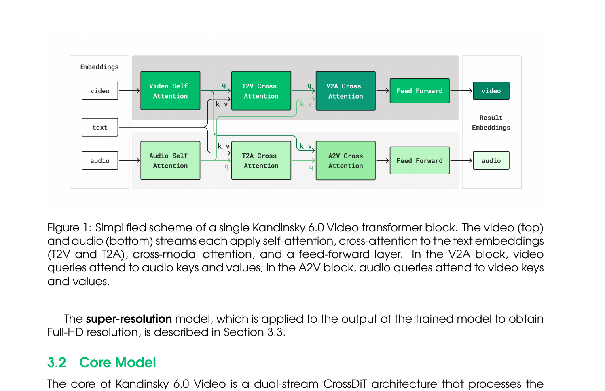
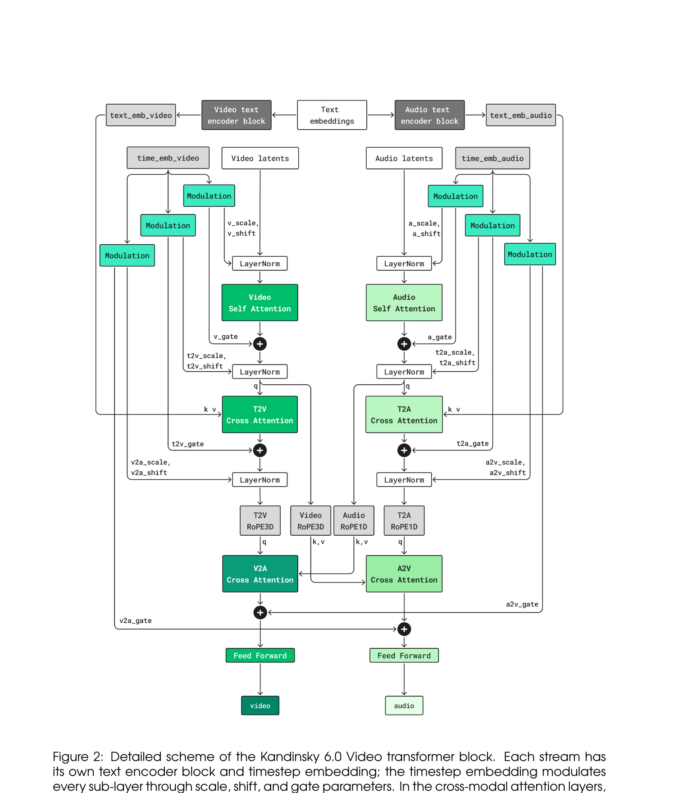
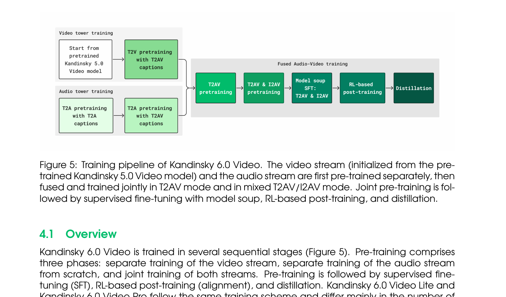
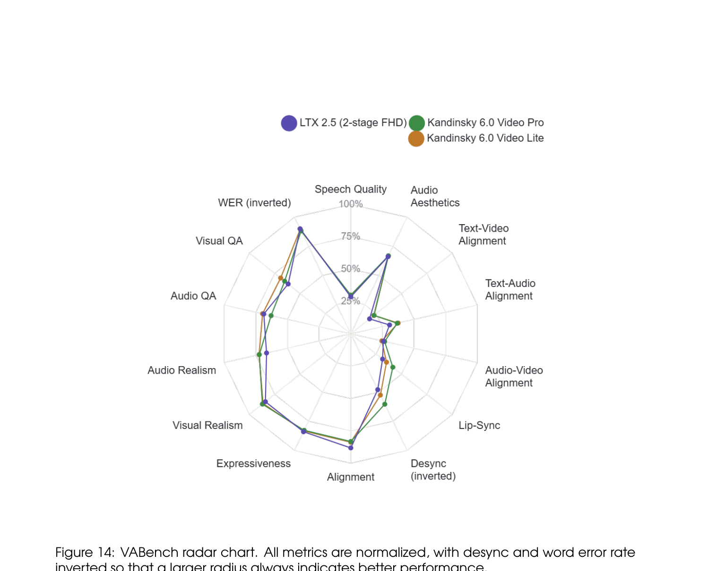

# Kandinsky 6.0 Video: Foundation Models for Synchronized Video and Audio Generation

**arXiv**: 2610.05608 | **机构**: Kandinsky Lab | **日期**: 2026-10-06 | **许可**: MIT（代码、权重、diffusers 集成全开源）

---

## 1. 一句话定位

双流 CrossDiT 架构，将预训练视频流与全新音频流通过逐块双向 cross-attention 连接，以持续预训练 → SFT → RL → 蒸馏的完整 post-training 流程，生成 5 秒 44kHz 同步音视频，配合超分辨率模块输出 Full-HD（1920×1080）。

---

## 2. 要解决的问题（动机）

现有开源视频生成模型（LTX-2.5、Wan 等）仅生成静音视频；商业闭源系统（Veo 3、Seedance 2.0）虽支持音视频，但不开放权重。音视频同步（唇形同步、冲击声与画面对齐）是核心难点：两种模态的时序结构差异大（视频帧 vs 音频波形），简单拼接会产生漂移。本文目标是提供首个开源的视频+音频联合基础模型，在语音质量、AV 对齐、视觉保真度三个维度全面可用。

---

## 3. 与前作的关系

- **Kandinsky 5.0**（前代）：纯视频 DiT，本文视频流直接从其预训练 checkpoint 初始化，保留参数量和层次结构。
- **OVI / LTX-2**：同样采用双流 DiT 处理两路模态，本文架构与其相似但针对视频+音频场景重新设计。
- **OmniNFT**：RL post-training 方法的来源，本文将其从 LTX-2 19B 适配到 Kandinsky 双流骨干。
- **MMAudio**：音频 VAE 来源，支持 44kHz 音频编解码。
- **π-Flow / LADD**：蒸馏阶段分别用于轨迹压缩和对抗精修。

---

## 4. 核心算法/方法

### 4.1 双流 CrossDiT 架构



> **Fig 1 逐段解读**：
>
> **(上行 - 视频流)** 视频 token 依次经过：Video Self-Attention（流内时空注意力）→ T2V Cross-Attention（以文本 embedding 为 k/v，视频 query 读取文本）→ V2A Cross-Attention（视频 query 读取音频 k/v）→ Feed Forward → 输出视频 embedding。
>
> **(下行 - 音频流)** 音频 token 同步经过：Audio Self-Attention → T2A Cross-Attention（以相同文本 embedding 为 k/v）→ A2V Cross-Attention（音频 query 读取视频 k/v）→ Feed Forward → 输出音频 embedding。
>
> **(V2A / A2V 互注意力)** 两路的跨模态注意力方向相反——V2A 中视频 query 去看音频的 k/v；A2V 中音频 query 去看视频的 k/v。这种双向设计使两流在每一层都能相互感知，而不是单向条件化。文本 embedding 被共享给两流但各自有独立的 text encoder block。



> **Fig 2 逐段解读**：
>
> **(顶部 - 文本编码)** 视频流和音频流各有独立的 text encoder block，从同一批 text embeddings 中分别提取 `text_emb_video` 和 `text_emb_audio`，使两流的文本条件化可以各自适配。
>
> **(时间条件调制)** `time_emb_video` 和 `time_emb_audio` 分别由各流时间步经 sinusoidal embedding 生成，通过 `Linear–SiLU–Linear` 产生 scale/shift/gate 三组向量，对 LayerNorm 后的每个子层（自注意力、text cross-attention、跨模态 cross-attention、FFN）分别调制（adaLN-Zero 风格）。
>
> **(自注意力 + 文本 cross-attention)** 视频侧 Self-Attention 使用 3D RoPE（时间/高度/宽度三维旋转位置编码，维度拆分为 16/24/24），音频侧 Self-Attention 使用 1D RoPE（时间维度）。T2V/T2A Cross-Attention 中两流分别以文本 token 为 k/v。
>
> **(V2A / A2V 跨模态注意力)** 两路在各自 LayerNorm 后，视频用 3D RoPE（`Video RoPE3D`）、音频用 1D RoPE（`Audio RoPE1D`）处理 query，然后音视频 k/v 共同进入注意力计算。gate 参数在训练初期接近零（残差初始化），让新加入的跨模态路径可以渐进学习而不破坏各流的原有能力。
>
> **(FFN + 残差)** 每个子层均通过 gate-weighted 残差连接回路，最终输出更新后的视频/音频 embedding。

**规模对比**:

| 版本 | 总参数 | 视频流 | 音频流 | 跨注意力 | 块数 |
|------|--------|--------|--------|----------|------|
| Lite | 3B | 2B | 0.6B | 0.4B | 32 |
| Pro | 29B | 19B | 5B | 5B | 60 |

两版本架构相同，视频流维度：`video_model_dim=1792/4096`，音频流维度：`audio_model_dim=896/2048`，FFN 维度：`ff_dim=7168/16384`。

**编解码器**:
- 视频：Hunyuan VAE（patch size (1,2,2)，16× 时空压缩）
- 音频：MMAudio autoencoder（44kHz，`in_audio_dim=40`）
- 文本：Qwen2.5-VL-7B-Instruct（max_length 1024，emb_size 3584）+ CLIP ViT-L/14（max_length 77，emb_size 768）

### 4.2 超分辨率模块（SR-DiT + Latent Upscaler）

基础模型输出 SD 分辨率（864×480 等），Full-HD 输出通过独立 SR 模块在 latent 空间完成：

**两阶段流程**:
```
LQ latent (64ch)
  ↓ Latent Upscaler (LU)   ← 卷积网络，×2 或 ×4，保持 latent 分辨率
HQ latent (64ch, 含退化)
  ↓ SR-DiT                 ← flow matching DiT，无文本条件，去除退化恢复细节
HQ latent (64ch, 干净)
  ↓ K-VAE decoder
Full-HD pixel video
```

**SR-DiT**: 32 块，隐藏维度 1792，28 头，~1.413B 参数，无文本编码器（pooled bias 替代文本条件）。输入为 `[x_t | anchor | mask]` 拼接（129 通道），HQ anchor（首帧）提供空间参考。

**Latent Upscaler (×4 model)**: 3×3×3 Conv(64→2048) → 5个 2048 宽 ResBlock → ×2 upsample → 3个 ResBlock(2048→1024) → ×2 upsample → 3个 ResBlock(1024→512) → 输出 64ch latent；约 1.44B 参数。

**推理路由（Full-HD）**: 基础模型输出 → 像素空间 ×1.125 双线性预放大 → K-VAE 编码 → LU(×2) → SR-DiT → K-VAE 解码 → 最终缩放到 1920×1080。

### 4.3 训练流程



> **Fig 5 逐段解读**：
>
> **(左侧 - 独立预训练)** 视频塔（从 Kandinsky 5.0 Video 预训练 checkpoint 启动）与音频塔（随机初始化）分别独立预训练：视频先在 T2V 字幕上预训练，再用 T2AV 字幕微调；音频先在纯音频字幕上，再用 T2AV 字幕继续。这一阶段两路 cross-attention 层尚未连接，视频和音频各自学习单模态表示。
>
> **(中间 - 融合音视频训练)** 将两塔通过跨模态 cross-attention 连接，在 T2AV（文本到音视频）数据上联合预训练，随后加入 25% I2AV（图像条件）数据混合训练，每次 forward pass 中视频和音频时间步独立采样（`independent_time` 模式）。
>
> **(右侧 - Post-training 阶段)** Model soup SFT（11 个领域独立微调后均匀权重平均）→ RL-based post-training（8 路奖励函数优化语音/同步/视觉质量）→ Distillation（π-Flow 轨迹压缩 + Sim-LADD 对抗精修），最终推理只需 10 NFE。

**持续预训练细节**（flow matching, MSE loss）:
- T2V（Lite）：45k steps（T2V 字幕）+ 20k steps（T2AV 字幕），batch 1024
- T2A（Lite）：40k steps（T2A 字幕）+ 2k steps（T2AV 字幕）
- 联合 T2AV（Lite）：57.5k steps，batch 256，最多 121 帧（5 秒 @ 23-25fps）
- 训练精度：bfloat16

**I2AV 模式 (Image-to-Audio-Video)**：参考帧 latent 沿时间轴拼接到视频 latent 的首位置，`channel_mask=1`（区别于 0 的生成帧），同时引入 Token Role Embeddings (TRE)（`emb_ref`/`emb_video`）区分条件帧与噪声帧的 token 角色。

**SFT（两阶段）**:
1. Stage 1（视觉质量）：冻结音频流，仅优化视频 loss，7000 steps，lr=1e-5；11 个领域独立训练后 model soup
2. Stage 2（唇形同步）：解冻所有模块，引入 face loss（视频 loss 0.85 + 音频 loss 0.15 + **face loss 1.0**），5000 steps，lr_video=1e-5, lr_audio=1e-6；model soup

**RL post-training（OmniNFT 适配）**:
8 路奖励函数，分三个 branch：

| Branch | 奖励函数 | 权重 |
|--------|----------|------|
| Video (2.5) | HPSv3 (1.5) + VideoAlign (1.0) | - |
| Audio (2.0) | AudioBox Aesthetics (0.5) + CLAP (1.0) + Whisper-ASR (0.5) | - |
| Sync (2.75，同时影响视频和音频) | AV-Desync (0.5) + AV-Align (0.75) + **LatentSync-gated (1.5)** | - |

优化策略：Branch-aware advantage routing（视频/音频 advantage 分别广播到对应 token），Layer-wise gradient surgery（压制 V2A cross-attention 的梯度防止视频梯度污染音频），Region-wise loss reweighting（用 A2V cross-attention 权重为人脸/手/乐器区域加权）。

RL 使用 LoRA（r=16, α=32），GRPO K=10 rollouts/prompt，DPM2 20步，CFG=1.0。

**效果**: Pro WER 0.235 → 0.124（-47%），Lite WER 0.179 → 0.127（-29%）

**蒸馏（两阶段）**:
1. **π-Flow 轨迹压缩**：on-policy 模仿学习，压缩到 10 NFE；4k steps，lr=3e-6，AdamW
2. **Sim-LADD 对抗精修**：判别器从学生自身 backward rollout 获取中间状态（非正向加噪），DRaFT-k（k=5）通过最终 5 步反向传播梯度；300 steps，batch 8，生成器 lr=8e-7

蒸馏后人评偏好：51% vs 49%（蒸馏 vs 全模型），质量无统计显著损失。

---

## 5. 关键数据集

| 类型 | 规模 | 备注 |
|------|------|------|
| T2I | 50M 图像 | 用于视频流图像注入（含 RCC 俄罗斯文化代码数据集） |
| T2V | 20M 视频场景 | 主视频预训练 |
| T2A | 大规模音频语料 | 音频流预训练 |
| T2AV | 配对音视频 | 联合训练核心数据 |
| SFT | 11 个领域（speech/music 等）| 每领域独立微调后 model soup |
| RL | 在线采样，per-prompt rollout | 8 路奖励实时打分 |
| SR | 150K clips（4K 100K + K5T2V 35K + Aesthetic-4K 15K）| 配对 LQ/HQ 退化数据 |
| RCC（俄罗斯文化代码）| 1.2M 图像 + 530K 视频 | 俄语文化内容，双语注入 |

字幕生成：Qwen3-235B-A22B 生成原始描述，Qwen3-30B-A3B 改写为 4 级详细程度混合（long 70% + medium 15% + short 10% + shortest 5%）。

---

## 6. 实验结果

### 6.1 VABench 自动评测（Table 11）



> **Fig 14 逐段解读**：
>
> **(三条线)** 绿色 = Kandinsky 6.0 Video Pro，橙色 = Kandinsky 6.0 Video Lite，蓝色 = LTX 2.5（两阶段 Full HD）。
>
> **(右上区域 - 语音/音频维度)** K6Pro 在 Speech Quality 和 Lip-Sync 方向明显突出，Pro 和 Lite 均超越 LTX 2.5；AV Alignment 方向两款 Kandinsky 与 LTX 接近。
>
> **(左上 - 文本对齐)** LTX 2.5 在 Text-Audio Alignment 上领先（蓝线在此方向最远）；Kandinsky Lite 在 Text-Audio 方向也略优于 Pro。
>
> **(左下 - 感知质量)** LTX 2.5 在 Alignment/Expressiveness 上保持领先（历史积淀的文本跟随能力）；K6Pro 在 Visual Realism 上最强。
>
> **(右下 - Desync 反转轴)** Desync 反转后越大越好，K6Pro 在此方向最优，表明音视频最少脱同步。

| 指标 | LTX 2.5 | K6 Lite | K6 Pro | 谁最好 |
|------|---------|---------|--------|--------|
| speech_qn（语音质量）| 1.427 | 1.477 | **1.496** | Pro |
| audio_aes（音频美学）| 3.307 | 3.323 | **3.345** | Pro |
| tv_align（文本-视频对齐）| 0.185 | 0.227 | **0.229** | Pro |
| ta_align（文本-音频对齐）| 0.307 | **0.374** | 0.367 | Lite |
| av_align（AV 对齐）| 0.258 | 0.245 | **0.268** | Pro |
| lipsync（唇形同步）| 1.567 | 1.761 | **2.072** | Pro |
| desync（脱同步，↓）| 0.521 | **0.474** | **0.396** | Pro |
| alignment | **4.527** | 4.351 | 4.329 | LTX |
| expressiveness | **4.360** | 4.334 | 4.312 | LTX |
| visual_realism | 4.366 | 4.459 | **4.485** | Pro |
| audio_realism | 3.663 | **3.900** | 3.893 | Lite |
| WER（↓）| **0.099** | 0.103 | 0.117 | LTX |

### 6.2 人类评估（侧面对比）

| 对比对象 | 结论 |
|----------|------|
| vs Kandinsky 5.0 Video Pro | **K6Pro 全面胜出**：视觉质量、Artifacts、运动真实性、视觉 prompt 跟随均大幅领先 |
| vs Kling 2.6 | **互有胜负**：K6Pro 领先音频 prompt 跟随；Kling 2.6 领先视觉美学和音频质量 |
| vs LTX 2.5 | **视觉和语音 K6Pro 胜出**；LTX 小幅领先通用音频保真度（未达显著性）|
| vs Veo 3.1 Fast | **清晰分工**：K6Pro 胜视觉干净度/相机控制；Veo 3.1 Fast 胜 prompt 跟随/音频质量 |
| vs MiniMax H3 | **H3 更强**：H3 在视觉质量全面领先；K6Pro 在语音/同步有竞争力 |
| vs Seedance 2.0 | **Seedance 视觉更强**；K6Pro 在语音质量上领先 |

### 6.3 推理效率（H100，5 秒 clips，非蒸馏）

| 模式 | Lite | Pro |
|------|------|-----|
| SD | 239s | 356s |
| HD | 203s | 292s |
| Full HD | 284s | 402s |

消费级 GPU（RTX 5090/4090）通过 block offloading 可运行，Pro 模型 SD 峰值内存从 72.8GB → 21.7GB（offloading 模式），支持 16GB VRAM 卡（NF4 量化文本编码器 + SR 空间分块）。

---

## 7. 争议/权衡

1. **实验结果位置**：VABench 只和 LTX 2.5 做自动评测对比，对 Kling/Veo/MiniMax/Seedance 只做人评；人评是自家标注，存在偏差风险，但协议描述较详细。

2. **WER 偏高**：K6Pro WER 0.117，高于 LTX 2.5 的 0.099。作者注明两套 WER（RL 内部用 Whisper-large-v3，外部报告用 Qwen3-ASR-1.7B）不可直接比较，但 LTX 仍更优。

3. **MiniMax H3 / Seedance 明显更强**：人评显示两者在视觉质量上以统计显著边距胜出，K6Pro 只在语音/同步方向保持竞争力，说明视觉 backbone（29B Pro）相比顶级对手仍有差距。

4. **Super-Resolution 是关键工程**：Full-HD 质量很大程度依赖 SR-DiT + LU 流程；基础模型仅 SD 输出。SR 是单独训练且与音频流无关，两阶段推理（主模型 + SR）延迟叠加。

5. **RL 奖励设计的权衡**：LatentSync-gated（面部唇形同步）权重 1.5 是最高单项，说明唇形同步是核心优化目标，但可能导致对无人脸场景的音频优化相对不足。

6. **蒸馏质量几乎无损**：51% vs 49% 的人评偏好差异不显著，是本文亮点之一；但蒸馏后模型 SR 推理还需额外 2 NFE（总共 NFE=12）。

---

## 8. 一句话总结

Kandinsky 6.0 Video 以双流 CrossDiT（视频 + 音频，逐块双向跨模态注意力）+ 完整 post-training 流程（SFT 唇形同步 + 8 路 RL + π-Flow/Sim-LADD 蒸馏）实现了目前开源最强的同步音视频生成，在语音质量和 AV 同步方面有竞争力，但视觉整体质量落后于 MiniMax H3 和 Seedance 2.0 等顶级闭源模型。

---

## Q&A

