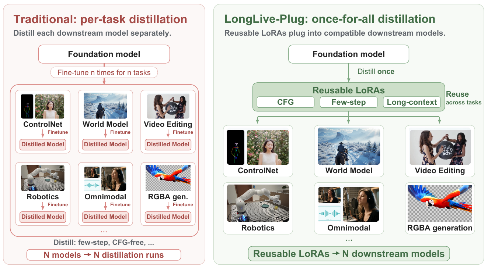
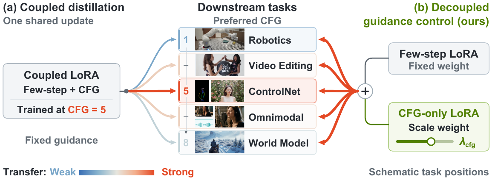
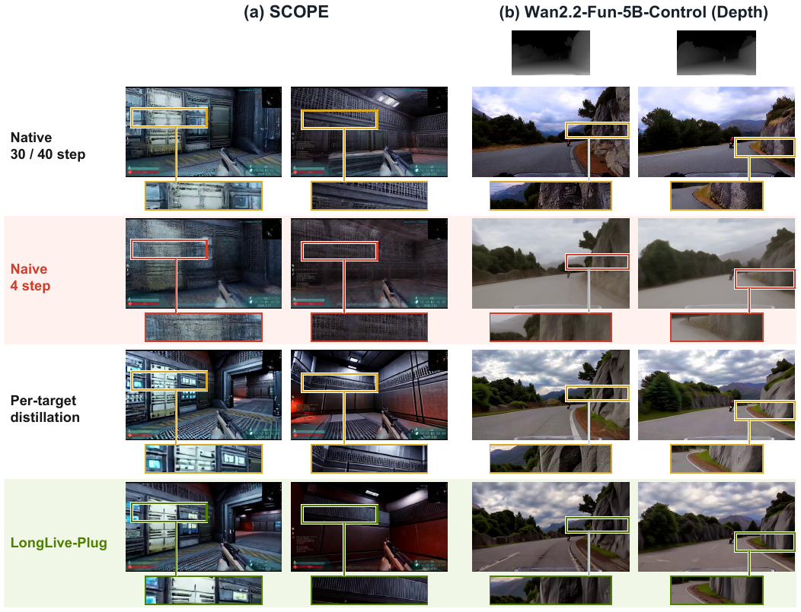
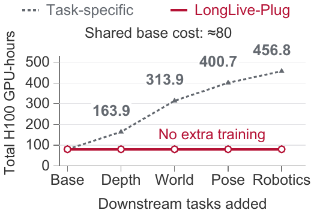
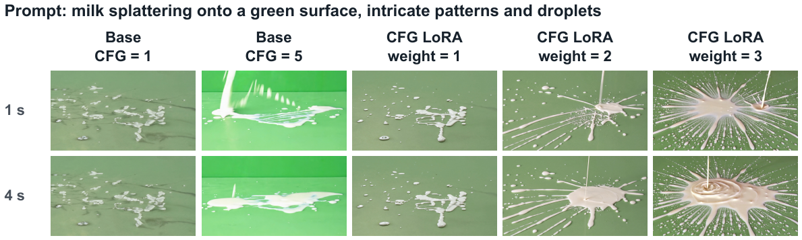
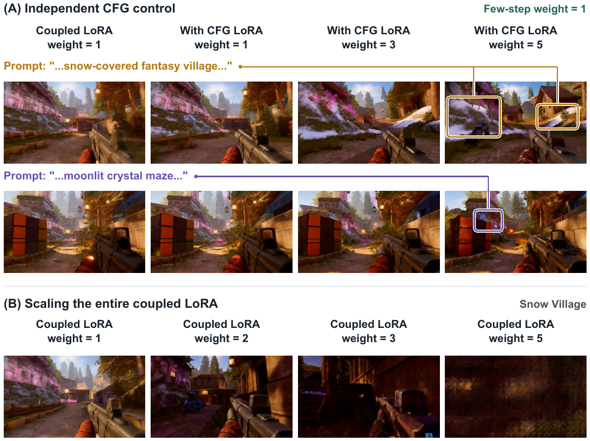
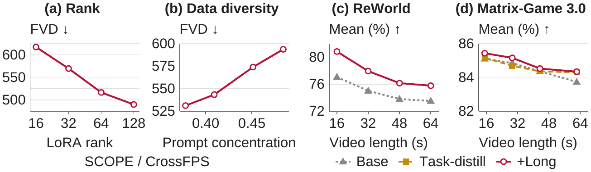
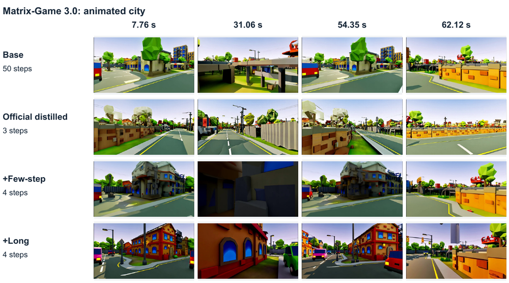
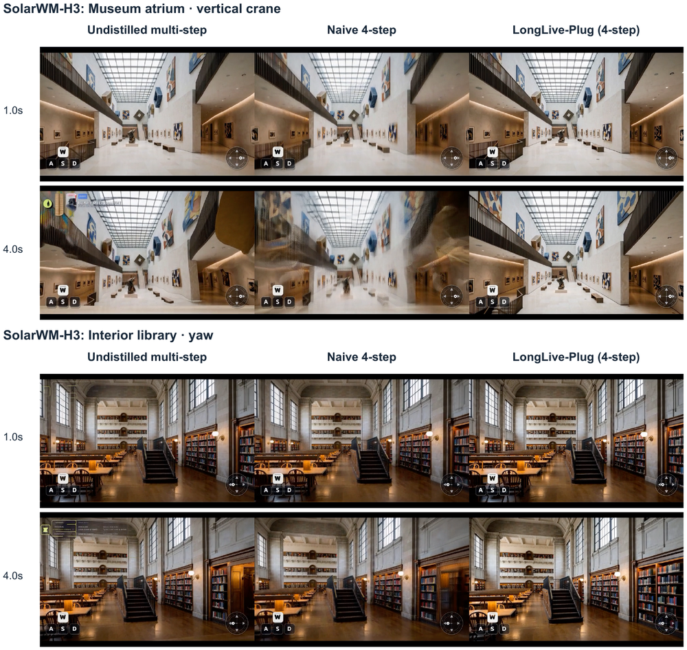

# LongLive-Plug: Once-for-All Distillation for Video Generation

**论文**: [arXiv:2609.38154v1](https://arxiv.org/abs/2609.38154) (cs.CV, 2026-09-29, 29 页：正文 9 页 + 参考文献 5 页 + 附录 15 页)
**作者**: Shuai Yang\*, Luozhou Wang\*, Wei Huang, ZhiFei Chen, Bohan Zhang, Xiao Fu, Qianli Ma, Chen-Hsuan Lin, Weian Mao, Bryan Chu, Song Han, Yukang Chen —— **NVIDIA**（\* 共同一作）。和 LongLive（ICLR 2026）共有 Shuai Yang、Wei Huang、Song Han、Yukang Chen 四位作者；[ReWorld](../reworld/analysis.md) 的一作 ZhiFei Chen、二作 Luozhou Wang 也在作者里
**链接**: [代码（NVlabs/LongLive）](https://github.com/NVlabs/LongLive)、[项目页](https://nvlabs.github.io/LongLive/LongLive-Plug/)、[模型](https://huggingface.co/collections/Efficient-Large-Model/longlive-plug)（三个链接取自 PDF 首页）。仓库内容和许可证我没有核对 `[待补]`；H3 版 LoRA 要和 MiniMax-H3 权重一起用，H3 本身的许可证也要一并看

---

## 1. 一句话定位

**LongLive-Plug 把"蒸馏"从"每个下游模型各做一次"改成"每个 base 只做一次"。** 在 base 模型上把三种能力各蒸成一个 LoRA：单次前向的 CFG、4 步采样、长上下文纠错。然后不经任何下游训练，直接加到同一 base 的各种下游模型上。这些下游模型可以是全参微调过的，可以挂了任务 LoRA，也可以多了 ControlNet 分支或输出通道。

**另一个卖点是把 CFG 单独蒸成一个 LoRA**：它的推理权重 `λ_cfg` 可以当引导强度旋钮用，每个下游任务按需调，而少步 LoRA 的权重固定为 1 不动。

| | 原生多步 | 朴素 4 步 | 逐目标蒸馏 | **LongLive-Plug** |
|---|---|---|---|---|
| SCOPE（FPS 游戏世界模型）FVD ↓ / JEPA ↑（Table 1） | **382.9 / 0.868**（30 步） | 805.5 / 0.732 | 502.1 / 0.782 | 478.7 / 0.792 |
| Wan2.2-Fun-5B-Control 深度 si-RMSE ↓ / DOVER ↑（Table 2） | 1.819 / 9.32（榜单值，设置未公开） | 2.135 / 8.90 | **1.515 / 10.25** | 1.641 / 10.11 |
| Matrix-Game 3.0，62 s 长 rollout，VBench 7 维均值 ↑（Table 3） | 83.73（50 步） | — | 84.30（官方 3 步） | **84.34**（4 步） |
| 新增一个下游任务的蒸馏成本（Fig 3） | — | 0 | 56–150 H100 GPU·h | **0** |

（原生多步、逐目标蒸馏的步数和设置各表不同，见 §5。）

🔴 **读完全文后我认为头条要打四个折扣**：
1. **"在 54 个下游模型上验证过"大多是定性的。** 54 个里有定量结果的只有 3 个（SCOPE、Wan2.2-Fun-5B-Control、Matrix-Game 3.0），另有一个不在清单里的 ReWorld。其余 51 个是并排对比的截图，附录 Fig 10 的图注自己也写了"迁移后外观和运动的变化仍然可见"。H3 的 10 组对比，附录 C.3 写明：全部单 seed，没有置信区间；"朴素 4 步 → LongLive-Plug"同时换了 adapter 和采样器；在一个相机偏航例子里，相机运动幅度被明显削弱（见 [§5.7](#57-54-个下游模型与-h3-的局限)）。
2. **"解耦"并不彻底，引导旋钮也没有定量验证。**
   - 少步 LoRA 的 DMD teacher 本身就带 CFG：Wan2.2 是 4，Wan2.1 是 5（附录 Table 4）。所以少步 LoRA 里已经烤进了一份引导，CFG LoRA 是在它上面**再加**一个可调的旋钮。
   - "旋钮近似线性"只有定性图支撑，没有"引导强度 vs `λ_cfg`"的曲线。
   - Fig 5 里 CFG LoRA 权重取 1 的画面明显更接近 base 的 CFG = 1，而不像它训练时对齐的 CFG = 5。按 Eq 3，权重 1 本应对应 w = 5。
   - 主结果的 `λ_cfg` 按任务分别取（SCOPE 3，ControlNet 1），怎么选的没说。
3. **长上下文那组少了关键对照。** Table 3 没有"只挂少步 LoRA、不挂长上下文 LoRA"这一行（附录定性图里有），所以说不清提升来自长上下文 LoRA 本身，还是只是来自 4 步蒸馏。ReWorld 那组也没和 ReWorld 自带的 4 步 DMD LoRA 比，只比了 24 步 base；Matrix-Game 那组倒是比了官方 3 步蒸馏。
   - ReWorld 上背景一致性从 88.87 掉到 80.81；
   - Matrix-Game 3.0 上 +Long 和官方 3 步蒸馏基本打平（84.34 vs 84.30），成像质量反而更低（70.43 vs 74.59）；
   - 动态程度这一维三方都是 100，被平均进总分。
4. **第三方数据点：挂到强专门化的控制模型上会掉质量。** [SolarRenderer](../../world_model/solarrenderer/analysis.md) 在 MiniMax-H3 的结构控制 LoRA 上，把三个现成的 4 步 LoRA 不经训练直接挂上去：
   - SolarRenderer 的 Table 3 里 LongLive-Plug 的 Gemini Elo 最低（922，DMAD 1006、FastH3 1053）；但在它的 Table 2 那一组里，LongLive-Plug 和 DMAD 基本打平（1028 vs 1024）。Elo 按组单独拟合、只能组内比较，所以"LongLive-Plug 比别的 4 步 LoRA 差"这个结论不稳。
   - 稳的是另一点：针对这个控制模型再做后训练，Elo 明显更高（同在 SolarRenderer 的 Table 2 里：从 LongLive-Plug 起步、w = 2 时从 1028 到 1107）。免训练挂载在这里是能用的起点，不是终点。

📌 **站得住的部分**：
- **工程价值清楚**：在 Wan2.2-TI2V-5B 上，base 蒸馏一次约 80 H100 GPU·h；给 4 个下游任务逐个蒸馏要再多 376.8 GPU·h，还要每个任务的数据。在两个有数字的任务上，LongLive-Plug 与逐目标蒸馏互有胜负。
- **两个面向迁移的发现有用**：LoRA rank 从 16 到 128，迁移后的 FVD 单调好 21%；蒸馏 prompt 越分散，迁移越好（FVD 差 12%）。也就是说，加速 LoRA 的容量和数据覆盖，不能只看它在 base 上拟合得好不好。
- **附录对 H3 部分的局限写得诚实**：明确说那些例子"评估的是完整部署配方，而不是单独加 LoRA 的因果效应"、"不能证明精确的轨迹跟随"。

---

## 2. 要解决的问题

下游视频模型越来越多：世界模型、机器人、编辑、ControlNet、音视频、RGBA……开发它们时通常有一个蒸馏阶段，用来加速采样或改善长视频，而这一步**每个下游模型都要重做一次**：准备数据、跑 teacher、调优化。论文举的例子：
- FlashMotion、StreamAvatar、LiveEdit、FlashVSR 都是对各自的专门模型单独蒸馏；
- DreamDojo 做少步因果蒸馏；
- BiWM 在相机控制微调之后再做 DMD。

**思路**：能力蒸馏在 base 上做一次，打包成 LoRA，挂到同一 base 的各个后代模型上。

> **Fig 1 读法**：
> - **左（传统）**：同一个基础模型先针对 n 个任务微调出 n 个模型，再分别蒸馏，n 个模型对应 n 次蒸馏。
> - **右（本文）**：基础模型只蒸一次，得到 CFG、Few-step、Long-context 三个可复用 LoRA，直接挂到 ControlNet、世界模型、编辑、机器人、全模态、RGBA 等下游模型上。

**和前作的边界**：
- "在 base 上蒸一个加速 LoRA、挂到各个微调模型上"，图像领域已有 LCM-LoRA（Stable Diffusion，2023）；
- CFG 蒸馏成 adapter 并考察它在图像派生模型上的迁移，有 Perez Jensen & Sadat（TMLR 2025）；把一个非 LoRA 的 guide network 在微调过的图像模型之间迁移，有 Plug-and-Play Diffusion Distillation（CVPR 2024）；
- [CASA](../casa/analysis.md) 做的是反方向：把下游 LoRA 搬到少步模型上。

本文的增量是：把这条路线扩到三类视频 backbone、54 个下游模型；单独蒸一个可调强度的 CFG LoRA；加入长上下文纠错 LoRA；给出 rank 与数据覆盖对迁移的影响。

---

## 3. 方法

### 3.1 一次蒸馏、到处挂载

对每个 backbone 家族，冻结 base 模型 `F_θ0`，把每种能力蒸成 LoRA 参数 `φ`，再直接加到兼容的下游模型 `F_θτ` 上：

$$
F_{\theta_0}\ \xrightarrow{\ \text{distill once}\ }\ \phi,\qquad F_{\theta_\tau}\ \xrightarrow{\ \oplus\phi,\ \text{no target training}\ }\ F_{\theta_\tau}\oplus\phi
$$

`⊕` 是把 LoRA 更新加到对应层上，同时保留下游模型自己的任务权重（包括额外的 ControlNet 分支、扩展的输出通道），不做任何下游训练。

### 3.2 CFG LoRA 与权重旋钮

**训练**（附录 Algorithm 1）：teacher 用标准 CFG，`v_cfg = v_∅ + w (v_c − v_∅)`。在固定的 `w_train` 下，只训一个 CFG LoRA，让它的**单次条件前向**输出去回归 teacher 的引导预测（目标视为常数）。backbone、采样步表、attention 模式都不变。
- "无条件"分支实际用的是配置好的负向 prompt；
- 双向 T2V 训练时整段视频共享一个 timestep，在训练步表的 2%–98% 之间采样。

**旋钮**：推理时调 CFG LoRA 的权重 `λ_cfg`。在近似线性响应的假设下：

$$
F_{\theta_0}\oplus\lambda_{\mathrm{cfg}}\phi_{\mathrm{cfg}}\ \approx\ v_c+\lambda_{\mathrm{cfg}}\left(v_{\mathrm{cfg}}^{(w_{\mathrm{train}})}-v_c\right)\ \approx\ v_{\mathrm{cfg}}^{(\tilde w)},\qquad \tilde w = 1+\lambda_{\mathrm{cfg}}\left(w_{\mathrm{train}}-1\right)
$$

权重 0 回到纯条件模型，1 对应训练时的引导，大于 1 是外推。论文自己说明这只是近似，非线性响应和下游专门化都会改变实际引导强度，所以"在 §4.3 做经验验证"。实际的验证只有定性图（Fig 5、6、14–18）。

**和少步 LoRA 组合**：推理时把两份更新加权合并进下游权重：

$$
\widetilde W_\ell^{(\tau)} = W_\ell^{(\tau)} + \lambda_{\mathrm{step}}\,\Delta W_{\ell,\mathrm{step}} + \lambda_{\mathrm{cfg}}\,\Delta W_{\ell,\mathrm{cfg}}
$$

部署时 `λ_step = 1` 固定，只按任务调 `λ_cfg`。合并后每步只需一次条件前向。

> **Fig 2 读法**：
> - **左（a）**：耦合 LoRA 在 CFG = 5 下同时蒸了少步和引导，只能整体缩放，对偏好其他引导强度的任务迁移就弱。图中五个任务里标了数的是机器人 1、ControlNet 5、世界模型 8（视频编辑、全模态没标），图上注明位置只是示意。
> - **右（b）**：少步 LoRA 权重固定，另加一个只管引导的 CFG LoRA，用 `λ_cfg` 调强度。

⚠️ **"解耦"的确切含义**：按附录 Table 4，少步 LoRA 是用 DMD2 训的，而 DMD 的真分数（teacher）本身带 CFG：Wan2.2 是 4，Wan2.1 是 5。所以少步 LoRA 里已经有一份固定的引导；Fig 6 里"few-step weight = 1"的那个 LoRA，图上标的就是"Coupled LoRA"。本文的"解耦"实际上是**在耦合的少步 LoRA 之上再叠一个独立可调的 CFG LoRA**，而不是"一个不带引导的少步 LoRA + 一个只管引导的 LoRA"。正文 §1 "distills CFG and few-step generation into separate LoRAs" 的说法容易让人误解成后者。

### 3.3 少步 LoRA（DMD2）

附录 A.2、Algorithm 2：
- 冻结的真分数 teacher（带 CFG），一个生成器 LoRA `φ_step`，一个可训的假分数 LoRA `ψ`；
- 生成器每 5 次假分数更新才更新 1 次；
- **没有 GAN 判别器项**。

细节：
- **score timestep**：按 `u ↦ su / [1 + (s − 1)u]` 做 shift，夹在训练时间范围的 [0.02, 0.98] 内。
- **按时间块归一化 DMD 梯度**：
  - 在每个时间块 `b` 内用 `n_b = mean |x_φ − x̂_real|` 归一化 `g_b = (x̂_ψ − x̂_real) / n_b`（再做 `nan_to_num`）；
  - 生成器损失 `½ mean ‖x_φ − sg[x_φ − g]‖²`，梯度不经过任何 score 网络。
- **假分数更新**：对另一个 detach 的学生样本加噪，回归 flow 目标 `ε − x_φ`。

### 3.4 长上下文 LoRA

用 LongLive 的 **Streaming Long Tuning** 在一个**冻结的因果 AR 版 base**（Wan）上训：学生基于自己缓存的历史逐段生成，预训练 teacher 对每段新生成的短片做 DMD 监督；前面的历史 detach，梯度只留在当前片段，rollout 再长也不爆显存。

**前提**：目标模型本身必须已经支持因果 AR 推理。LoRA 只改权重，改不了 attention mask（§5 原话）。

### 3.5 面向迁移的两个设计

- **Rank**：rank 小的 LoRA 可能在 base 上拟合得很好，但迁移差。所以评估容量时要同时看 base 拟合和下游迁移。checkpoint 按 base 上的验证集选。
- **蒸馏数据**：在 base 上用覆盖各种主体、场景、运动、风格的通用 T2V prompt，不用任何目标数据。

### 3.6 实现超参（附录 Table 4，Wan）

| | CFG-only，Wan2.2 | 少步，Wan2.2 | 少步，Wan2.1 |
|---|---|---|---|
| LoRA rank | 128 | 128 | 128 |
| 假分数 LoRA | 无 | 有 | 有 |
| 学习率（生成器 / critic） | 1e-5 / — | 1e-5 / 2e-6 | 1e-5 / 2e-6 |
| AdamW（β1, β2）、weight decay | (0, 0.999)、0 | (0, 0.999)、0 | (0, 0.999)、0.01 |
| 每进程 batch / 累积 | 1 / 1 | 1 / 1 | 1 / 1 |
| 生成器 EMA | 关 | 0.99，从第 200 步开始 | 关 |
| teacher CFG w | 5 | **4** | 5 |
| latent（帧 × C × H × W） | 32 × 48 × 22 × 40 | 32 × 48 × 44 × 80 | 21 × 16 × 60 × 104 |
| 采样步数 | 50 | 4 | 4 |

- 混合精度 + FSDP + 梯度检查点；CFG 回归用 FP32 目标与残差，梯度裁剪范数 10。
- DMD 的"迭代数"按假分数更新计数，生成器只在能被 5 整除的迭代上更新。
- **只给了 Wan 的超参**，H3 的少步 LoRA 怎么训的没写。
- CFG-only LoRA 训练时的 latent 在空间上只有少步 LoRA 的一半（22 × 40 vs 44 × 80），而 Table 2 是在 720P 上用的。

---

## 4. 实验设置

| 项 | 设置 |
|---|---|
| 主对比的 base | Wan2.2-TI2V-5B |
| 下游任务 1：SCOPE | FPS 游戏世界模型，1,378 个 CrossFPS clip，沿用 SCOPE 的输入输出设置和指标；原生 30 步 |
| 下游任务 2：Wan2.2-Fun-5B-Control | 深度 ControlNet，PAI-Bench-C 全部 600 个深度条件 case，720P；原生 40 步 |
| 对比 | 原生多步、朴素 4 步、逐目标 DMD2 蒸馏（作者自己跑的）、LongLive-Plug。LongLive-Plug 的权重：SCOPE 用 `(λ_step, λ_cfg) = (1, 3)`，ControlNet 用 `(1, 1)` |
| 长上下文 | 在 AR 版 Wan base 上蒸的长上下文 LoRA，迁到 ReWorld（训练窗口约 8 s，测 16–64 s，原生 24 步）和 Matrix-Game 3.0（1,057 帧 @ 17 fps = 62.18 s，原生 50 步，官方 3 步蒸馏）；指标是 VBench 七个视频本身的维度 |
| 覆盖面 | 54 个下游模型（Wan2.1-14B 24 个、Wan2.2-TI2V-5B 24 个、MiniMax-H3 6 个），8 类任务，对比原生多步与 4 步、免 CFG 的挂载结果（附录 Table 5 与图 10–13） |
| 没有报告的 | 实测加速（只说去噪步数降 5–12.5 倍；附录提到 H3 各后端的计时口径不同，但全文没有给计时数字）；Table 1 / 2 / 3 的 seed 数与误差棒；`λ_cfg` 怎么选；H3 少步 LoRA 的训练设置；CFG LoRA 单独的训练成本 |

---

## 5. 结果

### 5.1 SCOPE（Table 1）

| 方法 | JEPA ↑ | FVD ↓ | LPIPS ↓ | Flow ↑ | Smooth. ↑ | Photo. ↓ | Depth ↓ |
|---|---|---|---|---|---|---|---|
| 原生 30 步 | **0.868** | **382.9** | 0.651 | **22.11** | **2.418** | 9.182 | 1.287 |
| 朴素 4 步 | 0.732 | 805.5 | **0.628** | 11.77 | 2.093 | 8.468 | 1.242 |
| SCOPE 专门蒸馏 | 0.782 | 502.1 | 0.678 | 16.54 | 2.415 | 5.695 | **1.203** |
| **LongLive-Plug** | 0.792 | 478.7 | 0.669 | 16.87 | 2.399 | **4.246** | 1.230 |

- **对朴素 4 步**：FVD 从 805.5 降到 478.7，与 SCOPE 专门蒸馏（502.1）相当甚至略好。
- ⚠️ **LPIPS 一列最好的是朴素 4 步**（0.628），也就是最糊的那个，这一列的参考价值存疑。
- ⚠️ **一致性指标和运动量可能相关**：原生 30 步的两项一致性误差（Photo、Depth）反而最差，而所有 4 步方法的 Flow 都比它低（LongLive-Plug 16.87 vs 22.11，−24%，我算的）。运动少，一致性指标自然好看，所以 Photo 上的领先不能直接读成"更一致"。

### 5.2 Wan2.2-Fun-5B-Control（Table 2）

| 方法 | SSIM ↑ | F1 ↑ | si-RMSE ↓ | mIoU ↑ | DOVER ↑ | LPIPS（多样性）↑ |
|---|---|---|---|---|---|---|
| 榜单报告值（参照，设置未公开） | 0.556 | **0.106** | 1.819 | **0.615** | 9.32 | **0.481** |
| 朴素 4 步 | 0.560 | 0.094 | 2.135 | 0.582 | 8.90 | 0.264 |
| ControlNet 专门蒸馏 | 0.544 | 0.099 | **1.515** | 0.595 | **10.25** | 0.461 |
| **LongLive-Plug** | **0.566** | 0.100 | 1.641 | 0.612 | 10.11 | 0.426 |

- **对朴素 4 步**：六项全部更好。
- **对专门蒸馏**：SSIM、F1、mIoU 更好，si-RMSE、DOVER、多样性更差，互有胜负。
- ⚠️ **这张表没有同条件的原生 40 步基线**：本地三行都是 4 步、不开运行时 CFG；"榜单报告值"来自 PAI-Bench-C 榜单，设置未公开。所以"和原生多步差多少"这个问题，这张表回答不了。

> **Fig 4 读法**：每个任务两帧，从上到下依次是原生多步、朴素 4 步、逐目标蒸馏、LongLive-Plug，框住的区域在下方放大。朴素 4 步明显发糊（墙面、门边有重影，岩石和植被糊成一片）；后两行都清晰。⚠️ 图注里有一句"LongLive-Plug uses an additional base-distilled adapter variant"，没说明这个变体和 Table 1 / 2 用的是不是同一个。

### 5.3 成本（Fig 3）

- **base 蒸馏**：一次约 80 H100 GPU·h，即 700 次迭代、32 卡、约 2.5 小时。如果这 700 次按附录 DMD 的口径计数（按假分数更新计，生成器每 5 次更新 1 次），生成器只更新了约 140 次（我算的）。
- **逐目标蒸馏**：深度条件、世界模型、姿态条件、机器人仿真四个任务分别再加 83.9、150.0、86.8、56.1 GPU·h，共 376.8，累计 456.8；深度那个还需要 5,000 对 prompt 和动态深度视频。LongLive-Plug 停在 80，不需要任何下游数据。
- ⚠️ **两点没交代**：
  - 图里两条曲线都从这 80 GPU·h 起步。逐目标蒸馏为什么也要计入 base 蒸馏的成本（是从 base 蒸馏结果热启动，还是只是记账方式），论文没说。
  - CFG LoRA 的训练成本是否包含在 80 里，也没说。

### 5.4 CFG 旋钮（Fig 5、6）

> **Fig 5 读法**：Wan2.2-TI2V-5B，原生 50 步，prompt 是"牛奶溅到绿色表面"。前两列是 base 在 CFG = 1、5 下的结果，后三列是 CFG LoRA 权重 1、2、3（运行时 CFG = 1，每步一次条件前向）。权重越大，飞溅越明显。
>
> ⚠️ 仔细看，**权重 1 的画面和 base 的 CFG = 1 几乎一样，而不像它训练时对齐的 CFG = 5**；到权重 2、3 才出现明显的飞溅，形态也和 CFG = 5 不同。按 Eq 3，权重 1 应该对应 w = 5。论文的说法是"跟随更强 CFG 的趋势，但不精确对应原生 CFG 数值"。我的读法是：CFG LoRA 在训练权重下并没有复现训练目标的引导强度，至少在这个例子里如此。附录 D 也强调"LoRA 权重不是校准过的 CFG 数值"。

> **Fig 6 读法**：
> - **（A）**：耦合 LoRA 权重固定为 1，单独加 CFG LoRA，权重 1、3、5。雪村、水晶迷宫这类 prompt 属性随权重增强，几何和手里的武器保持不变。
> - **（B）**：把整个耦合 LoRA 放大到 2、3、5 倍，画面变暗变形，权重 5 时完全崩坏。
>
> 这组对比说明"单独加一个 CFG LoRA"比"整体放大"安全，但两边用的是不同的耦合 checkpoint（图注原话）。附录 Fig 17、18 也显示，CFG 权重到 5 时会改变几何、出现乱码文字，需要按任务在合理范围内调。

### 5.5 Rank 与数据覆盖（Fig 7a、b）

> **Fig 7 读法**：
> - **（a）**：rank 16 → 32 → 64 → 128，SCOPE 上迁移后的 FVD 约从 617 降到 489（从图上读的），单调好 21%。
> - **（b）**：横轴是 prompt 集中度（UMT5 嵌入的平均两两余弦相似度，越低越分散），FVD 约从 531 升到 594，差 12%。
> - **（c）**：ReWorld 上 16–64 s 的 VBench 七维均值，+Long 每个长度都高于 base。
> - **（d）**：Matrix-Game 3.0 上三条线前段几乎重合，+Long 一直略高；到 62 s，base 降到 83.73，另两条在 84.3 左右（Table 3）。

- **rank 实验**：固定 teacher、prompt、目标层、优化预算和 checkpoint 选择规则，只变 rank。但正文说的"小 rank 在 base 上拟合得好"没有给对应数字，图里只有迁移后的 FVD。
- **数据多样性实验**：论文自己承认"在固定训练量下，不同 prompt 的数量随集中度一起变"，所以这里的效应混合了"更分散"和"prompt 更多"两件事。
- **两组实验的共同限制**：都只在 SCOPE 一个下游、只看 FVD 一个指标，单次训练。

### 5.6 长上下文迁移（Table 3）

| 模型 | 成像质量 | 美学 | 主体一致 | 背景一致 | 时间闪烁 | 动态程度 | 运动平滑 | 均值 |
|---|---|---|---|---|---|---|---|---|
| ReWorld-base（24 步，64 s） | 33.83 | 37.18 | 63.48 | **88.87** | 95.29 | 100.00 | 95.89 | 73.51 |
| ReWorld +Long（4 步） | **45.41** | **44.53** | **66.01** | 80.81 | **95.75** | 100.00 | **97.89** | **75.77** |
| Matrix-Game-base（50 步，62.18 s） | 70.76 | 50.51 | 82.72 | 91.10 | 93.69 | 100.00 | 97.34 | 83.73 |
| Matrix-Game 官方蒸馏（3 步） | **74.59** | 51.91 | **83.35** | 91.39 | 91.93 | 100.00 | 96.90 | 84.30 |
| Matrix-Game +Long（4 步） | 70.43 | **54.25** | 82.16 | **91.51** | **94.12** | 100.00 | **97.90** | **84.34** |

- **ReWorld**：+Long 在所有测试长度上都高于 base，最长到训练时长的 8 倍（64 s / 8 s）；但背景一致性掉了 8 个点。⚠️ ReWorld 自己就带一个 4 步 DMD LoRA（rank 128，见 [ReWorld 笔记](../reworld/analysis.md)），两篇作者也有重叠，但这里只和 24 步 base 比，没有和它比。
- **Matrix-Game 3.0**：+Long 与官方 3 步蒸馏只差 0.04，成像质量低 4 个点，美学高 2 个点。论文的措辞是"competitive"，是准确的。
- ⚠️ **缺"+few-step"一行**：附录定性图（Fig 19–21）里有"只挂少步 LoRA"的对照，但 Table 3 没给它的数字。长上下文 LoRA 相对普通少步 LoRA 到底多带来多少，这张表回答不了。
- ⚠️ **动态程度三方都是 100**，这一维不区分方法，却以 1/7 的权重进了均值。

> **Fig 20 读法**：同一输入图、prompt、seed 和动作序列，四行依次是原生 50 步、官方 3 步蒸馏、只挂少步 LoRA（4 步）、挂长上下文 LoRA（4 步）。只挂少步 LoRA 那一行在 31 s 处画面发暗、看不清结构，54 s 后又恢复成正常街景；单帧分不清是生成退化还是镜头贴墙。这一行正是 Table 3 缺的那一行。图注说 +Long 在后段保留了清楚的楼体边缘和街道物体；四行的场景布局本来就各不相同（附录 Fig 21 的图注也这么说）。

### 5.7 54 个下游模型与 H3 的局限

**覆盖面**（附录 Table 5）：

| backbone | 数量 | 例子 |
|---|---|---|
| Wan2.1-14B | 24 | 世界模型（LongVie 2、FantasyWorld）、机器人（DreamZero、ABot-PhysWorld）、ControlNet、相机 / 轨迹（Wan-Move、ATI）、编辑（VideoCoF）、主体 / 数字人（Stand-In、MultiTalk、InfiniteTalk）、RGBA（Wan-Alpha）、风格（Index-AniSora） |
| Wan2.2-TI2V-5B | 24 | 世界模型（Matrix-Game 3.0、SCOPE、DreamX-World AR）、机器人（Fast-WAM）、Fun Control、FlashMotion、Kiwi-Edit、TalkVerse、Ovi 等音视频、Loomis Painter 风格 LoRA |
| MiniMax-H3 | 6 | H3-World、Code World Model、SolarWM-H3、Fun ControlNet-Union、LineartAnime、Viggle-Animate |

- **步数**：对 20–50 步的原生步表，换成 4 步是去噪步数降 5–12.5 倍。对原本开 CFG 的模型，还省掉无条件分支，每步前向次数减半，合起来是 10–25 倍（我算的）。论文**没有报任何实测耗时**。
- **H3 不挂 CFG LoRA**：MiniMax-H3 本身就支持无 CFG 推理，所以默认不挂。作者另在 H3 上训了一个 CFG 3 的 CFG-only LoRA，只做了定性展示：34 个 prompt × 13 种设置 = 442 个视频。

> **Fig 13 读法**：SolarWM-H3 的两个相机控制例子，三列依次是原生多步、朴素 4 步、LongLive-Plug 4 步。
> - **上（博物馆、垂直升降）**：LongLive-Plug 保留了清楚的建筑细节和向上的镜头运动；朴素 4 步糊成重影。
> - **下（图书馆、偏航）**：LongLive-Plug 画面清晰，但**镜头的转动幅度明显小于另两列**。
>
> 附录 C.3 自己写明：这些例子没有位姿回归指标，不能证明轨迹跟随准确；H3 的 10 组对比全部是单 seed；"朴素 4 步 → LongLive-Plug"同时换了 adapter 和采样器（后者用的是 fresh re-noising）；原生多步和另两列的初始噪声也不保证逐位相同。

---

## 6. 数字核对

| 说法 | 复算 | 结论 |
|---|---|---|
| base 蒸馏约 80 GPU·h（700 次迭代、32 卡、约 2.5 h） | 32 × 2.5 = 80 | ✅ |
| 4 个任务逐目标蒸馏另加 376.8，共 456.8 | 83.9 + 150.0 + 86.8 + 56.1 = 376.8；+ 80 = 456.8；Fig 3 的累计点 163.9 / 313.9 / 400.7 / 456.8 | ✅ |
| 54 个下游模型 | 24 + 24 + 6 | ✅ |
| 去噪步数降 5–12.5 倍 | 20 / 4 = 5，50 / 4 = 12.5 | ✅ |
| VBench 七维均值 | ReWorld base 514.54 / 7 = 73.51；+Long 530.40 / 7 = 75.77；MG 三行 83.73 / 84.30 / 84.34 | ✅ |
| Matrix-Game rollout 62.18 s | 1,057 / 17 = 62.18 | ✅ |
| ReWorld "到训练时长的 8 倍" | 64 / 8 | ✅ |
| rank 16 → 128，FVD 好 21% | 从图上读约 617 → 489，好 20.7% | ✅（图读数） |
| 数据多样性，FVD 差 12% | 从图上读约 531 → 594，差 11.9% | ✅（图读数） |
| H3 CFG-only 报告 442 个视频 | 34 个 prompt ×（7 个原生 + 6 个 adapter 设置） | ✅ |

---

## 7. 争议与权衡

**① "免训练迁移"的证据分布不均。** 有定量结果的是 2 个下游任务加 2 个长 rollout 世界模型，其余 50 个是定性截图。"在 54 个模型上验证"更准确的读法是"在 54 个模型上跑通并且看起来不坏"。对一个打算直接拿来用的团队，最该补的是在自己的下游模型上做一次同条件对比：原生多步 vs 朴素 4 步 vs 挂 LoRA。

**② 越专门化，可能掉得越多。** 论文自己在 H3 相机控制上看到了控制幅度被削弱。[SolarRenderer](../../world_model/solarrenderer/analysis.md) 在 H3 的结构控制 LoRA 上测到，三个现成 4 步 LoRA 免训练挂上去都能出图，但针对控制模型再后训练后 Elo 明显更高（同组内从 LongLive-Plug 起步：1028 → 1107）；LongLive-Plug 和其他 4 步 LoRA 谁强，两组 Elo 的结论不一致（见 §1 第 4 条）。我的推测是：下游改动越触及 base 的生成行为（控制信号、相机、结构），通用加速 LoRA 的偏差越大。

**③ CFG 旋钮是方便的工程接口，不是校准过的引导强度。** 权重与实际引导强度的对应关系没有定量曲线；Fig 5 里权重 1 远弱于它训练时对齐的 CFG 5；按 Eq 3 字面换算，SCOPE 用的 `λ_cfg = 3` 对应 `w̃ = 1 + 3 × (5 − 1) = 13`，而且是叠在一个已经带 CFG 的少步 LoRA 上，这个数显然不是实际的引导强度（我算的）。SCOPE 和 ControlNet 的最佳权重不同（3 和 1），选法没说明。用的时候要把它当成一个需要按任务扫一遍的超参。

**④ 长上下文 LoRA 的贡献没有和少步 LoRA 分开。** Table 3 缺"+few-step"一行；ReWorld 上没和它自带的 4 步 DMD LoRA 比，背景一致性还下降了；Matrix-Game 上它与官方蒸馏打平。"长上下文纠错可复用"这个结论目前的证据偏弱。

**⑤ 新意的边界。** "base 上蒸一个加速 LoRA、挂到各个微调模型"在图像领域有 LCM-LoRA，"CFG 蒸成 adapter 并迁移"有 Perez Jensen & Sadat。本文是把这条路线系统地扩展到视频的三个 backbone 家族和大量下游模型，并加入长上下文 LoRA 与迁移设计的经验。工程价值大于方法新意。

**⑥ 对游戏场景的直接价值。** 两个定量下游里有一个是 FPS 游戏世界模型（SCOPE），覆盖面里也有 Matrix-Game 3.0、DreamX-World、SolarWM-H3 等交互世界模型。如果我们的下游模型都派生自 Wan2.1-14B、Wan2.2-5B 或 MiniMax-H3，这套 LoRA 可以先免训练试一遍，作为"要不要单独蒸馏"的基线。

---

## 8. 一句话总结

**LongLive-Plug 把 CFG、4 步采样和长上下文纠错各蒸成一个 LoRA，在 base 上只做一次，然后免训练地加到同一 base 的各种下游模型上，并用一个独立的 CFG LoRA 权重当引导旋钮。在 SCOPE 和深度 ControlNet 两个有数字的任务上，它与逐目标蒸馏互有胜负，省掉了每个任务 56–150 GPU·h 的蒸馏；但"54 个模型已验证"大多是定性的，引导旋钮没有定量校准，少步 LoRA 本身就带着 CFG 4，长上下文 LoRA 的贡献没和少步 LoRA 分开，而在强专门化的 H3 控制模型上，第三方测到免训练挂载明显不如针对性后训练。**

---

## 9. 在仓库图谱里的位置

| | 关系 |
|---|---|
| **[DART](../dart/analysis.md)** / **[CASA](../casa/analysis.md)** | 🔴 **方向相反的同一个问题**：CASA 与 DART 是把下游的 LoRA 搬到蒸馏后的少步模型上；LongLive-Plug 是把蒸馏出的能力 LoRA 搬到下游模型上（本文引了 CASA）。两边的结论可以互相对照：DART 测到公开的风格 / 运动 LoRA 直接叠到 4 步蒸馏模型上，6 个里 4 个功能反向；本文的覆盖面里有 Loomis Painter 风格 LoRA 与少步 LoRA 叠加的例子，但只有定性截图 |
| **[SolarRenderer](../../world_model/solarrenderer/analysis.md)** | 第三方数据点：在 H3 结构控制 LoRA 上免训练挂 LongLive-Plug 的 4 步 LoRA，一组 Elo 里最低（922，DMAD 1006、FastH3 1053），另一组里与 DMAD 打平（1028 vs 1024）；它的 structure-guided DMD 从 LongLive-Plug 起步、w = 2 时到 1107 |
| **[ReWorld](../reworld/analysis.md)** | 长上下文 LoRA 的迁移对象之一，作者有重叠。挂长上下文 LoRA 后 64 s 的 VBench 七维均值从 73.51 到 75.77，背景一致性从 88.87 降到 80.81；没有和 ReWorld 自带的 4 步 DMD LoRA 比。ReWorld 自己的蒸馏经验是"用接近部署分布的 prompt"，本文的结论是"prompt 越分散，迁移越好"：前者优化单个模型，后者优化跨模型迁移 |
| **[Matrix-Game 3.5](../../world_model/matrix_game_35/analysis.md)** | 本文迁移的是它的前作 Matrix-Game 3.0：62 s rollout 上 +Long（84.34）与官方 3 步蒸馏（84.30）打平 |
| [LongLive 2.0](../longlive2/analysis.md) | 同一团队。长上下文 LoRA 用的 Streaming Long Tuning 来自 LongLive；LongLive 2.0 的少步能力也是一个 DMD-LoRA 旁路 |
| [五篇横向对照](../dmd_few_step_ar/analysis.md) | 那五篇各自给一个少步因果模型打补丁；本文换了一个轴：不改蒸馏方法，只让蒸出来的东西能在同一 base 的后代之间复用 |
| [SolarWM](../../world_model/solarwm/analysis.md) / [H3-World](../../world_model/h3world/analysis.md) | 都在 H3 迁移的 6 个下游里；SolarWM-H3 的相机偏航例子是"控制幅度被削弱"的那个。SolarWM 也有 NVIDIA 的 Wei Huang、Yukang Chen 署名 |

⚠️ **仓库缺口**：LCM-LoRA、DMD2、SCOPE、LongLive（第一版）都还没有笔记。

---

## Q&A

**Q: 我们自己从 Wan2.2-5B 微调出的模型，能不能直接挂这套 LoRA 加速？要注意什么？**

A: **可以先免训练试，但要自己补一组对比再决定。**
1. **权重配置**：按论文的部署方式，把少步 LoRA（权重 1）和 CFG LoRA 合并进下游权重，用 4 步、不开运行时 CFG。CFG LoRA 的权重要按任务扫：论文 SCOPE 用 3，ControlNet 用 1，到 5 往往会坏。
2. **评测**：至少做"原生多步 / 朴素 4 步 / 挂 LoRA"三方同 seed 对比。如果下游改动涉及控制信号（相机、结构、动作），重点看控制幅度有没有被削弱，论文和 SolarRenderer 都在这类模型上看到了问题。
3. **长上下文 LoRA**：只对已经是因果 AR 推理的模型有意义，而且它比普通少步 LoRA 好多少，论文没给数字，最好自己测。

---
