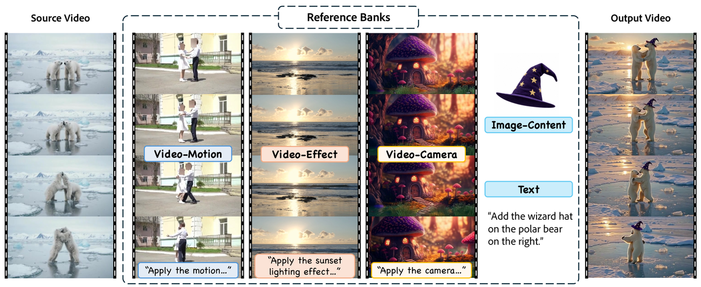
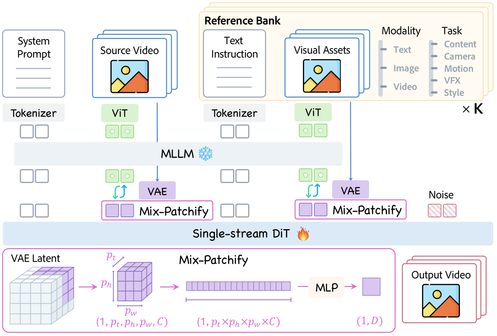
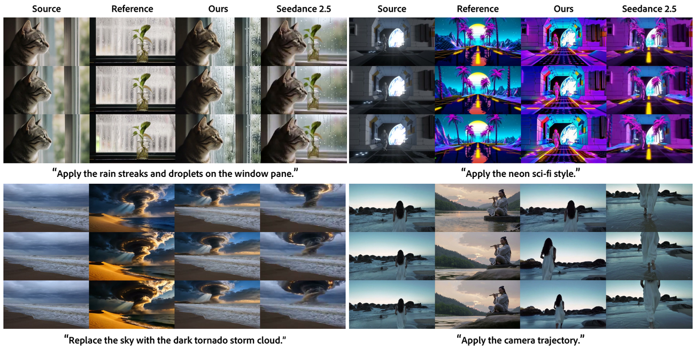
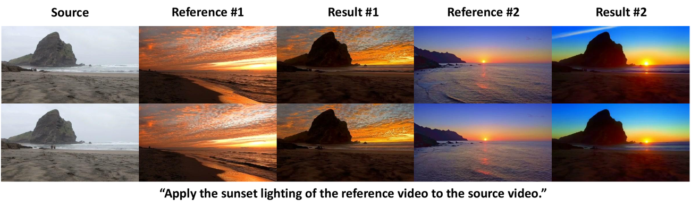
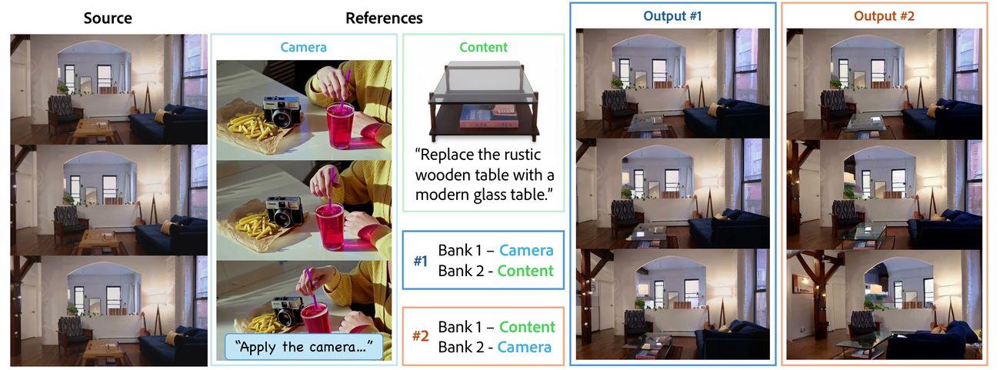
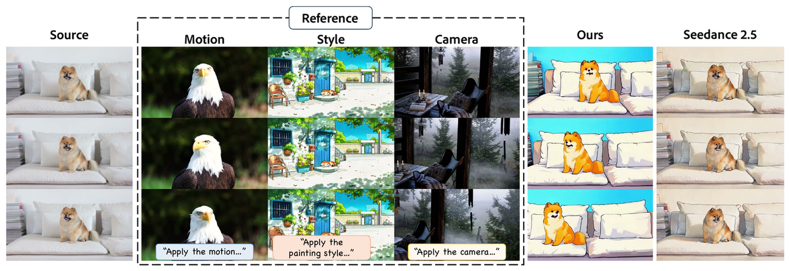
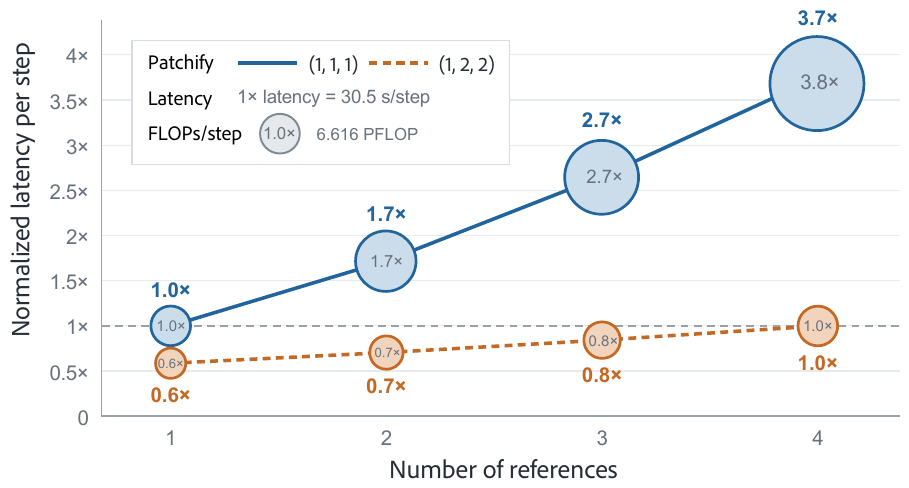
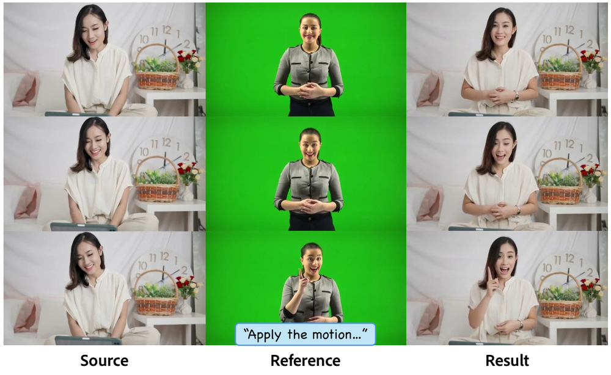

# OmniXRef: A Unified Framework for Multimodal Multi-Reference Video Editing

**论文**: [arXiv:2610.22744v1](https://arxiv.org/abs/2610.22744)（cs.CV，2026-10-15，29 页：正文 11 页 + 参考文献 3 页 + 附录 15 页）
**作者**: Xiaoyan Cong¹\*, Tianyu Wang², Hyeonho Jeong², Zhifei Zhang², Yuqian Zhou², Yijun Li², Shaoteng Liu², Zhe Lin², Srinath Sridhar¹, Soo Ye Kim²† —— ¹Brown University ²**Adobe Research**（\* Adobe 实习期间完成，† 通讯）。按参考文献的作者列表，8 位 Adobe 作者里有 7 位也是 EditVerse 的作者，6 位是 Generative Video Propagation（Liu et al., 2025，下文简称 GenProp）的作者；本文 DiT 的架构"类似 EditVerse"，VFX / Style 数据用的视频传播模型就是 GenProp
**链接**: [项目页](https://oliver-cong02.github.io/OmniXRef.github.io/)（PDF 首页给出）。正文和附录都没有代码、权重、数据或 benchmark 的发布链接 `[待补]`；DiT 是 Adobe 内部的预训练模型，7M 条文本编辑数据是 in-house 数据

---

## 1. 一句话定位

**OmniXRef 把"用文本、图片、视频参考去改一段源视频"统一成一种输入格式（reference bank），再用"冻结的 Qwen3-VL-8B + 单流 DiT"一次处理任意个 bank。** 每个 bank 是"任务定义 + 编辑指令 + 可选的图或视频参考"，任务定义写死了能从参考里拿什么：相机、动作、内容、风格、VFX 五类之一。

两个结构上的小改动：Mix-Patchify 让相机 / 动作 / 风格 / VFX 参考用 (1,2,2) 的粗 patch，token 数降到 1/4；R²-RoPE 在 RoPE 第四轴给参考预留 8 个槽，训练时随机分配。数据约 10M 条（7M in-house 文本编辑 + 合成的视频参考三元组），评测用自建的 125 例 OmniXRef-Bench，由 Gemini 3.8 Flash 打分。

| | OmniXRef | OmniXRef（MiniMax-H3 微调） | Seedance 2.0 | Seedance 2.5 | MiniMax-H3 |
|---|---|---|---|---|---|
| OmniXRef-Bench 五类平均 Score ↑（Table 2） | **3.78** | 3.59 | 3.12 | 2.73 | 1.45 |
| 五类平均 RA / VQ / SP ↑ | **3.67** / 3.68 / **4.68** | 3.48 / 3.76 / 4.61 | 3.32 / 3.83 / 4.17 | 3.21 / 3.70 / 3.71 | 2.46 / **3.84** / 2.30 |
| 相机 RotErr / TransErr / CamMC ↓（Table 3） | **0.874 / 3.961 / 4.437** | — | 4.443 / 22.455 / 24.008 | 4.373 / 22.445 / 24.001 | — |
| VEFX-Bench GeoAgg ↑（纯文本编辑，Table 7） | 2.708 | — | **2.766** | — | — |

（粗体是本表每行最好，包含商业模型；论文表格的粗体不含商业模型。）

🔴 **读完全文后我认为头条要打五个折扣**：
1. **"多参考"没有任何定量证据。** OmniXRef-Bench 的 125 例全是单个视频参考，消融（Table 4）也在这上面做。两个参考的组合、参考顺序（Fig 5）、三个视频参考（Fig 6）都只有单个定性例子。R²-RoPE 的卖点是"推理时能用比训练时更多的参考"，这一点没有数字。附录 E 写了"四个及以上参考时性能大幅下降"，而 Fig 1 的 teaser 恰好用了 4 个视觉参考（动作、特效、相机三段视频 + 一张帽子图）。
2. **领先主要来自 SP 和作者自定的 leakage cap。**
   - 平均 VQ（3.68）低于三个商业模型（3.70–3.84）。RA 上，Content 4.69 与 Seedance 2.0 持平、低于 Seedance 2.5 的 4.81；VFX 3.56 低于两代 Seedance（3.69、3.78）。
   - Score 是逐样本按 Eq 6 加一组 cap 算出来的。把各类均值直接代入 Eq 6 得到一个上界，它与报告值的差在 OmniXRef 上平均 0.14，在 Seedance 2.0、Seedance 2.5、MiniMax-H3 上分别是 0.42、0.56、0.96（我算的，见 [§6](#6-数字核对)）。按上界比，OmniXRef 对 Seedance 2.0 的领先从 0.66 缩到约 0.38。
   - 在第三方的 VEFX-Bench（纯文本编辑）上，衡量"只改该改的"的 EE 只有 2.615，低于 Seedance 2.0（3.088）、Grok Imagine（3.376）和开源的 UniVideo（3.091）。自建 bench 上最突出的"保源"，在第三方 bench 上没有出现（任务不同，只能算旁证）。
3. **评测的不确定性没有量化。** 只有一个 VLM 裁判（Gemini 3.8 Flash），每段视频只看 6 帧（相机 RA 看 8 帧）；没有人评，没有裁判一致性检验，没报 seed 数和方差。同一个完整模型在 Table 2 和 Table 4 的分数不完全一样（Content VQ 3.94 vs 3.87，Motion RA 2.92 vs 2.86），单次评测大约有 0.07 的波动（我比对的）。125 例从哪来（是否出自训练数据的同一套合成流水线）、每类多少例，都没写。
4. **相机指标有盲区，Table 3 缺行。** 轨迹按各自的最大位移归一化、不比内参，论文自己说测不到"绝对平移幅度和焦距变化"，而训练数据的相机路径里就有 optical zoom。Table 3 没有 OmniXRef（MiniMax-H3），尽管它在 Table 2 的 Camera Score 最高（3.99）；也没有原版 MiniMax-H3。两代 Seedance 的三项误差几乎相同（TransErr 22.455 vs 22.445），又缺一个"相机不动"的参照值，判断不了它们是不是基本没跟随参考相机。
5. **几乎无法复现。** DiT 是 Adobe 内部模型，只说架构类似 EditVerse，没给参数量；7M 文本编辑数据是 in-house。训练步数、batch、GPU、采样步数、CFG scale 都没写，也没有代码、权重和数据。延迟只给了每步 30.5 s（A100，480P，121 帧，1 个参考），乘多少步不知道。

📌 **站得住的部分**：
- **Reference bank 加上"只丢指令"的 CFG，很实用。** 任务定义句写死了"只从参考拿什么、其余保持源视频"，附录 Table 5 的原句可以直接照抄。CFG 默认只 drop 编辑指令、保留视觉参考；改成整个 bank 一起 drop 时，平均 Score 从 3.77 掉到 2.83（Table 4）。论文的解释是：整个 bank 一起 drop，guidance 放大的就是"整段参考"而不只是指定属性，容易把参考里的无关内容带进来。
- **数据设计防"照抄参考"。** 三元组要求参考和目标共享属性、内容不同，源和目标只差这一个属性。其中 Camera（同一条相机路径重拍两段视频）和 Motion（MotionPair 里不同角色做同一个动作）两条流水线的属性对齐是严格的。
- **Mix-Patchify 的账算得清楚。** 480P、121 帧、A100 上，1 个参考时每步 30.5 s；4 个参考时 (1,1,1) 要 3.7×，(1,2,2) 只要 1.0×（Fig 7）。同样训练步数下去掉 Mix-Patchify，平均 Score 从 3.77 掉到 2.86。
- **能搬到别的 backbone 上。** 不改结构，在 MiniMax-H3 的 Ref2VA checkpoint 上用 OmniXRef-Data 微调，平均 Score 从 1.45 升到 3.59，Camera（3.99）和 VFX（3.83）两类超过自家 DiT。

---

## 2. 要解决的问题

**文本和图片说不清随时间变化的属性，比如相机怎么走、光怎么变、特效怎么演化，所以需要视频参考；一个创意往往还要同时用好几个参考，每个管一个方面。** 论文用 `T′`、`I′`、`V′` 表示文本、图片、视频参考，`V2V` 表示"源视频 → 输出视频"的编辑。例如 `I′V′V2V` 是"一张图参考 + 一段视频参考"的编辑。

| 设定 | 代表工作 | 局限 |
|---|---|---|
| `T′V2V`、`I′V2V` | EditVerse、VIVA、InstructX、Kiwi-Edit | 没有视频参考 |
| 多张图参考 | ReBind、TIDE | 只有图 |
| 单个视频参考 | CamCloneMaster（相机）、RefVFX（VFX） | 一个模型只做一种任务 |
| 前沿系统 | Seedance 2.5、Gemini Omni、MiniMax-H3 支持多模态参考；Kling、HappyHorse、Veo 3.1 的参考只用于生成 | 多为闭源；很多只能生成、不能编辑 |

评测方面，ReCo-Bench、VEFX-Bench 测 `T′V2V`；EditVerseBench、RefVIE-Bench 测 `T′V2V` 和 `I′V2V`；IntelligentVBench、OmniVideo-1.0、TIDE-Bench 测多模态组合。论文的判断是：没有一个系统地测"把参考视频里的动态属性迁移到源视频、同时保住其余内容"。

> **Fig 1 读法**：左边是源视频（两只北极熊），中间是参考，右边是输出。参考有三段视频：动作（一对跳舞的人）、特效（日落光照）、相机（蘑菇屋的运镜）；还有一张巫师帽图片，配文本指令"给右边的北极熊戴上巫师帽"。输出里两只北极熊在日落光下跳舞，右边那只戴着帽子。这里一共 4 个视觉参考，正是附录 E 说"性能大幅下降"的区间，应当按精选案例来读。

---

## 3. 方法

### 3.1 Reference bank 与交错序列

每个 bank 由任务定义、编辑指令和可选的视觉参考组成；纯文本 bank 的任务定义和视觉参考都为空：

$$
B_i = \left( T_i^{\mathrm{task}};\ T_i^{\mathrm{edit}};\ V_i \right),\qquad i = 1,\dots,K
$$

冻结的 MLLM `G`（Qwen3-VL-8B-Instruct）先编码整条交错序列，得到语义上下文 `X`：

$$
X = G\left(T_{\mathrm{sys}},\ T_{\mathrm{src}},\ E_{\mathrm{ViT}}(V_{\mathrm{src}}),\ \lbrace B_i \rbrace_{i=1}^{K},\ T_{\mathrm{out}}\right)
$$

- `T_sys` 是所有配置共用的系统提示（附录 A.1），大意是"每个 bank 只用自己的参考，参考里的其他东西一概不拿，bank 没改的地方保持源视频"。
- `T_src` 和 `T_out` 是两句固定标记："This is the source video to edit:"、"The output video is:"。
- 源视频和每个 bank 里的视觉参考都经过 ViT 编码器 `E_ViT` 进 MLLM。

然后把 `X` 里所有视觉 token 换成 VAE latent（经 Mix-Patchify 变成 DiT token），得到 `X′`。单流 DiT `H_θ` 把 `X′` 和带噪的目标 token 放在一起做 full self-attention：文本位置保留 MLLM 输出的语义上下文，视觉位置换成 VAE latent。训练目标是标准 flow matching（附录 B.1）：

$$
Z_t = (1-t)\,Z_0 + t\,\epsilon,\qquad \mathcal{L}_{\mathrm{FM}} = \mathbb{E}_{Z_0,t,\epsilon}\left\lVert u_\theta(Z_t,t) - (Z_0-\epsilon)\right\rVert_2^2
$$

五类任务定义（附录 Table 5 原文）：

| 类别 | 任务定义 |
|---|---|
| Camera | "This is a camera edit — change only the camera trajectory, keep everything else exactly as in the source." |
| Motion | "This is a motion edit — change only the motion, keep everything else exactly as in the source." |
| Content | "This is a content edit — change only the indicated subject or background, keep everything else exactly as in the source." |
| VFX | "This is a visual effect edit — add only the indicated phenomenon, keep everything already in the source unchanged." |
| Style | "This is a style edit — change only the lighting or stylization, keep everything else exactly as in the source." |

> **Fig 2 读法**：
> - **上排**：从左到右是系统提示（文本 tokenizer）、源视频（ViT）、K 个 reference bank。每个 bank 有一条文本指令和可选的视觉资产，右侧标出模态（Text / Image / Video）和任务（Content / Camera / Motion / VFX / Style）。
> - **中间**：冻结的 MLLM（雪花）编码整条交错序列。之后视觉位置的 ViT token 换成 VAE latent（绿色双箭头），再经 Mix-Patchify 变成 DiT token。
> - **下排**：可训练的单流 DiT（火焰）把上下文 token、视觉 token 和噪声一起做全注意力。左下框是 Mix-Patchify：把 `(1, p_t, p_h, p_w, C)` 的 latent 块拉平成 `p_t×p_h×p_w×C` 维向量，过一个 MLP 变成一个 `D` 维 token。

### 3.2 Mix-Patchify

预训练 DiT 对 VAE latent 用的是 `p = (1,1,1)`。Mix-Patchify 按参考的任务类别选 patch 大小，时间方向始终是 `p_t = 1`，保住动态属性的时间分辨率（附录 B.2）：

$$
N_p = \left\lceil \frac{L}{p_t} \right\rceil \left\lceil \frac{H}{p_h} \right\rceil \left\lceil \frac{W}{p_w} \right\rceil,\qquad e_j = P_p\left(\mathrm{vec}(Z_{P_j})\right) \in \mathbb{R}^{D}
$$

| 输入 | patch | token 数（相对 (1,1,1)） |
|---|---|---|
| 源视频、目标视频 | (1,1,1) | 1 |
| Content 参考（要保身份和外观细节） | (1,1,1) | 1 |
| Camera、Motion、Style、VFX 参考 | (1,2,2) | 1/4 |

- **初始化**：粗 patch 的 MLP `P_p` 初始化成"对 patch 里 `r` 个 latent 分别过预训练的细 MLP 再取平均"，之后放开训练。
- **位置**：粗 token 取 patch 左上角 latent 在原网格上的 `(y, x, τ)` 坐标，所以不同粒度共用同一套 RoPE 坐标。

### 3.3 R²-RoPE

默认的 4D RoPE 坐标是 `q_j = (y_j, x_j, τ_j, ρ_s)`，其中 `ρ_s` 是 token 所属资产在整条序列里的顺序编号。训练时一条样本最多有几个资产，`ρ_s` 就只见过多大的范围；推理时参考数一多，就会出现没见过的编号和相对偏移。

R²-RoPE 只改第四轴：系统提示、源视频、噪声 token 各占一个固定槽；另留一个 8 个槽的池给 reference bank，同一个 bank 的所有 token 共用一个槽 `ρ_i`。训练时从池里不放回地随机抽槽，所以每个槽都被参考用过，推理时多出来的参考仍在训练见过的编号范围内：

$$
\rho(e_j) = \begin{cases} \rho_{\mathrm{sys}},\ \rho_{\mathrm{src}},\ \rho_{\mathrm{noise}} & \text{fixed slots} \\ \rho_i \in \mathcal{S},\ \lvert \mathcal{S} \rvert = 8 & e_j \in B_i \end{cases}
$$

⚠️ 消融只把 R²-RoPE 换回了"按顺序编号"（Table 4）。论文给的退化原因是：按顺序编号时，噪声 token 的第四轴编号随参考数变化，同一个编号在 1 个参考的样本里是输出、在 2 个参考的样本里却是参考。这个冲突只要给源和噪声固定槽位就能消除，用不着随机分配。所以"随机分配"本身对单参考成绩有没有贡献，表里拆不开。

### 3.4 课程训练与 CFG

| 阶段 | 分辨率 | 数据 | 学习率 |
|---|---|---|---|
| Stage 1：单参考适配 | 272P | `T′V2V`、`I′V2V`、`V′V2V` | 1.5e-5，前 5,000 步衰减到 1e-5 |
| Stage 2：多参考组合 | 272P | 加入 `I′V′V2V`、`V′V′V2V` | 1e-5 |
| Stage 3：高分辨率 | 480P | 与 Stage 2 相同 | 没另写（"其余设置不变"） |

每个阶段训多少步、batch 多大、用多少 GPU，都没写。

**CFG**：默认只 drop 编辑指令 `T_i^edit`，视觉参考保留。这样无条件预测仍然看着同一段参考，guidance 只放大"按指令提取哪个属性"这一部分。

### 3.5 数据（OmniXRef-Data）

**Table 1：各任务的样本数和各阶段采样权重**

| 任务 | Stage 1 权重 | Stage 2/3 权重 | 样本数 |
|---|---|---|---|
| `T′V2V` 纯文本编辑 | 20% | 20% | 7M |
| Camera | 16% | 8% | 1.5M |
| Motion | 24% | 12% | 100K |
| Content | 16% | 8% | 650K |
| VFX | 16% | 8% | 100K |
| Style | 8% | 4% | 650K |
| Content + Camera | 0% | 20% | 50K |
| Motion + Camera | 0% | 20% | 50K |
| 合计 | 100% | 100% | 10M |

**各类三元组 `(V_src, V_ref, V_tgt)` 怎么造**（数据构造全程用 Qwen3-VL-8B-Instruct 做 MLLM）：

| 类别 | 源 `V_src` | 参考 `V_ref` | 目标 `V_tgt` | 参考与目标靠什么共享属性 |
|---|---|---|---|---|
| VFX、Style | 用 GPT Image 2 去掉目标首帧里的特效或风格，再用 GenProp 把这一帧的编辑传播到整段 | MLLM 写一个"有同样属性的不同场景"，GPT Image 2 生成首帧，Wan2.2-TI2V-5B 生成视频 | 从一个大规模 T2V 数据集里挑出的带火焰、爆炸、烟雾、粒子或特殊风格的视频（约 2M 个候选） | **只靠文字描述** |
| Camera | 视频 `V1` | `V2` 用 Vista4D 按同一条采样路径重拍 | `V1` 用 Vista4D 按同一条路径重拍 | 同一条相机路径（严格） |
| Motion | Wan2.2-TI2V-5B 生成的同一角色、不同动作的视频 | MotionPair-60K 里另一个角色做同一个动作 | MotionPair-60K 的原视频 | 数据集本身的配对（同一个动作） |
| Content | RefVIE 的图片参考三元组（插入、删除、替换主体或背景），加上视频和谐化三元组（参考视频提供动态背景） | | | 现成数据 |
| 组合 | 把 Camera 的重拍流水线套到 Content、Motion 数据上，得到 `I′V′V2V` 和 `V′V′V2V` | | | |

相机路径包括环绕、推拉、升降、光学变焦、摇镜和俯仰，以及自由运动，幅度、速度、取景和节奏各不相同。所有数据最后再经过一轮 MLLM 质量过滤，Table 1 是过滤后的数量；过滤标准没写。

📌 **两点值得注意**：
- **小数据集被大量重复采样。** 以纯文本编辑数据为基准，每个样本被抽到的频率：Stage 1 的 Motion 是 (24%/100K) ÷ (20%/7M) = 84 倍，VFX 是 56 倍；Stage 2/3 的两类组合数据各是 140 倍（我算的）。训练总步数没给，算不出各自过了几个 epoch。
- **组合数据只有"内容 + 相机"和"动作 + 相机"两种，各 50K 条**，没有风格或 VFX 的组合。Fig 6 的"动作 + 风格 + 相机"三参考组合在训练里没有出现过。

---

## 4. 实验设置

| 项 | 设置 |
|---|---|
| 主 benchmark | OmniXRef-Bench（自建）：125 例，分 Camera、Motion、Content、Style、VFX 五类；每例一个源视频、一个参考视频，并指定要迁移的属性 |
| 打分 | Gemini 3.8 Flash 当 VLM 裁判，每个类别有自己的 prompt（附录 F 全文）。裁判只输出闭集标签，再用确定性规则换算成 0–5 分的 RA（参考跟随）、VQ（画质与时间质量）、SP（保源、不泄漏），最后算 Score |
| 相机几何指标 | 用 VGGT-Ω 分别估计参考和输出 32 帧的位姿，各自换到首帧坐标系，平移按最大位移归一化，对其余 31 帧的误差求和，得到 RotErr（弧度）、TransErr、CamMC；做法沿用 CamI2V |
| 纯文本编辑 | VEFX-Bench：VEFX-Reward 给 IF、RQ、EE 打 1–4 分，加官方 GeoAgg。ReCo-Bench：Gemini-2.5-Flash 打分，分 Add、Remove、Replace、Style 四类 |
| 对比 | 商业：Seedance 2.0、Seedance 2.5、MiniMax-H3。专门模型：CamCloneMaster（相机）、MotionFollower（动作）、RefVFX（Content、Style、VFX）。VEFX、ReCo 两个榜单上直接用榜单里的方法 |
| 硬件 | 延迟在单张 A100 上测，只算 DiT；源视频和参考视频都是 480P、121 帧 |
| 没有报告的 | DiT 参数量；训练步数、batch、GPU；采样步数、CFG scale；benchmark 样本的来源和每类数量；商业模型怎么调用（源视频和参考怎么喂进去）；裁判与人评是否一致；seed 数和方差 |

**标签怎么换算成分数（附录 Table 6）**：

| 项 | 判什么 | 标签 → 分 | cap |
|---|---|---|---|
| RA（Camera） | 方向、幅度、时序、取景 | match / partial / mismatch → 5 / 2.5 / 0 | 无（保源和泄漏归 SP） |
| RA（Content、Style、VFX） | 各类别自己的属性 | 同上 | 位置错 → 0；溢出 → ≤2.5；Style 把结构改坏 → ≤1.25；Content 明显多带了东西 → ≤2.5 |
| RA（Motion） | 6 个时刻的姿态是否一致 | 同上 | 外观投票里像参考的比例 ≥0.5 → 0，≥0.2 → ≤2.5；超过一半时刻主体不在画面 → 0 |
| VQ | 吸引力、合理性、连贯性里最严重的一个缺陷 | none / subtle / noticeable / obvious → 5 / 3.75 / 2 / 0 | 无 |
| SP | 源视频的各项属性 | preserved / side effect / altered / absent / from reference → 5 / 5 / 2.5 / 1.25 / 0 | 变成另一段视频 → 0；部分改变 → ≤4；泄漏：疑似 ≤3.125，轻微 ≤1.25，严重 → 0 |
| Score | RA、VQ、SP | 下式 | 严重泄漏 → 0；轻微泄漏或 SP ≤1.25 → ≤1.25；疑似泄漏 → ≤3.125 |

泄漏按 SP 裁判标成"来自参考"的属性个数分级：两个及以上明确的算严重，一个明确的算轻微，只有"可能"的算疑似。Score 逐样本计算：

$$
\mathrm{Score} = 0.45\,\mathrm{RA} + 0.25\,\min(\mathrm{VQ},\mathrm{RA}) + 0.30\,\mathrm{SP}
$$

cap 是逐样本加的，所以论文明说"平均后的 RA、VQ、SP 一般推不出平均 Score"。表里报的 VQ 是取 `min` 之前的值。

相机误差的定义（附录 C.3）：

$$
A_i^{v} = (T_0^{v})^{-1} T_i^{v} = \begin{pmatrix} R_i^{v} & p_i^{v} \\ 0^{\top} & 1 \end{pmatrix},\qquad \hat p_i^{v} = \frac{p_i^{v}}{\max_j \lVert p_j^{v} \rVert_2 + \epsilon}
$$

$$
\mathrm{RotErr} = \sum_{i=1}^{N-1} \arccos\frac{\mathrm{tr}\left((R_i^{\mathrm{ref}})^{\top} R_i^{\mathrm{out}}\right) - 1}{2},\quad \mathrm{TransErr} = \sum_{i=1}^{N-1} \lVert \hat p_i^{\mathrm{ref}} - \hat p_i^{\mathrm{out}} \rVert_2,\quad \mathrm{CamMC} = \sum_{i=1}^{N-1} \left\lVert [R_i^{\mathrm{ref}} \mid \hat p_i^{\mathrm{ref}}] - [R_i^{\mathrm{out}} \mid \hat p_i^{\mathrm{out}}] \right\rVert_F
$$

其中 `N = 32`，`v` 取参考或输出。两条轨迹各自归一化、不比内参，所以这组误差只反映运动方向、轨迹形状和时序，测不到绝对幅度和变焦。

---

## 5. 结果

### 5.1 OmniXRef-Bench（Table 2）

**Content、Style、VFX**（每格依次是 RA / VQ / SP / Score）：

| 模型 | Content | Style | VFX |
|---|---|---|---|
| RefVFX | 0.94 / 3.35 / 4.55 / 1.98 | 1.12 / 3.55 / 4.90 / 2.24 | 1.69 / 3.40 / 4.39 / 2.49 |
| OmniXRef（MiniMax-H3） | 4.22 / 3.61 / 4.08 / 3.70 | 3.75 / 3.74 / 4.40 / 3.55 | 3.56 / 3.63 / 4.85 / **3.83** |
| OmniXRef | 4.69 / 3.94 / 4.67 / **4.49** | 3.71 / 3.60 / 4.65 / **3.75** | 3.56 / 3.25 / 4.52 / 3.55 |
| MiniMax-H3（商业） | 3.81 / 4.03 / 1.97 / 2.23 | 2.92 / 3.92 / 1.75 / 0.94 | 3.09 / 3.56 / 1.90 / 1.32 |
| Seedance 2.0（商业） | 4.69 / 3.93 / 4.03 / 3.73 | 3.71 / 3.85 / 3.95 / 3.22 | 3.69 / 3.72 / 3.74 / 2.92 |
| Seedance 2.5（商业） | 4.81 / 3.76 / 4.25 / 4.04 | 3.52 / 3.47 / 3.02 / 2.30 | 3.78 / 3.50 / 2.84 / 2.22 |

**Camera、Motion、五类平均**：

| 模型 | Camera | Motion | 五类平均 |
|---|---|---|---|
| CamCloneMaster | 2.52 / 3.74 / 4.99 / 3.20 | — | — |
| MotionFollower | — | 2.02 / 2.43 / 2.99 / 2.14 | — |
| OmniXRef（MiniMax-H3） | 3.75 / 3.92 / 4.91 / **3.99** | 2.14 / 3.92 / 4.80 / 2.88 | 3.48 / 3.76 / 4.61 / 3.59 |
| OmniXRef | 3.48 / 3.74 / 5.00 / 3.81 | 2.92 / 3.87 / 4.56 / **3.30** | 3.67 / 3.68 / 4.68 / **3.78** |
| MiniMax-H3（商业） | 2.44 / 3.89 / 3.67 / 2.07 | 0.05 / 3.82 / 2.23 / 0.69 | 2.46 / 3.84 / 2.30 / 1.45 |
| Seedance 2.0（商业） | 2.65 / 3.81 / 4.97 / 3.27 | 1.85 / 3.84 / 4.18 / 2.45 | 3.32 / 3.83 / 4.17 / 3.12 |
| Seedance 2.5（商业） | 2.33 / 3.89 / 4.98 / 3.07 | 1.58 / 3.86 / 3.45 / 2.00 | 3.21 / 3.70 / 3.71 / 2.73 |

（Score 的粗体是包含商业模型在内的最好值。）

- **OmniXRef 的五类平均 Score、RA、SP 最高**；分类 Score 在 Content、Style、Motion 上最高，Camera 和 VFX 是 H3 版最高。对各自领域的专门模型都赢：Camera 3.81 vs 3.20，Motion 3.30 vs 2.14，VFX 3.55 vs 2.49。
- **Motion 最难**：最好的 RA 也只有 2.92；MiniMax-H3 的 Motion RA 是 0.05，等于完全没跟随动作参考。
- **MiniMax-H3 画质最好（VQ 3.84）、Score 最低（1.45）**：SP 只有 2.30。从 §6 的差值看，大量样本触发了泄漏 cap（我的推断）；它更像是照着参考重新生成，而不是改源视频。
- **Seedance 2.5 不如 Seedance 2.0**：Score 2.73 vs 3.12。SP 在 Style、VFX、Motion 三类分别低 0.93、0.90、0.73（我算的）。
- **RefVFX 是 VFX 专门模型**，拿它比 Content 和 Style 是跨领域使用，Content RA 只有 0.94 不意外。
- **H3 版**：论文说是"不改结构、不加任务专用组件"地在 Ref2VA checkpoint 上微调。按这个说法，H3 版很可能没用 Mix-Patchify 和 R²-RoPE（论文没明说），它验证的是 reference bank 格式加上这套数据。

### 5.2 相机轨迹（Table 3）

| 模型 | RotErr ↓ | TransErr ↓ | CamMC ↓ |
|---|---|---|---|
| CamCloneMaster | 2.086 | 9.329 | 10.332 |
| OmniXRef | **0.874** | **3.961** | **4.437** |
| Seedance 2.0（商业） | 4.443 | 22.455 | 24.008 |
| Seedance 2.5（商业） | 4.373 | 22.445 | 24.001 |

OmniXRef 三项误差都最低，约为 CamCloneMaster 的 42%–43%（我算的：0.874 / 2.086 = 0.42，3.961 / 9.329 = 0.42，4.437 / 10.332 = 0.43）。局限见 §1 第 4 条。

### 5.3 定性对比（Fig 3）

> **Fig 3 读法**：四组例子，每组四列依次是源视频、参考、OmniXRef、Seedance 2.5。
> - **左上（VFX：窗上的雨痕和水滴）**：OmniXRef 在窗玻璃上加了雨痕和水滴，猫和窗框不变。Seedance 2.5 有雨但没有参考里的水滴，改了窗框，还把参考里的盆栽搬了进来（论文称为 reference leakage）。
> - **右上（Style：霓虹科幻风格）**：两者都上了霓虹配色，Seedance 2.5 还把参考里的棕榈树带进了走廊，也是泄漏。
> - **左下（Content：把天空换成龙卷风暴云）**：两者都换了天空；从图上看，OmniXRef 的天空更接近参考（保留了参考里的光束）。
> - **右下（Camera：迁移相机轨迹）**：OmniXRef 保持源场景和人物，取景在变化；Seedance 2.5 变成了人物腿部的特写，构图和源视频差别很大。静帧看不出轨迹是否与参考一致。
>
> 每类各只有一个例子，是挑过的。

### 5.4 消融（Table 4）

**Content、Style、VFX**（RA / VQ / SP / Score）：

| 变体 | Content | Style | VFX |
|---|---|---|---|
| 去掉 Mix-Patchify | 3.75 / 3.80 / 3.30 / 2.97 | 3.40 / 3.22 / 3.58 / 2.71 | **4.12** / 3.61 / 3.64 / 3.30 |
| 整个 bank 一起 dropout | 3.06 / 3.73 / 3.30 / 2.48 | 3.25 / 3.50 / 4.45 / 3.29 | 3.72 / 3.47 / 4.14 / 3.42 |
| 去掉 R²-RoPE | 3.31 / 3.47 / 3.89 / 3.06 | 2.83 / 3.62 / 4.44 / 3.14 | 3.41 / 3.48 / 4.66 / **3.64** |
| 去掉课程训练 | 3.69 / 3.56 / 3.70 / 3.07 | 3.08 / 3.44 / 4.32 / 3.15 | 3.69 / 3.37 / 4.22 / 3.51 |
| 完整模型 | 4.69 / 3.87 / 4.70 / **4.48** | 3.71 / 3.60 / 4.65 / **3.74** | 3.56 / 3.25 / 4.52 / 3.55 |

**Camera、Motion、五类平均**：

| 变体 | Camera | Motion | 五类平均 |
|---|---|---|---|
| 去掉 Mix-Patchify | 3.01 / 3.87 / 4.67 / 3.24 | 1.51 / 3.86 / 3.92 / 2.11 | 3.16 / 3.67 / 3.82 / 2.86 |
| 整个 bank 一起 dropout | 2.95 / 3.40 / 4.25 / 2.85 | 2.07 / 3.80 / 3.43 / 2.11 | 3.01 / 3.58 / 3.91 / 2.83 |
| 去掉 R²-RoPE | 3.20 / 3.69 / 4.94 / 3.61 | 1.57 / 3.74 / 4.60 / 2.44 | 2.86 / 3.60 / 4.50 / 3.18 |
| 去掉课程训练 | 2.69 / 3.67 / 4.97 / 3.32 | 1.81 / 3.92 / 4.53 / 2.57 | 2.99 / 3.59 / 4.35 / 3.13 |
| 完整模型 | 3.48 / 3.74 / 5.00 / **3.81** | 2.86 / 3.88 / 4.57 / **3.27** | 3.66 / 3.67 / 4.69 / **3.77** |

（粗体：各类 Score 的最高值；VFX 的 RA 4.12 也加粗，便于和完整模型对照。）

- 四个消融的平均 Score 比完整模型低 0.59–0.94：整 bank dropout −0.94，去掉 Mix-Patchify −0.91，去掉课程训练 −0.64，去掉 R²-RoPE −0.59（我算的）。
- **所有变体都是"同样的训练步数"**（步数没给）。论文对 Mix-Patchify 和课程训练的解释都是"收敛更快"，所以这张表比的是固定预算下的收敛速度，不是最终能力。去掉课程训练的变体全程 480P，每步更慢、总算力更多，仍然更差，这一条对课程训练是有利的。
- ⚠️ **VFX 的 RA 在去掉 Mix-Patchify 后反而最高**（4.12 vs 3.56）。VFX Score 更低是因为 SP 掉了（3.64 vs 4.52）。雨滴、粒子这类细碎特效用 (1,2,2) 粗 patch 可能会丢细节，论文没讨论。
- 去掉 R²-RoPE 后 VFX 的 Score（3.64）略高于完整模型（3.55）。

### 5.5 参考的作用、顺序与三参考组合（Fig 4–6）

> **Fig 4 读法**：源视频是阴天海边的礁石，指令固定为"把参考视频的日落光照用到源视频上"。参考 #1 是橙色云霞，结果 #1 跟着变成橙色云霞；参考 #2 是蓝橙渐变、太阳贴着海平线，结果 #2 跟着出现同样的渐变和海平线上的太阳。说明外观由视觉参考决定，指令只决定迁移哪个属性。只有这一组例子。

> **Fig 5 读法**：源视频是客厅；参考是一段相机运动视频和一张玻璃桌图片，指令是"把木桌换成现代玻璃桌"。输出 #1 是"bank 1 = 相机、bank 2 = 内容"，输出 #2 把两个 bank 的槽位对调。两种顺序都换了桌子、镜头也都在动，但第三帧的取景明显不同（左侧木梁的位置、拱门的大小都不一样）。论文只说"两种顺序都正确迁移"，没有量化两次输出差多少。

> **Fig 6 读法**：源视频是沙发上的博美犬，三个参考分别是动作（白头鹰转头）、风格（卡通街景）、相机（林间木屋的运镜）。OmniXRef 输出卡通风格的狗，头部和取景都在变；Seedance 2.5 基本保持原样，只有颜色略淡。训练样本最多两个视觉参考，组合里也没有风格类，这是唯一的三参考例子。

### 5.6 推理成本（Fig 7）

> **Fig 7 读法**：横轴是参考数（1–4），纵轴是相对"1 个参考、(1,1,1)"的每步延迟；基准是 30.5 s/step、6.616 PFLOP/step（单张 A100，只算 DiT，480P、121 帧）。粗体数字是延迟倍数，圆圈里是 FLOPs 倍数。
> - (1,1,1)：延迟 1.0×、1.7×、2.7×、3.7×，FLOPs 1.0×、1.7×、2.7×、3.8×；
> - (1,2,2)：延迟和 FLOPs 都是 0.6×、0.7×、0.8×、1.0×。
>
> 也就是说，4 个参考时 (1,1,1) 每步约 112.9 s，(1,2,2) 约 30.5 s；1 个 (1,2,2) 参考约 18.3 s（我算的）。采样步数没给，整段生成要多久算不出来。

### 5.7 纯文本编辑（Table 7、8）

**VEFX-Bench（Table 7）**：

| 模型 | IF ↑ | RQ ↑ | EE ↑ | GeoAgg ↑ |
|---|---|---|---|---|
| Kling o3 Omni（商业） | 3.033 | 3.588 | 3.043 | 3.057 |
| Kling o1（商业） | 3.040 | 3.534 | 2.976 | 2.985 |
| Runway Gen-4.5（商业） | 2.817 | 3.319 | 2.923 | 2.912 |
| Seedance 2.0（商业） | 2.811 | 3.421 | 3.088 | 2.766 |
| Grok Imagine（商业） | 2.606 | 3.346 | 3.376 | 2.723 |
| Wan 2.6（商业） | 2.012 | 3.317 | 2.446 | 2.146 |
| UniVideo | 2.294 | 3.266 | 3.091 | 2.516 |
| VACE | 2.027 | 3.172 | 1.180 | 1.775 |
| OmniXRef | 2.699 | 3.315 | 2.615 | 2.708 |

OmniXRef 在开源模型里最好；GeoAgg 2.708，低于除 Wan 2.6 以外的 5 个商业模型，与 Grok Imagine（2.723）、Seedance 2.0（2.766）接近，论文的说法是"与它们相当"。EE 低于 Seedance 2.0、Grok Imagine 和 UniVideo（见 §1 第 2 条）。

**ReCo-Bench（Table 8）**（每格依次是编辑准确度 / 自然度 / 画质 / Total）：

| 模型 | Add | Remove | Replace | Style |
|---|---|---|---|---|
| InsViE | 2.60 / 3.10 / 3.46 / 3.05 | 2.44 / 3.76 / 3.29 / 3.16 | 2.10 / 3.91 / 3.49 / 3.17 | 8.17 / 8.21 / 7.35 / 7.91 |
| Lucy-Edit | 6.47 / 5.70 / 6.77 / 6.31 | — | 7.08 / 6.21 / 6.88 / 6.72 | 4.65 / 4.67 / 5.17 / 4.83 |
| VACE | — | 4.57 / 5.43 / 5.56 / 5.19 | — | — |
| Ditto | 6.70 / 7.57 / 8.41 / 7.56 | — | 4.56 / 7.21 / 7.96 / 6.58 | 9.20 / 9.07 / 8.77 / 9.01 |
| ReCo | 8.54 / 7.55 / 8.61 / 8.23 | 7.28 / 6.90 / 6.82 / 7.00 | 9.43 / 8.01 / 8.77 / 8.74 | **9.42** / 9.19 / 8.90 / **9.17** |
| ReCo_Ref | 7.96 / 7.39 / 8.69 / 8.02 | 8.06 / 7.45 / 7.44 / 7.65 | 8.35 / 7.67 / 8.38 / 8.13 | 8.81 / **9.27** / **9.29** / 9.12 |
| VInO | 9.44 / 8.00 / 9.11 / 8.85 | 8.39 / 8.00 / 8.10 / 8.16 | 9.17 / 8.18 / 8.74 / 8.70 | 9.05 / 9.25 / 9.01 / 9.10 |
| Mamoda2.5 | 9.31 / 8.27 / 8.83 / 8.80 | **9.15** / **8.50** / **8.35** / **8.67** | **9.60** / 8.64 / 8.95 / **9.06** | 8.95 / 9.19 / 8.83 / 8.99 |
| OmniXRef | **9.55** / **8.56** / **9.12** / **9.08** | 7.77 / 7.46 / 7.30 / 7.51 | 9.10 / **8.70** / **8.96** / 8.92 | 8.37 / 8.80 / 8.39 / 8.52 |

OmniXRef 在 Add 上全面第一，在 Remove 和 Style 上落后较多（Style Total 在 8 个方法里排第 6）。四类 Total 平均是 8.51，低于 Mamoda2.5 的 8.88 和 VInO 的 8.70（我算的，论文没给四类平均）。

### 5.8 局限（Fig 8）

> **Fig 8 读法**：源视频里的女人坐着、低头微笑；参考是绿幕前的另一个人，先双手交握，后来兴奋地竖起手指。输出里源视频的人做出了参考的姿态，**连表情也一起换成了参考的兴奋表情**。论文承认目前只能按属性整体迁移，分不开同一属性里更细的因素（这里是表情和身体姿态）。

附录 E 列的其他局限：
- 参考数到四个及以上时性能大幅下降；
- 训练数据偏自然场景，带文字渲染的 VFX 尤其少；
- 训练只到 480P，720P 或 4K 没有试过。

---

## 6. 数字核对

| 说法 | 复算 | 结论 |
|---|---|---|
| Table 2 的"Overall avg."是五类平均 | OmniXRef：RA (4.69+3.71+3.56+3.48+2.92)/5 = 3.672，Score (4.49+3.75+3.55+3.81+3.30)/5 = 3.78；其余模型逐列复算都吻合，只有 Seedance 2.5 的 RA 算出 3.204、表上是 3.21 | ✅（差 0.01，应是取整） |
| 均值不能直接代入 Eq 6 | 把各类均值代入 Eq 6 得到的上界减去报告值，五类平均：OmniXRef 0.14、OmniXRef（H3）0.20、Seedance 2.0 0.42、Seedance 2.5 0.56、MiniMax-H3 0.96；差得最多的单格是 MiniMax-H3 的 Style（2.57 vs 0.94）和 Seedance 2.5 的 VFX（3.43 vs 2.22） | 我算的。差值来自逐样本的 `min(VQ, RA)` 和 cap，两者拆不开；主要压在商业模型上 |
| 按上界比的差距 | 上界的五类平均：OmniXRef 3.92，OmniXRef（H3）3.79，Seedance 2.0 3.54，Seedance 2.5 3.29，MiniMax-H3 2.41 | 我算的。OmniXRef 对 Seedance 2.0 的领先从 0.66 变成约 0.38 |
| Table 4 的五类平均 | 4 个消融变体和完整模型逐列复算全部吻合（差 ≤0.01） | ✅ |
| 完整模型在 Table 2 和 Table 4 应该一致 | Camera、VFX 完全一样；Content（VQ 3.94 / 3.87，SP 4.67 / 4.70，Score 4.49 / 4.48）、Style（Score 3.75 / 3.74）、Motion（RA 2.92 / 2.86，Score 3.30 / 3.27）不同；五类平均 3.78 / 3.77 | ⚠️ 两次评测有出入，论文没说明 |
| Table 1 的权重和样本数 | Stage 1：20+16+24+16+16+8 = 100%；Stage 2/3：20+8+12+8+8+4+20+20 = 100%；样本数 7M+1.5M+100K+650K+100K+650K+50K+50K = 10.1M | ✅（"10M"是取整） |
| 小数据集的重复采样 | 相对纯文本编辑数据的每样本抽中频率：Motion (24%/100K) ÷ (20%/7M) = 84 倍；VFX 56 倍；Stage 2/3 的组合数据 140 倍 | 我算的 |
| Fig 7 的绝对延迟 | 3.7 × 30.5 = 112.9 s/step；0.6 × 30.5 = 18.3 s/step；FLOPs 3.8 × 6.616 = 25.1 PFLOP/step | 我算的 |
| Fig 7 的倍数与序列长度 | 把一段 (1,1,1) 视频的 token 记 1 份、(1,2,2) 记 0.25 份，忽略文本，序列 = 源 + 目标 + k 个参考，基准（k = 1，(1,1,1)）是 3 份。FLOPs 倍数接近长度比的平方：(1,1,1) k = 4 是 (6/3)² = 4，图上 3.8；(1,2,2) k = 2、3、4 是 0.69、0.84、1.00，图上 0.7、0.8、1.0 | 我算的。说明在这个长度下计算量主要在注意力 |
| Table 3 相对 CamCloneMaster | 0.874 / 2.086 = 0.42；3.961 / 9.329 = 0.42；4.437 / 10.332 = 0.43 | 我算的 |
| ReCo-Bench 的 Total 是三项算术平均 | OmniXRef Add：(9.55+8.56+9.12)/3 = 9.08 | ✅ |
| ReCo-Bench 四类平均 | OmniXRef (9.08+7.51+8.92+8.52)/4 = 8.51；Mamoda2.5 8.88；VInO 8.70；ReCo 8.29 | 我算的，论文没给 |
| VEFX 的 GeoAgg | 三项乘积开立方：OmniXRef 得 2.86，表上 2.708；Kling o3 Omni 得 3.21，表上 3.057 | 不是三项的简单几何平均，按 VEFX 官方定义，这里无法复算 |

---

## 7. 争议与权衡

**① 标题是"多参考"，证据是"单参考"。** 定量结果全部来自单视频参考：主表、相机几何、消融都是。真正多参考的结论（组合、顺序无关、推广到三个参考）各只有一个定性例子，teaser 用的 4 个参考又落在作者自己承认的退化区间。对想用它做"多参考"的人，最该补的是一组"1 / 2 / 3 / 4 个参考"的定量曲线，最好分开 R²-RoPE 和顺序编号。

**② 评测完全由作者设计，商业模型吃亏最多的地方恰好是作者定义的部分。** 单一 Gemini 3.8 Flash 裁判、每段 6 帧、作者写的标签规则和 cap。OmniXRef 在 RA 和 VQ 上并不领先商业模型，领先来自 SP 和泄漏 cap：MiniMax-H3 的 RA 和 VQ 并不差，Score 却只有 1.45。泄漏确实是参考编辑的核心问题，惩罚它是合理的；但 cap 的阈值（例如疑似泄漏就封顶 3.125）一旦变动，排名会变多少，论文没做敏感性分析。[SolarRenderer](../../world_model/solarrenderer/analysis.md) 同样以 Gemini 3.8 Flash 为主证据，人评也只有一句"方向一致"。

**③ VFX / Style 的参考和目标只在"文字层面"是同一种属性。** 目标来自真实数据，参考却是"MLLM 写一句描述 → GPT Image 2 出首帧 → Wan2.2-TI2V-5B 出视频"生成的。它们共享的只是"雨痕和水滴"这类文字描述，不是同一个特效。模型学到的更可能是"按类别迁移、用参考辅助描述"，这与论文的出发点（"视频参考能表达文字说不清的细节"）有张力。Camera 和 Motion 两条流水线没有这个问题。另外，源视频是"去掉特效 + 传播"造出来的，测试时的源视频却是干净的真实视频，存在训练与测试的差异。VFX 的 RA（3.56）低于两代 Seedance，可能就与此有关（推测）。

**④ 粗 patch 对细碎属性可能是错的默认值。** 去掉 Mix-Patchify 后 VFX 的 RA 最高（4.12 vs 3.56）。[SolarRenderer](../../world_model/solarrenderer/analysis.md) 的消融里，结构视频降到半分辨率，Ctrl 掉 1.4（48.0 → 46.6），超过换 seed 的 0.2。两边指向同一件事：需要空间细节的条件不宜降分辨率。Mix-Patchify 按类别一刀切（只有 Content 保留细 patch），VFX 也许应该保留 (1,1,1)，或者按参考的内容自适应。

**⑤ R²-RoPE 的消融混了两件事。** "给源和噪声固定槽位"就能消除论文说的编号冲突，"参考槽随机分配"是另一件事。表里只有"全有"和"全无"两行。

**⑥ 工程上难以直接拿来用。** 没有代码和权重，DiT 是内部模型，只训到 480P，每步 18–113 s（1 到 4 个参考，A100），步数未知。对手上有 MiniMax-H3 的团队，更现实的路径是论文的 H3 版：不改结构，只换数据和 bank 格式；但 H3 版的微调方式（全参还是 LoRA）、步数也没写，权重同样没放。

---

## 8. 一句话总结

**OmniXRef 把文本、图片、视频参考统一成"任务定义 + 指令 + 参考"的 bank，用冻结的 Qwen3-VL-8B 加单流 DiT 做多参考视频编辑，配了一套五类属性的合成三元组数据（约 10M 条）和一个 125 例的 Gemini 裁判 benchmark。在单视频参考的自建评测上，它的保源和抗泄漏明显好于 Seedance 和 MiniMax-H3，相机轨迹误差约为 CamCloneMaster 的 42%；Mix-Patchify 让 4 个参考时每步的计算量降到 1/3.7。但"多参考"只有定性例子，评分规则和 cap 都是作者定的，VFX 和风格数据的参考与目标只在文字层面对齐，模型、数据、代码都没有公开。**

---

## 9. 在仓库图谱里的位置

| | 关系 |
|---|---|
| **[SolarRenderer](../../world_model/solarrenderer/analysis.md)** | 🔴 **同一个 MiniMax-H3 Ref2VA 起点，处理参考的思路相反**。SolarRenderer 冻结 H3，结构视频不标类型、和目标帧共用 RoPE 位置（帧对齐），只训 LoRA；OmniXRef 给每个参考写任务定义句、在 RoPE 第四轴单独占一个槽，H3 版直接在 Ref2VA checkpoint 上微调。前者的参考与输出逐帧对应，后者的参考与输出内容不同、只共享一个属性，两种 RoPE 用法各自对应这两种情况。两篇都用 Gemini 3.8 Flash 当裁判 |
| [Seedance 2.0](../seedance2/analysis.md) | 主要商业对照。那篇笔记记录 Seedance 2.0 最多支持 3 段视频参考、9 张图片参考，VFX 参考被标为"仅 Seedance 2.0 支持"。在本文 bench 上它的 VFX RA（3.69）高于 OmniXRef（3.56），输在 SP 和泄漏 cap |
| [WROP](../../world_model/wrop/analysis.md) | 那篇把 Seedance 2.5 和 MiniMax H3 归为"参考生视频"：把输入当视觉参考，重新生成整段事件。本文 bench 上这两个模型的 SP 正好最低（3.71、2.30） |
| [Bernini](../bernini/analysis.md) | 同为"MLLM + DiT"的统一编辑模型：Bernini 用 Qwen2.5-VL-7B 在 ViT 空间规划、Wan2.2-A14B 渲染，用 SA-3D RoPE 给每段视觉输入加一个段相位来区分身份；本文用 RoPE 第四轴的槽位做同一件事，再把槽位改成"预留池 + 随机分配" |
| [MLLM-DiT Fusion](../mllm_dit_fusion/analysis.md) | 按那篇的分类，本文属于"冻结 MLLM、直接用隐状态"一路，没有 learnable query：文本位置用 Qwen3-VL-8B 的输出，视觉位置换成 VAE latent，一起进单流 DiT。本文没有和其他融合方式做对照 |
| [LongLive-Plug](../longlive_plug/analysis.md) | 本文 Content 数据用的 RefVIE 来自 Kiwi-Edit，相机数据用 Vista4D 重拍；这两个模型都在 LongLive-Plug 免训练挂载的 54 个下游清单里 |

⚠️ **仓库缺口**：EditVerse（本文 DiT 的架构来源）、Kiwi-Edit / RefVIE、Vista4D、GenProp、CamCloneMaster、RefVFX、VEFX-Bench 都还没有笔记。

---

## Q&A

**Q: 想给游戏角色视频加技能特效、或者整体换风格，OmniXRef 的哪些做法能直接借鉴？**

A: **接口和 CFG 可以直接抄；数据最好用引擎重做，而不是照它的 VFX 流水线。**
1. **接口**：用 reference bank 把"从参考拿什么"写成固定的任务定义句（附录 Table 5 五句原文），CFG 只 drop 编辑指令、保留视觉参考。消融里整 bank dropout 会让平均 Score 从 3.77 掉到 2.83，是这篇最确定的一条结论。
2. **数据**：它的 VFX / Style 参考是"文字描述 → 生成视频"，与目标只在文字层面是同一种特效（见 [§7](#7-争议与权衡) ③）。游戏引擎可以把**同一个特效资产**渲染到两个不同的角色或场景上：源 = 不挂特效，目标 = 挂特效，参考 = 同一个特效挂在另一个场景。这样得到的三元组和它 Camera 流水线（同一条相机路径重拍两段视频）一样严格对齐。
3. **成本**：参考用 (1,2,2) 粗 patch，4 个参考时每步计算量降到约 1/3.7（Fig 7）。但 VFX 的 RA 在粗 patch 下更低（3.56 vs 4.12），粒子、雨滴这类细碎特效的参考建议保留 (1,1,1)，自己做一组对比再定。
4. **起点**：如果用 MiniMax-H3，论文在 Ref2VA checkpoint 上不改结构地微调，平均 Score 从 1.45 到 3.59，VFX Score 3.83 是全表最高。但微调方式、步数没写，权重也没放出，需要自己复现。

**Q: 给参考视频分配位置编码，该学 OmniXRef 的 R²-RoPE，还是 SolarRenderer 的帧对齐？**

A: **看参考和输出之间有没有逐帧、逐像素的对应关系。**
- 有对应（灰盒、深度、骨架这类和输出逐帧对齐的结构控制）：让第 k 个参考帧用第 k 个目标帧的位置，也就是 SolarRenderer 的做法。
- 没有对应（相机路径、风格、特效取自另一个场景）：给参考单独一个槽、不和目标共享空间位置，也就是 OmniXRef 的做法。参考数可变时，用"预留池 + 随机分配"避免推理时出现训练没见过的编号。

两边的证据都不强。SolarRenderer 半分辨率下独立 RoPE 和共享 RoPE 的自动总分只差 0.2（66.0 vs 66.2），与换 seed 的 0.3 同量级。OmniXRef 只和"按顺序编号"比过，提升里有多少来自"随机分配"本身，没有拆开（[§3.3](#33-r²-rope)）。

---
