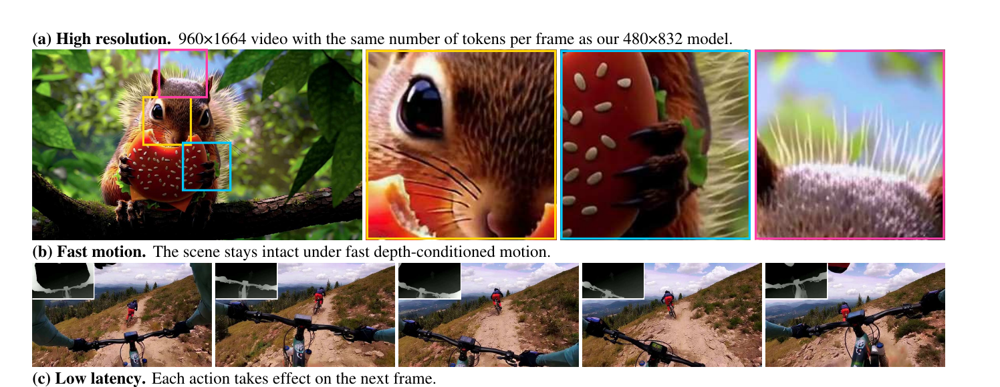
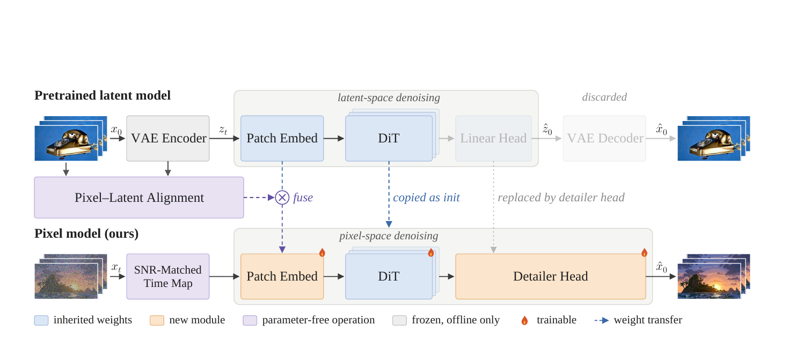
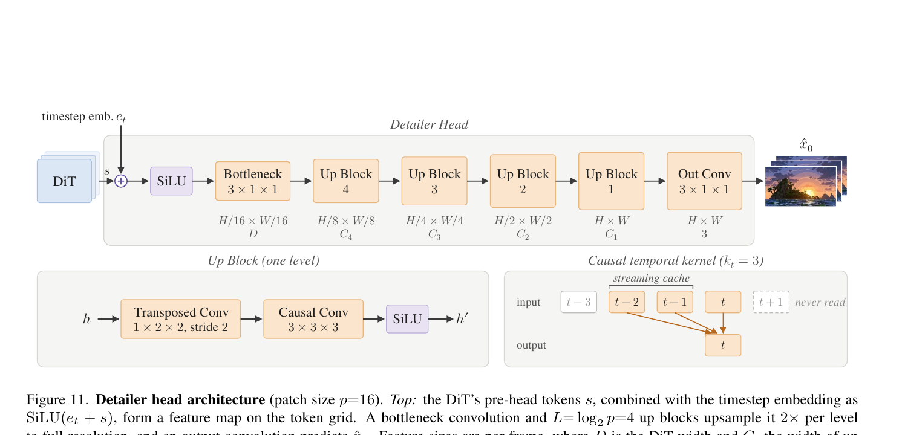
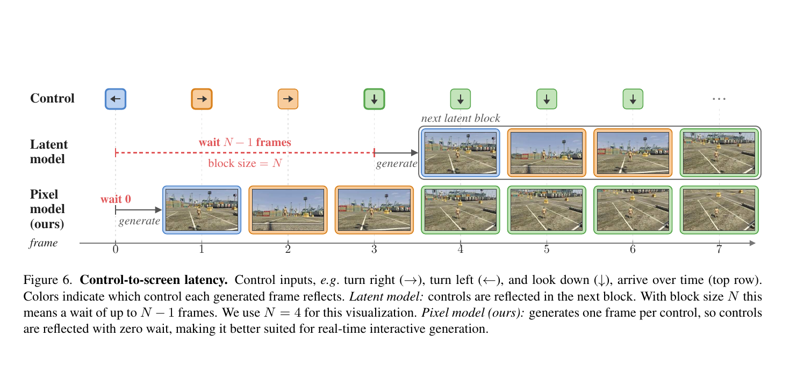

# PixVid: Back to Pixels — Lifting Latent Video Diffusion into Pixel Space

**论文**: Back to Pixels: Lifting Latent Video Diffusion into Pixel Space  
**作者**: Yanke Song, Shuo Chen, Chris Rockwell, Guande He, Nan Liu, Desai Xie, Tianpei Gu 等  
**机构**: Roblox + UC Merced + UPenn + UT Austin  
**时间**: 2026-11  
**链接**: [arXiv:2611.17336](https://arxiv.org/abs/2611.17336) | [项目页](https://chenshuo20.github.io/PixVid/)

---

## 1. 一句话定位

把预训练 latent 视频扩散模型(Wan2.1-14B)fine-tune 到**逐帧像素空间**:保留 DiT backbone 不动,换掉 VAE encoder/decoder,换上一个轻量卷积 detailer head,用 ~1.3M 训练片段收敛到与原 latent 模型相当的质量,同时解锁 2× 分辨率缩放、逐帧控制对齐、以及毫秒级交互延迟这三件 latent 模型结构性做不到的事。



> **Fig 1 逐段解读**：
>
> **(a) High resolution**——同一 `30×52` token grid 在 480×832 和 960×1664 两种分辨率下生成。左侧全图松鼠，右侧三张局部放大（黄/粉/蓝框区域）展示 960p 时绒毛、草莓籽、刺毛的像素级细节清晰度。Token 数不变，FLOPs 增加仅 17%（vs latent 模型的 6.9×）。
>
> **(b) Fast motion**——深度条件编辑（VACE）下的山地车第一人称视角，5 帧连续时序。左上角小图是深度图条件。PixVid 保持 98% 源运动量，而相同配置下 latent finetuned 模型因多帧共享 latent 导致运动帧边界处场景变形。
>
> **(c) Low latency**——AR 生成时每个控制指令（方向箭头）在下一帧即生效（蓝框）；latent 模型须等满 N-1=11 帧才能响应同一控制。

---

## 2. 要解决的问题

VAE 时空压缩带来三个结构性限制:

| 限制 | 表现 | 根因 |
|------|------|------|
| 分辨率缩放代价高 | 分辨率翻倍 → token 数 ×4 → attention FLOPs ×16 | VAE latent 分辨率随视频分辨率线性增长 |
| 控制对齐不精确 | 快速运动时场景变形、模糊 | 多帧共享一个 latent → 控制信号无法对齐到具体帧 |
| 控制响应延迟高 | 控制到屏幕中位数延迟 495 ms | AR 模型以 latent block(N=4 帧)为单位生成,新控制须等 N-1 帧积满 |

---

## 3. 与前作的关系

| 工作 | 路线 | 区别 |
|------|------|------|
| PixelUMM [88] | 从零训练像素空间模型 | PixVid 从成熟 latent 模型出发,训练代价低 ~1000× |
| AsymFlow [13] | 像素空间图像生成 | PixVid 把相同思路移植到视频,解决时序因果问题 |
| SolarWM [37] + Self Forcing [38] | latent AR 蒸馏 | PixVid 先 lift 到像素再 AR 蒸馏,消除 latent block 延迟 |
| L2p [18] / DiP [19] | 给 pixel 生成加多分辨率解码器 | PixVid 只替换 output head,不引入额外 token 计算 |

---

## 4. 核心方法

### 4.1 整体架构 — 三件事



> **Fig 2 逐段解读**：
>
> **(上) Pretrained latent model**——标准流程：像素 `x_0` 经 VAE Encoder 压缩为 latent `z_t`，送入 Patch Embed + DiT 去噪，Linear Head 预测 `ẑ_0`，再经 VAE Decoder 还原像素。蓝色模块（VAE/Linear Head/VAE Decoder）在 PixVid 中被丢弃。
>
> **(中) Pixel–Latent Alignment（紫色，离线，仅初始化用）**——离线拟合矩阵 `A`（Orthogonal Procrustes），学一个从像素 patch 到 latent 的线性映射，仅用于初始化 Pixel 模型的 Patch Embed 权重，训练时不参与梯度。
>
> **(下) Pixel model (ours)**——输入端：噪声像素 `x_t` 经 SNR-Matched Time Map 重校时间步（将 latent 噪声时间表映射到像素噪声水平），送入 Patch Embed（由上方 `A^T` 初始化）+ DiT（继承 latent 权重）。输出端：**Detailer Head**（橙色，全新卷积 decoder）直接预测 `x̂_0`，完全跳过 VAE。火焰图标 = 可训练；蓝色 = 继承 latent 权重。

**三步变换**:

```
① Pixel-Latent Alignment (离线, 冻结)
   A = argmin ||X - AZ||_F  s.t. A^T A = I_d
   (Orthogonal Procrustes, N 对 pixel patch / latent 拟合)
   c = ||A^T X||_F / ||Z||_F  (幅度归一化因子)

② Input Timestep Calibration (SNR-Matched)
   将 pixel 噪声像素 x_σ = (1-σ)x + σε 映射到等效 latent 噪声水平 σ'
   σ' = σ / (c(1-σ) + σ)
   DiT 实际接收: k(σ)·A^T x_σ, 其中 k(σ) = σ'/σ = 1/(c(1-σ)+σ)
   → 对于 Wan2.1-14B: c = 2.85 → shift s=11; 对于 1.3B: c=3.78 → s=15

③ Total Training Loss
   L = L_flow + λ_temp * L_temp + λ_LPIPS * L_LPIPS
   L_flow = E||v̂ - v||²₂  (x-prediction 转为 velocity 空间)
   L_temp = E[ρ(Δx̂^(f) - Δx^(f))]  (Charbonnier 时序平滑)
   L_LPIPS: 感知损失 (低噪声段加权)
```

### 4.2 关键设计选择

**x-prediction vs v-prediction**

像素空间冗余度高 → 给定 latent 预测值后，pixel 噪声约为 latent 的 `c²` 倍。用 v-prediction 要预测全分辨率逐像素噪声 (`ε`)，幅度是 x-prediction 的 **80×**，detailer 无法在低维清单流形上渲染干净细节。消融：v-prediction VBench noise 62.25 → x-prediction **0.78**。

**卷积 detailer head vs 线性 head**

线性 head 把每个 token 独立映射到对应 `p×p` 像素 patch，patch 边界不连续（patch seam 指标 118.6）。卷积 head 的 3×3×3 核跨 patch 边界滑动，消除拼接痕迹（seam 降到 **13.3**）。同时因果：每帧卷积只看 t-2, t-1, t → 支持流式单帧解码。

**Euler sampler vs UniPC**

像素颜色数值对高阶 ODE solver 更敏感；bf16 下 UniPC 状态精度不足，训练时 color 保留率仅 91%（fp32 baseline=100%），Euler 保 101%。故推理用 Euler。

**noise shift s=15 (1.3B) / s=11 (14B)**

像素各通道冗余 → 同一信噪比下有效信号更多，需要更高噪声 shift 保证 DiT 能在低噪声段看到足够多样的结构。最优 s=15 在 total VBench 和 semantic 双峰，更大或更小均下降。

### 4.3 Detailer Head 结构



> **Fig 4 逐段解读**：
>
> **(上) 整体流水线**——DiT 输出 token grid `s`（大小 H/16 × W/16，宽 D），与 timestep embedding `e_t` 相加后过 SiLU，进入 Bottleneck（3×1×1 卷积将 D 通道压缩到 C₄），随后 4 个 Up Block 逐级 2× 上采样，最终 Out Conv（3×1×1）输出 3 通道 `x̂_0`。尺寸序列（patch=16）：H/16 → H/8 → H/4 → H/2 → H，对应 D → C₄ → C₃ → C₂ → C₁ → 3。
>
> **(左下) Up Block 细节**——每个 level：Transposed Conv（1×2×2 stride=2，空间 2× 上采样，时间轴不变）→ Causal Conv（3×3×3，混合相邻 patch 和相邻帧）→ SiLU。注意时间轴方向卷积核 k_t=3 且因果，所以不引入未来帧。
>
> **(右下) Causal temporal kernel**——streaming cache：解码帧 t 时读取 t-2, t-1, t（橙色缓存），从不读 t+1（虚线）。推理时每新来一帧只滑动两帧 cache，保持 O(1) per-frame 解码代价，无需重新计算历史。

| 模型尺寸 | D | C = [C₄,C₃,C₂,C₁] | Head 参数量 |
|---------|---|----------------------|------------|
| 1.3B | 1536 | [512,256,128,64] | 44M |
| 14B | 5120 | [1024,256,64,64] | 337M |

### 4.4 高分辨率缩放：Patch-Doubling

把 patch 从 `p=16` 改为 `p=32`，token grid 保持 `30×52`（token 数不变），detailer head 多加一级 Up Block（L+1=5）。

```
初始化: p=32 patch embedding = p=16 weights 重复 2×2 并除以 4
       (等价于 2×2 average pooling 后再 patchify)
训练: 在 patch-32 下 SNR shift 加倍到 2c，noise shift 也双倍
结果: 480p → 960×1664 时 FLOPs 仅 +17%，而 latent 模型 FLOPs 增 6.9×
```

### 4.5 低延迟 AR 生成：Lifting + Self Forcing

```
SolarWM-5B (双向 latent) 
   ↓  lift 到 pixel space (同 Sec 3.2 流程)
   ↓  Self Forcing [38] 蒸馏 → 4-step 因果学生
   → block size = 1 帧 (每帧独立生成)
   → 控制响应: 下一帧立即生效
   → 中位数延迟: 495 ms (SolarWM 12-frame block) → 34 ms (PixVid)
```



> **Fig 3 逐段解读**：
>
> **(顶行) Control**——控制指令（左转←、右转→、低头↓）在不同帧到达，颜色（蓝/橙/绿）标记每条指令对应的帧。
>
> **(中行) Latent model**——控制到达后必须等够 N-1 帧（红色虚线 "wait N-1 frames"），凑满一整个 latent block（N=4）后才能开始生成；生成的帧整体才反映最新控制（同色边框）。最坏延迟 = N-1 帧 + 生成时间。
>
> **(下行) Pixel model (ours)**——"wait 0"：每个控制到达后立刻生成下一帧（"generate"箭头），帧边框颜色与控制信号对齐，零等待。这是逐帧 token 覆盖的直接结果，模型层面无需任何额外优化。

---

## 5. 关键实验结果

### 5.1 VBench T2V (Wan2.1-14B → PixVid)

| 模型 | 总分 | Quality | Semantic | Dynamic | 颜色 |
|------|------|---------|----------|---------|------|
| Wan2.1-T2V-14B | 84.05 | 84.91 | 80.63 | 60.83 | 97.00 |
| PixelUMM 8B MoT | 83.72 | 84.19 | 81.86 | 58.33 | 90.24 |
| **PixVid 480p** | **84.78** | **85.44** | **82.15** | **73.89** | 81.59 |
| **PixVid 960p** | **85.09** | **86.19** | 80.68 | 65.00 | **84.14** |

PixVid 在 dynamic degree 和 scene、imaging quality 上增益最大；颜色得分下降（像素空间 Euler 在 bf16 下有轻微偏移）。

### 5.2 精确视频编辑 (1000 clips, fast motion)

| 模型 | Motion Err↓ | Motion Kept↑ | Depth Err↓ | FVD↓ |
|------|-------------|--------------|------------|------|
| VACE-1.3B (zero-shot) | 5.6 | 84% | 0.199 | 199 |
| Latent (finetuned) | 2.7 | 96% | 0.136 | 91 |
| **PixVid (finetuned)** | **1.9** | **96%** | **0.109** | **118** |

快速运动时 latent 模型每 4 帧 latent 过渡处运动误差激增（2.0px 源于 VAE），PixVid 逐帧 token 对齐完全消除这个现象。FVD 略高于 latent finetuned（118 vs 91）——逐帧 token 在长时 rollout 中有轻微漂移，是已知局限。

### 5.3 低延迟 AR 生成

| 模型 | Block | 控制等待帧 | 中位延迟 | FPS | FVD |
|------|-------|-----------|---------|-----|-----|
| SolarWM 官方 | 12 | 11 | 495 ms | 72.0 | 53.8 |
| **PixVid** | **1** | **0** | **34 ms** | 29.4 | 51.1 |

延迟下降 **14×**，FVD 更低；但吞吐量下降（每帧 token 数相同，但 PixVid 每帧需独立 go，无 block 内并行）。

### 5.4 消融结论汇总

| 设计选择 | 对照 | 关键指标变化 |
|---------|------|------------|
| 卷积 head vs 线性 head | Seam: **13.3** vs 118.6 | 颜色稍损但伪影消失 |
| x-prediction vs v-prediction | Noise: **0.78** vs 62.25 | v-pred 像素噪声 80× 更高 |
| Euler vs UniPC | Color (bf16): **101%** vs 91% | UniPC 吸色 |
| shift s=15 vs s=1/5/30/60 | VBench total: **84.40** @ s=15 | 两侧均下降 |

---

## 6. 计算成本

| 模型 | 训练数据 | 时长 | 硬件 |
|------|---------|------|------|
| PixVid-1.3B 480p | 1.3M clips (Wan2.1 生成) | ~57 h | 64× B200 |
| PixVid-14B 480p → 960p | 1.3M + 39.8K real | 142 h (21 frames) | 64× B200 |

推理（T2V 21 帧 480×832，50 Euler 步）：
- PixVid-14B：24,960 tokens，151 s，33.4 GB — 与 latent 14B 的 32,760 tokens / 142 s / 31.0 GB 相当
- 960p：32,760 tokens，192 s，53.6 GB vs Latent† 37,440 tokens，176 s，41.9 GB

---

## 7. 争议与权衡

**优势**
- 训练成本极低：只需约 4K B200 GPU-hours（相比 latent 模型预训练的 ~1M 量级）
- 分辨率缩放代价线性（pixel detailer 增长）而非超线性
- 控制精度和延迟在结构层面都有严格保证（逐帧 token）

**弱点与局限**
- **token 数 3.5×**：480×832 时 PixVid = 32,760 tokens vs Wan2.1 = 9,360 tokens，同帧数情况下每秒吞吐（tokens/s）高出 latent 模型
- **颜色漂移**：pixel 空间 bf16 Euler 颜色约 +1% 偏高，ColorScore VBench 落后 latent 约 15 分
- **长 rollout 漂移**：AR 生成超过 41 帧后旋转/平移误差略高于 SolarWM（4.24° vs 2.52°）——逐帧 teacher forcing 问题，待解
- **无时序压缩 → 高 token 率**：与 Wan2.1 同 token 预算下每秒视频 PixVid 是 latent 的 1/3.5× — 长视频生成成本仍高
- **FVD 在精确编辑上弱**：finetuned latent 91 vs PixVid 118，说明 pixel detailer 在无强 teacher-forcing 的 open-domain 生成上质量略逊

---

## 8. 一句话总结

PixVid 把 VAE 解码器换成 44M 参数的因果卷积 detailer head，配合 x-prediction + SNR 时间步重校，用不到 4K B200·hours 把 Wan2.1 lift 到像素空间，在 token 数量不变的前提下把分辨率翻倍代价从 6.9× 降到 1.17×，同时把控制到屏幕延迟从 495 ms 压到 34 ms。

---

## Q&A

