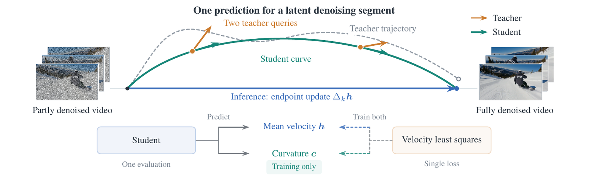
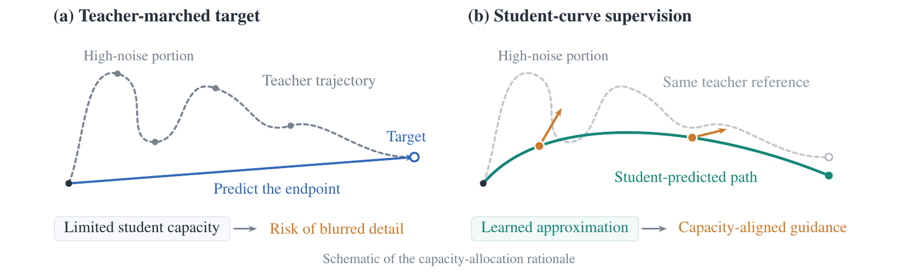
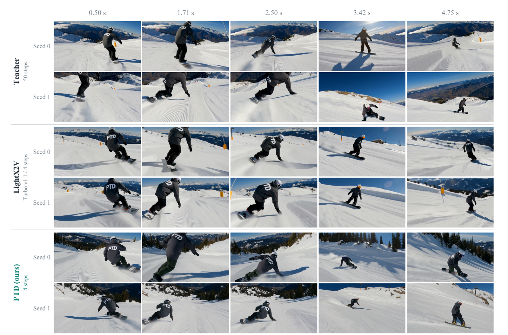
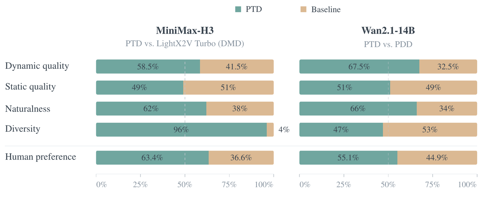
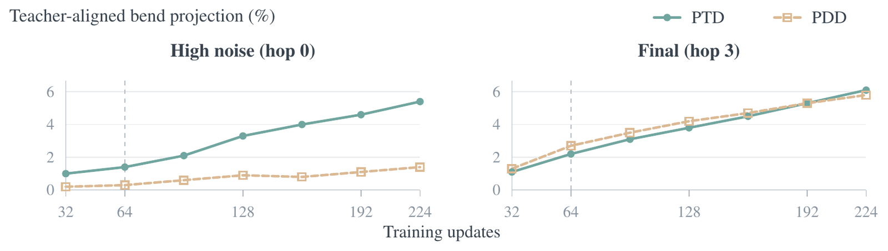
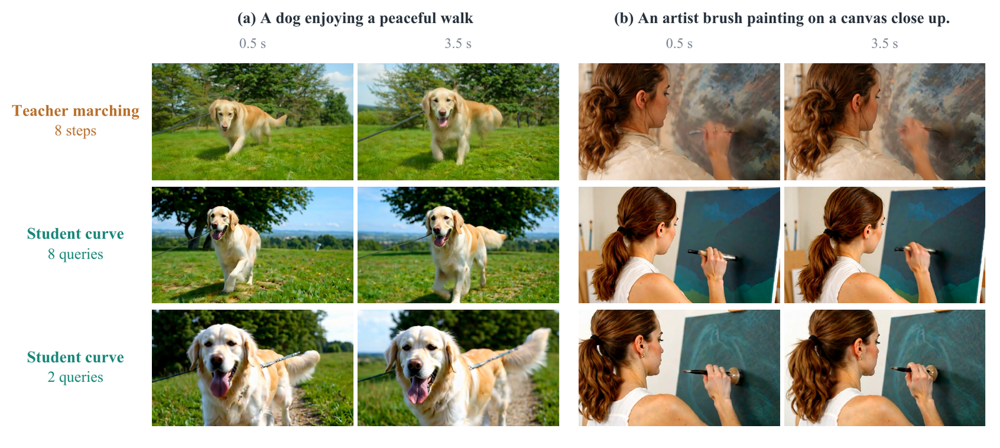
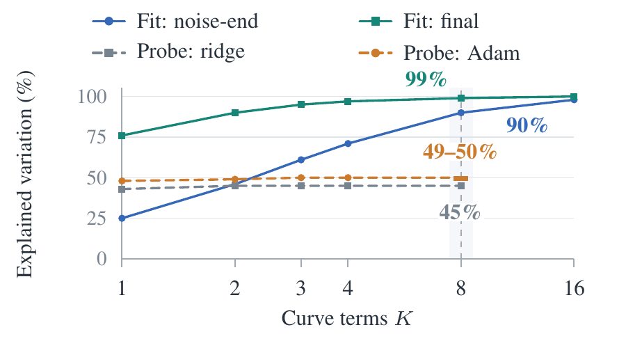

# PTD: Parametric Trajectory Distillation for Few-Step Video Generation

**论文**: [arXiv:2610.11498v1](https://arxiv.org/abs/2610.11498)（cs.CV，2026-10-08，32 页：正文 9 页 + 参考文献 5 页 + 附录 18 页）
**作者**: Lan Feng（EPFL、NVIDIA）, Peter Karkus, Maximilian Igl, Julius Berner, Yuxiao Chen, Shuhan Tan, Alexandre Alahi（EPFL）, Boris Ivanovic, Marco Pavone（NVIDIA、Stanford）—— **NVIDIA + EPFL + Stanford**。Julius Berner 也是主要对照 [PDD](../pdd/analysis.md) 的作者之一，本文以 "Anonymous (2026)"（ICLR 2027 投稿）引用 PDD
**链接**: [项目页](https://alan-lanfeng.github.io/PTD)。H3 的 LoRA、Wan 的 checkpoint、训练代码、评测 prompt 和裁判脚本都写的是"将发布"，目前没有 `[待补]`；H3 版要和 MiniMax-H3 权重一起用，许可证也要一并看

---

## 1. 一句话定位

**PTD 让学生每一步多输出一组"曲率系数"，和平均速度一起拼成一条两端固定的多项式曲线；teacher 只在这条曲线上的 2 个点被查询，一个速度最小二乘同时训两个输出；推理时只用平均速度，曲率头整个丢掉。** 全程只有轨迹监督：没有 DMD、GAN、critic，也没有 JVP。用这个配方，作者把 33B 的音视频模型 MiniMax-H3 蒸成 4 步（每跳一套 rank-128 LoRA），把 Wan2.1-14B 全参蒸成 4 步。

| | 对照 | PTD |
|---|---|---|
| **MiniMax-H3**，GPT-6 Astra 多样性（1–4，Table 4） | LightX2V Turbo v1.1（DMD）1.55 | **2.81** |
| H3，Astra 自然度 / 动态质量 / 静态质量 | 2.98 / 2.61 / **3.06** | **3.09** / **2.70** / 3.04（后两项差异不显著） |
| H3，人评偏好份额（Table 8） | — | **63.4%**（82 票，p = 0.010） |
| **Wan2.1-14B**，Astra 动态质量 / 自然度 | PDD 复现 @96 次更新：2.16 / 2.60 | **2.43** / **2.82** |
| Wan，人评偏好份额 | — | 55.1%（79 票，p = 0.36，不显著） |
| Wan，VBench Overall（Table 1） | PDD 复现 83.67；PDD 发表值 84.92 | 84.57 |

🔴 **读完全文后我认为要打五个折扣**：
1. **主证据是一个 LLM 裁判加小规模人评，Wan 那一半统计上不成立。**
   - 人评只有 10 个评审、161 票。H3 的 63.4% 显著（p = 0.010）；Wan 的 55.1% 不显著（p = 0.36），其中真人实拍 prompt 子集 PTD 只拿到 47.4%，是输的。
   - GPT-6 Astra 每次只看 12 张拼图帧（每格 256 × 448），静态质量的判断粒度很粗；100 个评测 prompt 里有 50 个是 Claude 写的。
   - H3 是音视频联合模型，学生也输出立体声音频，但**音频完全没有评测**。
2. **H3 上的胜出主要是"比 DMD 多样"，这本来就是轨迹类方法对 DMD 的已知优势。**
   - 动态、静态质量都没有显著差别，显著的只有多样性（+1.26）和自然度（+0.11）。
   - 只比了 LightX2V Turbo v1.1 一个发布的 LoRA，训练数据和算力都不同。同样是 H3 上 4 步 DMD2 LoRA 的 FastH3 论文自己引了，却没比；DMAD、LongLive-Plug 也没比。
   - H3 的配方也不是纯粹的"在学生曲线上查询"：最后一跳改用 8 步 teacher marching 的目标，正是论文论证"会让细节变软"的那种做法。论文只说"经验上提升了细节"，没有给数字。
3. **Wan 上"轨迹蒸馏新 SOTA"建立在自己复现的 PDD 上。**
   - PDD 复现版的 VBench 比 PDD 发表值低 1.25（83.67 vs 84.92）；PTD 的 84.57 也低于 PDD、rCM、AnyFlow 的发表值（84.92–84.95，评测 prompt 不同，不能直接比）。
   - 两边的 checkpoint 都是按 VBench 挑的：PTD 训到 240 次更新，报的是 VBench 最高的第 64 次；PDD 在 64、96、256 三个点里挑了第 96 次。
   - 多样性上 PTD 没赢：Astra 持平（−0.04，不显著）；特征空间多样性反而低于 PDD 复现，V-JEPA 2 低 9%，VideoMAE V2 低 29%（我算的）。VBench 的 dynamic degree 低 9.72（76.11 vs 85.83）。论文的"动态质量更好"指的是运动更真实，不是运动更多。
4. **曲率头本身有多大用，没有被单独验证。**
   - 学到的弯曲很小：Wan 上第一跳（64 次更新），学生弯曲幅度只有 teacher 的 8%（`r = 0.081`），方向余弦 0.171，夹角约 80°（我算的）。论文的说法是"学到了一个缩小的、与 teacher 对齐的弯曲"。
   - 最关键的消融缺失：`K = 0`，即直弦加弦上两点 teacher 查询。收益可能主要来自"在学生自己的路径上查询 teacher"，而不是"多项式曲率"。`K` 的选择只用离线拟合和冻结特征的线性探针来论证，没有端到端对比。
5. **复现和部署信息不全。** 代码、权重还没放；H3 训练用了 64 张 GPU、150 次更新、batch 512，总 GPU 时没报。部署时每一跳一套 rank-128 LoRA（共 4 套），要么每步切换 adapter，要么存 4 份合并后的 33B 权重（我的推论），推理速度和显存都没报。

📌 **站得住的部分**：
- **方法简洁，推理零改动。** 一个速度最小二乘同时训平均速度和曲率；因为基函数在两端为零，`h` 恰好是整条曲线的平均速度（Eq 3），曲率头推理时可以直接扔掉，部署的仍是原 backbone。附录把它严格写成"起点固定在网格上、映射限制为多项式"的 Lagrangian 流映射蒸馏，并给出每跳的端点误差界和 W2 界。
- **H3 的多样性提升又大又稳。** 两类 prompt 上分别 +1.24、+1.28，100 个 prompt 里 93 胜 6 平 1 负。Fig 1 很直观：Turbo 的两个 seed 几乎是同一个构图。
- **诊断数据对做少步蒸馏的人有用。**
  - teacher 轨迹在最高噪声的第一跳弯得最厉害：Wan 的探针上，第一跳内速度方向转了 43.5°，最后一跳只有 4.7°；H3 上 `K = 2` 的多项式只能解释第一跳 46% 的速度变化，最后一跳是 90%。
  - 学生在第一跳上的平均速度误差很大：相对 L2 误差约 58%，第三跳只有 6%（按 Table 9 的平方误差开方，我算的）。
  - 两点查询的估计误差只有学生误差的约 1/8。
- **训练很省。** H3 的 150 次更新只过了 0.34 遍 prompt 语料；Wan 第 64 次更新就是最好的 checkpoint。不需要任何训练视频。

---

## 2. 要解决的问题

**少步蒸馏是一个容量分配问题。** 学生和 teacher 参数一样多，但顺序计算少得多（4 步对 50 步），要用这点计算复现 teacher 很长的生成过程。两条主流路线各有代价：

| 路线 | 代表 | 优点 | 问题 |
|---|---|---|---|
| 轨迹监督 | Consistency Models、sCM、PDD | 保留 teacher 的噪声→样本对应关系，运动和多样性好 | mode-covering：学生容量不够时回归到目标的平均，细节变糊 |
| 分布匹配 | DMD、DMD2 | mode-seeking，只在学生自己的样本上评估 teacher，细节锐利 | 多样性明显下降 |
| 混合 | rCM、AnyFlow | 两者兼顾 | 多叠一个目标，训练成本和复杂度上升 |

**PTD 的思路**：像分布匹配那样"在学生自己的路径上找 teacher 要监督"，同时保留轨迹监督的噪声→样本对应关系，不额外叠目标。

**和相近方法的区别**（附录 Table 2）：

| 方法 | teacher 在哪查询 | 学生的速度怎么得到 | 部署形态 |
|---|---|---|---|
| Lagrangian 流映射蒸馏（Boffi 等） | 映射预测出的状态 | 对两时间网络做 JVP | 两时间映射 |
| TVM | 预测的终端状态，用自己的 EMA 速度当目标，外加数据上的 flow matching | 对两时间网络做 JVP 并反传 | 两时间映射 |
| π-Flow | 策略的数值积分 rollout | 闭式策略 | 策略 + 子步积分 |
| [PDD](../pdd/analysis.md) | teacher 自己 Runge–Kutta 的中间点 | 离散的区间输出 | 融合后的区间输出 |
| **PTD** | 学生曲线上的点（闭式） | 对已知基函数求解析导数 | `x_k + Δ_k h` |

---

## 3. 方法

> **Fig 2 读法**：
> - **上半**：从左边"部分去噪的视频"到右边"完全去噪的视频"是一跳。灰色虚线是 teacher 的真实轨迹，弯得很厉害；绿色实线是学生预测的曲线；蓝色直线是推理时真正走的那一步 `Δ_k h`，两端和学生曲线重合。两个橙色点是在学生曲线上查询 teacher 的位置，橙色箭头是 teacher 在那里给出的速度。
> - **下半**：学生一次前向同时输出平均速度 `h` 和曲率 `c`（`c` 标着"只在训练时用"）；右边一个速度最小二乘损失同时训这两个输出。
> - 图里的视频缩略图是示意；同样的构造也用于中间噪声水平之间的跳。

### 3.1 一次前向预测一整段

把 teacher 的生成过程压到一个固定的递减时间网格 `t_0 > … > t_N` 上，每个区间叫一"跳"（hop），学生一次前向走完一跳。第 `k` 跳从状态 `x_k`、时间 `t_k` 出发，`Δ_k = t_{k+1} − t_k < 0`，归一化进度 `τ ∈ [0, 1]`，物理时间 `s(τ) = t_k + τΔ_k`。

学生在 `(x_k, t_k)` 上一次前向，输出平均速度 `h_θ` 和 `K` 个曲率系数向量 `c_{θ,j}`（每个都和 latent 同维），定义整段曲线（Eq 1）：

$$
x_{\theta,k}(\tau)=x_k+\Delta_k\left(\tau\,h_\theta+\sum_{j=0}^{K-1}b_j(\tau)\,c_{\theta,j}\right),\qquad b_j(\tau)=\tau(\tau-1)\,P_j(2\tau-1)
$$

`P_j` 是 `j` 阶 Legendre 多项式，所以基函数 `b_j` 在两端都为零：不管 `c` 是多少，曲线都从 `x_k` 出发、停在 `x_k + Δ_k h`。`c` 只管中间的形状，`c = 0` 就是直弦。

对物理时间求导（网络输出视为常数）得到曲线上的局部速度，它在一跳上的平均恰好是 `h`（Eq 2–3）：

$$
v_{\theta,k}(\tau)=\frac{dx_{\theta,k}}{ds}=h_\theta+\sum_{j=0}^{K-1}d_j(\tau)\,c_{\theta,j},\qquad d_j(\tau)=\frac{db_j(\tau)}{d\tau},\qquad \int_0^1 v_{\theta,k}(\tau)\,d\tau=h_\theta
$$

只对已知的基函数求导，所以曲线上任意多个位置和速度都不需要再跑网络，也不需要 JVP。

### 3.2 一个损失

在 `(0, 1)` 里取 `m` 个位置，在学生当前曲线的对应点上查询 teacher，再让学生曲线在这些点上的速度去拟合 teacher 的速度（Eq 4–5）：

$$
x_i=\mathrm{sg}\left[x_{\theta,k}(\tau_i)\right],\qquad u_i=\mathrm{sg}\left[u_T(x_i,s_i\mid y)\right],\qquad \mathcal{L}_{\mathrm{PTD}}=\sum_{i=1}^{m}\omega_i\left\lVert h_\theta+\sum_{j=0}^{K-1}d_j(\tau_i)\,c_{\theta,j}-u_i\right\rVert^2
$$

- `sg` 是 stop-gradient：查询点和 teacher 速度都不回传梯度，下一次更新时按新的曲线重新查询。
- 同一个残差同时训 `h`（系数为 1）和 `c`（系数为 `d_j(τ_i)`），不需要单独的平均速度目标或曲率目标。按均匀积分取期望，`h` 的梯度会把它拉向"teacher 速度沿当前学生曲线的平均"（附录 A.1）。
- 默认 `m = 2`：前后半段各均匀抽一个点、等权，是均匀积分平方残差的无偏估计。查询数和 `K` 无关，多查询只增加 teacher 开销，不改推理。
- **实现上的梯度路由**（附录 A.2）：把损失精确分解成"均值残差 + 去中心残差"两项，在均值项里对 `Σ d̄_j c_j` 做 stop-gradient。这样 `h` 的梯度不变，`c` 的梯度只来自去中心的残差，少掉的那一项期望是 `2·Cov(d̄_j, r̄)`。

### 3.3 为什么在学生曲线上查询

> **Fig 3 读法**：
> - **（a）teacher 积分目标**：把 teacher 的 ODE 在一跳内密集积分到终点，让学生直接预测这个终点（蓝线）。高噪声那一段 teacher 轨迹（灰色虚线）弯得很厉害，学生一次前向学不会这种转移，结果是细节变糊（橙字）。这种目标每个都要很多次 teacher 顺序计算。
> - **（b）学生曲线监督**：同一条 teacher 轨迹（浅灰）只作参照，查询点落在学生自己预测的路径（绿线）上，橙色箭头是 teacher 在这些点给的局部速度。目标随学生的预测一起变化，始终落在学生当前能表示的路径上。
>
> 这是示意图，对应的实验是 §5.4 的 Fig 6。

**例外是 H3 的最后一跳。** 最后一跳平滑得多（`K = 2` 就能解释 90% 的速度变化，第一跳只有 46%），作者发现对它改用 8 步 Euler 的 teacher 积分目标、只训 `h`，细节更好，训练算力多约 20%（附录 B.3，Eq 21）：

$$
h_m=\frac{x_{\mathrm{end}}-x_3}{\Delta_3},\qquad \mathcal{L}_{\mathrm{H3},3}=\left\lVert h_\theta-\mathrm{sg}[h_m]\right\rVert^2
$$

Wan 四跳都用学生曲线查询，不做 marching。

### 3.4 训练与推理

- **训练在学生自己的 rollout 上进行**：从噪声出发，每一跳一次前向预测曲线，用 Eq 5 算损失，把预测的终点 detach 后交给下一跳；第 4 跳之后从新噪声重来。只需要 prompt 和噪声，不需要训练视频，也不需要预先算好的 teacher 轨迹。所有 worker 每次迭代处理同一跳，所以一条完整 rollout 跨 4 次迭代（4 次优化器更新）。
- **推理只用 `h`**（Eq 6）：

$$
x_{k+1}=x_k+\Delta_k\,h_\theta(x_k,t_k\mid y),\qquad k=0,\dots,N-1
$$

  不查 teacher，也不算曲率；每一跳仍是原 backbone 的结构和输出维度。

### 3.5 理论（附录 A.3、A.4）

记曲线上的残差 `r(τ) = v_θ(τ) − u_T(x_θ(τ), s(τ))`。若 teacher 速度场在相关区域关于状态 `L_T`-Lipschitz，由 Gronwall 不等式（Eq 16）：

$$
\left\lVert x_k+\Delta_k h-x_T(1)\right\rVert\le|\Delta_k|\,e^{|\Delta_k|L_T}\left(\int_0^1\lVert r(\tau)\rVert^2\,d\tau\right)^{1/2}
$$

`m = 2` 的分层查询损失，期望正好是右边括号里的积分；所以压低 Eq 5，就是在压一跳的端点误差，而且不需要积分 teacher。残差处处为零时，学生曲线就是 teacher 轨迹，`h` 等于 teacher 在这一跳上的平均速度。

附录还证明，PTD 等价于对 Lagrangian 流映射蒸馏做了四个限制：起点固定在网格上、终点只在当前跳内、终点时间依赖放进固定的多项式基、用两点分层估计积分。由此还得到一跳的 W2 距离界（Eq 20）。

---

## 4. 实验设置

| 项 | MiniMax-H3（33B，音视频） | Wan2.1-T2V-14B |
|---|---|---|
| 输出 | 768×1344，124 帧，24 fps，立体声 32 kHz 音频 | 480×832，81 帧，16 fps |
| 训练方式 | 每跳一套 rank-128 LoRA（含速度投影层），不加时间嵌入 / AdaLN 的 LoRA | 全参微调，速度投影层稠密可训 |
| 曲率项 / 查询 | `K = 8`；第 0–2 跳两点查询；最后一跳 8 步 teacher marching | `K = 8`；四跳都是两点查询 |
| teacher | 发布的 CFG 蒸馏版 H3（每次查询一次条件前向） | CFG 5 + skip-layer guidance（第 12 层）+ 官方负向 prompt |
| 学习率 / batch | 1e-4（常数）/ 512（64 卡 × 8 轮累积） | 1e-5（常数）/ 256（128 卡 × 2 轮） |
| 报告的 checkpoint | 第 150 次更新 | 第 64 次更新（训到 240） |
| 训练 prompt | 55,879 条，来自 ViMix、OpenVid、VidProM，用 H3 官方改写器改成三段式音视频模板；去掉了评测用的 ViMix 验证集 caption | ViMix |
| 对照 | LightX2V Turbo v1.1（发布的 4 步 DMD LoRA，保留其采样设置） | PDD 复现：同 backbone、同 teacher、同 batch 和学习率，训 256 次更新，评第 64、96、256 次，取 VBench 最高的第 96 次 |

**时间网格**：学生的跳边界放在 shift-6 网格 `t = γu / (1 + (γ − 1)u)`（`γ = 6`）上，`u` 取四等分点，得到 `t = (0.999, 0.947, 0.857, 0.667, 0)`，`Δ = (−0.052, −0.090, −0.190, −0.667)`。前三跳只占不到三分之一的时间，最后一跳占三分之二。

**评测**：
- **GPT-6 Astra**：100 个 prompt，固定于生成之前，50 个是 ViMix 留出的真人实拍 caption，50 个是 Claude 写的动作 prompt；每个模型每个 prompt 生成 3 个 seed。每次裁判看 12 张按时间排序的 2 × 3 拼图（一行一个模型，三列是三个 seed），隐去模型身份，两种行顺序各判两次，每个 prompt 共 4 次调用。在动态质量（运动是否真实，不奖励运动多）、静态质量、自然度、多样性四个维度上打 1–4 分；按 prompt 做 bootstrap 给 95% 置信区间。
- **人评**：10 个评审，161 票（H3 82 票，Wan 79 票），看完整视频（静音循环），在两行三个 seed 之间选更想看的一行或平局。
- **VBench**：只在 Wan 上作为参考，946 个 prompt × 5 个 seed。

**没有报告的**：总训练 GPU 时；推理延迟与显存（尤其 H3 每跳一套 LoRA 的切换开销）；H3 音频质量；H3 最后一跳 marching 的定量消融；`K = 0` 的端到端消融；其他 PTD checkpoint 的 VBench；与 FastH3、DMAD 等其他 H3 加速器的对比。

---

## 5. 结果

### 5.1 MiniMax-H3：对 LightX2V Turbo（Table 4、Fig 1、Fig 4）

> **Fig 1 读法**：同一个滑雪板 prompt，每行是一个 seed 在 0.50、1.71、2.50、3.42、4.75 s 的画面。
> - **上（teacher，50 步）**：两个 seed 的构图、地形和镜头距离差别都很大，seed 1 后半段换成了大远景。
> - **中（LightX2V Turbo v1.1，4 步）**：两个 seed 几乎一样，每个时刻的姿态、取景、背景都高度重合，这就是 DMD 的模式坍缩。
> - **下（PTD，4 步）**：两个 seed 的背景（树林的多少、山脊的位置）和取景不同，人物转弯时身体倾斜、扬雪，和 teacher 的风格接近。
>
> 这是挑选过的单个 prompt，统计结论看下表。

| 维度（Table 4） | PTD | Turbo | 差值 [95% CI] | 胜 / 平 / 负 |
|---|---|---|---|---|
| 动态质量 | 2.70 | 2.61 | +0.09 [−0.04, +0.21] | 45 / 27 / 28 |
| 静态质量 | 3.04 | 3.06 | −0.03 [−0.08, +0.02] | 6 / 86 / 8 |
| 自然度 | 3.09 | 2.98 | **+0.11** [+0.06, +0.17] | 28 / 68 / 4 |
| 多样性 | 2.81 | 1.55 | **+1.26** [+1.15, +1.36] | 93 / 6 / 1 |

（胜负按 prompt 级差值 ≥ 0.25 判定。）两类 prompt 分开看（Table 5），多样性 +1.24、+1.28，自然度 +0.19、+0.04，置信区间都不含零。

> **Fig 4 读法**：每根条是 PTD（绿）对 baseline（棕）的份额，平局各算一半，虚线是 50%。
> - **左（H3 对 Turbo）**：多样性 96% 对 4%，自然度 62%，动态质量 58.5%，静态质量 49%（基本打平）；人评 63.4%。
> - **右（Wan 对 PDD）**：动态质量 67.5%，自然度 66%，静态质量 51%，多样性 47%（略输）；人评 55.1%。
> - 前四行由 Astra 的打分差换算，人评是另一次独立的整体投票。

### 5.2 Wan2.1-14B：对 PDD（Table 1、4、6、7，Fig 5）

**Astra**（Table 4）：

| 维度 | PTD @64 | PDD @96 | 差值 [95% CI] | 胜 / 平 / 负 |
|---|---|---|---|---|
| 动态质量 | 2.43 | 2.16 | **+0.27** [+0.17, +0.36] | 47 / 41 / 12 |
| 静态质量 | 2.85 | 2.84 | +0.01 [−0.06, +0.07] | 12 / 78 / 10 |
| 自然度 | 2.82 | 2.60 | **+0.22** [+0.13, +0.32] | 44 / 44 / 12 |
| 多样性 | 2.47 | 2.52 | −0.04 [−0.17, +0.09] | 36 / 22 / 42 |

**VBench 与特征空间多样性**（Table 1）：

| 方法 | NFE | Overall | Quality | Semantic | V-JEPA 2 多样性 | VideoMAE V2 多样性 |
|---|---|---|---|---|---|---|
| UniPC（teacher，发表值） | 50×2 | 83.90 | 84.56 | 81.24 | 0.1263 | 0.0250 |
| rCM（发表值） | 4 | 84.92 | 85.43 | 82.88 | — | — |
| AnyFlow（发表值） | 4 | 84.95 | 85.70 | 81.92 | 0.0786 | 0.0130 |
| DMD2（FastGen，发表值） | 4 | 84.40 | 85.16 | 81.34 | 0.0568 | 0.0095 |
| PDD short（发表值） | 4 | 84.92 | 85.71 | 81.77 | 0.0791 | 0.0125 |
| PDD long（发表值） | 4 | 84.69 | 85.69 | 80.71 | 0.0846 | 0.0126 |
| PDD @96（复现） | 4 | 83.67 | 85.24 | 77.40 | **0.1340** | **0.0254** |
| **PTD @64** | 4 | **84.57** | **85.44** | **81.10** | 0.1220 | 0.0180 |

- 发表值来自 PDD 作者的评测，用的是 Self Forcing 的 prompt（rCM 用的是自己的私有 prompt）；本文的复现和 PTD 用 946 个 prompt × 5 个 seed。两组数不能直接比。
- **PDD 复现在三个 checkpoint 上**（Table 6）：第 64 次 83.29，第 96 次 83.67，第 256 次 82.83。PTD 第 64 次就比三个都高；同为 64 次更新时高 1.28。
- **逐维度**（Table 7）：PTD 在 16 个维度里有 13 个更高，最大的是 spatial relationship +8.73、multiple objects +8.72、scene +5.67；最大的劣势是 dynamic degree **−9.72**（76.11 vs 85.83）。
- ⚠️ 特征空间多样性上，PDD 复现甚至略高于 teacher（0.1340 vs 0.1263，0.0254 vs 0.0250），PTD 低于 PDD 复现。

> **Fig 5 读法**：纵轴是学生弯曲向量在 teacher 弯曲方向上的投影，按 teacher 弯曲能量归一化（%），横轴是训练更新次数，虚线标出评测用的第 64 次。
> - **左（最高噪声的第 0 跳）**：PTD 从 1.0% 升到 5.4%，PDD 一直在 0.2%–1.4%。
> - **右（最后一跳）**：两者几乎重合，都升到约 6%。
>
> 换句话说，PTD 在第一跳上学到的 teacher 对齐弯曲是 PDD 的约 4–5 倍，但绝对量很小：第 64 次更新时只有 1.4%。对应的弯曲幅度比 `r` 为 0.081，方向余弦 0.171（Table 10）。

### 5.3 人评（Table 8）

| 子集 | 票数 | PTD 胜 / 平 / 负 | 偏好份额 | 去掉平局的胜率 [Wilson 95% CI] | 符号检验 p |
|---|---|---|---|---|---|
| H3：全部 | 82 | 45 / 14 / 23 | **63.4%** | 66% [54, 76] | **0.010** |
| H3：动作 prompt | 43 | 22 / 10 / 11 | 62.8% | 67% [50, 80] | 0.08 |
| H3：真人实拍 prompt | 39 | 23 / 4 / 12 | 64.1% | 66% [49, 79] | 0.09 |
| Wan：全部 | 79 | 33 / 21 / 25 | 55.1% | 57% [44, 69] | 0.36 |
| Wan：动作 prompt | 40 | 21 / 8 / 11 | 62.5% | 66% [48, 80] | 0.11 |
| Wan：真人实拍 prompt | 39 | 12 / 13 / 14 | 47.4% | 46% [29, 65] | 0.85 |

### 5.4 消融与诊断

**学生曲线查询 vs teacher marching**（Fig 6）：在 Wan2.1-1.3B 上训三个学生各 40 次更新，推理都是 4 步：每跳 8 步 teacher marching 的终点目标、学生曲线上 8 点查询、学生曲线上 2 点查询（默认）。

> **Fig 6 读法**：两个 prompt 各取 0.5 s 和 3.5 s 两帧。
> - **上（teacher marching，8 步）**：狗的毛发、画家的手和笔尖都偏软，像轻微失焦。
> - **中（学生曲线，8 点查询）**：毛发和手部边缘清楚，构图和上一行接近。
> - **下（学生曲线，2 点查询，默认）**：同样清楚，但构图明显不同：狗凑到镜头前，画布内容也变了。
>
> 只有两个 prompt、一个 seed、40 次更新，没有任何定量指标；"细节变软"是肉眼判断。

**两点查询够不够**（附录 Table 9，H3 第 0–2 跳）：用 100 条存好的 teacher 轨迹，比较"每半段查一点的平均"和真实平均速度，误差按真实平均速度能量归一化：

| 跳 | 学生误差（96 个 prompt） | 两点查询误差 | 占学生误差 | 三点查询误差 | 占学生误差 |
|---|---|---|---|---|---|
| 0 | 0.3346 | 0.04218 | 12.6% | 0.02224 | 6.6% |
| 1 | 0.0114 | 0.00155 | 13.6% | 0.00069 | 6.1% |
| 2 | 0.0036 | 0.00048 | 13.3% | 0.00021 | 5.8% |

两点查询的估计误差约为学生自身误差的 1/8，三点能再减半，但每跳多一次 teacher 前向，所以默认用两点。注意学生在第 0 跳的误差本身很大：开方后相对 L2 误差约 58%，第 2 跳约 6%（我算的）。

**曲线能表达多少 vs 学生能预测多少**（Fig 8）：

> **Fig 8 读法**：横轴是曲率项数 `K`，纵轴是能解释的速度变化比例。
> - **实线（离线拟合 8 条 H3 teacher 轨迹）**：最靠近噪声的一跳，`K` 从 2 到 8 解释比例从 46% 升到 90%，`K = 16` 约 98%；最后一跳从 90% 升到 99%。也就是说，多项式族几乎能精确表示 teacher 轨迹。
> - **虚线（冻结学生特征上的线性探针，500 个留出 prompt，只测最后一跳）**：不管 `K` 取多少，ridge 都约 45%，Adam 约 49–50%。
>
> 附录还给了更早的跳：探针在第 0、1、2 跳上只能解释 7–11%、14–15%、约 3.5%。学生特征能预测的弯曲远少于曲线能表达的，这就是它学到的弯曲"缩小了"的原因。论文据此取 `K = 8`："多加项不会降低可预测性，又提高了上限"。

---

## 6. 数字核对

| 说法 | 复算 | 结论 |
|---|---|---|
| Fig 4 各条份额 | H3：(45 + 27/2)/100 = 58.5%，(6 + 86/2)/100 = 49%，(28 + 68/2)/100 = 62%，(93 + 6/2)/100 = 96%；Wan：67.5%、51%、66%、47% | ✅ |
| 人评份额 63.4% / 55.1% | (45 + 14/2)/82 = 63.4%；(33 + 21/2)/79 = 55.1% | ✅ |
| H3 训练量 | 150 × 512 = 76,800 个跳级样本，÷ 4 = 19,200 条 rollout，÷ 55,879 = 0.34 遍 | ✅ |
| 时间网格 | 6u/(1 + 5u)，u = 3/4、1/2、1/4 时为 0.947、0.857、0.667 | ✅ |
| Table 9 的相对误差 | 0.04218/0.3346 = 12.6%，0.00155/0.0114 = 13.6%，0.00048/0.0036 = 13.3%；三点 6.6%、6.1%、5.8% | ✅ |
| VBench 差距 | 84.57 − 83.67 = 0.90；84.57 − 83.29 = 1.28；复现与发表值差 84.92 − 83.67 = 1.25 | ✅ |
| 学生第 0 跳的相对误差 | √0.3346 = 0.578；第 1、2 跳 0.107、0.060 | 我算的 |
| 弯曲方向夹角 | arccos 0.171 = 80.2°（PTD @64）；arccos 0.300 = 72.5°（PTD @240） | 我算的 |
| 特征空间多样性 | PTD / PDD 复现：0.1220/0.1340 = −9%；0.0180/0.0254 = −29% | 我算的 |
| PDD 发表值的训练量 | Table 1 注：short / long 为 200 / 3,000 次迭代；与 PDD 论文 §5 原文一致 | ✅（仓库 PDD 笔记记成了 250 / 3.5k，已在那边补更正） |

---

## 7. 争议与权衡

**① "曲率"与"在学生路径上查询"两个成分没有拆开。** PTD 的叙事是"学生学一条与容量匹配的曲线"。但学到的弯曲只有 teacher 的几个百分点，方向夹角接近 80°，而缺了 `K = 0`（直弦上两点查询）这个对照。如果直弦版本效果接近，那 PTD 的本质就是"在学生自己的直线路径上取两点 teacher 速度的平均"，曲率头只是一个让查询点稍微偏离直线的训练技巧。这对实现成本影响很大：`K = 0` 时不需要额外的 8 个 latent 大小的输出头。

**② 对照的选择让两边的结论都偏有利。** H3 上对 DMD，多样性大胜是可预期的；Wan 上对轨迹类方法 PDD，多样性没赢，质量的提升又建立在一个比发表值低 1.25 的复现上，而 PDD 的作者之一就在本文作者里。最有说服力的对照（同 backbone、同算力下的 DMD 和混合方法，例如 rCM、AnyFlow）没有做。

**③ 评测协议本身很严谨，但量太小。** 固定 prompt、隐去身份、两种行顺序、按 prompt bootstrap、报告胜平负和符号检验，都值得学；问题是 Astra 只看 12 张小图，人评只有 161 票，Wan 那一半不显著。对 H3 这种音视频模型，音频一点没评。

**④ H3 配方里有一个"例外"。** 论文的核心论点是"别让学生去拟合 teacher 积分出来的终点"，但 H3 的最后一跳恰恰这么做了，而且只有一句"经验上更好"。最后一跳覆盖了 `t` 从 0.667 到 0 的三分之二时间，低噪声段通常决定纹理细节；H3 结果中有多少来自这个例外，无法判断。

**⑤ 部署成本没交代。** 每跳一套 rank-128 LoRA，对 33B 模型意味着要么在线切换 adapter（每步多一次 LoRA 计算），要么常驻 4 份合并权重。这和"推理保持原架构、四步"的说法并不矛盾，但实际的显存和延迟账没有给。

---

## 8. 一句话总结

**PTD 让学生一次前向输出"平均速度 + 曲率系数"拼成的多项式曲线，只在这条曲线上的两点查询 teacher，用一个速度最小二乘训练，推理时丢掉曲率头、保留原架构。在 MiniMax-H3 上，它把 4 步学生的多样性从 DMD 式 LightX2V Turbo 的 1.55 提到 2.81，质量持平，人评 63.4% 显著；在 Wan2.1-14B 上对自己复现的 PDD 提高了动态质量和自然度，但人评不显著、多样性没赢。最缺的是 `K = 0` 的消融：收益究竟来自"曲率"还是来自"在学生自己的路径上查询 teacher"，目前分不清。**

---

## 9. 在仓库图谱里的位置

| | 关系 |
|---|---|
| **[PDD](../pdd/analysis.md)** | 🔴 **直接对照，也是同一个 NVIDIA 组的兄弟方法**（Julius Berner 两篇都署名）。两者都只用轨迹监督、都回归 teacher 速度：PDD 在 teacher 自己的 Runge–Kutta 中间点上取目标，一次前向输出 128 个区间速度；PTD 在学生预测的曲线上取目标，只输出一个平均速度加曲率。本文复现的 PDD 比发表值低 1.25 |
| **[SolarRenderer](../../world_model/solarrenderer/analysis.md)** | MiniMax-H3 上又一种 4 步加速。那篇比较的是 LongLive-Plug、DMAD、FastH3 三个 LoRA，本文比的是 LightX2V Turbo v1.1；四五个 H3 加速器至今没有共同基准。那篇发现普通 DMD 会把学生拉向模糊的 teacher，用结构引导外推修正；本文发现 DMD 的问题主要在多样性 |
| [LongLive-Plug](../longlive_plug/analysis.md) | 同为"base 上蒸一个 4 步 LoRA"，LongLive-Plug 用 DMD2 且只有一套 LoRA、想挂到所有下游；PTD 每跳一套 LoRA，只在 base 上评测 |
| [CTM](../../inference_acceleration/ctm/analysis.md) | 流映射一族的源头之一：CTM 学任意 `t → s` 的两时间映射；PTD 是把起点限制在网格上、终点限制在当前跳内、终点时间依赖放进多项式基的特例 |
| [TDM](../../inference_acceleration/tdm/analysis.md) | 另一种把"轨迹"和"分布匹配"结合的少步蒸馏 |
| [DyMD](../dymd/analysis.md) | 从分布匹配一侧修 DMD 的"动态 / 多样性损失"（按运动一致性调 re-noise 时间步）；PTD 从轨迹监督一侧绕开它 |
| [FewStepRL](../../image_generation/fewsteprl/analysis.md) | 少步模型蒸好之后的下一步：用 RL 继续调。它的主要改造依赖网络带区间终点 `r` 这个输入（AnyFlow 蒸出的平均速度模型）；PTD 的学生每跳只输出一个平均速度、不带 `r`，套它的方法只能用最简单的 u-form |

⚠️ **仓库缺口**：rCM、AnyFlow、π-Flow、TVM、MeanFlow、Flow Map Matching 都还没有笔记；H3 上的 LightX2V Turbo、FastH3、DMAD 也没有专篇。

---

## Q&A

**Q: 我们要给 MiniMax-H3 选一个 4 步加速方案，PTD 和 DMD 系的 LoRA（LightX2V Turbo、FastH3、DMAD、LongLive-Plug）该怎么选？**

A: **看你更在乎"同一个 prompt 出多个不同结果"，还是"单张画面的锐利度"；PTD 的权重放出来之前，DMD 系是唯一能直接用的。**
1. **要多样性就优先试 PTD。** 做游戏资产时经常一个 prompt 要出几版供挑选，DMD 的模式坍缩在这里伤害最大（Fig 1 里 Turbo 两个 seed 几乎一样）。PTD 在 H3 上多样性 2.81 对 1.55，静态质量持平。
2. **只要单个结果好看，两者差别不大。** 论文里静态、动态质量都没有显著差异。
3. **部署前先算显存账。** PTD 每跳一套 rank-128 LoRA，四步就要四套；在线切换会多一点每步计算，合并则要常驻 4 份 33B 权重。LongLive-Plug 是一套 LoRA 走所有步；LightX2V Turbo、FastH3 是否按步拆 LoRA，我没核实 `[待补]`。
4. **音频要自己测。** 论文完全没评 H3 的音频，如果资产生成要带音效或配音，需要自己做对比。
5. **自己训的话**：只需要 prompt 和噪声，H3 上 150 次更新、batch 512 就收敛，但每个训练样本要额外两次 teacher 前向（最后一跳 8 次），而且要先做 `K = 0` 的对照，确认曲率头值得留。

---
