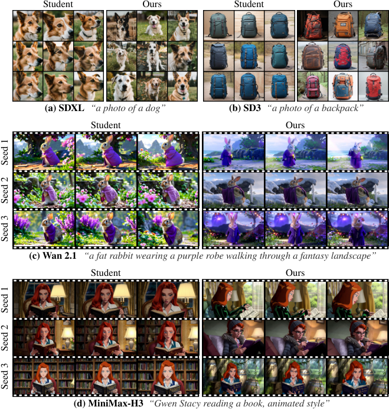
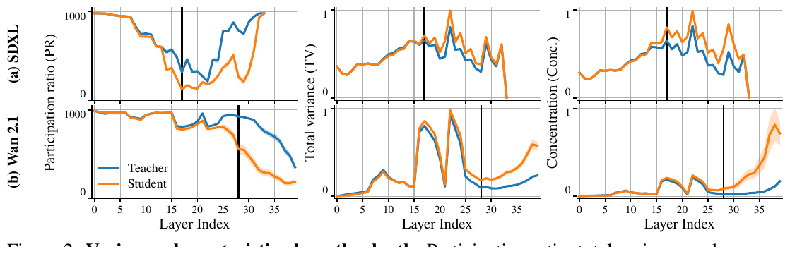
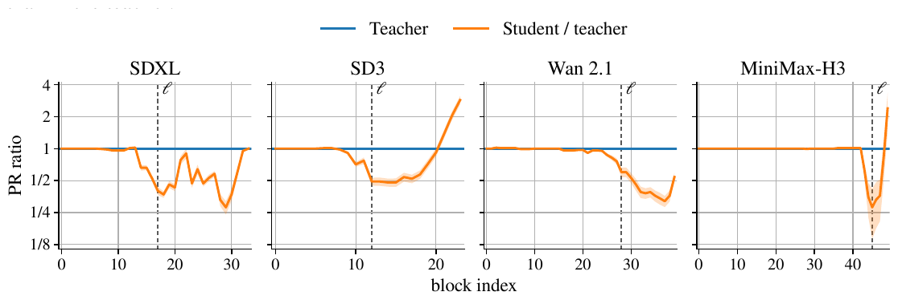
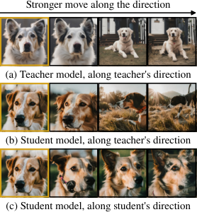
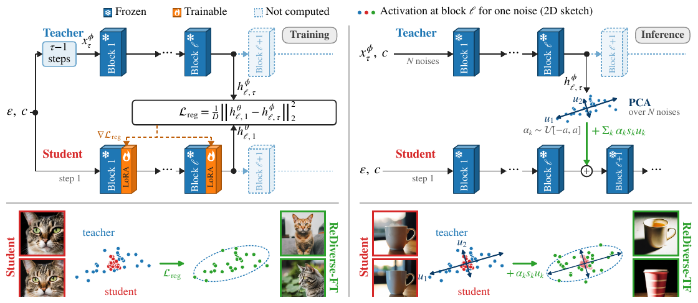
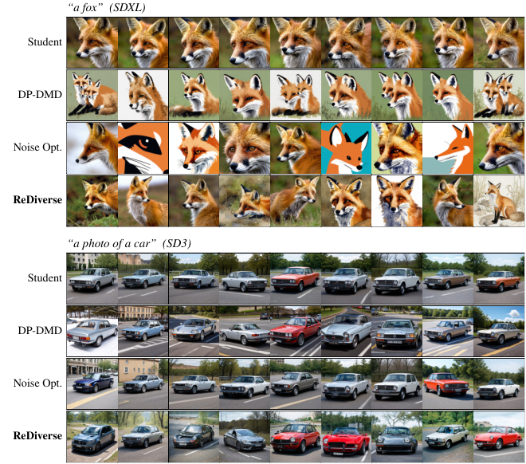
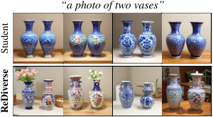
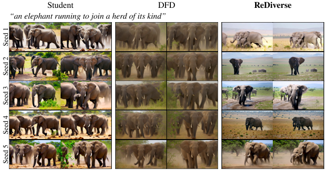
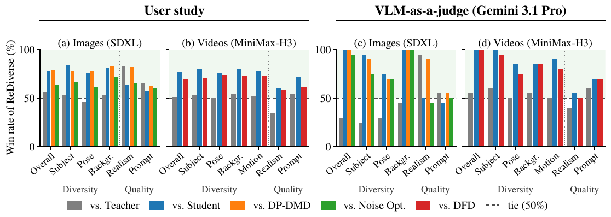

# ReDiverse: Restoring Diversity in Distilled Image and Video Generators by Probing Activations

**论文**: [arXiv:2611.18550v1](https://arxiv.org/abs/2611.18550)（cs.CV，2026-11-13，42 页：正文 11 页 + 参考文献 5 页 + 附录 26 页）
**作者**: Furkan Horoz, Ozgur Kara（UIUC）, Kaan Oktay, Adil Kaan Akan, Atakan Kara（fal）, Anand Bhattad†（JHU）, James Matthew Rehg†（UIUC）—— **UIUC + fal + JHU**，† 为共同指导
**链接**: [项目页](https://rediverse-distillation.github.io/rediverse-distillation/) · [github.com/H-furkan/rediverse](https://github.com/H-furkan/rediverse)（Apache-2.0，本笔记查看时 HEAD 为 `e288d2b`，2026-11-16）· [HF ReDiverse/ReDiverse](https://huggingface.co/ReDiverse/ReDiverse)（4 个 FT adapter，另有 Pika H3 Flex 版）
⚠️ **许可证按底座走**：代码是 Apache-2.0，adapter 不是。SDXL adapter 继承 DMD2 的 **CC BY-NC-SA 4.0（不可商用）**；SD3 适用 Stability AI Community License；H3 / Pika H3 Flex 适用 MiniMax H3 Community License，仓库 README 写明其 Applicable Territory **不含欧盟、英国、韩国和美国**；只有 Wan 2.1 那份是 Apache-2.0

---

## 1. 一句话定位

**少步学生的多样性坍缩，在激活层面不是"方差没了"，而是"方差挤进了更少的方向"，而且这件事发生在第一步的某一个中间 block（collapsed block ℓ）。** 据此作者给出两个修补：ReDiverse-FT 在 ℓ 及之前的 block 上训一个 rank-32 LoRA，把学生第 1 步在 ℓ 的激活回归到 teacher 第 τ 步的激活（200 次迭代，只在第 1 步打开）；ReDiverse-TF 不训练，每个 prompt 先跑 25 次 teacher 求 PCA 方向，再给学生第 1 步在 ℓ 的激活随机加上前 8 个方向。两者叠加就是 ReDiverse。学生全部是公开发布的 4 步 checkpoint，不重新蒸馏。

| DINO 多样性（×100，Table 4） | Student | ReDiverse | Teacher | 补回的 gap（我算的） |
|---|---|---|---|---|
| SDXL / DMD2 | 59.4 | **65.0** | 66.3 | 81% |
| SD3-M / TDM | 48.4 | **60.1** | 61.6 | 89% |
| Wan2.1-14B / lightx2v | 31.6 | **52.2** | 51.6 | 103% |
| MiniMax-H3 / LightX2V Turbo | 36.5 | **50.9** | 52.5 | 90% |

| 质量代价（Table 4） | Student | ReDiverse | Teacher |
|---|---|---|---|
| SDXL ImageReward / HPSv2 | 0.854 / 30.4 | 0.672 / 29.7 | 0.695 / 29.2 |
| SD3 ImageReward / HPSv2 | 1.026 / 30.1 | 0.872 / 29.0 | 1.017 / 29.5 |
| Wan ViCLIP-S / BgC | 21.5 / 95.6 | 20.5 / 95.9 | 21.4 / 97.3 |
| H3 ViCLIP-S / BgC | 19.9 / 95.1 | 19.8 / 94.0 | 20.7 / 94.6 |

🔴 **读完全文后我认为要打四个折扣**：

1. **"training-free" 的 TF 每个 prompt 要先跑一遍 teacher，视频上很贵。**
   - 方向要按 prompt 现算：25 个噪声，每个跑到 teacher 的第 τ 步（SDXL 7、SD3 9、Wan 8、H3 16），引导步还要算 CFG。
   - 仓库 README 给的耗时：**SDXL / SD3 约 15 s，Wan 2.1 约 15 min，MiniMax-H3 约 1 GPU 小时**，每个 prompt 一次。论文正文和 Table 4 都没报这个开销。
   - 主表的 "ReDiverse" 一行是 FT + TF 叠加，所以主结果默认包含这笔 teacher 开销。4 步学生本身生成一条 H3 视频要多久，论文没给，`[待补]`。对"每个 prompt 只出几条"的场景，这已经比直接用 teacher 采样还贵（我的推论）。
2. **质量损失主要落在 reward 分数和视频真实感上，而且与多样性增益同步出现。**
   - ImageReward：SDXL 0.854 → 0.672（−21%），SD3 1.026 → 0.872（−15%），SD3 上低于 teacher 的 1.017。HPSv2 两个底座也都降了 0.7–1.1。
   - 人评里视频真实感对 teacher 只有约 35% 胜率（从 Fig 10 读的，约数）。作者在 §6 自己承认这两点。
   - 消融里几乎每个"更多样"的设置都伴随 ImageReward 下降（§6），这更像一条 trade-off 曲线上换了个点，而不是免费的修复。
3. **Gemini 裁判的结果被选择性引用。** 正文说"VLM 裁判同意 ReDiverse 比 4 步方法更多样"。但同一张 Fig 10(c) 里，Gemini 在 SDXL 上对 teacher 的多样性胜率只有约 30%（subject 约 25%、pose 约 30%），也就是裁判认为 teacher 明显更多样，这和人评"与 teacher 持平"相反。正文没提这一点。
4. **几处论文与代码、表与表不一致。**
   - Wan 的 FT 目标步 τ：论文 Table 2 / Table 7 写 8；仓库 README 写 FT 用 **13**、TF 用 8，并说明 Wan 的 FT 目标其实取自"加了 Perflow CFG5→CFG1 LoRA 的 CFG 蒸馏版 teacher"。论文写的是"CFG 5"的 teacher。
   - Table 5a 的 "Regress at all blocks" 一行，TPIPSavg 写 26.6、没有标差值。对应的附录 Table 8 里 26.6 是 overall TPIPS，不是 TPIPSavg。如果真是 TPIPSavg，就比 teacher 的 21.7 还高 4.9，所以这里大概率是填错了列。
   - H3 学生在 ℓ 处的 PR 比值：Table 1 写 0.37（20 个 prompt），§3.2 和 Table 6 写 0.28（5 个 prompt）。Table 6 的图注解释了这个差别，但正文两处直接并列，读的时候容易混。

📌 **站得住的部分**：

- **诊断本身干净，且在 4 个底座上都成立。** 同一组 1000 个噪声分别喂给 teacher 和学生，只看第 1 步。在 collapsed block 处，学生的总方差是 teacher 的 1.03–2.92 倍，PR 只有 0.37–0.60，集中度高出 2.5–8.1 倍（Table 1）。
- **"学生能解码 teacher 的方向"有直接的因果证据。** 把学生在 ℓ 的激活沿 teacher 的第一主方向推，构图和机位会变；沿学生自己的主方向推，只有颜色、光照变（Fig 3、Fig 16）。所以下游 block 的渲染能力还在，丢的是第 1 步在 ℓ 处的方向分配。
- **PR 比值能区分同一个 teacher 的两个学生。** 同为 MiniMax-H3 的 4 步学生，FastVideo（全参 DMD2）在 ℓ 处保留 61% 的 PR，Turbo（LoRA）只有 28%；DINO 多样性对应为 52.3 和 35.8（teacher 55.3）。这个探针可以拿来评估自己蒸出来的学生，不需要生成和评测大量样本。
- **FT 很便宜。** 100 条 DiffusionDB caption × 16 个噪声，batch 32，200 步，4 个底座同一套超参。只改第 1 步，后 3 步仍是原学生。adapter 已发布（89–612 MB）。
- **基线对比方式公平。** 所有方法共用同一个噪声库，逐 prompt 配对比较。DINO 的胜率在 4 个底座上都显著（p < 0.001，sign test）。DP-DMD、DFD 都是作者按同一 teacher–student 对重新训的。

---

## 2. 背景：少步蒸馏为什么不多样

> **Fig 1**：每格同一个 prompt、不同 seed。(a) SDXL "a photo of a dog"：学生几乎都是同一种近景，ReDiverse 有远近、姿态变化；(b) SD3 背包款式变化；(c)(d) 视频每行一个 seed，时间从左到右，ReDiverse 的环境、机位、画风更分散。

DMD、对抗蒸馏这类目标只监督最终输出，学生第 1 步就把全局结构定死，不同 seed 出近似一样的图。已有解法分两类：

| 路线 | 代表 | 代价 |
|---|---|---|
| 重蒸 / 改目标 | f-distill、ADM、DP-DMD（第 1 步回归 teacher 更早的 latent）、Duet、DFD（混入真实视频） | 要完整重蒸或后训练，DFD 还要真实数据 |
| 冻结学生、推理时干预 | Noise Optimization（优化初始噪声）、Gandikota & Bau（第 1 步用 teacher）、STRIDE（沿学生自己的 PCA 方向加噪）、feature self-guidance | 每个样本额外优化，或者加噪方向不对 |

作者的切入点：**两类方法都没回答多样性是在网络的哪里丢的。** 本文先定位，再在那一个位置修。STRIDE 和 ReDiverse-TF 形式上最像，都是在中间激活上沿 PCA 方向加扰动。区别在方向来源：STRIDE 用学生自己的方向，ReDiverse 用 teacher 的方向。§6 的消融说明这正是关键差别。

---

## 3. 诊断：同样的方差，更少的方向

### 3.1 三个量

对 block `b`，把 N 个噪声的激活展平、减均值，堆成 `X_b ∈ R^{N×D}`，协方差 `Σ_b = X_bᵀX_b / N`，特征值为 `λ_j`。D 太大，实际算的是 N×N 的 Gram 矩阵，非零特征值相同。

$$
\mathrm{TV}(\Sigma_b) = \sum_j \lambda_j ,\qquad
\mathrm{PR}(\Sigma_b) = \frac{\left(\sum_j \lambda_j\right)^2}{\sum_j \lambda_j^2} ,\qquad
\mathrm{Conc}(\Sigma_b) = \frac{\mathrm{TV}(\Sigma_b)}{\mathrm{PR}(\Sigma_b)}
$$

- **TV** 是激活随噪声变化的总幅度。
- **PR**（participation ratio）是有效维数：方差均匀分布在 m 个方向时，PR = m。
- **Conc** 是平均每个有效方向分到的方差。

测量设置（App. A）：同样 N = 1000 个噪声作为第 1 步的输入，只跑条件分支，记录每个 block 的图像 / 视频 token 激活；SDXL、SD3 用 100 个 prompt，Wan、H3 用 20 个。

### 3.2 结果

> **Fig 2**：蓝线 teacher、橙线学生，竖线是 collapsed block。左列 PR：前面的 block 学生和 teacher 重合，到中间 block 学生明显掉下去。中列 TV（min–max 归一化）：学生始终不低于 teacher。右列 Conc：在 ℓ 附近学生开始明显高于 teacher，之后一直保持。

> **Fig 12**：学生 PR 除以 teacher PR，虚线是 ℓ。四个底座都是"前段贴着 1、中段跌到 1/2 以下"。SD3 和 H3 在最后几个 block 又回升到 1 以上，这说明 PR 的跌落不是一直延续到输出的；作者选 ℓ 的依据是 Conc 出现明显台阶的位置（App. A），而不是 PR 的最低点。

| Table 1：ℓ 处学生 / teacher | PR | TV | Conc |
|---|---|---|---|
| DMD2 (SDXL) | 0.40 | 1.63 | 4.76 |
| TDM (SD3) | 0.49 | 1.03 | 2.68 |
| lightx2v (Wan) | 0.60 | 1.41 | 2.54 |
| Turbo (H3) | 0.37 | 2.92 | 8.08 |

三个补充观察（App. A）：

1. **Teacher 自己沿采样步也会"收方向"，但学生收得更狠。** Fig 15 把学生第 1 步和 teacher 第 1…τ 步逐一比较：teacher 的 PR 随步数下降，但学生第 1 步的 PR 平均仍低于 teacher 前 τ 步的每一步。这就是 FT 回归目标选 teacher 第 τ 步（而不是第 1 步）的依据：一步学生替代了 teacher 的若干步。
2. **FT 之后 PR 确实回升了。** SDXL 在 ℓ 处的 PR 从 120 升到 190（teacher 317），Wan 从 535 升到 593（teacher 918）。只补回了一部分，但输出的 DINO 多样性已经补回 75–76% 的 gap（FT 单独，我算的），说明 PR 和输出多样性之间不是线性关系。
3. **ℓ 的选择要人工判断。** 论文的说法是"PR 下降不是在一个 block 发生的，是在几个 block 里累积的"，再在其中选 Conc 出台阶的那个。新底座要先跑一遍探针、看图选 ℓ。仓库给了探针脚本，SDXL 一次约 4 min / arm，但会把约 184 GB 激活放在内存里。

### 3.3 Steering：丢掉的方向就是决定构图的方向

> **Fig 3**：同一个噪声，从左到右推的幅度增大。(a) teacher 沿自己的主方向：从猫脸特写拉成室内全景。(b) 学生沿 **teacher** 的主方向：出现同样的构图变化。(c) 学生沿**自己**的主方向：只有毛色、光照变化，构图不变。

做法（App. B）：取 25 个其他噪声在 ℓ 的激活做 PCA，得第一主方向 `u_1` 和该方向上的标准差 `s_1`；只在第一次前向时把激活换成 `h + α·s_1·u_1`，后续采样不变。

这一节的结论有两层：

- teacher 方向承载了"构图 / 机位 / 姿态"这类结构多样性，而学生恰恰丢了它们；
- 学生的下游 block 仍能把这些方向渲染出来，所以不必重蒸整个模型，只需要在 ℓ 处把方向补回来。

### 3.4 同一 teacher 的两个学生

| Table 6（H3，5 个 prompt） | ℓ 处 PR 比值 | DINO | V-JEPA 2 | TPIPSavg | ViCLIPdiv | Vendi | ViCLIP-S |
|---|---|---|---|---|---|---|---|
| Teacher | 1.00 | 55.3 | 21.8 | 31.0 | 39.9 | 2.77 | 19.7 |
| FastVideo（全参，data-free DMD2） | 0.61 | 52.3 | 17.5 | 30.1 | 39.0 | 2.74 | 18.8 |
| LightX2V Turbo（LoRA） | 0.28 | 35.8 | 11.3 | 22.9 | 27.7 | 2.21 | **20.3** |

两个学生在 block 42 之前都贴着 teacher，从 block 43 开始掉，Turbo 掉得更多（ℓ = block 45）。⚠️ 这里只有两个学生、5 个 prompt，能说明"PR 排序与多样性排序一致"，还不足以说明 PR 能定量预测多样性。另外 Turbo 的文本对齐反而最高（20.3），这和"多样性换对齐"的常见 trade-off 一致。

---

## 4. 方法

> **Fig 5**：左 FT：teacher 跑 τ−1 步到 `x_τ`，读第 τ 步在 ℓ 的激活；学生从同一个 `(ε, c)` 出发，第 1 步在 block 1…ℓ 上挂 LoRA，读 ℓ 的激活；两者做 MSE，只更新 LoRA，ℓ+1 之后的 block 不算。右 TF：teacher 跑 N 个噪声，在 ℓ 处做 PCA 得 `u_k, s_k`；学生第 1 步在 ℓ 处加 `Σ_k α_k s_k u_k`。下方 2D 示意：蓝点 teacher、红点学生、绿点 ReDiverse。

### 4.1 ReDiverse-FT：在 ℓ 处做 FitNets 式特征回归

$$
\mathcal{L}_{\mathrm{reg}}(\theta) = \mathbb{E}_{\epsilon, c} \left[ \frac{1}{D} \left\| h^{\theta}_{\ell,1}(\epsilon, c) - h^{\phi}_{\ell,\tau}(x^{\phi}_{\tau}, c) \right\|_2^2 \right], \qquad x^{\phi}_{\tau} = S^{\phi}_{\tau-1}(\epsilon, c)
$$

- `θ` 是学生（只训 LoRA），`φ` 是冻结的 teacher；`S^φ_{τ−1}` 表示 teacher 从 `ε` 走 τ−1 步。
- **逐噪声配对回归**：同一个 prompt 配 M = 16 个噪声，每个噪声都回归到 teacher 在同一个噪声下的激活。这样学生学到的是 teacher "随噪声变化的方式"，不只是均值。论文据此说不需要额外的协方差正则或对抗项。
- 只有 MSE，没有其他 loss。SD3、H3 这类 prompt 和图像 token 联合处理的模型，loss 只算图像 / 视频 token。

| 配置（Table 2、App. D.2） | 值 |
|---|---|
| LoRA | rank 32，α = 32，B 零初始化，无 dropout；挂在 block 1…ℓ 的 q/k/v/o 和 FFN |
| 数据 | DiffusionDB 前 100 条 caption × 16 噪声 = 1,600 对，与评测 prompt / 噪声不重叠 |
| 优化 | AdamW，lr 1e-4 常数，wd 0.01，梯度裁剪 10；每步 4 caption × 8 噪声 = batch 32；200 步；前向 bf16，LoRA 参数 fp32 |
| 推理 | adapter **只在学生第 1 步打开**，后 3 步用原学生 |
| 训练算力 | 论文没报；仓库说所有实验在 80 GB H100 上做，`[待补]` GPU 时 |

| 底座（Table 2 / Table 7） | Teacher | 4 步学生 | ℓ | τ | 目标的引导 |
|---|---|---|---|---|---|
| SDXL | SDXL-base-1.0，Euler 50 步 | DMD2（全参 UNet） | 17（`up_blocks.0.attentions.0`） | 7 | CFG 8 |
| SD3-M | SD3-medium，FM-Euler 28 步 | TDM（LoRA） | 12 | 9 | CFG 7 |
| Wan 2.1 | Wan2.1-T2V-14B，UniPC 50 步 | lightx2v（步数 + CFG 蒸馏） | 28 | 8（仓库 FT 用 13，见 §1） | CFG 5（仓库用 CFG 蒸馏 LoRA 版 teacher） |
| MiniMax-H3 | MiniMax-H3 33B，FM 50 步 | LightX2V Turbo（LoRA） | 45 | 16 | 本身是 CFG 蒸馏的 |

为什么 LoRA 只挂在 ≤ ℓ 的 block：这些 block 负责把噪声映射到中间表示；ℓ 之后的 block 被 §3.3 证明仍能渲染 teacher 的方向，冻住它们可以保住学生原本的渲染质量。§6 的消融支持这一点：回归点放到更后面的 block，多样性更高，但 ImageReward 掉得更多。

### 4.2 ReDiverse-TF：沿 teacher 主方向随机加扰动

对每个评测 prompt，teacher 跑 N = 25 个噪声（与评测噪声库独立）到第 τ 步，在 ℓ 处取中心化激活 `X ∈ R^{N×D}`，对 Gram 矩阵 `XXᵀ` 做特征分解得 `λ_k, v_k`：

$$
u_k = \frac{X^{\top} v_k}{\left\| X^{\top} v_k \right\|_2}, \qquad s_k = \sqrt{\frac{\lambda_k}{N}}
$$

$$
\tilde{h}^{(i)}_{\ell,1} = h^{(i)}_{\ell,1} + \sum_{k=1}^{K} \alpha_{i,k}\, s_k\, u_k, \qquad \alpha_{i,k} \sim \mathcal{U}[-a, a]
$$

- 默认 K = 8，a = 2；每个样本 i 独立抽 `α`，只在第 1 步加。
- `s_k` 是 teacher 在该方向上的标准差，用它定尺度，让扰动后的激活仍在 teacher 的分布范围内。
- 可以加在原学生上，也可以加在 FT 之后的学生上；加在 FT 学生上就是 ReDiverse。评测时 α 由固定种子生成，TF 与 ReDiverse 两行用的是同一组 α。
- 开销：每个 prompt 25 × τ 次 teacher 前向（带 CFG 的步再约 ×2），仓库实测见 §1 折扣 1。方向只依赖 prompt，同一个 prompt 的所有样本共享。

---

## 5. 实验

### 5.1 设置

| | 图像 | 视频 |
|---|---|---|
| Prompt | GenEval 553 条 | VBench 300 条（每个维度固定配额） |
| 每 prompt 样本数 | 100 | 10 |
| 分辨率 | 1024² | Wan 832×480、81 帧、16 fps；H3 1344×768、124 帧、24 fps |
| 多样性指标 | DINO（DINOv2-B patch token 逐位置余弦距离）、DreamSim、LPIPS、TPIPS（文本条件的感知距离，overall + 主体 / 背景 / 光照 / 机位取平均）、Vendi（DINOv2 CLS） | DINO（16 帧）、V-JEPA 2（64 帧）、TPIPS（8 帧）、相机轨迹（ViPE 估计，归一化后逐点距离）、ViCLIP 距离 |
| 质量 / 对齐 | CLIPScore（ViT-B/32）、HPSv2.1、ImageReward | VBench 主体一致性、背景一致性、ViCLIP-S |
| 基线 | Noise Optimization（作者官方代码，50 次迭代；作为上界参考，不参与排名）、DP-DMD（作者按同一 teacher 重蒸；SD3 用官方代码，SDXL 用自己的实现） | DFD（Wan 用官方代码 + 29k 条真实视频；H3 自己移植 + 2k 条；fake score 预热 100 步后再训 100 步，取多个变体中最好的） |

所有方法共用同一个噪声库，逐 prompt 配对比较。

### 5.2 图像（Table 4a）

| 底座 | 方法 | DINO | DreamSim | LPIPS | TPIPS | Vendi | CLIPScore | HPSv2 | ImageReward |
|---|---|---|---|---|---|---|---|---|---|
| SDXL | Teacher | 66.3 | 36.0 | 65.9 | 24.1 | 7.66 | 32.9 | 29.2 | 0.695 |
| | Noise Opt.（参考） | 67.0 | 37.9 | 71.2 | 25.1 | 7.83 | 32.7 | 29.7 | 0.714 |
| | Student | 59.4 | 27.6 | 65.2 | 19.0 | 5.02 | 33.0 | 30.4 | 0.854 |
| | DP-DMD | 58.3 | 22.7 | 64.1 | 17.6 | 4.32 | 32.6 | 30.2 | 0.709 |
| | ReDiverse-TF | 60.1 | 28.4 | 65.6 | 19.6 | 5.30 | 33.0 | 30.3 | 0.836 |
| | ReDiverse-FT | 64.6 | 32.9 | 67.8 | 22.6 | 6.74 | 32.8 | 29.8 | 0.694 |
| | **ReDiverse** | **65.0** | **33.3** | **67.9** | **23.0** | **7.03** | 32.7 | 29.7 | 0.672 |
| SD3 | Teacher | 61.6 | 30.3 | 67.0 | 21.1 | 6.02 | 33.4 | 29.5 | 1.017 |
| | Noise Opt.（参考） | 56.9 | 26.4 | 61.2 | 18.3 | 6.74 | 33.1 | 29.8 | 0.967 |
| | Student | 48.4 | 19.2 | 55.1 | 13.8 | 3.78 | 33.3 | 30.1 | 1.026 |
| | DP-DMD | 56.8 | 22.4 | 62.2 | 17.4 | 4.46 | 32.5 | 30.5 | 0.993 |
| | ReDiverse-TF | 53.8 | 23.5 | 60.7 | 17.0 | 4.86 | 33.1 | 29.7 | 0.965 |
| | ReDiverse-FT | 53.5 | 22.7 | 58.0 | 15.3 | 4.66 | 33.5 | 29.2 | 0.992 |
| | **ReDiverse** | **60.1** | **28.3** | **64.9** | **20.3** | **6.24** | 32.9 | 29.0 | 0.872 |

> **Fig 6**：每列是同一个初始噪声，四行分别是 Student / DP-DMD / Noise Opt. / ReDiverse。学生和 DP-DMD 的狐狸几乎都是同一种正脸构图；ReDiverse 的机位、距离、背景都在变。

读表：

- **FT 和 TF 的贡献随底座变化。** 按 DINO gap 算（我算的）：SDXL 上 FT 补 75%、TF 只补 10%；SD3 上两者各补约 40%，叠加到 89%，接近可加。TF 在 SDXL 上作用小，论文没解释原因。
- **Noise Optimization 在 SDXL 上全面更强**：5 个多样性指标都比 ReDiverse 高，ImageReward 也更高（0.714 vs 0.672）。论文的"超过 Noise Opt."只在 SD3 上成立（Vendi 除外）。Noise Opt. 每组 4 个样本要做 50 次带梯度的优化，代价不同，作者把它列为参考上界。
- **DP-DMD 在 SDXL 上比原学生还差**（DINO 58.3 vs 59.4）。SDXL 版是作者自己实现的，官方代码不支持 SDXL，这个结果的可信度要打折。

> **Fig 9**：同一列同一个噪声。学生把两个花瓶画成一模一样的；ReDiverse 保持数量和布局，两个花瓶的外观不同了。作者的解释是方向少了，不同空间位置更容易落到同一个模式。这个现象只给了一个 prompt 的定性例子，没有量化。

### 5.3 视频（Table 4b）

| 底座 | 方法 | DINO | V-JEPA 2 | TPIPS | 相机轨迹 | ViCLIP 距离 | 主体一致 | 背景一致 | ViCLIP-S |
|---|---|---|---|---|---|---|---|---|---|
| Wan 2.1 | Teacher | 51.6 | 20.9 | 31.3 | 36.2 | 36.2 | 94.7 | 97.3 | 21.4 |
| | Student | 31.6 | 11.2 | 23.2 | 36.2 | 22.6 | 96.7 | 95.6 | 21.5 |
| | DFD | 26.2 | 10.0 | 17.8 | 25.1 | 18.5 | 97.4 | 96.4 | 22.0 |
| | ReDiverse-TF | 34.6 | 12.5 | 26.3 | 35.8 | 26.1 | 96.3 | 95.2 | 21.5 |
| | ReDiverse-FT | 46.8 | 17.0 | 28.7 | **40.6** | 34.7 | 96.4 | 96.4 | 20.8 |
| | **ReDiverse** | **52.2** | **18.7** | **32.6** | 40.0 | **40.0** | 95.0 | 95.9 | 20.5 |
| MiniMax-H3 | Teacher | 52.5 | 20.7 | 30.4 | 37.7 | 37.2 | 92.8 | 94.6 | 20.7 |
| | Student | 36.5 | 12.4 | 23.0 | 26.9 | 28.4 | 94.0 | 95.1 | 19.9 |
| | DFD | 35.6 | 12.3 | 22.2 | 26.7 | 27.2 | 94.3 | 95.8 | 20.1 |
| | ReDiverse-TF | 42.2 | 13.4 | 26.4 | 29.4 | 33.6 | 93.4 | 94.1 | 19.8 |
| | ReDiverse-FT | 44.1 | 15.9 | 26.2 | 33.2 | 32.2 | 94.8 | 95.5 | 20.1 |
| | **ReDiverse** | **50.9** | **16.2** | **29.9** | **35.6** | **38.6** | 94.2 | 94.0 | 19.8 |

> **Fig 8**：每行一个 seed，每条视频取首帧和末帧，三列共用噪声。学生 5 个 seed 基本是同一个侧面跟拍；ReDiverse 的机位和象群位置都在变。

- **两个学生丢的东西不一样**：Wan 学生的相机轨迹多样性和 teacher 一样（36.2），丢的是内容；H3 学生两样都丢（26.9 vs 37.7）。ReDiverse 没有针对某一类变化，两种情况都补回来了。
- **Wan 上 ReDiverse 在 DINO、TPIPS、相机轨迹、ViCLIP 距离 4 项上追平或超过 teacher**，只有 V-JEPA 2 仍差 2.2。超过 teacher 不一定是好事：多出来的变化可能来自扰动带来的不稳定，主体一致性也从 96.7 降到 95.0（teacher 94.7）。
- **DFD 在 Wan 上反而降低多样性**（DINO 31.6 → 26.2），在 H3 上基本没变。DFD 在 H3 上是作者自己移植的，只用了 2k 条真实视频。
- 质量：ViCLIP-S 最多降 1.0（Wan 21.5 → 20.5），H3 背景一致性降 1.1。论文的说法是"文本相似度在学生的一个点以内"，Wan 上恰好是 1.0。

### 5.4 人评和 VLM 裁判

> **Fig 10**：纵轴是 ReDiverse 对各方法的胜率，平局算一半，虚线 50%。灰色是对 teacher 的胜率。

设置（App. J）：每个底座 10 个 prompt（图像用 GenEval 单物体，视频用 VBench 场景 / 动作）。质量和多样性分成两个评分任务，每个任务 30–31 人，共 59 人，A/B 顺序随机。只评了 SDXL 和 MiniMax-H3 两个底座。

以下数值从图上读出，都是约数：

| | 人评 | Gemini 3.1 Pro |
|---|---|---|
| 图像，多样性 overall，对 Student / DP-DMD / Noise Opt. | 约 78% / 79% / 64% | 约 100% / 100% / 95% |
| 图像，多样性 overall，对 Teacher | 约 56% | **约 30%** |
| 视频，多样性 overall，对 Student / DFD / Teacher | 约 77% / 70% / 51% | 约 100% / 100% / 55% |
| 视频，真实感，对 Teacher | **约 35%** | 约 40% |

人评支持"多样性对 4 步方法全胜、和 teacher 持平"。但 Gemini 在图像上判 teacher 明显更多样，和人评不一致（见 §1 折扣 3）。另外每个底座只有 10 个 prompt，样本量偏小。

### 5.5 附录里的补充结果

- **逐 prompt 胜率（Table 16）**：ReDiverse 在 DINO 上赢学生的 prompt 比例为 SDXL 95%、SD3 100%、Wan 98%、H3 88%。但 CLIPScore / ViCLIP-S 赢学生的比例只有 31–47%，也就是说多数 prompt 的对齐分略降。
- **分维度 TPIPS（Table 17）**：主体、背景、光照、机位四项都有提升，不是只在某一项上涨。
- **前景 / 背景分开算（Table 18，SAM 3 分割）**：两个区域都有提升，说明补回的变化不只是背景纹理。

---

## 6. 消融（全在 SD3 上，50 个 prompt × 100 样本）

⚠️ 消融的评测集比主表小，所以 teacher / student 的数和 Table 4 不一样（学生 DINO 46.9 vs 48.4），只能在同一张表内比。

### 6.1 FT：在哪个 block、哪一步回归

| Table 8：回归的 block | DINO | DreamSim | TPIPS | Vendi | CLIPScore | HPSv2 | ImageReward |
|---|---|---|---|---|---|---|---|
| Teacher | 61.0 | 32.9 | 30.2 | 6.26 | 31.8 | 28.6 | 0.885 |
| Student | 46.9 | 19.7 | 20.1 | 3.89 | 31.9 | 29.3 | 0.955 |
| Block 8 | 48.9 | 21.9 | 21.6 | 4.33 | 31.9 | 28.3 | 0.921 |
| Block 10 | 49.4 | 22.7 | 21.7 | 4.47 | 32.0 | 28.1 | 0.913 |
| **Block 12 = ℓ（默认）** | 51.6 | 23.3 | 22.4 | 4.72 | 32.0 | 28.4 | **0.934** |
| Block 16 | 55.4 | 25.1 | 24.2 | 5.53 | 31.8 | 28.2 | 0.839 |
| Block 20 | 55.6 | 26.9 | 25.4 | 5.46 | 31.8 | 27.8 | 0.836 |
| Block 23 | 57.4 | 27.8 | 26.2 | 5.97 | 31.8 | 27.8 | 0.831 |
| 全部 24 个 block | 57.8 | 28.5 | 26.6 | 6.05 | 31.7 | 27.7 | 0.801 |

越往后回归越多样、ImageReward 越低。block 12 是"ImageReward 在所有回归位置里最高"的点，但它不是 Pareto 意义上唯一合理的点：block 16 多 3.8 DINO、少 0.095 ImageReward。**"ℓ 是正确位置"的证据更多是"在 ℓ 处质量掉得最少"，而不是"在 ℓ 处多样性收益最大"。**

| Table 9 / 12：学生哪一步回归、adapter 哪一步打开 | DINO | Vendi | HPSv2 | ImageReward |
|---|---|---|---|---|
| 第 1 步（默认） | 51.6 | 4.72 | 28.4 | 0.934 |
| 只在第 2 步回归 | 48.2 | 5.13 | 25.8 | 0.477 |
| 第 1–2 步回归 | 51.2 | 6.44 | 24.9 | 0.299 |
| 4 步都回归 | 50.0 | 7.66 | 20.0 | **−0.564** |
| 第 1 步回归、4 步都开 adapter | 51.7 | 7.02 | 25.1 | 0.380 |

布局在第 1 步就定了：在后面的步回归或打开 adapter，DINO 不再增加，质量明显崩（4 步都回归时 ImageReward 变负）。这一条结论比较稳。

### 6.2 FT：teacher 目标取哪一步、带不带引导

| Table 10 / 11 | DINO | Vendi | HPSv2 | ImageReward |
|---|---|---|---|---|
| τ = 1 | 54.6 | 5.75 | 26.3 | 0.642 |
| τ = 3 | 52.8 | 4.87 | 28.6 | 0.906 |
| **τ = 9（默认）** | 51.6 | 4.72 | 28.4 | **0.934** |
| τ = 18 | 52.6 | 4.90 | 27.6 | 0.820 |
| τ = 28（最后一步） | 58.7 | 7.16 | 24.0 | 0.328 |
| 目标不带引导（条件分支） | 58.6 | 5.82 | 27.9 | 0.807 |
| 引导 w = 3.5 | 53.8 | 4.97 | 28.5 | 0.911 |
| **引导 w = 7（默认）** | 51.6 | 4.72 | 28.4 | 0.934 |

目标的引导越弱越多样、ImageReward 越低。**默认配置每一项都选在"ImageReward 最高"的点上**，所以 FT 的默认值本身已经是偏向质量的那一端。如果更看重多样性，"不带引导的目标"这一行（DINO 58.6、ImageReward 0.807）其实接近 teacher（61.0 / 0.885）。

### 6.3 FT：LoRA 挂在哪

| Table 13 | DINO | ImageReward |
|---|---|---|
| **block ≤ ℓ，attn + FFN（默认）** | 51.6 | 0.934 |
| block ≤ ℓ，只 attn | 50.5 | 0.923 |
| block 6–12 | 50.3 | 0.921 |
| 只 block ℓ | 47.8 | 0.935 |

LoRA 覆盖的 block 越多越多样，质量基本不变。只挂在 ℓ 一个 block 上几乎没用（DINO +0.9），说明方向是在 ℓ 之前的若干 block 里逐步丢的，和 Fig 12 "PR 下降在几个 block 内累积"一致。

### 6.4 TF：注入几个方向、谁的方向

| Table 14：K | DINO | Vendi | CLIPScore | ImageReward |
|---|---|---|---|---|
| 0（学生） | 46.9 | 3.89 | 31.9 | 0.955 |
| 1 | 48.2 | 4.12 | 31.9 | 0.941 |
| 4 | 50.6 | 4.67 | 31.7 | 0.907 |
| **8（默认）** | 53.0 | 5.18 | 31.6 | 0.878 |
| 16 | 56.3 | 5.85 | 31.3 | 0.811 |
| 24 | 58.4 | 6.57 | 31.1 | 0.761 |

| Table 15：K = 8，注入能量相同 | DINO | TPIPS 背景 | TPIPS 机位 | CLIPScore | ImageReward |
|---|---|---|---|---|---|
| **Teacher 的方向（默认）** | 53.0 | 17.9 | 14.3 | 31.6 | 0.878 |
| 学生自己的方向（≈ STRIDE 的做法） | 49.5 | 14.5 | 12.4 | 31.8 | 0.954 |
| 随机方向，用 teacher 的 `s_k` | **57.8** | **20.8** | **15.0** | 30.8 | 0.719 |

- 学生自己的方向几乎不加多样性（+2.6 DINO），这是对 STRIDE 一类方法的直接反驳。
- **随机方向比 teacher 方向更多样**（57.8 vs 53.0），代价是 CLIPScore −0.8、ImageReward −0.16，而且多出来的主要是背景变化。论文的论点因此要收窄：teacher 方向的优势是"同样的 DINO 增益下对齐损失更小"，不是"多样性更高"。论文没有给"随机方向 + 更小的 a"这类在同一 ImageReward 下比 DINO 的对照。
- K = 24（N = 25 个样本最多只有 24 个非零主方向）时 DINO 58.4，已接近 teacher 的 61.0，但 ImageReward 掉到 0.761。

---

## 7. 争议与权衡

| 问题 | 我的判断 |
|---|---|
| 诊断能不能推广到我们自己蒸的学生 | 四个底座、三种蒸馏方法（DMD2、TDM、lightx2v / DMD 式 LoRA）上现象一致，可信度较高。但都是 DMD 或 DMD 相关的学生；轨迹蒸馏（PDD、PTD、rCM）的学生有没有同样的方向坍缩，本文没测 |
| PR 能不能当蒸馏质量的监控指标 | 只需要第 1 步前向、不用采完整样本，比生成后再算多样性便宜很多。证据只有 H3 上两个学生加 5 个 prompt（§3.4），定量关系还不清楚；可以作为辅助指标，不能替代输出多样性评测 |
| ℓ 怎么选 | 要看 PR 和 Conc 曲线人工判断，没有自动规则；消融显示 ℓ 前后几个 block 的结果差别不小（block 8 → 16，DINO 48.9 → 55.4） |
| TF 的定位 | 名义上 training-free，实际上每个 prompt 要跑 25 × τ 步 teacher。图像上约 15 s 可以接受；视频上 15 min（Wan）到 1 GPU 小时（H3），只适合同一个 prompt 要出很多条的场景 |
| 多样性和质量是不是被同时改善了 | 不是。几乎所有消融都是同一条 trade-off 曲线：更多样，ImageReward 更低。ReDiverse 的贡献是给出了一个代价比较低的点，以及一个可以调的旋钮（K、a、τ、目标的引导强度） |
| 和"一开始就别坍缩"的方法比 | 作者在 §6 说下一步要在蒸馏阶段就约束 ℓ 处的方向。和 PDD / PTD 这类本来就保多样性的轨迹蒸馏相比，ReDiverse 的优势是不需要重蒸，可以直接修已发布的 DMD 学生 |

对我们的启示（游戏资产生成，基于我对业务的理解，未经实验）：

- 用 4 步学生（Qwen-Image-Lightning 类、Wan lightx2v 类）批量出资产时，"同一个 prompt 出来都长一样"正是这里说的现象。FT 的成本很低（200 步、1,600 对数据），可以作为现有学生的后处理补丁先试。
- 先跑探针看我们的学生有没有 PR 坍缩、坍在哪个 block，比直接训 FT 更省事。仓库的探针脚本 SDXL 一次约 4 min / arm，但要约 184 GB 主机内存（可用 `--ram-gb` 分批）。
- 如果需要按需调多样性，用 TF 的 K 和 a 当旋钮比重训方便；图像上单 prompt 15 s 的开销可以接受。

---

## 8. 一句话总结

**DMD 类 4 步学生的多样性不是被"学没了"，而是第 1 步在某个中间 block 把激活方差挤进了更少的方向；在这一个 block、这一步上用 200 步 LoRA 回归 teacher 激活（FT）或沿 teacher 的 PCA 方向加扰动（TF），就能补回 81–103% 的 DINO 多样性 gap，代价是 ImageReward 降 15–21%，以及 TF 每个 prompt 一次的 teacher 前向（视频上 15 min 到 1 GPU 小时）。**

---

## 9. 在仓库图谱里的位置

| | 关系 |
|---|---|
| **[PTD](../ptd/analysis.md)** | 🔴 **对照的是同一家的 H3 学生**：PTD 对比的 LightX2V Turbo v1.1 和本文的 Turbo 都是 lightx2v 发布的 H3 4 步 LoRA（本文没写版本号）。PTD 认为 DMD 的问题主要在多样性，于是换成轨迹蒸馏；本文保留 Turbo，只在第 1 步、block 45 处补方向。本文还给出了 PTD 笔记里缺的 FastH3（FastVideo）对照：在 ℓ 处 PR 保留 61%，DINO 52.3，比 Turbo（28%，35.8）多样得多 |
| **[PDD](../pdd/analysis.md)** | 另一条路：从一开始就用轨迹监督，不走 DMD，在 Qwen-Image 4 NFE 上多样性 0.192，而 DMD2 是 0.095。本文是"先用 DMD 蒸好，再后处理补多样性" |
| **[DyMD](../dymd/analysis.md)** | 都在治 DMD 学生"动作少、多样性低"。DyMD 在训练时改 re-noise 的时间步分布，要重新跑 DMD；ReDiverse 不动蒸馏，事后在激活上修 |
| [RWTD](../../image_generation/rwtd/analysis.md) | 一步生成器 reward 对齐，那篇讨论了 reward tilt 过尖导致的多样性损失；ReDiverse 的消融说明反方向也成立：补多样性会降 reward 分 |
| [FewStepRL](../../image_generation/fewsteprl/analysis.md) | 少步模型蒸好后的另一种后处理：用 RL 拉 reward。和 ReDiverse 的目标正好相反，两者如果叠加，需要注意 reward 与多样性的此消彼长 |
| [SolarRenderer](../../world_model/solarrenderer/analysis.md) | H3 上的另一组 4 步加速器对比（LongLive-Plug、DMAD、FastH3），比的是画质；本文的 Table 6 补了 FastH3 与 Turbo 在多样性上的对比 |

⚠️ **仓库缺口**：DP-DMD、DFD（Data-Forcing Distillation）、Noise Optimization（It's Never Too Late）、Distilling Diversity and Control（Gandikota & Bau）、STRIDE、DMD2、TDM 都还没有笔记。

---

## Q&A

（暂无）

---
