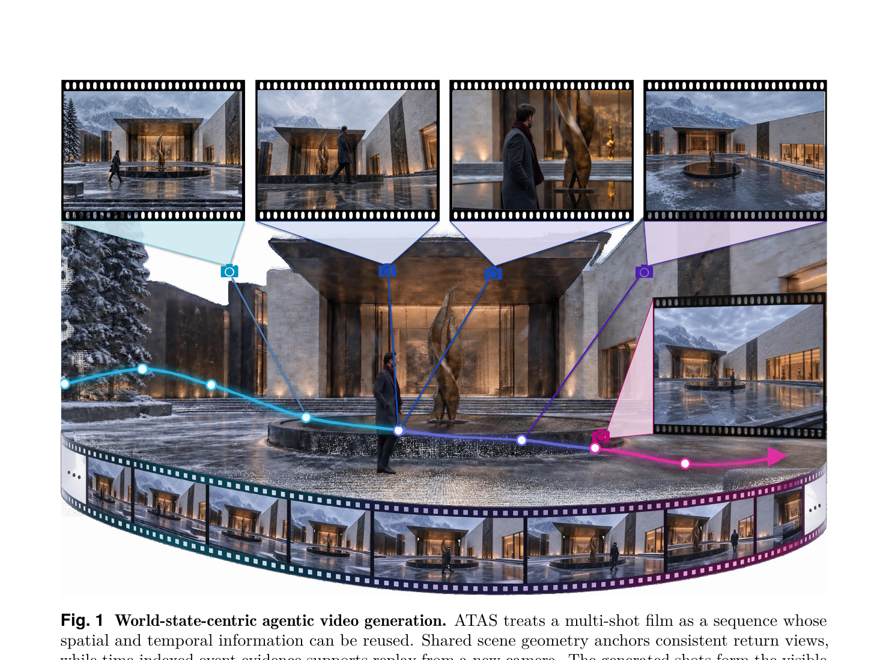
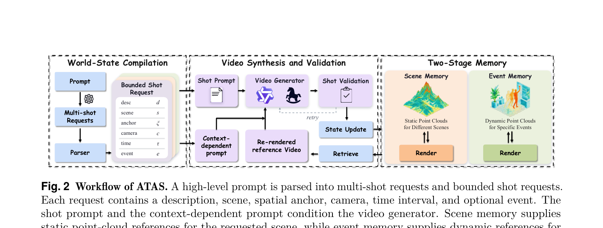
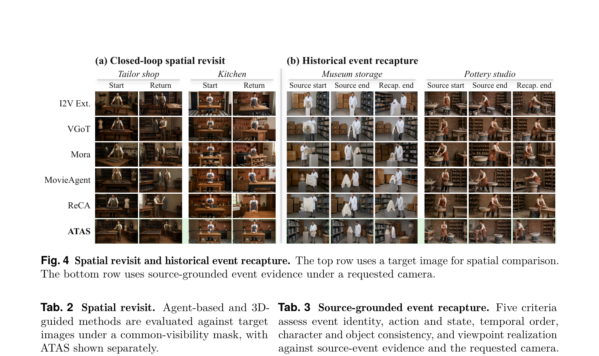
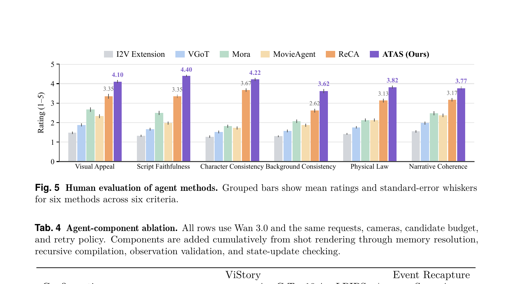

# ATAS: Any Time, Any Space — A World-State-Centric Framework for Agentic Video Generation

**论文链接**：[arXiv 2610.20571](https://arxiv.org/abs/2610.20571) | **项目主页**：[lhmd.top/atas](http://lhmd.top/atas/) | **代码**：[github.com/ziplab/ATAS](https://github.com/ziplab/ATAS)  
**机构**：Zhejiang University + Monash University + BAIR/UC Berkeley + Adelaide University  
**作者**：Weijie Wang\*, Haomin Zhang\*, Ye Li\*, Akide Liu, Zeyu Zhang, Haoyu Zhao, Yefei He, Donny Y. Chen, Feng Chen, Bohan Zhuang†  
**发表时间**：2026-10-13

---

## 1. 一句话定位

ATAS 把剧本编译成带**显式场景/时间坐标**的分镜请求，用**场景记忆**（静态点云）和**事件记忆**（动态时序点云）两级持久状态维持跨镜头一致性，生成结果通过验证才准入世界状态——实现任意时间、任意空间的持久跨镜头重访和事件重现。

---

## 2. 要解决的问题（动机）



> **Fig 1 逐段解读**：
>
> **上方四格胶片（生成镜头）**——同一建筑场景的四个非连续镜头，从不同角度和时段捕捉同一地点。蓝色相机轨迹连接"送别者离开"→"主角站在入口"，洋红色相机轨迹连接"侧视归来"→"新角度归来"（右侧插图），可见重访时场景几何保持一致。
>
> **中央 3D 全景图（点云世界）**——背景是半透明的 3D 重建点云，展示建筑广场的静态几何；4 个青色相机标记对应 4 个镜头的拍摄角度；白色连接线将镜头与点云中的空间锚点对齐，说明每次生成都有明确空间坐标。
>
> **底部胶片条（Film Strip）**——整部影片的胶片序列，体现镜头的时序关系；两段相机轨迹（蓝/洋红）跨越多个中间镜头，证明记忆不依赖相邻镜头，可跨越插入内容做长程定位。
>
> **设计动机**：现有系统把"最近帧"或"文本摘要"当接口——无法建立共享坐标系（无法回到同一位置）、无法时间索引（无法重现早前事件）。ATAS 的两级记忆正是为解决这两个缺陷而设计。

**问题本质**：长片段视频生成要求跨越非连续镜头保持空间和时间一致性：
1. **空间重访（Spatial Revisit）**：故事从 A 处移到 B 处后再回到 A，回归镜头必须还原 A 的场景布局；现有方法无共享坐标系，无法定位"回到哪里"。
2. **历史事件重现（Event Recapture）**：从新视角重拍早前发生的事件（如换一个机位重现追逐场景）；需要时间索引的事件记录，而非单纯的视觉历史。

---

## 3. 与前作的关系

| 对比维度 | 传统智能体视频系统 | ATAS |
|---|---|---|
| 跨镜头接口 | 最近帧 / 文本摘要 | 显式 (scene, anchor, camera, time, event) 坐标 |
| 空间信息 | 无共享参考系 | 注册到统一坐标帧的点云 S_t |
| 时间事件 | 无索引 | 按 (scene, event, time) 检索的事件记录 E_t |
| 状态更新规则 | 直接接受或丢弃 | 三重门控（film review f_t + registration r_t + state check a_t）|
| 视频交付与状态入库 | 耦合 | 解耦：视频可交付但状态不入库 |

最相关的先验工作：
- **ReCA**（2605.26525）：multi-shot 长视频递归上下文分配，无持久 3D 场景记忆
- **WorldCrafter / SMI**：场景几何记忆，但无时间事件检索
- **WorldMem / EVOKE**：时序持久性，无显式空间索引

---

## 4. 核心方法

### 4.1 系统流程



> **Fig 2 逐模块解读**：
>
> **左侧：World-State Compilation**——高层剧本 Prompt 经解析器(Parser)分解为 Multi-shot Requests；每条请求被编译成 Bounded Shot Request，包含 6 个字段：desc(描述)、scene(场景标识)、anchor(空间锚点 ξ)、camera(相机)、time(时间区间 τ)、event(可选事件标识 e)。这一步把自然语言剧本转化为精确的时空坐标请求。
>
> **中间：Video Synthesis and Validation**——Shot Prompt 和 Context-dependent Prompt 共同输入 Video Generator（支持 MiniMax-H3 / Wan / HappyHorse 等多后端）；生成的视频片段 V_t 进入 Shot Validation；验证失败则 retry 重生（retry arrow 虚线）；验证通过后分两路：(1) 加入 Film（可交付），(2) 送 State Update（经注册后加入持久记忆）。
>
> **右侧：Two-Stage Memory**——Scene Memory（静态点云，不同场景各一份；下方 Render 模块把点云投影为参考视频 C_t^scene）和 Event Memory（动态点云，按特定事件；Render 模块把事件点云投影为 C_t^event）。两路记忆通过 Retrieve 接口向 Video Synthesis 提供 Context-dependent Prompt。

### 4.2 形式化定义

**世界状态**是场景记忆和事件记忆的一对：

$$
\mathcal{W}_t = (\mathcal{S}_t,\ \mathcal{E}_t)
$$

每个事件记录 `ε_i = (s_i, e_i, b_i, τ_i, D_i)` 存储：场景标识、事件标识、源观测标识、时间区间、帧级 RGB-D + mask + 动态点云证据。

**分镜请求**：编译器递归展开高层剧本，输出

$$
q_{t,k} = (d_{t,k},\ s_{t,k},\ \xi_{t,k},\ c_{t,k},\ \tau_{t,k},\ e_{t,k})
$$

- `d`: 局部镜头描述；`s`: 场景标识；`ξ`: 场景坐标中的空间锚点；`c`: 目标相机；`τ`: 请求时间区间；`e`: 可选事件标识

**记忆查询**，两路并行：

$$
C_t^{\text{scene}} = \text{Render}(\mathcal{S}_t,\ c_t)
$$

$$
C_t^{\text{event}} = \begin{cases} \text{Retrieve}(\mathcal{E}_t,\ s_t,\ e_t,\ \tau_t), & e_t \neq \varnothing \\ \varnothing, & \text{otherwise} \end{cases}
$$

场景记忆渲染把静态点云投影到请求相机视角，提供几何参考视频；事件记忆检索把匹配 (scene, event, time) 的帧级动态证据返回，条件视频模型重现该事件。

**验证与状态转移**（三重门控）：

$$
\mathcal{W}_{t+1} = \begin{cases} \widehat{\mathcal{W}}_{t+1}, & f_t = r_t = a_t = 1 \\ \mathcal{W}_t, & \text{otherwise} \end{cases}
$$

- `f_t`：film review（视频可接受用于交付？）
- `r_t`：registration（点云是否成功注册到场景坐标系？）
- `a_t`：state-update check（有效来源、场景范围、父状态版本一致？）

**关键设计**：`V_t` 只要 `f_t = 1` 就进 Film，**无论** `r_t` 或 `a_t` 是否通过；这确保不可靠的观测不会污染持久状态，但不妨碍视频交付。

### 4.3 两类持久性查询

| 查询类型 | 机制 | 评测指标 |
|---|---|---|
| **空间重访** (Spatial Revisit) | 编译器发出早前场景标识 + 回归锚点 + 相机；Render(S_t, c_t) 生成目标参考图；生成结果与目标图在公共可见区 mask 下对比 | PSNR_C / SSIM_C / LPIPS_C |
| **历史事件重现** (Event Recapture) | 请求含事件标识 + 时间区间 + 新相机；Retrieve(E_t, ...) 返回源事件帧；VLM judge 对生成结果评分 | 事件身份 / 动作状态 / 时序 / 角色一致性 / 视角实现 |

---

## 5. 实验结果

### 5.1 标准基准（Table 1）

测试覆盖 4 个视频生成后端（MiniMax-H3, Wan 2.7, HappyHorse 1.0, Wan 3.0），与 5 个 Baseline（I2V Extension, VGoT, Mora, MovieAgent, ReCA）在同一后端下对比，指标为 VBench / ST-Bench / ViStory-Self / ViStory-Cross 四维均值。

| 后端 | ATAS Avg | 次优 Baseline | 提升 |
|---|---|---|---|
| MiniMax-H3 | **0.702** | ReCA 0.659 | +0.043 |
| Wan 2.7 | **0.656** | ReCA 0.612 | +0.044 |
| HappyHorse 1.0 | **0.694** | ReCA 0.656 | +0.038 |
| Wan 3.0 | **0.734** | ReCA 0.648 | +0.086 |

ATAS 在全部 4 个后端上领先所有 baseline，且 ST-Bench（跨镜头一致性）提升幅度最大（Wan 3.0 的 C-Top10：0.602→0.719）。

VBench 各维度（Table A 附录）：
- 主体一致性 Wan 3.0 ATAS：0.9643；背景一致性：0.9717；动态程度：0.6882

ST-Bench 详情（Table B）：
- Wan 3.0 ATAS C-All 0.6844、C-Top10 0.7187；参照 ReCA 的 0.5751 / 0.6015，C-Top10 提升 +0.117

### 5.2 空间重访（Table 2）



> **Fig 4 逐面板解读**：
>
> **(a) Closed-loop spatial revisit（左半）**——Tailor shop 和 Kitchen 两个场景，每行 2 张图：Start（离开时生成的帧）和 Return（重访时生成的帧）。ATAS（最后行）的 Return 帧与 Start 帧保持一致的场景布局（桌面、货架位置、光照），而 I2V Ext./VGoT/Mora 的 Return 帧场景漂移明显（如 Kitchen 中台面变色、物品消失）。
>
> **(b) Historical event recapture（右半）**——Museum storage 和 Pottery studio 两个事件场景，每行 3 张：Source start、Source end、Recap. end（从新相机重现）。ATAS 的 Recap. end 保留了 Source 中的动作语义（人物位置、道具状态），ReCA 的重现在博物馆场景中角色服装发生变化，其余 baseline 场景细节漂移更严重。

空间重访定量（对比目标图在公共可见 mask 下）：

| 方法 | PSNR_C | SSIM_C | LPIPS_C |
|---|---|---|---|
| I2V Extension | 13.601 | 0.293 | 0.339 |
| VGoT | 14.444 | 0.313 | 0.300 |
| Mora | 13.796 | 0.318 | 0.288 |
| MovieAgent | 14.543 | 0.352 | 0.296 |
| ReCA | 13.870 | 0.268 | 0.306 |
| FlexWorld | 14.740 | 0.343 | 0.315 |
| ViewCrafter | 15.255 | 0.375 | 0.293 |
| **ATAS** | **15.968** | **0.385** | **0.284** |

ATAS 在全部三项指标上领先，包括专用 3D 引导方法（ViewCrafter）。

### 5.3 历史事件重现（Table 3）

VLM judge 从 5 个维度打分（0/1 二值或 1-5 归一化）：

| 方法 | 事件身份 | 动作状态 | 时序 | 角色一致 | 视角实现 |
|---|---|---|---|---|---|
| I2V Extension | 0.450 | 0.433 | 0.433 | 0.817 | 0.200 |
| VGoT | 0.517 | 0.533 | 0.400 | 0.850 | 0.400 |
| Mora | 0.286 | 0.339 | 0.357 | 0.768 | 0.250 |
| MovieAgent | 0.500 | 0.450 | 0.500 | 0.783 | 0.350 |
| ReCA | 0.733 | **0.700** | 0.617 | **0.917** | 0.500 |
| **ATAS** | **0.750** | 0.688 | **0.688** | **0.917** | **0.650** |

ATAS 领先事件身份(+2.3pp vs ReCA)、时序(+7.1pp)、视角实现(+15pp)；动作状态略低于 ReCA(-1.2pp)。

### 5.4 人类评估（Fig 5）



> **Fig 5 逐指标解读**（1-5 分制，6 种方法分组柱状图）：
>
> **Visual Appeal（视觉吸引力）**：ATAS 4.10（紫色柱，最高），ReCA 3.35，其余 ≤2.7。ATAS 大幅领先，说明持久记忆条件提升了视觉质量感知。
>
> **Script Faithfulness（剧本忠实度）**：ATAS 4.40（全指标最高），ReCA 3.35，其他 ≤2.5。对剧本内容的实现最忠实，差距最显著（+1.05 vs ReCA）。
>
> **Character Consistency（角色一致性）**：ATAS 4.22，ReCA 3.67，其他 ≤2.0。角色外观和动作跨镜头保持最一致。
>
> **Background Consistency（背景一致性）**：ATAS 3.62，ReCA 2.62。注意这是 6 个指标中 ATAS 绝对值较低的，说明环境级一致性（跨场景）仍有提升空间。
>
> **Physical Law（物理合理性）**：ATAS 3.82，ReCA 3.13。空间锚点的几何约束间接帮助了物理合理性。
>
> **Narrative Coherence（叙事连贯性）**：ATAS 3.77，ReCA 3.17。整体故事在时序和因果层面更连贯。
>
> **总结**：ATAS 在全部 6 个指标上均获最高人类评分，差距最大在 Script Faithfulness（+1.05）和 Visual Appeal（+0.75）；Background Consistency（3.62）和 Narrative Coherence（3.77）绝对值相对低，对应论文中"环境级一致性和全局连贯性仍不足"的结论。

### 5.5 组件消融（Table 4）

使用 Wan 3.0 固定后端，逐步加入组件：

| 配置 | ViStory 均值 | C-Top10 | LPIPS_C | Event 重现 |
|---|---|---|---|---|
| w/ shot rendering only | 0.478 | 0.528 | 0.341 | 0.441 |
| + scene+event resolution | 0.612 | 0.568 | 0.334 | 0.508 |
| + recursive compilation | 0.638 | 0.684 | 0.288 | 0.711 |
| + observation validation | 0.651 | 0.702 | 0.286 | 0.726 |
| + state update check（完整） | **0.670** | **0.719** | **0.284** | **0.739** |

每个组件均有单调正增益，递归编译对事件重现贡献最大（0.508→0.711），场景+事件记忆对 C-Top10 贡献最大（0.528→0.568→0.684）。

### 5.6 记忆消融（Table 5）

固定 ATAS Agent + Wan 3.0，仅改变存储证据：

| 记忆配置 | C-Top10 | LPIPS_C | Event Recap |
|---|---|---|---|
| w/o memory | 0.536 | 0.341 | 0.452 |
| w/ frame history | 0.598 | 0.319 | 0.548 |
| w/ static scene | 0.617 | 0.289 | 0.583 |
| w/ updated scene | 0.658 | 0.286 | 0.585 |
| w/ scene + event | 0.703 | 0.285 | 0.728 |
| **w/ full state** | **0.719** | **0.284** | **0.739** |

事件记忆对 Event Recap 提升最大（0.585→0.728），场景记忆对 LPIPS_C 提升最显著（0.341→0.289）；两者互补，都不可缺。

### 5.7 效率分析（Fig 6）

在 6 种记忆配置下，随记忆状态增加：
- **Retries per shot**：1.00（无记忆）→ **0.54**（完整状态），重试率下降 46%
- **Retry-adjusted delivery time**：359s → **339s**（每镜头交付加速 20s）
- **Per-story runtime**：51.9min → 64.9min（总时间增加，记忆开销 98s/shot）
- **Film rejection rate**：52.6% → **36.8%**（记忆减少了不合格生成）
- 内存开销：无记忆 N/A → 静态场景 30s → 完整状态 98s/shot

代价：记忆维护使总 story 时间增加 25%，但换来更少重试、更低拒绝率和更高空间重访精度。

---

## 6. 局限性

1. **内存开销线性增长**：每镜头额外 98s 内存处理，完整故事总时长从 51.9 → 64.9min，规模化成本高。
2. **动作状态保存弱于 ReCA**：历史事件重现中动作状态维度低 1.2pp，精确动作-状态还原仍有挑战。
3. **背景和全局叙事仍有差距**：人类评分中背景一致性（3.62）和叙事连贯性（3.77）是最低两项，说明环境级一致性和长程叙事仍未解决。
4. **依赖 3D 重建质量**：场景记忆基于点云注册，重建失败（r_t = 0）会让镜头无法入库，影响后续重访。

---

## 7. 总结

```
ATAS 架构拓扑：

剧本(Screenplay)
    │ World-State Compiler（递归解析）
    ▼
 q_{t,k} = (desc, scene, anchor, camera, time, event)
    │ Memory Query
    ├──▶ Render(S_t, c_t) ──▶ C_t^scene（静态几何参考视频）
    └──▶ Retrieve(E_t, s_t, e_t, τ_t) ──▶ C_t^event（动态事件证据）
    │
    ▼ Video Generator G（MiniMax-H3 / Wan / HappyHorse）
   V_t（生成视频片段）
    │
    ▼ Shot Validation
   ┌─────────────────────────────┐
   │ f_t=1：加入 Film（交付）     │
   │ r_t=1：3D 注册成功           │
   │ a_t=1：状态检查通过          │
   │ f+r+a=1：更新 W_{t+1}        │
   └─────────────────────────────┘
    │
    ▼ W_{t+1} = (S_{t+1}, E_{t+1})
  持久世界状态供下一请求查询

关键数字：
  测试后端         4 个（MiniMax-H3, Wan 2.7/3.0, HappyHorse 1.0）
  对比 baseline    5 个智能体方法 + 2 个 3D 引导方法
  Wan 3.0 Avg      0.734（vs 次优 ReCA 0.648，+0.086）
  空间重访 PSNR_C  15.968（vs ViewCrafter 15.255）
  事件重现 Score   0.739（全态）
  人类评分最高项   Script Faithfulness 4.40
  重试率降幅       1.00 → 0.54 shots/retry（−46%）
```

---

## Q&A

**Q: ATAS 的场景记忆和 SMI（Spatial Memory Intelligence）的记忆管理有什么区别？**

A: 两者都维护跨镜头空间记忆，但定位和实现不同：
- **SMI**：用 Qwen3.5-4B MLLM 作记忆管理器，执行聚类/稀疏化/检索/可靠性过滤四原子操作，侧重于在无限生成中压缩记忆大小（稀疏化 83.68%），延迟代价 ×1.38；记忆以语义特征形式存储。
- **ATAS**：记忆以**注册到统一坐标帧的 3D 点云**形式存储，渲染时投影为参考视频；支持事件时间索引（按 scene+event+time 检索），还有三重门控阻止错误证据入库；侧重精确的**几何可重访性**和**历史事件可重现性**，而非无限长时生成。

核心差异：SMI 的记忆是"语义压缩后的历史"，ATAS 的记忆是"几何精确的空间时间索引"。

---

**Q: 为什么 state update 和 film delivery 要解耦？**

A: 这是 ATAS 最重要的设计决策之一。如果"能交付 = 能入库"，有两种问题：
1. 视频质量好但 3D 注册失败（r_t=0，如相机估计漂移）→ 不能入库，但该视频对故事仍有价值，丢弃浪费；
2. 视频凑合（f_t=1）但几何错误 → 如果入库，会污染后续空间重访的参考点云，导致错误传播。

解耦后：Film 只看视觉可接受性，State 额外要求几何可信度；两路输出互不干扰。类比：一个演员表演（视频）可以用于剪辑，但若场景背景重建有误，就不记录为"这个场景长这样"的地图信息。
