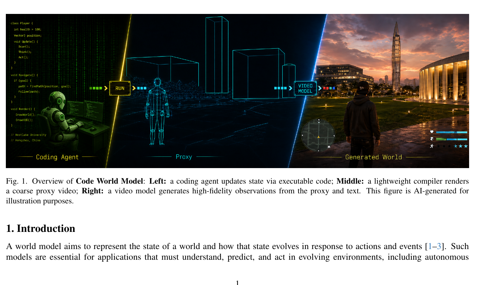
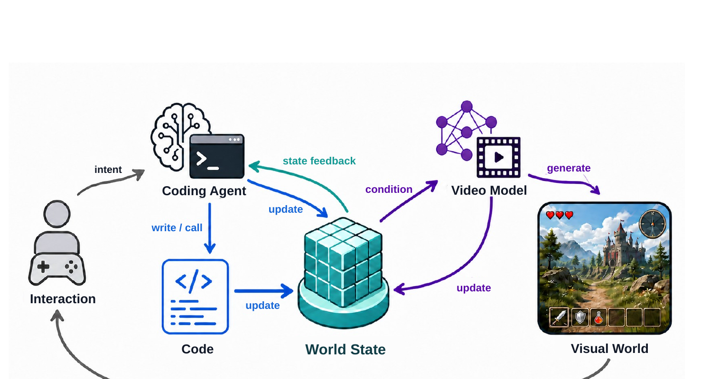
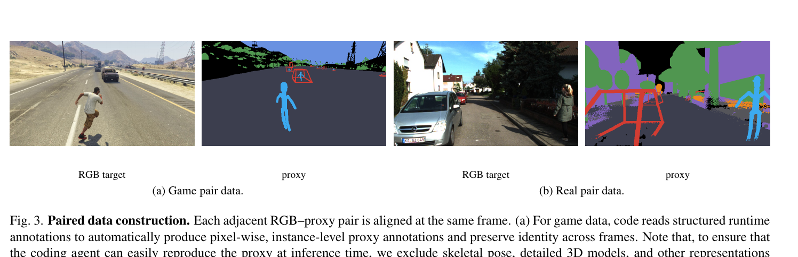
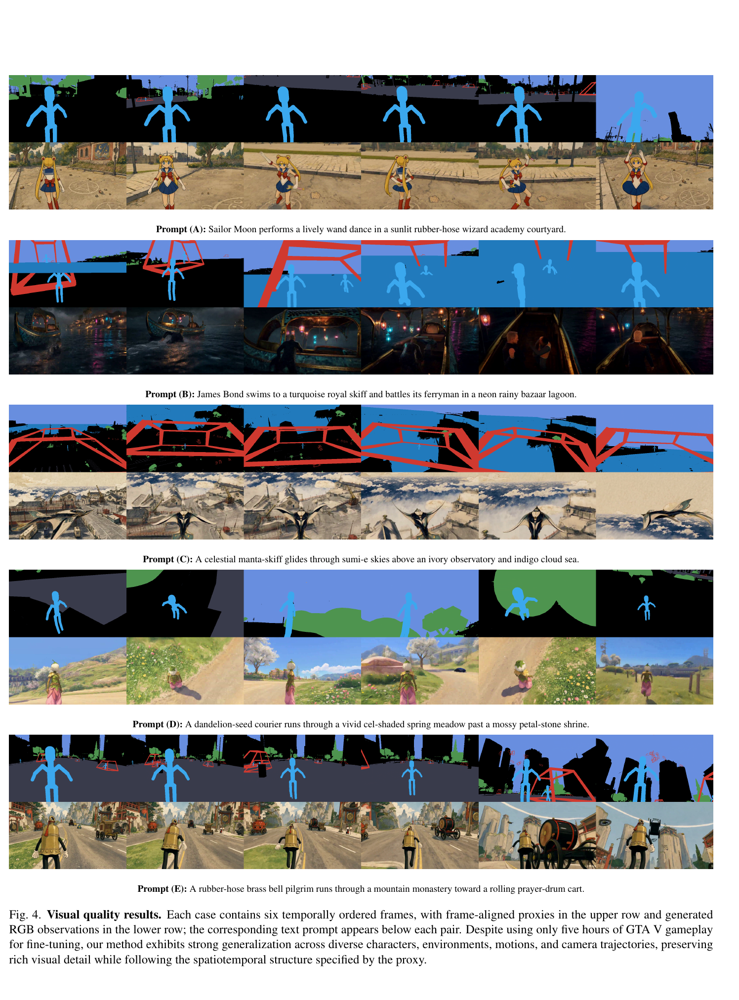

# Code World Model: Coding Agent as World Brain

**论文链接**：[arXiv 2608.25927](https://arxiv.org/abs/2608.25927) | **项目主页**：[buaacyw.github.io/cwm](https://buaacyw.github.io/cwm/)  
**机构**：Westlake University AGI Lab + Nanyang Technological University  
**作者**：Yiwen Chen, Guosheng Lin, Chi Zhang  
**发表时间**：2026-08-26

---

## 1. 一句话定位

把世界演化（Coding Agent + 可执行代码）与视觉渲染（视频模型）彻底解耦：Coding Agent 作为"世界大脑"写代码维护持久世界状态，轻量编译器把状态压成 **Proxy Video** 作为时空条件，MiniMax-H3 视频模型负责高保真视觉生成。

---

## 2. 要解决的问题（动机）

现有视频世界模型存在两个根本缺陷：

1. **机制不可见**：视频只记录运行结果，背后的规则（角色关系、因果逻辑、长程后果传播）对模型完全不透明——无法从视觉观察中学到"刺杀领主会导致城市整体政治结构改变"这类知识。
2. **代码即答案**：游戏引擎每帧都在执行精确代码；每帧渲染后代码被丢弃，视频模型要从渲染结果倒推底层逻辑，高度欠定。

现有方案的不足：
- **纯文本条件**：视频模型跟随复杂文本条件精度差，难以精确控制逐帧实体位置和相机轨迹
- **显式 3D 场景**：生产级资产和渲染管线代价过高，且提前锁定视觉风格，限制开放世界扩展性

---

## 3. 与前作的关系

| 对比维度 | 传统视频世界模型 | Code World Model |
|---|---|---|
| 世界演化载体 | 隐式神经网络 | 可执行代码 + Coding Agent |
| 控制信号格式 | 动作标签 / 相机参数 / 文本 | Proxy Video（帧对齐时空约束） |
| 视觉后端 | 视频模型本身 | 解耦的 MiniMax-H3（可换后端） |
| 规则持久性 | 无（每次生成独立） | 代码持久维护，历史事件继续影响未来 |
| 长程一致性 | 靠上下文窗口 | 靠代码中的变量/规则自动维护 |

最相关的先验工作是 LingBot-World（PWM）——也探索了确定性引擎+视频模型的解耦，但 CWM 首次引入 Coding Agent 作为规则生成器，使引擎本身变得可编程、可扩展。

---

## 4. 核心方法

### 4.1 系统架构总览



> **Fig 1 逐段解读**：
>
> **(Left) Coding Agent**——机器人形象+代码界面，表示 LLM 代理持续编写、调用、修改世界程序；右侧绿色代码片段展示 Player 类和 Navigate 函数，说明 Agent 把高层决策转化为可复用的类/函数。
>
> **(Middle) Proxy**——蓝绿色线框几何体：人形骨骼 + 建筑包围盒 + 路径线，是世界状态的最小视觉表达；流水线箭头 `RUN → ■■■ → VIDEO MODEL` 表示编译器把状态渲染成 Proxy Video，再输入视频模型。
>
> **(Right) Generated World**——第三人称游戏画面：都市夜景建筑 + 角色 + HUD 元素，代表视频模型输出的高保真视觉观察，与左侧抽象代码形成对比，体现"代码定义什么发生，视频决定它如何呈现"。

### 4.2 系统流程图



> **Fig 2 逐模块解读**：
>
> **Interaction（左）**——玩家/环境事件触发 intent 信号输入 Coding Agent；下方弧形箭头表示视觉世界反馈回用户，形成闭环。
>
> **Coding Agent（中左）**——脑+终端图标，代表 LLM 驱动的决策节点；接收 intent 和 state feedback（蓝绿色箭头），输出 `write/call` 操作更新 Code。
>
> **Code（中左下）**——代码文件图标；被 Coding Agent 写入，再执行 `update` 操作维护 World State。
>
> **World State（中心）**——蓝绿色立方体堆；同时被 Code 和 Video Model（紫色 `update` 箭头）更新，充当两条路径的汇聚节点。
>
> **Video Model（中右）**——神经网络+胶卷图标；接收来自 World State 的 `condition`（紫色），输出 `generate` 到 Visual World。
>
> **Visual World（右）**——游戏截图；生成的视觉观察，通过底部 `feedback` 弧线回到 Coding Agent 供其做下一次决策。

### 4.3 形式化定义

世界状态分解为可执行状态和视觉状态两部分：

$$
S_t = (S_t^{\text{exe}},\ S_t^{\text{vis}})
$$

两种更新机制并行：

$$
S_{t+1}^{\text{exe}} = \mathcal{T}_{\text{AC}}\!\left(S_t^{\text{exe}},\ A_t\right)
$$

$$
S_{t+1}^{\text{vis}} = G_\theta\!\left(S_t^{\text{vis}},\ S_{t+1}^{\text{exe}}\right)
$$

- `S^exe` 由 **T_AC**（Agent-Code Transition）更新：Coding Agent 负责稀疏的高层决策，Code 负责密集的高频确定性执行
- `S^vis` 由 **G_θ**（视频模型）更新：从当前视觉状态和新可执行状态生成下一帧视觉观察

### 4.4 Proxy 设计

Proxy 是连接可执行世界状态与视频模型的"接口层"，设计原则：

**什么信息进 Proxy**：
| 实体类型 | Proxy 表示 |
|---|---|
| 行人/角色 | Capsule skeleton（胶囊骨骼） |
| 车辆 | Wireframe（线框） |
| 植被 | Low-poly proxy（低面代理） |
| 大型建筑 | Coarse 3D extent（包围盒） |
| 复杂/罕见物体 | Bounding box fallback + 文本描述 |

**分辨率策略**：Proxy 使用目标分辨率的 1/16 像素数（1/4 宽 × 1/4 高）；例如目标 1344×768，Proxy 为 336×192。视觉 token 数极少，对全分辨率视频生成的推理开销可忽略。

**Condition bandwidth 权衡**：
- Proxy 太细 → Coding Agent 需构建高精度姿态，超出当前 Agent 能力
- Proxy 太粗 → 视频模型缺乏空间锚点，无法精确跟随
- 当前实现：固定 Proxy 设计，自适应带宽调整是未来工作

**文本 + Proxy 双通道**：
- 文本（structured text）：语义意图 + 外观属性 + 动作描述 + 角色背景
- Proxy video：逐帧时空约束（位置 / 轨迹 / 相机）
- 两者互补：文本管"什么角色长什么样"，Proxy 管"它在哪儿怎么动"

### 4.5 数据管线



> **Fig 3 逐面板解读**：
>
> **(a) Game pair data（左两格）**——左：GTA V 渲染画面（公路场景，角色滑板），即 RGB target；右：对应 Proxy 帧（深色背景 + 青色胶囊骨骼 + 线框包围盒 + 红色车辆包围盒 + 语义颜色填充），是编译器从运行时状态自动生成的。关键点：Proxy 和 RGB 完全时间对齐，且 identity 信息通过像素级实例 map 精确对应。
>
> **(b) Real pair data（右两格）**——左：KITTI-360 路面实拍（欧洲街道，行人+车辆），即 RGB target；右：对应 Proxy（紫色背景 + 红色线框人体骨骼 + 青色骨骼 + 橙色语义区域），通过标定 3D 重建离线编译，无需 game engine runtime state。证明 Proxy 可从真实世界数据中构建。

**游戏数据**（GTA V）：
- 157 次游戏录制，约 5.6 小时源视频
- 从 take 中按 2s 间隔采样 9,420 个 5s 片段
- 目标：1344×768, 124 帧, 24 FPS
- 运行时同步录制：相机状态 / 实体位置 / 方向 / 缩放 / 场景布局 / 交互关键状态
- 同一运行时录制可用不同 Proxy 粒度重编译，无需重录视频

**真实世界数据**（KITTI-360）：
- 标定 3D 重建 + 校正 RGB 帧 + 精确相机位姿（离线用，推理时不提供）
- 行人：capsule skeleton；车辆：wireframe；植被：low-poly proxy；大型建筑：coarse 3D extent
- 通过共享深度缓冲区光栅化，保留相机运动、空间对齐、遮挡关系
- 每个 RGB 帧与编译条件通过 dataset frame index 一一对应

---

## 5. 训练与推理实现

### 5.1 训练配置

| 配置项 | 值 |
|---|---|
| 基底模型 | MiniMax-H3 Ref2VA（官方检查点） |
| LoRA rank | 128，覆盖全部 50 个 Transformer block |
| 可训练参数 | ~596M |
| GPU | 8 × NVIDIA H800 |
| 优化器 | AdamW，batch 8，weight decay 0.01 |
| 精度 | BF16 + FlashAttention-3 |
| LR 调度 | cosine decay，`2e-5 → 1e-6`，warmup 100 steps |
| 训练步数 | 3 epochs / 3,534 optimizer steps |
| 视频规格（目标） | 1344×768，124 帧，24 FPS |
| Proxy 规格（条件） | 336×192，124 帧（1/16 像素） |
| 多模态编码器输入 | 系统指令 + clip 专属文本 + 11 帧 Proxy（偏移 0,12,24,...,120） |

### 5.2 推理流程

**Coding Agent**：使用 GPT-5.6 Sol；输入 = 游戏引擎代码模板（玩家控制 / 碰撞 / 运行时更新循环）+ 同一批 Proxy 原语；输出 = 目标世界的可执行程序。

**视频模型首帧**：GPT Image 2 生成 1536×864 外观锚点图，Coding Agent 撰写文本 prompt（实体数量 / 位置 / 朝向 / 布局 / 相机高度 / 整体视觉风格）；锚点缩放至 1344×768，注入 target latent slot 0。

**单窗口**：explicit Euler，20 步；FlashAttention-3 on H800。

**长视频拼接**（overlapping windows）：
- 窗口大小 124 帧，overlap 34 帧，每次前进 90 帧
- 保留首窗口全部帧；后续窗口丢弃重叠的 34 帧，追加新 90 帧
- 每窗口重新提供外观锚点（保持全局身份一致性）

---

## 6. 实验结果

### 6.1 视觉质量（Fig 4）



> **Fig 4 逐行对比**（每组上行 = Proxy 帧，下行 = 生成 RGB；每组 6 帧按时序排列）：
>
> **Prompt A（Sailor Moon 魔法棒舞蹈）**——Proxy 上行：青色胶囊骨骼在深色游乐场背景中运动。下行：MiniMax-H3 生成卡通风格人物（水手服、魔法棒），背景为晴天操场；骨骼位置与角色动作高度对应，每帧服装细节一致。
>
> **Prompt B（James Bond 游泳 + 雨夜集市）**——Proxy 上行：红色线框（船只）+ 青色骨骼，模拟水上移动；下行：黑暗雨夜场景，人物在水中，灯笼映照，氛围渲染细腻，相机倾斜轨迹与 Proxy 对应。
>
> **Prompt C（天体魔鬼鱼在水墨天空滑翔）**——Proxy 上行：红线框大型飞行器 + 青色骨骼，无纹理；下行：巨型魔鬼鱼在云海中翱翔，配以水墨画风格，体现视频模型将粗糙 Proxy 转化为丰富视觉风格的能力。
>
> **Prompt D（蒲公英种子信使奔跑）**——Proxy 上行：青色骨骼奔跑动作，绿色地面遮罩；下行：粉色和服角色在樱花草地中奔跑，服装与 Prompt 描述精准匹配，运动连贯。
>
> **Prompt E（黄铜钟铃朝圣者穿越山地寺庙）**——Proxy 上行：骨骼 + 红色框车辆（祈祷鼓车），场景延伸；下行：中世纪服装角色在山地道路上行走，背景连续变化，祈祷鼓车出现在多帧，时序一致。
>
> **总结**：仅用 5 小时 GTA V 数据 fine-tune，视频模型已能跨风格（卡通 / 现实 / 水墨）、跨场景（陆地 / 水下 / 空中）跟随 Proxy 指定的时空结构，同时保留 rich visual detail。

### 6.2 定性对比

论文项目主页展示与动作条件/相机条件视频世界模型的对比视频，CWM 在以下维度有明显优势：
- **角色动作控制**：逐帧骨骼 Proxy 直接对应角色肢体位置，粒度等同 AAA 游戏
- **相机运动跟随**：相机轨迹直接编进 Proxy，不依赖文本描述
- **视觉可控性**：不包含视频推理延迟的比较（控制变量）

---

## 7. 局限性与结论

### 7.1 主要局限

1. **训练规模小**：当前实验受限于算力，生成质量仍有提升空间；不支持自回归实时生成（每帧重新 diffusion）。
2. **Coding Agent 能力瓶颈**：当前 Agent（GPT-5.6 Sol）难以从零构建高度复杂的游戏机制；系统依赖 AAA 游戏场景和现有代码模板作为脚手架。目前论文无法展示自主构建完整开放世界游戏的能力。

### 7.2 结论

Code World Model 实现了世界建模的两路解耦：
- Coding Agent + Code → **如何演化**（知识 / 规则 / 长程后果）
- Proxy + Video Model → **如何呈现**（外观 / 动态 / 细节）

这一框架使世界可以"知识驱动地演化、视觉模型地渲染"，为开放式世界模型提供了新路径。

---

## 8. 技术亮点速览

```
Code World Model 架构拓扑：

 ┌──────────────────────────────────────────────────┐
 │  Human/Event → [INTENT] → Coding Agent (GPT-5.6) │
 │                               │ write/revise      │
 │                               ▼                   │
 │                           [CODE]                  │
 │                               │ execute           │
 │                               ▼                   │
 │                        World State S^exe          │
 │                               │ compile           │
 │                               ▼                   │
 │                    Proxy Video (336×192)           │
 │                 + Structured Text Prompt           │
 │                               │ condition         │
 │                               ▼                   │
 │           MiniMax-H3 (rank-128 LoRA, 596M)        │
 │                               │ generate          │
 │                               ▼                   │
 │          Visual World S^vis (1344×768, 24fps)      │
 │                               │ state feedback    │
 │                               └──► Coding Agent   │
 └──────────────────────────────────────────────────┘

关键设计数字：
  Proxy 分辨率     336×192  (1/16 of 1344×768)
  训练数据         5.6h GTA V → 9,420 clips
  LoRA rank        128，50 blocks，596M params
  训练设施         8×H800，3,534 steps
  推理窗口         124 帧，overlap 34，每次前进 90 帧
  Coding Agent     GPT-5.6 Sol
  首帧锚点         GPT Image 2 (1536×864→1344×768)
```

---

## Q&A

**Q: Proxy 和 PWM（Programmable World Model）的 ControlNet 控制图有什么本质区别？**

A: 两者都把"世界状态→视觉条件"解耦，但底层设计不同：
- **PWM ControlNet**：三张独立控制图（Identity / Semantic / Direction），通过 ControlNet 注入冻结主干；每张图聚焦一类信号，互相独立；推理时固定相机方向。
- **CWM Proxy Video**：单一时序条件流（proxy video sequence），直接条件视频模型的全部帧；proxy 是"miniature video"，同时承载实体位置 + 相机 + 遮挡关系；Coding Agent 可在推理中动态修改 proxy。

CWM 的 proxy 更轻量（不需要 ControlNet 旁支），但对视频模型理解帧间对应的要求更高。

---

**Q: 为什么选 MiniMax-H3 而不是 Wan 或 HunyuanVideo 作为视频后端？**

A: 论文未直接对比；但 MiniMax-H3 的 Ref2VA（Reference-to-Video-Appearance）架构有 **appearance reference 分支**，专门设计用于锁定角色外观一致性（类似 IP-Adapter 机制）。CWM 需要在多窗口长视频中保持角色身份不漂移，Ref2VA 的 appearance anchor 机制天然契合这一需求。这也是为什么每窗口都重新提供 GPT Image 2 生成的锚点图。
