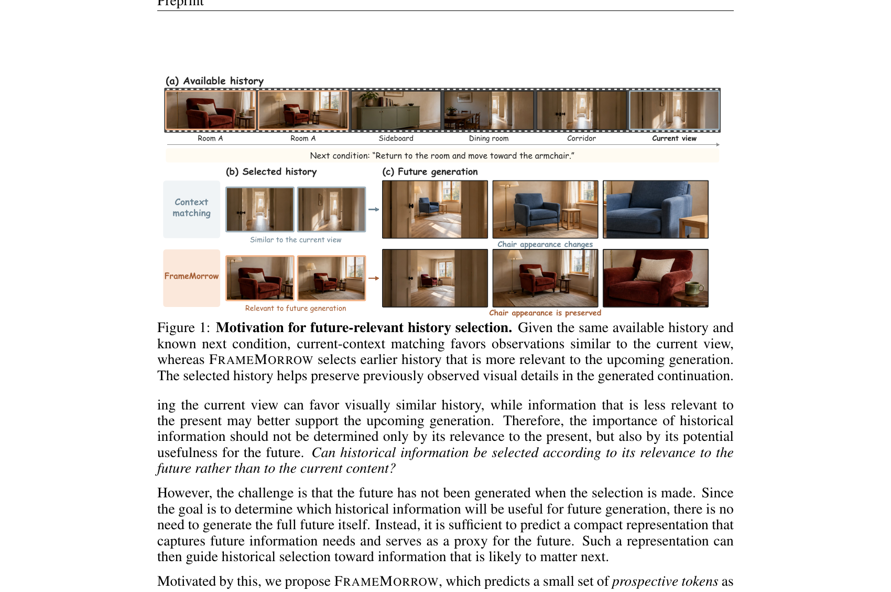
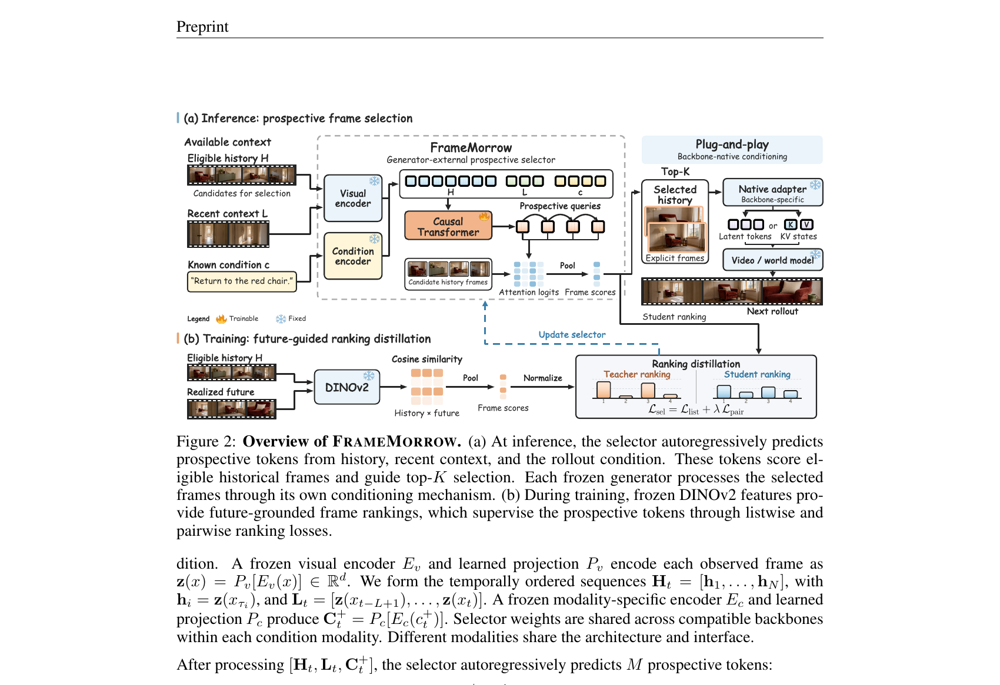
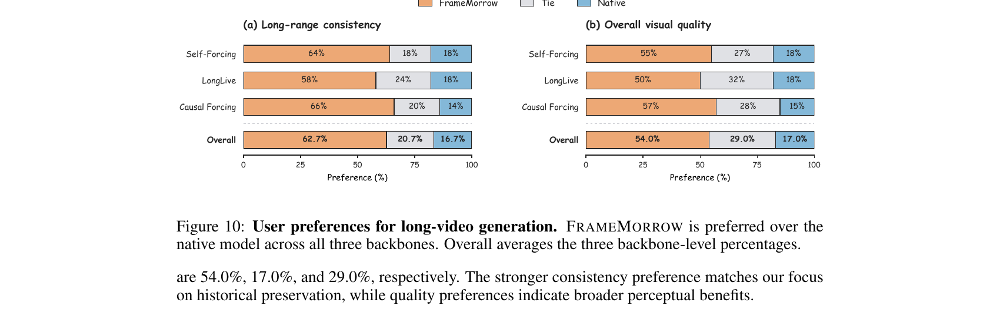

# FrameMorrow: Future-Guided Frame Selection with Prospective Tokens for Long-Horizon Video Generation

**arXiv**: 2609.38839 | **机构**: NUS + 哈工大（深圳）| **日期**: 2026-09-30 | **代码**: https://github.com/YinBo0927/FrameMorrow

---

## 1. 一句话定位

插件式选帧模块：用 **Prospective Tokens** 预测"未来将需要什么信息"，据此从历史帧中检索最有用的参考帧，以 plug-and-play 方式增强 11 种视频/世界模型骨干的长时一致性，仅新增 **16M 可训练参数**，选帧耗时 < 120ms。

---

## 2. 要解决的问题（动机）

长视频生成中，随着生成历史增长，需要从越来越长的历史帧序列中选取有用的参考。现有方法按**当前帧相似度**检索历史（context matching）——但"与现在相似 ≠ 对下一步有用"。

核心反例：生成过程从 Room A → 走廊 → "返回房间走向扶手椅"。当前视角是走廊，context matching 会选走廊帧（与当前最像）；但即将生成的场景需要的是更早的 Room A 帧（含扶手椅外观）。结果是椅子外观发生漂变。

**核心问题**：历史帧的重要性不应只由它与当前帧的相似度决定，而应由它对**未来**生成的潜在价值决定。

> **Fig 1 逐段解读**：
>
> **(a) Available history** 一行历史帧，从左到右：Room A（红色扶手椅）→ Room A → Sideboard → Dining room → Corridor → Current view（走廊当前视角）。时间轴从左到右，Current view 在最右。
>
> **(b) Selected history 上行 - Context matching)** 选出两张"与当前走廊视图最相似"的帧（走廊帧）。**(c) Future generation 上行**：生成后椅子颜色发生漂变（从原始的红褐色变成蓝色），注明"Chair appearance changes"——正是因为选中的帧里没有椅子的正确外观。
>
> **(b) Selected history 下行 - FrameMorrow)** 选出更早的 Room A 帧（含红褐色扶手椅）。**(c) Future generation 下行**：生成后椅子外观保持正确（红褐色），注明"Chair appearance is preserved"。
>
> **设计动机**：同一段历史、同一个 next condition，仅选帧策略不同，就导致了截然不同的生成质量。这证明选帧不应依赖"当前相似度"，而应依赖"未来需求预测"。

---

## 3. 与前作的关系

- **LongLive-RAG**：按最新视觉上下文检索历史 latent，与 FrameMorrow 同场景但基于 current-context 相似度。
- **DySink**：动态帧 sink（注意力机制内部），属模型内部操作，非显式帧选择，不可跨骨干迁移。
- **MemFlow / Memento**：按 upcoming chunk prompt 或 shot 线索检索，FrameMorrow 改用预测的前瞻 token 代替已知 prompt。
- **Future Forcing**：构造 future-query proxy 引导 KV cache eviction，但依赖模型内部状态，不支持闭源骨干。
- **Frame-Voyager / FrameOracle**：视频理解中的帧选择，针对已观测完整视频（fully observed），FrameMorrow 面向**未生成的未来内容**。

本文独特之处：选**显式历史帧**（非内部状态），且用预测的前瞻 token 而非任何已实现的未来信息做推理时决策。

---

## 4. 核心算法/方法

### 4.1 方法总览

> **Fig 2 逐段解读**：
>
> **(a) 推理阶段 - 前瞻选帧**：输入三路信息——Eligible history H（历史帧候选集）、Recent context L（近期上下文帧）、Known condition c（文本 prompt 或动作序列）。视觉编码器（冻结）将帧编码为特征，条件编码器（冻结）将 condition 编码。Causal Transformer（**可训练**）自回归预测 M=4 个 Prospective Queries（前瞻 token），这些 token 对历史帧候选集打 attention 分数，经 Smooth Maximum 聚合后 Top-K 选出 K=4 帧。选出的显式帧通过各骨干的 Native Adapter（骨干特定，冻结）注入生成器（Latent tokens 或 KV states），生成器骨干完全冻结，无需任何微调。
>
> **(b) 训练阶段 - 未来引导排名蒸馏**：教师信号来自已实现的续集（Realized future）帧，用冻结 DINOv2 计算历史帧与未来帧的余弦相似度，Smooth Maximum 聚合后归一化为 Teacher ranking。学生（FrameMorrow selector）输出 Student ranking，两者通过 `L_sel = L_list + λ L_pair`（listwise 分布匹配 + 带边距的 pairwise 排序约束）对齐。训练时 selector 获得未来帧信息，推理时**完全不需要**未来信息。

### 4.2 前瞻选帧（Prospective Frame Selection）

**符号定义**：
- 当前步骤 t，近期上下文：`L_t = {x_{t-L+1}, ..., x_t}`
- 长期历史候选集：`H_t = {x_{τi}}_{i=1}^N, τi ≤ t-L`（仅历史帧参与选择，不含近期上下文）
- 已知 rollout 条件：`c_t^+`（文本 prompt / 动作序列 / 控制信号，不含未来用户输入）

选帧流程：

$$
\hat{r}_t = S_\theta(\mathcal{H}_t, \mathcal{L}_t, c_t^+) \in \mathbb{R}^N, \quad \mathcal{I}_t = \text{TopK}(\hat{r}_t, K), \quad \mathcal{M}_t = \mathcal{H}_t[\mathcal{I}_t]
$$

选出的帧按时间戳排序后送入生成器。

### 4.3 前瞻 Token（Prospective Tokens）

小型因果 Transformer 从 `[H_t, L_t, C_t^+]` 自回归预测 M=4 个前瞻 token：

$$
q_t^m = F_\psi(\mathbf{H}_t, \mathbf{L}_t, \mathbf{C}_t^+, q_t^{<m}), \quad m = 1, \ldots, M
$$

每个 token 对历史帧候选集打点积 attention 分数，再用 Smooth Maximum 聚合（防止所有 token 打同一帧）：

$$
a_{t,m,i} = \frac{(W_Q q_t^m)^\top (W_K \mathbf{h}_i)}{\sqrt{d}}, \quad \hat{r}_{t,i} = \tau_q \log\!\left(\frac{1}{M} \sum_{m=1}^{M} e^{a_{t,m,i}/\tau_q}\right)
$$

自回归设计：每个 token 能在前序 token 的基础上关注不同历史区域，Token M=4 足够，M=8/16 无进一步提升。

### 4.4 未来引导排名蒸馏（Future-Grounded Ranking Distillation）

训练时，教师用**冻结 DINOv2**对历史帧和续集帧的余弦相似度构造排名目标：

$$
R^F_{t,i,j} = \cos(\Phi(x_{\tau_i}), \Phi(x_{t+j})), \quad r^F_{t,i} = \tau_f \log\!\left(\frac{1}{H} \sum_{j=1}^{H} e^{R^F_{t,i,j}/\tau_f}\right)
$$

H=8 个续集帧（2fps，覆盖未来 4 秒）。损失函数同时包含 listwise 和 pairwise 项：

$$
\mathcal{L}_{\text{sel}} = \mathcal{L}_{\text{list}} + \lambda \mathcal{L}_{\text{pair}}
$$

$$
\mathcal{L}_{\text{list}} = -\sum_{i=1}^N p^F_{t,i} \log \hat{p}_{t,i}, \quad \mathcal{L}_{\text{pair}} = \frac{1}{|\mathcal{P}_t|} \sum_{(i,j) \in \mathcal{P}_t} \text{softplus}[-(\hat{r}_{t,i} - \hat{r}_{t,j})]
$$

其中 `P_t = {(i,j) | r^F_{t,i} ≥ r^F_{t,j} + δ}` 是教师评分差超过边距 δ 的有序对。

**关键超参数**：`τ_q=0.10, τ_f=0.05, τ_r=0.10, τ_s=1.00, δ=0.05, λ=0.50, H=8`。

### 4.5 插件式集成

生成器完全冻结，选出的显式帧由各骨干自带的适配器 Γ_b 转换为对应表示：

$$
\mathbf{M}_t^{(b)} = \Gamma_b(\mathcal{M}_t), \quad \hat{\mathcal{Y}}_t^+ = G_{\omega_b}(\mathcal{L}_t, c_t^+, \mathbf{M}_t^{(b)})
$$

支持以下 9 种骨干（Table 10）：

| 骨干 | 条件类型 | 历史帧注入方式 |
|------|----------|--------------|
| Self-Forcing | 文本 | KV conditioning |
| LongLive 1.0 | 文本 | 注入 memory cache |
| Causal Forcing | 文本 | 编码进 causal context KV |
| CausVid | 文本 | 历史 latent 编码进 context KV |
| LongLive 2.0 | 文本 | 流式 memory 接口 |
| ShotStream | 文本 | 跨镜头参考帧条件化 |
| Matrix-Game 3.0 | 动作 | rollout context 中的编码帧 |
| WorldMem | 动作 | 带 pose metadata 的帧记忆 |
| YuMe 1.5 | 动作 | rollout conditioning 的 latent 参考 |

### 4.6 选帧器架构（Table 7）

| 配置项 | 值 |
|-------|-----|
| 视觉编码器（冻结）| DINOv2 ViT-B/14，特征维度 768 |
| Causal Transformer 层数/隐藏维度 | 4 / 512 |
| 注意力头数 / FFN 维度 | 8 / 2,048 |
| 归一化 / 激活 | Pre-LayerNorm / GELU |
| 位置编码 | 学习的时序 embedding |
| Dropout | 0.0 |
| 前瞻 token 数 M / 记忆预算 K | 4 / 4 |
| 最大训练候选帧数 | 128 |
| **可训练参数** | **16M**（文本条件版） |

**训练配置**：AdamW，lr=1e-4，batch=64，5 epoch，BF16，2× A100 80GB，6 小时（12 GPU-hours/selector）。

**训练数据**：
- 文本条件选帧器：10K OpenViDHD 视频（90:10 分割），2 秒标注单元，Qwen3-VL-8B-Instruct 生成 segment prompt
- 动作条件选帧器：10K chunk-aligned Sekai Game-Walking 样本（相机运动导出伪动作标签）

---

## 5. 实验结果

### 5.1 长视频生成（Table 1，VBench-Long，128 个 MovieGenBench prompt，60s）

各 block 内比较同一骨干上的多种长上下文方法，平均排名跨 6 个指标计算：

| 方法 | Subject ↑ | Background ↑ | Motion ↑ | Dynamic ↑ | Aesthetic ↑ | Imaging ↑ | Avg Rank ↓ |
|------|:---------:|:------------:|:--------:|:---------:|:-----------:|:---------:|:----------:|
| Self-Forcing | 95.84 | 95.27 | 98.20 | 51.72 | 56.05 | 62.22 | 4.33 |
| +∞-RoPE | 97.24 | 96.24 | 98.58 | 46.64 | 56.09 | 63.28 | 3.17 |
| +Deep Forcing | 96.08 | 95.38 | 98.24 | 41.44 | 56.68 | 60.81 | 4.17 |
| +LongLive-RAG | 97.60 | 96.51 | **98.70** | 44.69 | 57.19 | 64.97 | 2.00 |
| **+FrameMorrow** | **97.71** | **96.45** | 98.60 | **64.56** | **57.27** | **68.47** | **1.33** |
| LongLive 1.0 | 97.13 | 95.89 | 98.61 | 44.56 | 58.17 | 67.56 | 3.83 |
| **+FrameMorrow** | **97.32** | **96.17** | **98.75** | **50.42** | **58.75** | **67.82** | **1.25** |
| Causal Forcing | 93.52 | 94.12 | 95.74 | 72.32 | 51.24 | 62.30 | 4.83 |
| **+FrameMorrow** | **94.54** | **94.28** | **96.59** | **89.74** | **56.27** | **68.76** | **1.33** |

Dynamic 指标（动态程度）提升最显著：Self-Forcing 51.72→64.56，Causal Forcing 72.32→89.74。

### 5.2 交互式视频生成（Table 2，60s）

**Single-shot**：

| 骨干 | Quality ↑ | Consistency ↑ | Aesthetic ↑ | CLIP Avg ↑ |
|------|:---------:|:-------------:|:-----------:|:----------:|
| LongLive 1.0 | 83.49 | 92.62 | 64.21 | 28.75 |
| +**FrameMorrow** | **84.06** | **93.21** | **64.56** | **29.08** |
| Self-Forcing | 78.71 | 84.95 | 58.16 | 26.39 |
| +**FrameMorrow** | **81.74** | **89.30** | **60.62** | **28.05** |
| Causal Forcing | 76.00 | 80.46 | 55.45 | 24.53 |
| +**FrameMorrow** | **78.66** | **83.48** | **58.75** | **25.24** |
| CausVid | 81.94 | 89.77 | 63.53 | 28.63 |
| +**FrameMorrow** | **82.26** | **90.52** | **63.64** | **29.03** |

**Multi-shot**：

| 骨干 | Quality ↑ | Consistency ↑ | Aesthetic ↑ |
|------|:---------:|:-------------:|:-----------:|
| LongLive 2.0 | 82.77 | 93.14 | 61.32 |
| +**FrameMorrow** | **83.18** | **93.49** | **61.68** |
| ShotStream | 83.12 | 92.75 | **62.30** |
| +**FrameMorrow** | **84.85** | **96.76** | 61.74 |

ShotStream Consistency 从 92.75 → **96.76**（+4.01），是交互视频中最大的单项提升。

### 5.3 闭源模型扩展（Table 3，30 cases × 5 turns，30s）

通过公开 reference-conditioning API 使用，无需访问模型内部：

| 模型 | Quality ↑ | Consistency ↑ | Aesthetic ↑ |
|------|:---------:|:-------------:|:-----------:|
| Seedance 2.0（原生）| 86.80 | 94.02 | 65.61 |
| +Uniform | 86.47 | 93.54 | 65.28 |
| +**FrameMorrow** | **87.46** | **95.31** | **65.92** |
| Kling O3（原生）| 83.47 | 91.28 | 63.41 |
| +Uniform | 83.21 | 90.84 | 63.18 |
| +**FrameMorrow** | **84.06** | **92.61** | **63.77** |

FrameMorrow 在两个闭源模型上均超过了随机均匀选帧（Uniform），验证选帧质量本身的有效性。

### 5.4 动作条件世界模型（Table 4）

| 模型 | Subject ↑ | Background ↑ | Imaging ↑ | Anti-flicker ↑ | Action Align ↑ |
|------|:---------:|:------------:|:---------:|:-------------:|:--------------:|
| Matrix-Game 3.0 | 0.801 | 0.894 | 68.20 | 0.936 | 0.842 |
| +**FrameMorrow** | **0.816** | **0.910** | **68.35** | **0.939** | **0.861** |
| WorldMem | 0.782 | 0.924 | 70.23 | 0.910 | 0.866 |
| +**FrameMorrow** | **0.793** | **0.932** | **70.47** | **0.913** | **0.889** |
| YuMe 1.5 | 0.765 | 0.872 | 50.98 | 0.944 | 0.883 |
| +**FrameMorrow** | **0.798** | **0.886** | **51.80** | **0.947** | **0.912** |

Action Alignment 提升：Matrix-Game +0.019，WorldMem +0.023，YuMe 1.5 +0.029——说明选帧改善了动作跟随。

### 5.5 用户研究（Fig 10，10 位盲评者，30 cases/backbone）

> **Fig 10 逐段解读**：
>
> **(a) 长时一致性**（橙=FrameMorrow，灰=平局，蓝=Native）：Self-Forcing 64/18/18，LongLive 58/24/18，Causal Forcing 66/20/14，Overall **62.7% vs 16.7%**。三骨干一致表明 FrameMorrow 在历史保留上有明确感知优势。
>
> **(b) 整体视觉质量**：Self-Forcing 55/27/18，LongLive 50/32/18，Causal Forcing 57/28/15，Overall **54.0% vs 17.0%**。视觉质量偏好不如一致性那么显著（54% vs 62.7%），说明 FrameMorrow 的主要贡献是历史保留，而非整体画质提升。

### 5.6 选帧策略对比（Table 5，Single-shot/Multi-shot Consistency）

| 策略 | Single-shot | Multi-shot |
|------|:-----------:|:---------:|
| Recent-K（最新 K 帧）| 85.70 | 92.80 |
| Uniform（均匀采样）| 86.60 | 92.21 |
| Context matching（当前帧余弦）| 87.85 | 92.68 |
| Prompt matching（CLIP 文本-图像）| 88.35 | 93.17 |
| Direct scoring（无前瞻 token）| 88.22 | 92.53 |
| **FrameMorrow** | **89.30** | **93.49** |

FrameMorrow 在两个设置下均超过所有基线，且比 Direct scoring（无前瞻 token，直接用输入特征打分）高出约 1 个点，验证前瞻 token 的价值。

### 5.7 推理开销（Table 6）

| 骨干 | 原生耗时 | 选帧耗时 | 总计 | Δ |
|------|:--------:|:--------:|:----:|:-:|
| Self-Forcing | 82.6s | 112ms | 84.0s | +1.7% |
| LongLive 1.0 | 67.8s | 109ms | 69.2s | +2.1% |
| Causal Forcing | 82.6s | 115ms | 84.0s | +1.7% |

选帧器运行一次约 110ms（每 5 秒刷新一次），额外开销不超过 2.1%。

---

## 6. 消融研究关键结论

**未来监督的重要性**（Fig 6a，基线 Consistency 84.95）：
- 无未来监督（context 相似度当目标）：+1.25
- 未来蒸馏（FrameMorrow，用已实现续集帧监督）：+**4.35**
- 未来 oracle（直接用 ground-truth 未来帧）：+5.65
- 蒸馏与 oracle 差距仅 1.30，说明前瞻 token 大幅捕捉了 oracle 信息。

**前瞻 token 数 M**（固定 K=4）：M=1→4 一致性从 87.20→89.30，M=8/16 无进一步提升。

**历史帧预算 K**（固定 M=4）：K=2 达 88.00（超过 Uniform K=16 的 87.10），K=4→8 只增 0.40。**选择质量比数量更重要。**

**Spearman 相关性验证**（Table 16，前景与下游生成 utility 的相关性）：

| 排名信号 | 使用未来信息 | ρ | 95% CI |
|----------|:-----------:|:-:|:------:|
| Context similarity | 否 | 0.10 | [0.04, 0.16] |
| FrameMorrow 预测 | 否 | **0.42** | [0.35, 0.49] |
| Future-grounded teacher | 是 | 0.51 | [0.44, 0.57] |

FrameMorrow 推理时不用未来信息，但 Spearman ρ=0.42 远超 context similarity（0.10），接近特权 oracle 教师（0.51）。

**视觉教师对比**（Table 12）：CLIP +3.47，SigLIP +3.81，DINOv2 +**4.35**。DINOv2 的语义特征比 CLIP 更适合捕捉视觉对应。

---

## 7. 争议/权衡

1. **代理指标与真实效用的差距**：教师用 DINOv2 视觉对应作为未来有用性的代理——ρ=0.51 vs FrameMorrow ρ=0.42，oracle 上界有限，且 DINOv2 余弦相似度不直接等于"生成效果提升"。

2. **训练数据规模有限**：仅 10K OpenViDHD 视频（文本条件）/ 10K Sekai 样本（动作条件），跨域泛化未详细评估。评估时已回避对 Self-Forcing / LongLive 的同视频帧评估，但分布外表现未知。

3. **K=4 的记忆预算极小**：只额外提供 4 帧，对于复杂场景（多角色、多场景切换）可能不足；K 从 4 增大到 8 收益仅 0.40，说明 4 帧信息量接近饱和，但也反映模型没能利用更多帧。

4. **仅评长时一致性，不评视觉保真度提升**：用户研究中质量偏好（54.0%）低于一致性偏好（62.7%），FrameMorrow 不能根本改善画质，只是减少历史遗忘。

5. **闭源模型实验规模偏小**：30 cases × 5 turns，置信区间未报告，统计显著性存疑。

6. **续集帧监督的归因局限**：teacher 用 H=8 帧（未来 4 秒）的视觉对应打分，适合重访场景，对"永不重访的历史场景"（如一次性路过的路灯）意义有限，这部分历史帧的排名质量无从验证。

---

## 8. 一句话总结

FrameMorrow 将参考帧检索从"当前相似度"改为"前瞻需求预测"——用 16M 参数的因果 Transformer 自回归生成 4 个 Prospective Tokens，以 DINOv2 视觉对应作为未来监督，在 11 个骨干上以 < 120ms 选帧开销提升长时一致性（Spearman ρ=0.42 接近 oracle 的 0.51）；局限是训练规模有限、记忆预算仅 4 帧，且对从不重访的历史内容监督信号偏弱。

---

## Q&A

