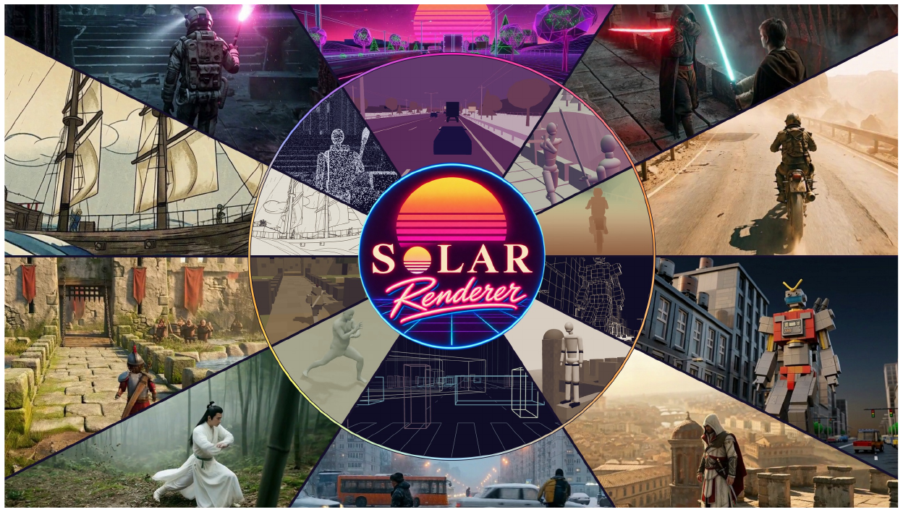
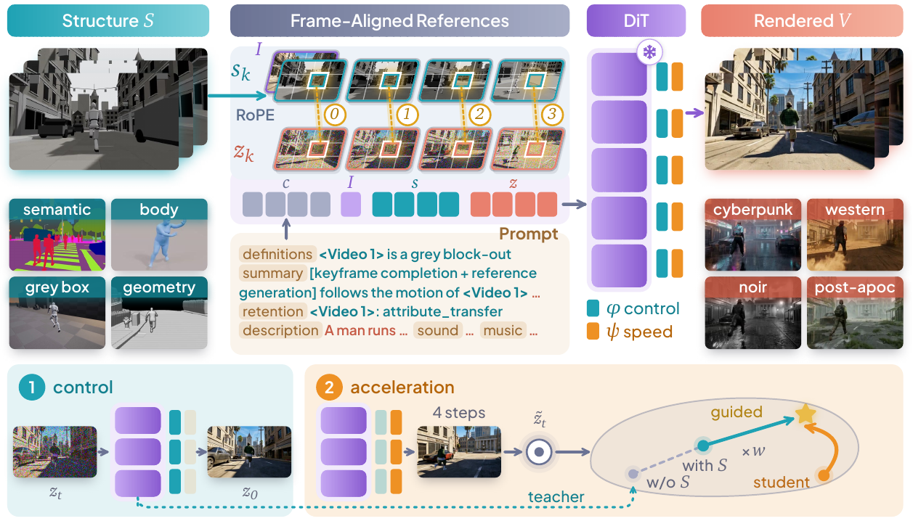
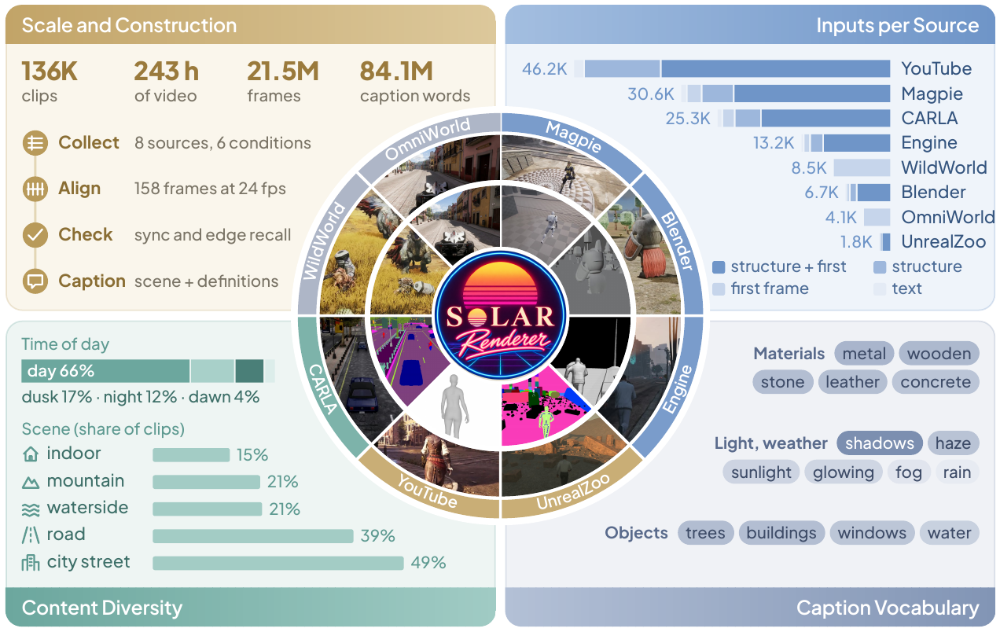
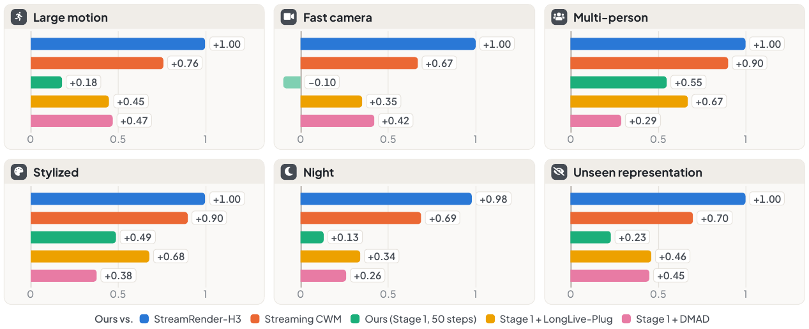
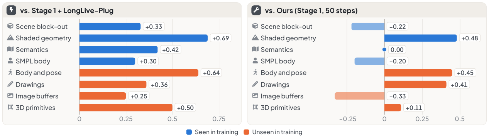
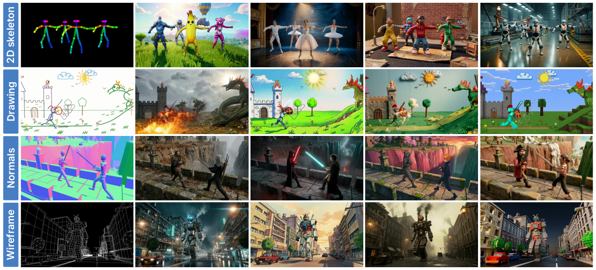
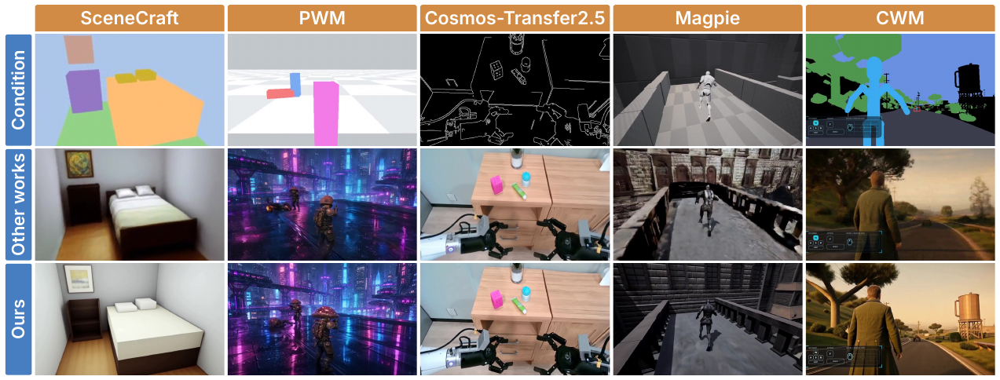
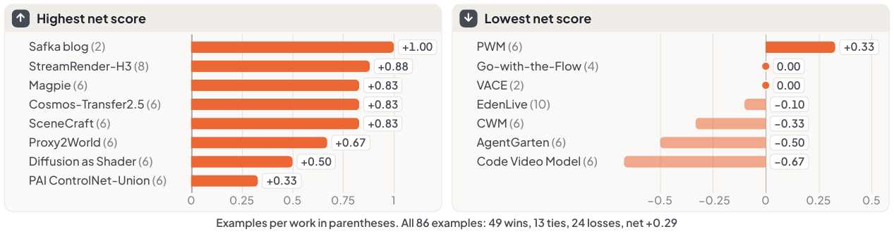

# SolarRenderer: Few-Step Generative Reference Rendering

**论文**: [PDF](https://enderfga.cn/data/solarrenderer.pdf)（作者主页发布，2026-10-16，暂无 arXiv 号；28 页：正文到第 14 页，附录第 14–23 页，参考文献第 24–28 页）
**作者**: Guian Fang, Shengju Qian, Dongyue Lu, Junchao Huang, Lutao Jiang, Xin Wang, Yiren Song, Li Jiang, Mike Zheng Shou — **NUS + LIGHTSPEED + 港中深 + SLAI + 港科大(广州)**，与 [SolarWM](../solarwm/analysis.md) 是同一批人
**Backbone**: MiniMax-H3 33B Ref2VA，全程冻结，只加两个 LoRA
**代码 / 数据 / 权重**: 论文首页给了 [项目页](https://enderfga.cn/SolarRenderer)、[GitHub](https://github.com/Enderfga/SolarRenderer)、[数据集](https://huggingface.co/datasets/Enderfga/SolarRenderer-Data)、[权重](https://huggingface.co/Enderfga/SolarRenderer)。仓库内容和许可证我没有核对 `[待补]`；用它必须先有 MiniMax-H3 的权重，H3 社区许可证的地区与营收限制见 [Veda 笔记 §6](../../inference_acceleration/veda/analysis.md#6-代码发布的实现与论文差在哪)

---

## 1. 一句话定位

**SolarRenderer 是一个"结构视频 → 真实视频"的渲染器：游戏引擎或 coding agent 导出灰盒、语义图、深度、骨架这类结构视频，它补全材质与光照，渲染出真实画面。做法是把结构视频当作 MiniMax-H3 原生的 reference 视频喂进去，但让第 k 个结构 latent 帧拿到第 k 个目标帧的 RoPE 位置（帧对齐），不加任何类型标记，只在 prompt 里用两句固定的话描述这种表示；一个 control LoRA 学会照结构渲染，再用 structure-guided DMD 把一个现成的 4 步加速 LoRA 后训练到这个 control 模型上。**

| | 官方 backbone（50 步） | Ours Stage 1（50 步） | LynnReal-Omni（4 步） | **Ours（4 步）** |
|---|---|---|---|---|
| 泛化集 Elo：Overall / Structure（208 例，Table 1） | 1075 / 627 | 1389 / 1276 | **1441** / 1241 | **1441 / 1338** |
| In-distribution Elo：Overall / Structure（53 例，Table 1） | 651 / 554 | 1299 / 1308 | 1410 / 1295 | **1510 / 1386** |
| 训练没见过的表示 Elo：Overall / Structure（74 例，Table 6） | 998 / 722 | 1318 / 1280 | **1409** / 1275 | 1403 / **1360** |
| 自动总分：泛化 / In-dist.（0–100，Table 8） | 69.8 / 64.8 | **71.6** / 66.2 | 70.0 / 64.2 | **71.6 / 67.0** |
| 一条 158 帧视频的耗时（单卡，§5.1） | — | 2,562 s | — | **209 s** |

Elo 是 Gemini 3.8 Flash 两两比较后拟合的 Bradley–Terry 分数，所有方法均值为 1000。差 100 分约等于 64% 的胜率（我按 Elo 公式算的）。

🔴 **读完全文后我认为头条要打四个折扣**：
1. **"SOTA" 主要靠一个 LLM 裁判，而且对最强对手只是打平或小胜。** LynnReal-Omni 和本文同一个 backbone、同为 4 步。在泛化集上 Overall 打平（1441 = 1441）；在 74 个训练没见过的表示上 Overall 反而低 6 分（1403 vs 1409）。本文的优势集中在 Structure 一项（+97 / +85）和 in-distribution 集（+100）。In-distribution 测试集有 ground-truth 视频，却**没有报任何有参考指标**（PSNR、LPIPS、FVD 都没有）。人评只有一句 *"agrees with the verdicts of the judge"*，没有人数，也没有数字。
2. **"比 50 步快 12.3 倍"比的是自己的 Stage 1。** 209 s 对 2,562 s，每步耗时几乎一样（52.3 s vs 51.2 s，我算的），加速完全来自步数。同 backbone 的 4 步对手（LynnReal-Omni、Streaming CWM）在速度上和它同档。209 s 生成 6.6 s 的视频，比实时慢约 32 倍；GPU 型号没写；§3.4 的流式扩展**没有任何实验数字**。
3. **自动指标在几处和裁判的结论相反。**
   - 自动 Control 组（edge F1 + CoTracker 轨迹误差）分数最高的是 Cosmos-Transfer2.5 和 Wan2.2-VACE-Fun，不是本文；
   - In-distribution 集上，Stage 1（带 control LoRA）的 Control 是 43.8，低于不带 LoRA 的官方 backbone（44.4）；
   - 核心贡献 structure-guided DMD 让 Elo 从 1006 升到 1096，但自动总分从 72.1 **降到** 71.6（Table 10）。
4. **conditioning 和数据的消融几乎都在 seed 噪声里。** 同一配置换一个 seed，自动总分差 0.3（66.2 vs 65.9）。大多数消融的效应与之同量级：ControlNet 对 native 是 0.5，半分辨率对全分辨率是 0.3，去掉不对齐数据是 0.3，只用 1/10 数据是 0.1。每个变体只训了一次，用的还是"earlier data mixture"，测在哪个集上也没说（附录 A.1、Table 7）。

📌 **站得住的部分**：
- **设计极简、可复用。** 不加分支、不加类型 embedding，只改 RoPE 位置、写两句固定描述、训一个 LoRA；接入新的表示只需要再写两句描述。在训练没见过的 11 种表示上（2D 骨架、铅笔分镜、儿童蜡笔画、线框、点云、体素等），Structure 评分最高（1360 vs 1275）。
- **"control 与加速解耦"的诊断很清楚。** 把现成的 4 步 LoRA 直接叠到 control LoRA 上能出图，但 Elo 只有 922–1053；冻结 control LoRA、只后训练加速 LoRA，160 次 generator 更新就到 1096。不加引导的普通 DMD（w = 1）反而把学生拉向模糊的 50 步 teacher（1024 → 820），这一点论文给了原因，也给了解法（Table 2）。
- **数据侧"对齐优先"做得认真。** 用运动互相关检查时间偏移，用"原图 vs 镜像"的边缘召回检查空间对齐；信息不够的 box 代理被换掉；不对齐的 WildWorld / OmniWorld 结构标注不用，只当外观数据。输入组合在建数据时就固定好，prompt 只描述实际给了的输入，避免缺失输入通过 prompt 泄漏。

---

## 2. 要解决的问题

**任务**：游戏开发、电影预演、agent 生成内容时，创作者常常已经定好了场景布局、物体运动和相机轨迹。把这些结构渲染成真实视频，视频模型就只需要负责外观，结构和时序漂移的空间小得多。形式化为

$$
p_\theta\left(V \mid S,\ I,\ c\right)
$$

其中 `S` 是同相机、同时间戳渲染的结构视频，`I` 是可选的首帧，`c` 是文本（始终提供）。`S` 和 `I` 都可以缺席，所以共有 4 种输入组合：结构 + 首帧、只有结构、只有首帧、只有文本。结构规定了布局、几何、角色身体、运动和相机，但没规定材质、光照和细小结构，所以论文称之为**约束补全**问题。

**论文认为现有渲染器有三个问题**：
1. **控制绑死在一种表示上。** 引擎驱动的渲染器只吃自己引擎导出的那一种：Magpie 吃白盒帧，StreamRender-H3 吃语义图，Code World Model 吃代理视频，Generative World Renderer 吃完整 G-buffer。通用可控生成器则是每种条件挂一个分支（ControlNet、Cosmos-Transfer），或者给每个输入标类型（LynnReal-Omni）。换一个引擎或一种新代理，就得训一个新模型。
2. **慢。** 大 backbone 要几十步，从头蒸馏一个这么大的结构条件模型又贵又不稳。
3. **训练对没有逐帧对齐。** 从真实视频估计出来的条件带着估计器误差，和测试时拿到的引擎代理不同；而已有的引擎配对数据都只来自单一引擎。

> **Fig 1 读法**：每个扇区内圈是结构输入，外圈是渲染结果。十种结构里有七种没出现在训练中，包括铅笔线稿（帆船）、点云（举火把的人物）、线框（机甲）、白模人偶、灰色身体网格等。论文 PDF 里这张图可以在 Acrobat 中播放。

---

## 3. 方法

> **Fig 2 逐段解读**：
>
> **上排**：左边是结构视频 `S`，下面四个小图示意四种来源的表示（semantic、body、grey box、geometry）。中间 "Frame-Aligned References" 把首帧 `I`、结构 latent `s_k`、带噪目标 latent `z_k` 放进同一个序列，**`s_k` 与 `z_k` 用同一组 RoPE 编号**（图上的 0–3）；下方是 prompt 的四个固定段落（definitions / summary / retention / description）。右边是冻结的 DiT（雪花标记），每个 block 挂一个 `φ` control LoRA 和一个 `ψ` speed LoRA，最右是同一结构渲染出的四种风格。
>
> **下排**：① control 阶段用 flow matching 训 `φ`；② acceleration 阶段只训 `ψ`，学生走 4 步，teacher 用"有 S"和"无 S"两次预测的外推（`× w`）作为引导目标。

### 3.1 原生 reference 通路与帧对齐 RoPE

**为什么不用 ControlNet**：ControlNet 分支和通道拼接都要引入从零训练的参数。MiniMax-H3 本身有一条 reference 通路：它把文本、reference 视频、音频、目标视频打包进一个全注意力序列。用这条通路，control adapter 就能继承预训练时"读 reference 视频"的能力。

**问题**：原生 reference token 在时间上排在目标视频之前、空间上有自己的网格，所以零样本的 backbone 把结构视频当成一个松散的参考，要么照抄，要么自己换相机，并不跟随结构。

**做法**：第 k 个结构 latent 帧使用第 k 个目标 latent 帧的时间索引和空间网格，首帧作为静止 clip 放在索引 0。位置相同的 token 靠 timestep 区分：reference token 保持 backbone 给 reference 的近乎干净的时间值，目标 token 带当前噪声级。论文说这是把 OminiControl 的"对齐图像条件共享位置"推广到时间对齐的视频上，不需要任何额外模块。

### 3.2 无类型 reference 与固定描述句

reference token 在序列里**不带任何类型标识或模态 embedding**，由 adapter 自己从结构视频推断它约束了什么。prompt 里每种表示配两句固定的话：一句定义它显示什么，一句说明要跟随哪些属性、哪些视觉特征不能出现在输出里。灰盒的例子：

> *"&lt;Video 1&gt; is an untextured grey block-out of the scene, rendered from the same camera as the target video, giving the layout, the large geometry, the characters' bodies, their motion and the camera of every frame."*
> *"&lt;Video 1&gt; (...): attribute_transfer - the layout, large shapes, character bodies, motion and camera are followed exactly; small objects, materials, colours and lighting are not given by &lt;Video 1&gt; and are the target video's own; the grey look of &lt;Video 1&gt; is not shown."*

同一种表示永远用同样的两句话；新格式只需要写一段新描述，不加参数、不重训。

### 3.3 Stage 1：control LoRA

- **结构**：rank 384 的 LoRA，挂在每个 block 的 attention 和 FFN 投影上。backbone 是 single-stream transformer，reference token 和目标 token 走的是同一组被改动的投影，所以**一个 adapter 同时学会"读结构"和"照结构渲染"**。
- **目标**：flow matching，`z_t = (1 − t) z_0 + t ε`，回归 `ε − z_0`，loss 只算在目标视频 token 上。
- **超参**（附录 A.1）：158 帧、1344 × 768、24 fps；AdamW，学习率 1e-4，**38,400 步 × batch 4**，即 153,600 个样本，约 1.13 个 epoch（我算的）。附录还说明：这些配置是按单个 8 卡节点给的，发布的权重用的是更大的 batch、相同的样本数。

### 3.4 Stage 2：structure-guided DMD

**为什么要单独一个阶段**：只要加速目标能改到 control adapter，它就会改变"怎么跟随结构"；从头蒸馏一个 33B 的少步学生又贵又不稳。所以两者在同一个冻结 backbone 上解耦：

- 从 **DMAD 的 rank-128 4 步 LoRA** 出发，放进一个 rank-384 LoRA 的前 128 维，其余维度初始为零更新；
- 组合方式是 `W = W0 + ΔW_ctrl + ΔW_acc`，**只训加速 LoRA `ψ`，control LoRA `φ` 冻结**。

DMD 梯度是

$$
\nabla_\psi \mathcal{L}_{\mathrm{DMD}}=\mathbb{E}\left[w(t)\left(s_{\mathrm{fake}}(\tilde z_t,t,C)-s_{\mathrm{teacher}}(\tilde z_t,t,C)\right)^{\top}\frac{\partial G_{\phi,\psi}}{\partial \psi}\right]
$$

其中 teacher 是固定的 Stage 1 全步模型，fake score 是另一个 rank-128 LoRA，从 teacher 初始化、在学生样本上训练。

**关键改动：沿结构条件外推 teacher**。论文的观察是 backbone 的全步采样是糊的：组合出来的学生一开始就比 teacher 清晰，普通 DMD 会把它拉回到 teacher 的模糊上，结果学生比起点还差。于是放大 teacher 里结构带来的那部分信号：

$$
\hat z_0^{w}=\hat z_0(C)+(w-1)\left(\hat z_0(C)-\hat z_0(C_\varnothing)\right)
$$

`C∅` 是把结构视频的 token 从 reference 序列里删掉，首帧和 prompt 保持不变。两次预测之差就是结构视频贡献的东西（轮廓、布局、角色位置）；`w > 1` 时目标比 teacher 自己更锐利、更果断，`w = 1` 退化为普通 DMD。论文把它类比为只作用在结构条件上的 classifier-free guidance。

**超参**：`w = 1.5`；fake score 每更新 5 次、generator 更新 1 次；学习率 generator 1e-5、fake score 2e-6；**800 次迭代 × batch 4**。按"每次迭代一次 fake score 更新"算，**generator 实际只更新了 160 次**（我算的）。代价是每次 generator 更新多一次 teacher 前向。

📌 **一个和自己原则相矛盾的细节**：§4.3 强调训练时不能随机丢掉结构，因为"prompt 仍然会提到它"，所以输入组合在建数据时就固定。但 `C∅` 恰恰是删掉结构 token、保留仍然描述 &lt;Video 1&gt; 的 prompt，也就是一个训练里从未出现过的"prompt 提到结构、结构却不在"的输入。论文没讨论这对引导方向的影响。

### 3.5 因果流式扩展

- 把视频切成最多 5 个 latent 帧的 block。用 teacher forcing 把双向 control LoRA 改成因果版：每个 block 只看 prompt、首帧、自己和前 5 个 block 的结构，以及前 5 个 block 的干净帧。训练 19,200 步，batch 2，学习率 3e-5。
- 再冻结因果 control LoRA，单独后训练一个加速 LoRA：从双向 4 步 LoRA 初始化，在学生自己逐 block 的 rollout 上训练，teacher 是双向 control 模型（`w = 1.5`），1,600 次迭代，batch 1。rollout 不带梯度生成，再作为一整段 teacher-forced 序列重放，让梯度同时覆盖"每个 block 怎么生成"和"它怎么作为后续 block 的上下文"。
- 推理时两个 LoRA 合并进 backbone，每个 block 4 步，用固定窗口的 KV cache。
- ⚠️ **这一节没有任何实验结果**：没有速度，没有质量，也没有和 StreamRender-H3、Streaming CWM 这类流式渲染器的对比。

---

## 4. 数据

> **Fig 3 读法**：
> - **左上**：规模（136K clips、243 h、21.5M 帧、8,410 万 caption 词）和构建步骤（收集 8 个来源 6 种条件 → 对齐成 24 fps 的 158 帧窗口 → 同步与边缘召回检查 → 写 caption）。
> - **中间环**：每个扇区一个来源，内圈是条件，外圈是同一 clip 的真值帧；WildWorld 和 OmniWorld 的内圈是首帧。
> - **右上**：每个来源的 clip 数，按输入组合分段。
> - **下方**：caption 里提到的时间段、场景和高频词。

### 4.1 八个来源

每个 clip 都是 24 fps、768p 的 158 帧窗口。

| 来源 | 结构条件 | clips（Fig 3） |
|---|---|---|
| **YouTube**（MiraData） | 主角的 SMPL 身体：用 GVHMR 拟合，相机和深度来自 VGGT 与 Depth Anything 3，从目标相机渲染成白底灰色人体 | **46.2K** |
| **Magpie**（真人玩的 UE 游戏录像，60 fps） | 同步导出的灰盒：布局、大几何、角色身体与运动、相机 | 30.6K |
| **CARLA** | 语义分割，每类一种纯色 | 25.3K |
| **引擎录制** | 30 m 内的深度渲染成灰色明暗，远处和天空置黑 | 13.2K |
| **WildWorld**（《怪物猎人 荒野》录像） | **只给首帧**，当外观数据 | 8.5K |
| **Blender** 动画场景 | 场景白盒（布局 + 主角运动） | 6.7K |
| **OmniWorld**（《赛博朋克 2077》等 3A 游戏录像） | **只给首帧** | 4.1K |
| **UnrealZoo**（UE5，第一 / 第三人称） | 每个物体一种颜色的 mask，角色骨架画在上面 | 1.8K |

八项加起来是 136.4K（我按 Fig 3 的数加的）。YouTube、Magpie、CARLA 三家占 75%。

### 4.2 对齐检查

**条件失败有两种情况：在时间或空间上和目标错位；或者对齐了，但太粗、描述不了目标。**

- **时间**：在一组帧偏移上算条件运动与目标运动的相关性，峰值不在零偏移的 clip 删掉。
- **空间**：比较"条件的边缘在目标帧里的召回"和"水平镜像后的条件的召回"，没有明显差距的 clip 视为空间错位，删掉。差距阈值没给。
- **其他过滤**：近重复、过暗或低对比度、条件覆盖面积太小的 clip 也删掉；每个来源进入训练前都人工抽查。
- **条件够不够用**：最初用的是把身体部件和物体画成粗框的 box 代理，时间上同步，但漏掉了大部分场景几何，模型学不到它要跟随的形状，所以换成 30 m 内的灰度深度。更细的 0.25 m 方块代理闪烁高 4–7 倍，没有采用。WildWorld 的框与画面不对齐，OmniWorld 的背景块漏掉了人和运动物体，所以这两个来源都不当结构用。
- **审计数字**（附录 B.3）：
  - Magpie 同步审计保留 44,266 个 clip 里的 32,027 个（72.4%，我算的），淘汰主要因为切镜、静止内容、结构不匹配和过暗；
  - 引擎录制里 84 个运动窗口有 80 个最佳偏移为零，深度 + 相机重投影误差中位数 0.06%；深度转换保留 13,702 个里的 13,700 个；
  - YouTube 只保留了 559 个视频里有清晰主角的 137 个。

⚠️ **YouTube 的 46.2K 个 clip 来自 137 个视频**，平均每个视频切出约 337 个 158 帧窗口；如果窗口不重叠，相当于每个视频约 37 分钟（我算的）。窗口是否重叠、同一视频的 clip 会不会同时出现在训练和测试里，论文没说。

### 4.3 Caption 与输入组合

- **格式**：沿用 backbone 的六段式 prompt：主体定义、带任务前缀的摘要、保留分析、详细描述、音效、音乐。
- **场景描述**：由 Kimi K2.6 **只看目标视频**写成，覆盖材质、颜色、光照、天气、角色外观、事件、相机运动和声音，填入摘要、详细描述、音效、音乐四段。
- **固定部分**：由代码按输入组合生成，包括每个 reference 的定义、摘要里的任务名、保留分析里每个 reference 要跟随的属性。所以同一种条件的描述在所有 clip 里逐字相同。
- **校验**（附录 B.2）：六个字段齐全、只用已定义的 reference 标签、正文 350–500 词、引号外不含中文、镜头时间递增；给了首帧时第一个镜头必须从它开始。不合格的重写，最多重试 3 次。
- **输入组合**：结构 + 首帧 67.1%，只有结构 16.7%，只有首帧 13.2%，只有文本 2.9%。有结构的来源也会贡献一部分不带结构的样本，避免"没有结构"和 WildWorld / OmniWorld 的外观绑定在一起。

8,410 万词 ÷ 136K ≈ 每条 caption 618 词（我算的），比正文要求的 350–500 词多；多出来的应该是每条都有的固定定义和保留段落。

---

## 5. 实验设置

| 项 | 设置 |
|---|---|
| **In-distribution 测试集** | 53 个 clip，来自训练来源，但不共享录像、场景或地图；**每条都有真值视频** |
| **泛化 benchmark** | 208 个 case，由 57 个结构视频构成，覆盖 16 种表示，其中 11 种训练没见过（如铅笔分镜、儿童画、点云、体素、线框）；**没有真值**；大部分由 coding agent 在游戏引擎里搭出来；每个 case 标了难度标签（大运动、快相机、多人、风格化、夜景） |
| **主要指标** | Gemini 3.8 Flash 两两比较：输入结构视频、首帧和两个结果，回答四个问题（画质、结构与运动跟随、首帧保持、更愿意交付哪个）。每对正反两个顺序各判一次，两次都偏好或一次偏好一次平局才算赢。报 net score =（赢 − 输）/ case 数，并按每个问题拟合 Bradley–Terry 得到 Elo（均值 1000，每个方法加一个对固定参照的虚拟平局，防止全输的方法分数发散）。裁判的输入统一缩到 672 × 384、12 fps |
| **自动指标** | 四组：画质（DOVER、LAION aesthetics、VideoScore2）、稳定性（RAFT 光流 warp 残差、相邻帧 DINOv2 相似度）、控制（CoTracker3 轨迹误差、与结构的 Canny 边缘 F1）、首帧保持（最后一秒与首帧的 DINOv2 相似度）。每个指标线性映射到 0–100，先组内平均，再四组平均 |
| **对比方法** | 基线：官方 Ref2VA backbone（50 步，**渲染 124 帧**）、本文 Stage 1（50 步）。加速 LoRA：LongLive-Plug、DMAD、FastH3，直接挂到 Stage 1 上不再训练。结构条件渲染器：LynnReal-Omni、StreamRender-H3、Streaming CWM、PAI ControlNet-Union、Cosmos-Transfer2.5、Wan2.2-VACE-Fun，各自按发布的分辨率、帧数和步数跑，再缩放到 1344 × 768、24 fps |
| **同 backbone 的对手** | LynnReal-Omni、StreamRender-H3、Streaming CWM、PAI ControlNet-Union（MiniMax-H3-Fun-Controlnet-Union-2.0）四个都是 MiniMax-H3 上的模型 |
| **没有报告的** | 任何有参考指标；人评的人数与数字；GPU 型号；流式版本的结果；conditioning / 数据消融用的测试集 |

---

## 6. 结果

### 6.1 主表

Table 1，Gemini Elo 与自动总分：

| 方法 | 步数 | 泛化 Overall | Quality | Structure | First fr. | Auto. | In-dist. Overall | Quality | Structure | First fr. | Auto. |
|---|---|---|---|---|---|---|---|---|---|---|---|
| 官方 backbone | 50 | 1075 | 1086 | 627 | 1153 | 69.8 | 651 | 586 | 554 | 660 | 64.8 |
| Ours（Stage 1） | 50 | 1389 | 1339 | 1276 | 1395 | **71.6** | 1299 | 1196 | 1308 | 1346 | 66.2 |
| Wan2.2-VACE-Fun | 50 | 389 | 489 | 763 | 377 | 65.2 | 651 | 586 | 554 | 660 | 63.0 |
| PAI ControlNet-Union | 40 | 1221 | 1228 | 1083 | 1150 | 69.4 | 1189 | 1304 | 1187 | 1029 | 64.6 |
| Cosmos-Transfer2.5 | 35 | 389 | 368 | 1007 | 377 | 64.7 | 651 | 991 | 1012 | 660 | 64.7 |
| LynnReal-Omni | 4 | **1441** | 1412 | 1241 | 1423 | 70.0 | 1410 | 1359 | 1295 | 1362 | 64.2 |
| Streaming CWM | 4 | 1075 | 1100 | 930 | 1199 | 70.7 | 988 | 968 | 955 | 1102 | 64.2 |
| StreamRender-H3 | 2 | 580 | 560 | 737 | 498 | 63.9 | 651 | 586 | 750 | 660 | 59.0 |
| **Ours** | 4 | **1441** | **1420** | **1338** | **1428** | **71.6** | **1510** | **1424** | **1386** | **1522** | **67.0** |

- **全输的方法共用一个分数**：In-distribution 集上，官方 backbone、VACE、StreamRender-H3 的 Overall 都是 651，即它们输掉了每一场比较。
- **只为一种引擎训练的渲染器迁移不过来**：StreamRender-H3（赛车游戏语义图）和 Streaming CWM（CARLA）在泛化集上 Overall 只有 580 和 1075。
- **跟边缘跟得紧，不等于画得好**：Cosmos-Transfer2.5 和 VACE 的结构评分不低（1007、763），但画质评分不到 500。
- **对 LynnReal-Omni**：泛化集 Overall 打平，Structure 高 97；in-distribution 集 Overall 高 100。论文把 Structure 上的差距归因于"LynnReal-Omni 给每个 reference 标类型，本文读的是无类型、帧对齐的结构"，但这个归因没有对应的消融。
- **对自己的 Stage 1**：4 步模型在两个集上都更受偏好（1441 vs 1389，1510 vs 1299），论文的解释是 Stage 1 的 50 步输出更糊。

### 6.2 训练没见过的表示

Table 6 只看 74 个训练没出现过的表示：

| 方法 | 步数 | Overall | Quality | Structure | First | Auto. |
|---|---|---|---|---|---|---|
| 官方 backbone | 50 | 998 | 1038 | 722 | 1120 | 69.9 |
| Ours（Stage 1） | 50 | 1318 | 1272 | 1280 | 1325 | 70.4 |
| PAI ControlNet-Union | 40 | 1215 | 1224 | 1046 | 1103 | 68.7 |
| LynnReal-Omni | 4 | **1409** | 1369 | 1275 | **1405** | 69.7 |
| Streaming CWM | 4 | 1098 | 1095 | 891 | 1135 | 70.1 |
| **Ours** | 4 | 1403 | **1381** | **1360** | 1390 | **70.6** |

（VACE、Cosmos、StreamRender-H3 的 Overall 都是 519，表中略。）

**Structure 评分领先 85 分，是"无类型 reference 能泛化"最直接的证据；但 Overall 比 LynnReal-Omni 低 6 分，First fr. 低 15 分。** 论文正文写"在未见表示上也是 SOTA"，依据的是 Structure 和 Quality 两列。

### 6.3 自动指标

Table 8，四组分数（0–100），节选：

| 方法 | 泛化 Quality / Stability / Control / First / Auto. | In-dist. Quality / Stability / Control / First / Auto. |
|---|---|---|
| 官方 backbone | 63.8 / 90.7 / 55.6 / 69.3 / 69.8 | 54.4 / 91.4 / **44.4** / 69.1 / 64.8 |
| Ours（Stage 1） | 69.3 / 90.7 / 57.8 / 68.8 / **71.6** | 60.3 / 91.4 / **43.8** / 69.4 / 66.2 |
| Wan2.2-VACE-Fun | 60.3 / 87.6 / 62.6 / 50.3 / 65.2 | 55.9 / 85.4 / **59.9** / 50.8 / 63.0 |
| Cosmos-Transfer2.5 | 52.3 / 90.0 / **69.5** / 47.2 / 64.7 | 57.5 / 89.6 / 58.3 / 53.3 / 64.7 |
| LynnReal-Omni | **70.7** / 86.4 / 55.4 / 67.5 / 70.0 | **64.8** / 86.5 / 39.1 / 66.4 / 64.2 |
| Streaming CWM | 67.9 / **92.3** / 50.3 / **72.1** / 70.7 | 59.4 / **92.1** / 36.3 / 69.1 / 64.2 |
| **Ours** | 69.1 / 89.8 / 61.0 / 66.7 / **71.6** | 61.9 / 89.8 / 48.9 / 67.5 / **67.0** |

- **没有哪一组是本文第一**：画质最好的是 LynnReal-Omni，稳定性和首帧保持最好的是 Streaming CWM，控制最好的是 Cosmos-Transfer2.5 和 VACE。本文的优势是各组都不差，所以总分最高（论文自己的说法是 *"balances quality and structural agreement"*）。
- **泛化集总分与 Stage 1 打平**：两者四组加起来都是 286.6（我算的）。
- ⚠️ **In-distribution 集上 Stage 1 的 Control（43.8）低于官方 backbone（44.4）**，而 Gemini 给两者的 Structure 是 1308 对 554。论文"control 全部来自那个轻量 LoRA"的结论，只在裁判指标上成立。

### 6.4 按难度与按表示

> **Fig 5 读法**：六个难度标签各一组柱子，每根柱子是本文对一个方法的 net score（正值偏向本文）。对 StreamRender-H3 和 Streaming CWM 几乎全是 +0.67 到 +1.00；对两个 4 步组合（Stage 1 + LongLive-Plug / DMAD）在 +0.26 到 +0.68 之间；**唯一的负值是对自己 50 步模型的"快相机"（−0.10）**。

> **Fig 6 读法**：
> - **左图**：对 Stage 1 + LongLive-Plug，八个类别全部为正（+0.25 到 +0.69）。
> - **右图**：对自己的 50 步 Stage 1，4 步模型在 Body and pose（+0.45）、Drawings（+0.41）、Shaded geometry（+0.48）上更好，但在**灰盒（−0.22）、SMPL 身体（−0.20）、Image buffers（−0.33）上更差**。灰盒正是训练里最主要的结构来源之一，**加速在它上面是有代价的**。论文的说法是"加速在未见结构上代价很小"。

> **Fig 4 读法**：四行分别是 2D 骨架、儿童蜡笔画、法线图、线框，左列是结构，其余四列是同一结构配不同 prompt 的渲染结果，例如同一组舞者被渲染成游戏角色、芭蕾舞者、黏土人偶和机器人。这是挑选过的展示样例。

### 6.5 消融

**后训练（Table 2、3，泛化集上的 Elo，每个块单独拟合，只能块内比较）**：

| Table 2：结构引导 | Overall | Quality | Struct. | First fr. |
|---|---|---|---|---|
| 自蒸馏：起点（LongLive-Plug） | 986 | 985 | 984 | 999 |
| 自蒸馏：w = 1 | 949 | 947 | 979 | 981 |
| 自蒸馏：w = 2 | **1066** | **1069** | **1037** | 1020 |
| LongLive-Plug 起步：不后训练 | 1028 | 1033 | 997 | 1028 |
| LongLive-Plug 起步：w = 1 | 798 | 789 | 980 | 856 |
| LongLive-Plug 起步：w = 1.5 | 1067 | 1065 | 1012 | 1046 |
| LongLive-Plug 起步：w = 2 | **1107** | **1113** | 1012 | **1070** |
| DMAD 起步：不后训练 | 1024 | 1027 | 1003 | 1040 |
| DMAD 起步：w = 1 | 820 | 812 | 982 | 850 |
| **DMAD 起步：Ours（w = 1.5）** | **1156** | **1161** | **1015** | **1110** |

| Table 3：后训练设置 | Overall | Quality | Struct. | First fr. |
|---|---|---|---|---|
| 起点 LongLive-Plug（不后训练） | 922 | 910 | 993 | 956 |
| 起点 FastH3（不后训练） | 1053 | 1061 | 1000 | 1049 |
| 起点 DMAD（不后训练） | 1006 | 1011 | 992 | 1012 |
| w = 2 | 1045 | 1062 | 996 | 1059 |
| 2 步 | 961 | 969 | 970 | 983 |
| 8 步 | 1080 | 1094 | **1010** | 1032 |
| **Ours（DMAD，w = 1.5，4 步）** | **1096** | **1108** | 1005 | **1076** |

正文还给了几个不在表里的数：只在 σ ≥ 0.9 的重加噪级别上加引导是 1107，与全程加引导（1096）持平；后训练 1,200 次迭代降到 992；在后训练之上再对 control LoRA 做自蒸馏降到 1049。

- **结构引导主要改善的是画质，不是结构**：从 DMAD 起步，w = 1.5 让 Quality 从 1027 涨到 1161，First fr. 从 1040 涨到 1110，Structure 只从 1003 到 1015。Table 3 里也一样：Structure 从 992 到 1005，Quality 从 1011 到 1108。这和论文自己的解释一致：普通 DMD 的问题是 teacher 糊，外推修的是模糊。所以把它叫 "structure-guided"，指的是引导方向取自结构条件，而不是说它让结构跟得更紧。
- **最佳 w 依赖起点**：从 LongLive-Plug 起步时 w = 2 最好，从 DMAD 起步时 w = 2 反而从 1096 降到 1045。
- **没从最好的起点做后训练**：不后训练时 FastH3 的组合最好（1053），但后训练只试了 DMAD 和 LongLive-Plug，原因没说。
- **自动指标给出相反的结论**（Table 9、10）：DMAD 组合不后训练时自动总分是 72.1，后训练之后是 71.6。Control（60.4 → 61.0）和 Quality（68.8 → 69.1）略涨，但 Stability（91.3 → 89.8）和首帧保持（68.1 → 66.7）下降。论文承认了这个 tradeoff，并以 Elo 为准。

**conditioning 与数据（Table 4、5，自动分数，用的是"earlier data mixture"）**：

| 变体 | Qual. | Stab. | Ctrl. | First | Auto. |
|---|---|---|---|---|---|
| ControlNet 分支 | **60.2** | 90.5 | 46.8 | 66.4 | 66.0 |
| **Ours（native，全分辨率结构）** | 59.6 | **91.6** | **48.0** | 66.8 | **66.5** |
| 结构半分辨率 | 59.5 | 91.5 | 46.6 | **67.0** | 66.2 |
| 半分辨率 + 独立 RoPE | 59.1 | 91.5 | 46.4 | 67.0 | 66.0 |
| 半分辨率 + 共享 RoPE | 59.5 | 91.5 | 46.6 | 67.0 | 66.2 |
| 全部数据（半分辨率） | 59.5 | 91.5 | 46.6 | 67.0 | 66.2 |
| 只用有结构的样本 | 59.7 | 91.2 | 47.3 | 66.8 | 66.2 |
| **去掉不对齐的结构（Ours）** | **59.9** | **91.6** | **47.4** | 66.9 | **66.5** |
| 1/10 数据 | 59.6 | 91.4 | 46.5 | 67.1 | 66.1 |
| 全部数据，换一个 seed | 58.9 | 91.5 | 46.4 | 66.9 | 65.9 |

- **Ctrl 组的差距大于 seed 噪声**：换 seed 时 Ctrl 只变 0.2，而全分辨率结构 +1.4、native 比 ControlNet +1.2、去掉不对齐数据 +0.8。这几条结论在"控制"这一组上是有信号的。
- **总分的差距和 seed 噪声同量级**：换 seed 时总分变 0.3。
- **数据量几乎不重要**：1/10 数据对每一项的影响都不超过 0.2。论文据此说"对齐比数据量重要"。另一种读法是 control LoRA 主要在借用 backbone 已有的 reference 能力，约 13.6K 个 clip 就够它学会（这是我的推断）。

### 6.6 对 15 个工作的 demo

> **Fig 7 读法**：五列分别来自 SceneCraft、Programmable World Model、Cosmos-Transfer2.5、Magpie、CWM 的项目页 demo；从上到下是结构条件、原作结果、本文结果。论文的描述是：家具边界更锐利（SceneCraft），霓虹场景里角色轮廓更清楚（PWM），桥栏杆更贴灰盒（Magpie），路边布局保住、水塔细节更清楚（CWM）。

> **Fig 17 读法**：拿 15 个工作项目页上的 86 个 demo case，用它们公开的结构输入和首帧重新渲染，再请同一个 Gemini 裁判比较。**49 胜、13 平、24 负，net +0.29**。左图赢得多：对 Safka 博客 +1.00，对 StreamRender-H3 +0.88，对 Magpie、Cosmos、SceneCraft 都是 +0.83。右图是**输掉的几家**：对 Code Video Model −0.67，对 AgentGarten −0.50，对 CWM −0.33，对 EdenLive −0.10。这些是对方挑过的展示样例，样本量也很小（每家 2–10 例），所以"整体为正"比单项数字更可信。

---

## 7. 数字核对

| 论文说法 | 复算 | 结论 |
|---|---|---|
| 4 步 209 s，比 50 步 2,562 s 快 12.3 倍 | 2,562 / 209 = 12.26；每步 52.3 s vs 51.2 s | ✅；加速完全来自步数 |
| 136K clip、21.5M 帧、每个 158 帧 | 136,000 × 158 = 21.49M | ✅ |
| 243 小时 | 21.5M 帧 / 24 fps = 248.8 h；243 h 只对应约 132.9K 个 clip | ⚠️ 差 2.3%，口径没说 |
| 8 个来源合计 136K | Fig 3 的 8 个数相加 = 136.4K | ✅ |
| 输入组合 67.1 / 16.7 / 13.2 / 2.9% | 合计 99.9% | ✅（四舍五入） |
| 自动总分 = 四组均值 | Ours 泛化（69.1 + 89.8 + 61.0 + 66.7）/ 4 = 71.65；in-dist. 268.1 / 4 = 67.03；Stage 1 泛化同为 286.6 / 4 | ✅ |
| 泛化集 208 例，其中未见 74 例 | Fig 16：见过 51 + 54 + 19 + 10 = 134，未见 22 + 22 + 12 + 18 = 74，合计 208 | ✅ |
| "对 LynnReal-Omni 的 in-dist. 领先 100 分" | 1510 − 1410 = 100，约 64% 胜率 | ✅ |
| "未见表示上 Overall 只比 LynnReal 低 6 分" | 1403 vs 1409 | ✅ |
| 后训练 800 次迭代、fake score : generator = 5 : 1 | generator 更新 160 次 | 论文没明说，是我按附录 A.1 的设置算的 |
| Control LoRA 38,400 步 × batch 4 | 153,600 个样本 ≈ 1.13 epoch | 我算的 |
| Magpie 审计保留 32,027 / 44,266 | 72.4% | ✅ |
| Fig 17：49 胜 13 平 24 负，net +0.29 | （49 − 24）/ 86 = 0.291 | ✅ |

---

## 8. 争议与权衡

**① 评测几乎完全依赖一个 LLM 裁判。** 主指标是 Gemini 3.8 Flash 的两两偏好；人评只有一句"方向一致"；in-distribution 集有真值视频，却不报任何有参考的指标。自动指标在几处和裁判相反：最好的 Control 分属于 Cosmos 和 VACE；in-distribution 集上 Stage 1 的 Control 不如官方 backbone；后训练让自动总分下降。论文的处理是"以 Elo 为准"。如果要用这篇的结论做选型，最好自己在目标场景上补一组带真值的测试。

**② 对比方法的运行条件差别很大。** 各方法按自己发布的设置运行：
- VACE 只渲染前 5 s（832 × 480、16 fps 下的 81 帧）；
- Cosmos 是 93 帧一段；
- Streaming CWM 是把十个 17 帧的片段拼起来再截到 158 帧，结构输入缩到 336 × 192；
- 官方 backbone 只渲染 124 帧；
- 最后统一缩放到 1344 × 768、24 fps 再评。

低分辨率、短片段的方法在"画质"一问上天然吃亏。另外 6 个结构渲染器里有 4 个和本文同一个 MiniMax-H3 backbone，所以这张表更像是"同 backbone 上几种适配方式"的比较，外加两个不同 backbone 的参照。

**③ 速度与实用性。** 12.3 倍是对自己的 50 步版本；对同 backbone 的 4 步对手没有速度优势。209 s 渲染 6.6 s 视频，GPU 型号不明，离交互还很远。流式扩展写了方法，但没有一个数字，看不出它能不能做到实时，也看不出质量损失多少。

**④ 消融的统计强度。** conditioning 和数据消融每个变体只训一次，总分差异与换 seed 的波动同量级；只有 Ctrl 组的差距明显大于噪声。这组消融用的是"earlier data mixture"，测试集没说明。后训练消融用的是 Elo，"每个块单独拟合、只能块内比较"，块之间的数不能横着读。

**⑤ 数据来源的集中与版权。**
- YouTube 一家贡献 34% 的 clip，但只来自 137 个视频，窗口重叠和训练 / 测试划分都没说明。
- WildWorld（《怪物猎人 荒野》）和 OmniWorld（《赛博朋克 2077》等）是商业游戏录像，虽然只当外观数据用，但作为游戏公司的训练数据有版权风险 `[待确认]`。
- 权重依赖 MiniMax-H3，H3 社区许可证对地区和营收有限制。

**⑥ structure-guided DMD 的几个开放点。**
- `C∅` 里删掉了结构 token，却保留了描述它的 prompt，这个输入在训练中从未出现过（§3.4）；
- 最佳 `w` 随起点变化；
- 在最好的起点 FastH3 上没做后训练；
- 收益主要体现在画质和首帧保持上，Structure 评分几乎不变。

**⑦ 新意的边界。**
- "把条件放进序列、共享位置编码"来自 OminiControl（图像）和 FramePrompt（第一作者自己的前作）的思路；
- "沿条件做外推的 teacher"是 CFG 思路在 DMD 上的又一个变体，论文自己引了 Decoupled DMD；
- "冻结 backbone、组合两个 LoRA"是 LoRA 复用这条线上的一个工程决策。

真正新的是三者组合在一起，加上一套为"引擎结构 → 视频"专门准备的帧对齐数据，以及"无类型 reference 能泛化到 11 种没见过的表示"这一实证。

---

## 9. 一句话总结

**SolarRenderer 用最小的改动把 MiniMax-H3 变成了一个"照结构渲染"的模型：结构视频走原生 reference 通路，用目标帧的 RoPE 位置对齐，不标类型，只写两句描述，一个 control LoRA 就能跟随灰盒、语义图、深度、身体网格，甚至没见过的骨架、线稿和点云；再用沿结构条件外推的 DMD 只后训练加速 LoRA，160 次 generator 更新就把 4 步出图的质量拉回来。代价是证据几乎全部来自同一个 Gemini 裁判：对同 backbone 的 LynnReal-Omni 只是打平或小胜，自动指标在几处给出相反结论，速度优势只是相对自己的 50 步版本，流式版本没有任何结果。**

---

## 10. 在仓库图谱里的位置

| | 关系 |
|---|---|
| **[SolarWM](../solarwm/analysis.md)** | 同一团队，本文的训练建在开源的 SolarWM 框架上（§5.1）。SolarWM 在 MiniMax-H3 上做的是"相机可控的交互世界模型"，本文在同一个 backbone 上做的是"结构可控的渲染器"，两者都保留 H3 原生的多模态打包，不把它改成 video-only DiT |
| **[Programmable World Model](../pwm/analysis.md)** | 同类思路的另一端：PWM 用确定性引擎维护世界状态，再用"冻结主干 + ControlNet"渲染三张控制图；本文正是要替掉这种"每种表示一个分支"的渲染器，它在 PWM 的 6 个 demo 上 net +0.33（Fig 17） |
| **[H3-World](../h3world/analysis.md)** | 同为 MiniMax-H3 上的轻量适配：H3-World 把键鼠动作翻成文本、只训 0.199% 的 LoRA；本文把结构视频接进 reference 通路，也只训 LoRA |
| **[DART](../../video_generation/dart/analysis.md)** / [CASA](../../video_generation/casa/analysis.md) | 本文引了这两篇（"让 LoRA 能在 base 与蒸馏模型之间迁移"）。它给了同一问题的一个新数据点：把现成的 4 步加速 LoRA 直接叠到 control LoRA 上能用，但质量明显下降（Elo 922–1053）；解法不是改 control LoRA，而是冻结它、只后训练加速 LoRA |
| **[Veda](../../inference_acceleration/veda/analysis.md)** | 同一个 33B backbone 的另一条加速路线（块稀疏注意力），官方实现 Miowtion 有在 24 GB 卡上跑 H3 的工程路径；本文的对比里也出现了 FastH3 这个 4 步 LoRA |
| **[Mask Forcing](../../video_generation/mask_forcing/analysis.md)** | 同团队（Shengju Qian）在因果视频蒸馏上的工作；本文 §3.5 的流式扩展同样是在学生自己的 rollout 上做分布匹配，但没有给出结果 |
| [五篇横向对照](../../video_generation/dmd_few_step_ar/analysis.md) | structure-guided DMD 是"给 DMD 打补丁"的又一种：不改目标函数，只把 teacher 的预测沿条件方向外推，用来抵消 teacher 自身的模糊 |

⚠️ **仓库缺口**：直接对手 LynnReal-Omni、StreamRender-H3、Magpie、Code World Model、Cosmos-Transfer2.5 都还没有笔记；本文的 4 步起点 DMAD 也没有。

---

## Q&A

**Q: 能不能直接拿它把我们引擎里的灰盒 / 白模渲染成效果视频？**

A: **技术上最对口的就是这一类输入，但目前只适合离线预演。**
- **输入**：灰盒或白模视频、可选首帧、一段按六段式写的 prompt，其中两句固定描述可以照抄附录的灰盒模板。Magpie 灰盒、Blender 白盒都在训练里，没见过的线框、点云、骨架也有不错的泛化（§6.2）。
- **输出**：158 帧、1344 × 768、24 fps，一条约 209 s（单卡，型号未知）。
- **三个限制**：
  1. 要能部署 MiniMax-H3 33B，并接受它的许可证限制（地区与营收门槛）；
  2. 4 步模型在灰盒类输入上反而不如自己的 50 步版本（Fig 6 右，−0.22），对画质要求高时可能要退回 50 步；
  3. 论文没有任何带真值的指标，建议先拿我们自己的场景（有引擎真实渲染作参照）跑一组 PSNR / LPIPS 和人评，再决定用不用。

---

**Q: structure-guided DMD 和普通的 CFG 蒸馏有什么区别？**

A: **数学形式一样，作用对象和目的不同。** CFG 蒸馏是在文本条件上外推 teacher，把"有文本"和"无文本"两次预测之差放大；这里只在结构条件上外推：`ẑ0(C) + (w − 1)(ẑ0(C) − ẑ0(C∅))`，`C∅` 只删掉结构 token，首帧和 prompt 不动。目的也不同：论文的出发点是 MiniMax-H3 的 50 步采样本身是糊的，学生一开始就比 teacher 清晰，普通 DMD（w = 1）会把学生拉回模糊（1024 → 820）。外推之后目标比 teacher 自己更锐利，所以主要涨的是画质（Quality 1027 → 1161），结构评分几乎不变（1003 → 1015）。

---
