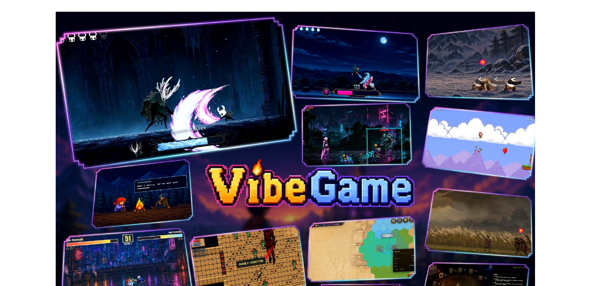
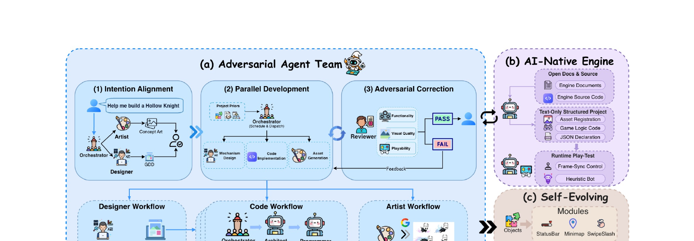
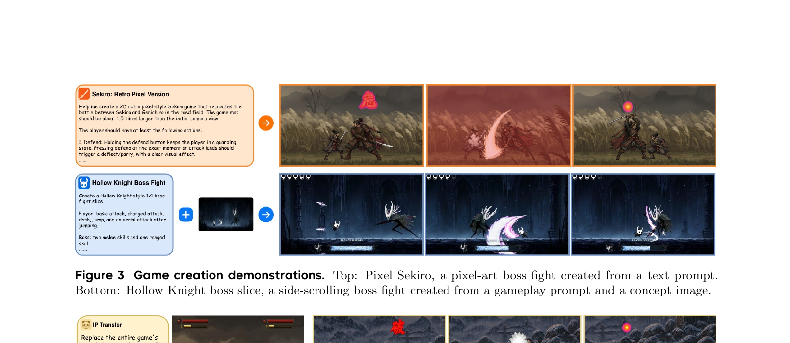
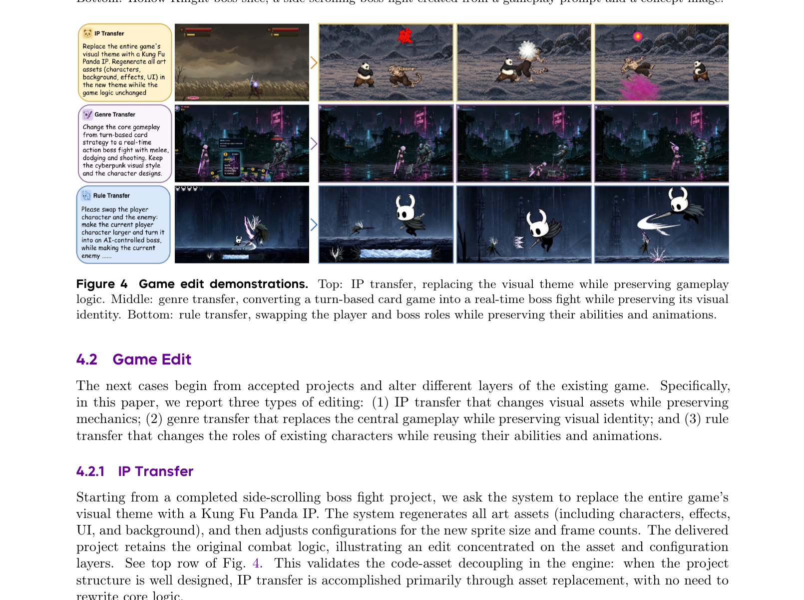

# VibeGame — Prompt-to-Game Development with AI-Native Engine and Self-Evolving Adversarial Agent Team

> **技术报告**: 2026-08-17 · **机构**: PRLab 南京大学 + S-Lab 南洋理工大学 + Liblib.ai · **代码**: [github.com/tettethu/VibeGame](https://github.com/tettethu/VibeGame) · **主页**: [vibegame.tettet.org](https://vibegame.tettet.org)

---

## 1. 一句话定位

VibeGame 是首个面向**完整 2D 游戏项目**的自然语言驱动开发框架,通过 AI-native 游戏引擎 + 对抗式 Agent 团队 + 无训练自演化机制,实现从文本/图像 Prompt 到可运行、可持续编辑的游戏项目全链路自动化。

---

## 2. 要解决的问题(动机)

游戏开发是软件工程中最复杂的形态之一:不仅要维持代码、场景、素材、动画、物理、配置的一致性,还需在运行时验证综合行为,并随需求演化不断修改。现有两条路线均不够:

| 路线 | 代表 | 问题 |
|------|------|------|
| Neural world models | Genie | 输出神经隐表示,无源码可检查/版本管理/精确修改 |
| Engine-integrated LLM | DreamGarden (UE) | GUI 工作流,Agent 无法可靠检查和修改二进制资产 |
| Vibe coding agents | Claude Code, Codex | 通用代码仓库开发,无游戏专有状态/运行时验证能力 |

VibeGame 将问题定义为 **Prompt-to-Game Development**:给定自然语言描述和可选参考图像,系统产出完整可玩游戏项目,并支持后续持续修改请求。

三个核心挑战:
1. **Agent-operable project state** — 项目状态必须可供 Agent 检查和修改(跨脚本/场景/素材的依赖关系需显式)
2. **Interaction-grounded verification** — 静态代码正确 ≠ 运行时行为正确,必须通过实际游戏交互来验证
3. **Preserve validated development experience** — 已验证的设计决策、项目结构、功能实现要能复用到后续项目

---

## 3. 与前作的关系

VibeGame 站在以下工作的交叉点:
- **Vibe coding 框架**(Claude Code, Codex, Trellis): 继承需求管理和项目记忆,扩展到游戏项目全状态管理
- **多 Agent 协作**(ChatDev, MetaGPT): 继承角色专业化,增加对抗式评审与运行时 play-test 机制
- **游戏专项研究**(OpenGame, GameDevBench, GameCraft-Bench): 对齐 Prompt-to-Game 任务定义;VibeGame 首个完整 JavaScript/Phaser 端到端方案

---

## 4. 核心方法

### 4.1 AI-Native 游戏引擎(基于 Phaser)

传统引擎为人类 GUI 操作设计,给 Agent 带来三大障碍:二进制资产、GUI 调试工具、文档不完整。VibeGame 重新定义 **AI-native** 游戏引擎需满足三条性质:

```
AI-native Engine
├── (1) GUI-Independent   ← 纯文本 JSON 结构化项目表示
│   └── 场景→节点→JSON字段(schema validation), 跨场景共享节点存为独立定义文件
├── (2) Runtime-Accessible ← 帧同步可编程接口
│   └── 暂停/推进/注入语义动作(如"press jump")/截图 → Agent 可在自己节奏下验证行为
└── (3) Source-Available   ← 引擎源码复制进项目目录
    └── Agent 可在推理时读取实际 API 实现,避免文档与实现不一致
```

项目结构层次:
- **Scene** — 游戏场景,配置存于 type-checked JSON
- **Node** — 场景内构建块,聚合视觉外观/碰撞/行为脚本/配置
- **Asset** — 跨场景共享的定义文件,实例化时引用

### 4.2 对抗式 Agent 团队(AAT)

8 个专业角色,分工明确且相互对抗:

| 角色 | 模型 | 职责 |
|------|------|------|
| Orchestrator | Claude Opus 4.7 | 协调整个团队,分解任务,转化失败检查为修复任务 |
| Designer | Claude Sonnet 4.6 | 将用户意图扩展为 GDD(Game Design Document) |
| Artist | Claude Opus 4.7 | 用 gpt-image-2 / nano-banana-pro 生成素材,后处理注册 |
| Architect | Claude Opus 4.7 | 规划技术方案和验证流程 |
| Programmer | Claude Sonnet 4.6 | 实现功能 |
| Auditor | Claude Haiku 4.5 | 静态检查:一致性 + 设计规范合规 |
| Player | GPT-5.4-mini | 运行时 play-test:帧同步控制,视觉模型评估渲染结果 |
| Reviewer | GPT-5.5 | 最终独立评审:功能性/视觉质量/可玩性三维度 |

三阶段流程:

```
(1) Intention Alignment
    User → Orchestrator → Designer(GDD) + Artist(Concept Art)
                       ↓ 用户确认
(2) Parallel Development
    Orchestrator → [Code Workflow || Artist Workflow || Designer Workflow]
    Code Workflow: Architect → Programmer → Auditor → Player (Git worktree 并行隔离)
(3) Adversarial Correction
    Reviewer → 功能性/视觉质量/可玩性 → PASS → 交付
                                      → FAIL → Orchestrator 转化为修复任务 → 循环
```

**关键设计**:通过 Git worktree 隔离并行子任务,合并时才集成;将"生成"与"评估"彻底分离 — Player 不是生成者,而是破坏者/发现者。



> **Fig 1 解读**：展示 VibeGame 从 Prompt 生成的多类型 2D 游戏样例。
>
> - **大图(左上)**：Hollow Knight 风格横板 Boss 战 — 白色角色扔出半月形攻击,注意 HUD 血条和黄色魂魄计数,代表最复杂的状态机实现。
> - **右上两图**：Demon Slayer IP 迁移版(炎柱 vs 上弦鬼,月夜列车场景) + 横板 Sekiro 风格师徒对决(像素美术)。
> - **中间行**：赛博朋克动作 Boss 战 + 横板跑酷 platformer(气球弹跳关卡)。
> - **下方行**：KOF 风格格斗(霓虹都市) + 俯视角 roguelike 地牢 + 文明风格 4X 策略(六边形地图) + 纯文本风格剧情游戏。
> - **品牌标志**："VibeGame" 火焰 Logo 居中。整图说明系统能处理差异极大的游戏类型和视觉风格。



> **Fig 2 逐段解读**：
>
> **(a) Adversarial Agent Team**——三阶段流程图。(1) Intention Alignment:用户输入"Help me build a Hollow Knight" → Orchestrator 分发给 Artist(概念图)和 Designer(GDD),用户 ✓ 确认后进入下一阶段。(2) Parallel Development:Orchestrator 调度 Mechanism Design(架构) + Code Implementation(编程) + Asset Generation(美术)三条并行工作流。(3) Adversarial Correction:Reviewer 在功能性、视觉质量、可玩性三维度打分 → PASS 交付用户 / FAIL 反馈给 Orchestrator 重新分派修复任务。
>
> 下方展开 Designer / Code / Artist 三条 Workflow 的细节,显示各角色的执行顺序(Architect→Programmer→Player→Auditor 等)。
>
> **(b) AI-Native Engine**——右上角三层结构:Open Docs & Source(引擎文档+源码可读)、Text-Only Structured Project(素材注册/逻辑代码/JSON 声明全文本化)、Runtime Play-Test(帧同步控制+启发式 Bot)。
>
> **(c) Self-Evolving**——右下角显示 Modules(Objects/StatusBar/Minimap/SwipeSlash 等可复用功能模块)、Skeletons(Projects/Cards/Sideview/Topdown 等游戏类型模板)、Contracts(Collaboration/Footmap/Tilemap/AI 等协同规范)。每个完成项目产出这三类工件,供后续项目复用。

### 4.3 无训练自演化机制

每个被接受的游戏项目,系统自动蒸馏出三类可复用工件:

| 工件 | 定义 | 内容 |
|------|------|------|
| **Skeleton** | 游戏类型的可运行模板 | 代码架构+调优值+场景流程+runtime 结构+错误注记+美术包(含 asset 生成 Prompt 和后处理规范) |
| **Module** | 可跨游戏类型复用的节点脚本 | 实现逻辑 + 将历史运行时失败转化的静态校验规则 |
| **Contract** | 适配 AAT 工作流的特性规范文档 | 为特定特性(如地图生成)定义各角色输入/输出/验证标准 |

**关键性质**:工件在每个新项目中被**适配并重新验证**,而非盲目复用 — 避免错误经验的无限传播(论文承认污染风险,强调用户确认的必要性)。

---

## 5. 演示结果

### 5.1 Game Creation(从 Prompt 创建游戏)

**文本输入 — Pixel Sekiro**
- 输入: 描述苇原战场背景 + deflect/parry 格挡系统规则(几句话)
- 输出: 12 个脚本 + 2 个角色素材包 + 11 个视觉特效实体 + 1 个 UI 素材包
- 系统从现有横板 action skeleton 出发,从零构建双方独立姿态槽(posture gauge)+ 多阶段必杀动画

**多模态输入 — Hollow Knight Boss**
- 输入: 文本(操作动作 + Boss 技能定义) + 作者自绘概念图(角色、废墟大教堂、整体氛围)
- 输出: Boss AI(贴近距离用扫击/地砸,远距离用弓形弹幕,可被眩晕)+ 5 个玩家动作 + mask 风格血条
- 概念图锚定角色和视觉风格,文本定义机制规则,两者分工明确



> **Fig 3 逐行解读**：
>
> **上行(Pixel Sekiro — 纯文本输入)**：左侧橙色卡片是用户的文本 Prompt,描述 1.5 倍相机宽度的地图和 deflect/parry 机制。右侧三帧游戏截图依次显示:苇原初始状态(武士对决)→ 攻击命中特效(红色元素爆发)→ 月圆背景的平衡交战场面。像素像素风格贯穿始终,证明从纯文本指令可生成有风格的完整战斗场景。
>
> **下行(Hollow Knight Boss — 多模态输入)**：左侧蓝色卡片是文本 Prompt(基础攻击/冲刺/跳跃/空中攻击/Boss 双近战+远程技能),中间小图是用户提供的概念图(黑色角色剪影 + 月亮背景)。右侧三帧截图:废墟大教堂场景(HUD 血条在上),两角色交战(Boss 扔出白色镰刀弧),最终帧展示远距离弓形弹幕攻击。系统准确还原了概念图中的视觉氛围。

### 5.2 Game Edit(编辑已有游戏)

三种编辑类型:



> **Fig 4 逐行解读**：
>
> **上行(IP Transfer — IP 迁移)**：起点是横板 Boss 战,要求换成功夫熊猫 IP。左侧卡片说明:重新生成所有美术素材(角色/特效/UI/背景)同时保留游戏逻辑不变。四格截图显示:原版黑白武士→功夫熊猫角色接管,背景从幽暗城堡变为竹林,但攻击判定框、移动速度等物理参数均继承原版。这验证了引擎中代码与素材层的彻底解耦。
>
> **中行(Genre Transfer — 玩法迁移)**：起点是回合制卡牌游戏,要求改成实时动作 Boss 战并保留赛博朋克视觉风格和角色设计。四格截图显示:原版卡牌 UI(回合按钮/手牌区) → 实时横板对战(机甲 Boss + 人形角色近战/闪避/射击),赛博朋克霓虹背景和角色设计完全保留。此为"深度变换",系统需判断哪些层可保留,哪些需完全重写。
>
> **下行(Rule Transfer — 规则迁移)**：起点是 Hollow Knight 风格 Boss 战,要求交换玩家/Boss 角色:原玩家角色放大变为 AI 控制 Boss,原 Boss 缩小变为玩家控制角色。四格截图显示:小犄角战士→ AI Boss(保留其原有扫击/弓形弹幕技能),黑色触手 Boss → 玩家角色(保留其原有冲刺/收费斩/空中攻击)。系统还需重新绑定输入映射、AI 控制方案和 HUD。

---

## 6. 局限性

| 局限 | 说明 |
|------|------|
| **无定量评测** | 全为定性 demonstration,缺乏受控基准测试;未做消融分析 |
| **仅支持 2D Web 游戏** | 3D 扩展面临空间物理/相机控制/复杂场景表示等挑战,能否保持全文本表示不清楚 |
| **视觉验证不完美** | 视觉模型辅助验证仍会误判,单次输出质量有概率性;需迭代作为安全网 |
| **自演化污染风险** | 错误经验一旦进入 skeleton/module/contract,影响所有后续项目 — 用户确认步骤至关重要 |

---

## 7. 一句话总结

VibeGame 通过将游戏引擎 AI 化(全文本表示 + 帧同步运行时)、将 Agent 团队对抗化(实现与评估彻底分离)、将项目经验结构化(skeleton/module/contract 三层复用),首次实现了从 Prompt 到完整可玩游戏项目的端到端持续开发 pipeline — 本质上是把游戏开发中"写代码→运行验证→积累经验"三个人类循环全部交给 Agent 自动完成。

---

## Q&A

**Q: VibeGame 里的 AI-native 引擎跟直接用 Claude Code 改 Phaser 项目有什么本质区别?**

A: 三点核心差异:

1. **结构化项目表示** — 普通 Phaser 项目文件是扁平的 JS 脚本,资产引用藏在构造函数内部,Agent 改一处可能隐性破坏别处依赖。VibeGame 引擎强制所有场景节点用 type-checked JSON 声明,跨文件引用显式化,schema validation 在执行前就能检测缺失资产。
2. **帧同步运行时接口** — 原生 Phaser 游戏实时运行,Agent 无法以可靠速度读取/注入状态。VibeGame 提供暂停/推进 N 帧/注入语义动作/截图的编程接口,让 Player/Auditor Agent 以自己节奏做 play-test,而非依赖截图猜测运行时行为。
3. **源码内嵌** — 引擎源码复制到项目目录,Agent 遇到文档不覆盖的行为可以直接读代码确认,避免幻觉。

---

**Q: 自演化(Self-Evolution)产出的三类工件 skeleton/module/contract 分别在什么时候被用到?**

A: 在 Code Workflow 的最开头:Orchestrator 分解任务时,会先从自演化仓库中检索相关工件作为"project prior"。

- **Skeleton**: 新建同类型游戏时直接作为可运行起点,包含代码架构+已知 bug fix+美术工作流 — 相当于"有记忆的项目模板"。
- **Module**: 某个节点功能(如小地图/状态条/滑动斩击)被 Programmer 直接引入并实例化,避免从零实现已解决的问题。
- **Contract**: Orchestrator 编排某个复杂特性(如地图生成)时调取对应 contract,其中规定了每个角色的输入/输出/验收标准,减少角色间沟通歧义。

三类工件解决三个维度的复用:项目级(skeleton)、功能级(module)、协作流程级(contract)。
